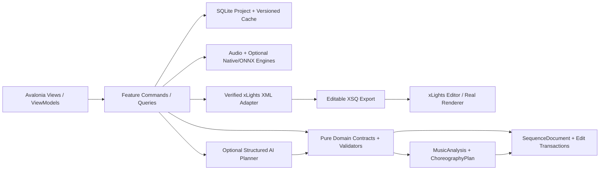
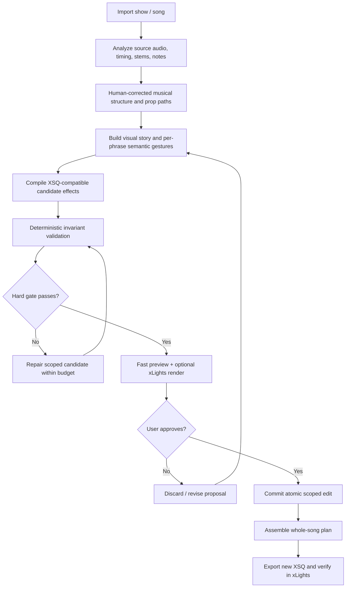

# Master System Architecture — xLights AI Choreography Studio

**Authoritative baseline for the 16 self-contained phase specifications (2026-10-10).**

## Product contract

A standalone local-first Avalonia/.NET 10 editor turns a user-owned xLights show and audio into a versioned musical understanding, semantic choreography plan, non-destructive editable effects and target-version validated XSQ export. User approval and musical motion are more important than increasing effect count. The shipped app has no Python/Docker/Git/cloud-token requirements.

## 1. System architecture



## 2. Phase integration dependency graph


## 3. Immutable identities and source of truth

| Aggregate / contract | First introduced | Sole authority / rule |
|---|---:|---|
| `ProjectManifest` and `ProjectId` | 01 | Project identity/version + root; SQLite and JSON atomically recoverable |
| `DisplayGraph`, `DisplayModel`, `ModelId` | 02 | Imported xLights model identities/group info; reference layout by hash |
| `SequenceDocument`, `EffectInstance` | 02 | Editable effects/locked state provenance; never serialize business behavior directly as XML |
| `EditScope`, `EditTransaction`, `DocumentRevision` | 03 | Exact time + model boundary and user-approved reversibility |
| `SongAsset`, `IAudioTransport` | 04 | Original song hash, timebase and synchronized playback |
| `BeatGrid` | 05 | Analyzed/corrected beats and alternative tempo hypotheses |
| `StemManifest`, `StemAsset` | 06 | Derived separated sources; known model version and sample origin |
| `MelodyTrack`, `NoteEvent` | 07 | Note/onset/contour truth with human corrections |
| `SongStructure`, `MotifLink` | 08 | Related phrase identities and inheritance decisions |
| `SpatialDisplayGraph`, `SpatialPath` | 09 | Artistic routes / normalized geometry separate from imported xLights identities |
| `VisualStory`, `ChoreographyPlan` | 10 | Musical/visual intent before concrete effect rendering |
| `EditProposal` | 11 | Untrusted/optional AI idea validated before `EditTransaction` |
| `LoopRun`, `Candidate`, `QualityReport` | 12 | Bounded attempts and reproducible candidate comparisons |
| `RenderArtifact` | 13 | Actual or clearly-marked approximate preview evidence |
| `WholeSongPlan` | 14 | Section continuity and approved phrase assembly |
| `ReleaseManifest` | 15 | Platform/model assets and delivery integrity |
| `ReleaseReadiness` | 16 | Explicit community compatibility/artistic evidence and release gate |

## 4. Shared C# value types

```csharp
// Shared across phases; put these in Studio.Contracts (single declarations in the codebase).
namespace XlightsAI.Studio.Contracts;
public readonly record struct ProjectId(Guid Value);
public readonly record struct SongId(Guid Value);
public readonly record struct ModelId(string Value);
public readonly record struct DocumentRevision(long Value);
public readonly record struct TimelineTick(long Value); // 100 ns ticks from song origin
public readonly record struct TimeWindow(long StartTicks, long EndTicks); // [Start, End)
```

## 5. Time, scope and editing invariants

- All time intervals half-open `[startTicks, endTicks)` with xLights frame quantization at export/edit snap only.
- A source `SongAsset` has immutable content hash, sample rate and original time origin. Stems/notes reference origin and algorithm versions.
- A `SequenceDocument` is the accepted effect list. All changes require optimistic revision, scope/lock validation and an undoable transaction.
- Semantic `ChoreographyPlan` and AI `EditProposal` are untrusted/proposed data until validated/accepted.
- Layout import remains read-only. Model identity is reconciled on rename or re-import.
- xLights XSQ XML is output format not our domain model; `fseq` is renderer/playback data.
- Authoritative xLights rendering requires supported/observed executable capability, never an assumption.

## 6. Suggested project organization

```text
src/
  Studio.Desktop/           # Avalonia Views + feature ViewModels
  Studio.Core/              # Stable domain/value types, gesture + editing policies
  Studio.Infrastructure/    # SQLite, audio/ML, xLights adapters, filesystem
tests/
  Studio.UnitTests/
  Studio.IntegrationTests/
  Studio.GoldenTests/
  Studio.DesktopTests/
reference/                   # Pinned source only for testing/porting
implementation-evidence/   # Step-by-step proof of quality gates
```

## 7. Global system lifecycle and bounded loop



## 8. Architectural assumptions and limits

- **Product:** locally installable Avalonia/.NET 10 desktop application; no Python, Docker, Git or mandatory LLM subscription for end users. CPU-first inference; native/ONNX only after a demonstrated and legally redistributable runtime/model fit.
- **Topology:** modular monolith with vertical feature slices. UI (Views/ViewModels), application orchestration, pure domain contracts, and platform/infrastructure adapters. Do not fabricate generic interfaces without a concrete boundary.
- **Timing:** internally represent position with an explicit canonical monotonic clock tied to source audio origin. Preserve sample index/rate for analysis provenance; UI may show milliseconds. All time scopes are half-open `[start,end)`. Convert to xLights frames only when explicitly snapping or exporting.
- **Ownership:** SQLite project metadata and committed user edits; immutable source media (linked/copied with consent); hash-addressed and versioned analysis/preview artifacts on disk. Every cache key includes algorithm/model/settings versions.
- **xLights:** `xlights_rgbeffects.xml` describes models/groups and other show configuration; `xlights_networks.xml` covers controller/output configuration; editable sequence is `.xsq` XML; rendered playback data is `.fseq`. Never overwrite source show files silently. Match layout models by verified name/identity mapping; do not invent xLights effect parameters.
- **Safe editing:** `SequenceDocument` is the editable state. `ChoreographyPlan` is an intent proposal, not a destructive replacement. Keep optimistic revision checks, effect locks, selection scope, immutable before/after patches, undo/redo, and explicit human acceptance.
- **AI trust:** optional local or BYOK cloud AI returns validated structured proposals only. Do not execute LLM-produced code, scripts or XML directly. Treat song lyrics, filenames, descriptions and external metadata as untrusted data. Explicit consent before sending media-derived data to remote services.
- **Verification:** unit tests + fixtures + integration tests + one observable UI/xLights demonstration per phase. An XML parse pass does not prove xLights renders an effect. A numeric musical score does not prove artistic quality. Do not claim tests ran when they did not.
- **Migration:** upstream xLightsAI (MIT repository, with separate dependency/model license checks) is a pinned reference for behavior, data and effect recipes. Python may run only in developer comparison tooling; there is no runtime Python requirement in releases.

## 9. Detailed phase map and gate evidence

| Phase | Step IDs | Contract focus | Required visible integration gate |
|---:|---|---|---|
| [01](phase-specs/PHASE-01.md) | 001–008 | Own application startup, project lifecycle, persistence, diagnostic scaffol… | Start a fresh install; create “Demo Song”, close/reopen; open a second project; inject a migration failure; show recovery screen, … |
| [02](phase-specs/PHASE-02.md) | 009–015 | Show-file discovery, read-only model/group import, initial effect plan, ver… | Import a sample layout with Roofline, Arch 1 and Arch 2; click Generate 3 Effects; save into app exports folder; open resulting XS… |
| [03](phase-specs/PHASE-03.md) | 016–023 | Timeline display and editing transactions over `SequenceDocument`; selected… | Open a three-effect sample, drag Arch 1 effect, resize Roofline, undo/redo both operations, lock Arch 2, attempt forbidden modific… |
| [04](phase-specs/PHASE-04.md) | 024–030 | Audio import, decoding, waveform index, playback transport, source timebase… | Import a click track, display waveforms, drag an effect to a click, loop 1 second, seek to song midpoint and back, close/reopen an… |
| [05](phase-specs/PHASE-05.md) | 031–037 | Audio feature extraction, onset candidates, tempo hypotheses, beat/downbeat… | Analyze a click/drum sample, see beat markers, correct an intentionally wrong downbeat, generate restrained pops for two props and… |
| [06](phase-specs/PHASE-06.md) | 038–044 | Verified local model assets, audio stem extraction, inference lifetime/reso… | On CPU-only Windows, install model through app (or use offline pre-provisioned asset), separate a short sample, view aligned stems… |
| [07](phase-specs/PHASE-07.md) | 045–051 | Melodic pitch/onset/rest events, optional MIDI import, contour abstraction,… | Import trusted MIDI or simple isolated melody, view notes on piano roll, correct an incorrect note, select five arches, preview st… |
| [08](phase-specs/PHASE-08.md) | 052–058 | Song structure inference, phrase boundaries, self-similarity, motif linking… | Analyze a song with repeated chorus; show two matching phrases highlighted; accept the first chorus as a template and propagate on… |
| [09](phase-specs/PHASE-09.md) | 059–065 | Layout-derived display graph, visual geometric editor, explicit ordered pat… | Load a layout, inspect suggested arch and roofline paths, reverse the arch route manually, preview C-D-E-G-E-D-C across both and p… |
| [10](phase-specs/PHASE-10.md) | 066–071 | Role assignment, visual story, attention/density budgets, multi-layer chore… | Choose lead piano on arches, kick/snare on roofline and bass on tree for a 20-second song excerpt; preview verse vs louder chorus,… |
| [11](phase-specs/PHASE-11.md) | 072–078 | Context-aware selection, deterministic structured commands, optional LLM ed… | Select 42–48 seconds on five arches, ask for rising piano pops, inspect affected models/times and before/after visualization; reje… |
| [12](phase-specs/PHASE-12.md) | 079–084 | Durable bounded refinement run, deterministic candidate generation, technic… | Start with a knowingly over-busy 8-bar phrase, generate three candidates, inspect density/timing metrics and previews, accept one,… |
| [13](phase-specs/PHASE-13.md) | 085–089 | Lightweight preview, installed xLights version/capability probing, authorit… | Preview simple arch stepping, export a temp XSQ and render it using a verified installed xLights mode (headless if supported), com… |
| [14](phase-specs/PHASE-14.md) | 090–093 | Song-level visual story, transitions, assembly of accepted phrase instances… | Take a song with Intro/Verse/Chorus/Verse/Chorus/Bridge/Final chorus; show section intensity arc and shared motif variants, inspec… |
| [15](phase-specs/PHASE-15.md) | 094–097 | Self-contained desktop distribution, native/model asset management, first-r… | Install on a clean Windows x64 machine, import sample show/song, generate/edit a simple XSQ, optionally download model with consen… |
| [16](phase-specs/PHASE-16.md) | 098–100 | End-to-end quality matrix, manual A/B music/visual studies, clean-install c… | Give a non-developer tester only the installer and demo show; observe install, import, song analysis or safe fallback, phrase edit… |

## 10. Unknowns that MUST be verified during implementation

- Exact xLights effect/parameter serialization for *target versions* (collect xLights-generated golden XSQs and inspect upstream C++ and pinned xLightsAI writer).
- Actual availability and flags of headless rendering in released xLights binary; the xLights source may document features not present in a given installer.
- ML model ONNX/native inference compatibility, quality, licensing, resource usage and platform support.
- Actual accuracy of beat/section/melody analysis on a diverse rights-cleared fixture collection.
- Distribution/signature/notarization requirements, native dependencies and compatibility range.
- Actual human-perceived artistic value: measure through blind A/B tests; do not substitute metrics.

## 11. Research/source references

- xLights source / headless rendering design (verify installed builds separately): https://github.com/xLightsSequencer/xLights/blob/master/AGENTS.md
- xLights manual glossary (layout/sequence formats): https://manual.xlights.org/xlights/appendicies/glossary
- xLights timing tracks: https://manual.xlights.org/xlights/chapters/chapter-four-sequencer/timing-tracks
- xLights model groups: https://manual.xlights.org/xlights/chapters/chapter-four-tabs/model-groups
- xLights importing and re-rendering: https://manual.xlights.org/xlights/chapters/chapter-five-menus/import
- xLights official source repository: https://github.com/xLightsSequencer/xLights
- Real public XSQ example (for observation; verify against target version): https://github.com/FRC3620/xlights.sign1/blob/main/2026%20Doug.xsq
- xLightsAI upstream raw XSQ generator path: `src/generator/xsq_writer.py` in pinned upstream checkout.

**Note:** All phase docs are *implementation specifications*, not proof of a finished app. Signatures may require adaptation to existing code and are not claimed to be upstream source APIs.
