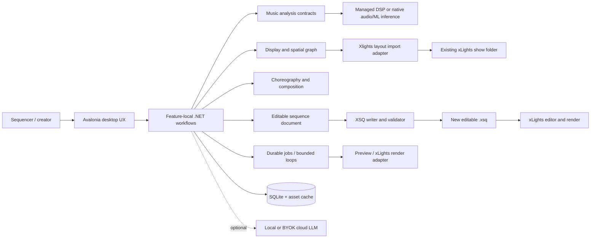
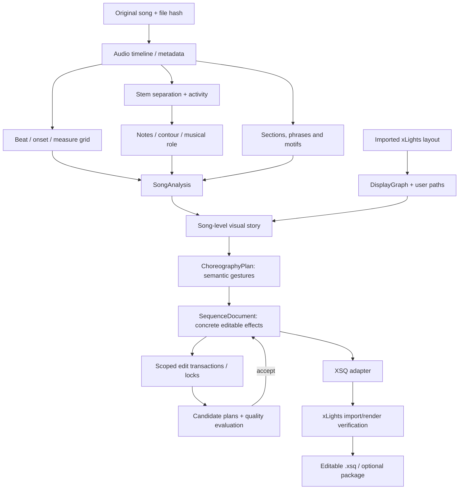
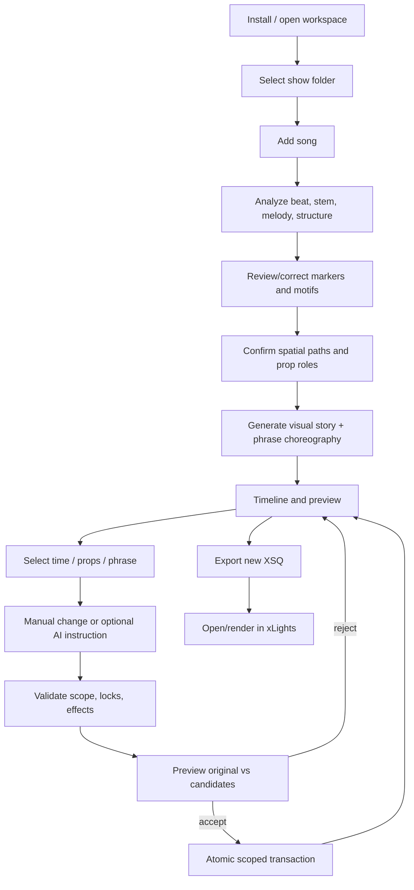
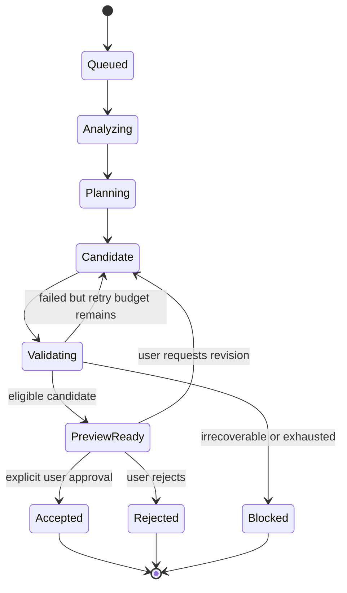

# xLights AI Choreography Studio - System Design and Phase Integration

**Status:** Proposed product/engineering design, not proof of an implemented product  
**Companion:** [UI and Screen Blueprints](UI-UX-SCREEN-BLUEPRINTS.md)  
**Implementation backlog:** [Phase Index](PHASE-INDEX.md) | [Architecture Guardrails](ARCHITECTURE-AND-GUARDRAILS.md)  
**Last reviewed:** 2026-10-10

## 1. Product vision

Build a **local-first, installable Avalonia/.NET application** that helps xLights users choreograph a physical lighting display to the *musical meaning* of a song, not just to a global beat. It should convert a song and a user's existing xLights layout into an editable composition of rhythmic accents, melodies, musical phrases, repeated motifs, instrument roles, colors, spatial movement and visual intensity.

Users retain editorial control: they can select a time range, one or more props and/or a musical phrase, ask for a change, preview candidates and approve only the desired results. Previous user-approved work must not be overwritten by a later automatic pass. The application exports an editable `.xsq` sequence for final work in xLights.

**Core experience:** Import show -> add song -> analyze -> review musical structure -> choose prop paths -> generate phrase choreography -> refine selected regions -> compare -> export and validate in xLights.

**Constraints:** No mandatory Python, Git, Docker, local web server, cloud token subscription or developer tools for an end user. Native libraries/model assets may be distributed or acquired by the installer, subject to licenses and platform compatibility. xLights itself remains an integration/validation dependency for checking exact effect rendering.

### Success criteria

1. A user on a supported desktop OS can install and launch without building source.
2. The app imports a copy/reference of a show layout **without silently changing** xLights layout or network configuration.
3. It can generate, open and edit a real `.xsq` for that layout.
4. Melody notes can produce directional movement (steps, jumps, holds, descents) across a user-selected prop path.
5. Repeated phrases can share recognizable choreography while allowing controlled variations.
6. A selected-region edit does not alter any locked or out-of-scope effect, prop or time range.
7. A bounded refinement loop preserves the best candidate and requires explicit user approval.
8. The user can validate final effects in real xLights and understand warnings/compatibility issues.

## 2. Product boundary and components



**Architectural style: modular monolith, feature-local vertical slices.** The shell is Avalonia; business rules are independent of Avalonia; audio algorithms are managed C# where practical; pretrained models can run via suitable native/ONNX inference. A Python implementation may run in the *development test harness* as a migration reference, never as an end-user requirement.

### Preferred solution layout

```text
src/
  Studio.Desktop/                   Avalonia App, Views, ViewModels, Composition Root
    Features/
      Projects/ Shows/ Songs/ Timeline/ BeatGrid/ Stems/ PianoRoll/
      SongStructure/ DisplayPaths/ Choreography/ ScopedEdits/
      Refinement/ Rendering/ Export/ Settings/
  Studio.Core/                      Stable domain records and pure logic
    Audio/ Music/ Timing/ Display/ Gestures/ Sequences/ Editing/ Evaluation/
  Studio.Infrastructure/            I/O adapters and platform-bound services
    SQLite/ Media/ AudioAnalysis/ Inference/ xLights/ Assets/

tests/
  Studio.UnitTests/
  Studio.IntegrationTests/
  Studio.GoldenTests/
  Studio.DesktopTests/

reference/
  xlights-autosequencer/            Pinned external comparison reference only
```

This is a starting point, **not** a requirement to create an interface or project per operation. Add abstraction only when a real seam needs it (audio backend, xLights versions, inference engine, optional model provider).

## 3. The data pipeline and sources of truth



The explicit boundaries avoid turning xLights XML into the application's editing model:

| Object | Purpose | Authoritative for | Not authoritative for |
|---|---|---|---|
| `SongAsset` | Original audio identity, hash, metadata and playback origin | Source-media identity | Notes/interpretation |
| `SongAnalysis` | Versions of beat grids, stems, notes, energy, sections and confidence | Derived music facts | User-approved effect edits |
| `DisplayGraph` | Stable models, physical coordinates, custom groups and named ordered paths | User-approved spatial semantics | xLights network controller configuration |
| `MusicalMotif` | Related phrase IDs, fingerprints and a source motif | Repetition relationships | Exact rendered effects |
| `VisualStory` | Section intensity, themes, role hierarchy and planned climaxes | Global creative guidance | Specific XML parameters |
| `ChoreographyPlan` | Renderer-independent gestures with notes, paths, props and timing | Musical intent of the generation | Final hand-edited effect state |
| `SequenceDocument` | Concrete effect instances, layers, overrides, locks, revision | Editable working sequence | xLights' proprietary rendering semantics |
| `EditTransaction` | Before/after patch, approved scope, provenance and optimistic version | Reversible mutation history | Audio analysis quality |
| `QualityReport` | Rules, scores, render evidence, evaluator versions and limitations | Evidence for choosing a candidate | Objective artistic truth |
| `ExportArtifact` | XSQ path, target xLights version, validation result, hash | Export identity and result | Internal project state |

**Timing rules:** Use exact sample offsets or a sufficiently precise canonical time representation internally. Convert to milliseconds for display/API where appropriate. Use half-open ranges `[start, end)` and quantize to xLights output frames only at defined export or explicitly snapped-edit boundaries. Preserve the audio-origin offset and the selected frame interval. All analyzers record source and confidence, not just a bare result.

**Persistence strategy:** SQLite for project metadata, approved edits, job states and relationships; immutable source audio and versioned analysis/preview caches on disk; content hashes include algorithm and model version; schema migrations with backups. Autosave must be atomic/recoverable.

## 4. What comes from the reference project vs what we build

An upstream Python-centric reference project (analyzer, stem processing, xLights layout reader, effect/variant libraries, musical story builder, generator and web UI) was previously pinned via a git submodule for behavioral comparison; it has since been removed from this repository. Treat any future upstream reference as a **behavioral reference and source of candidate algorithms** only. Do not assume all algorithms are straightforward to port or that every dependency can legally be redistributed.

| Concern | Reuse/port approach | Verification before declaring done |
|---|---|---|
| Effect definitions and variants | Read portable catalogs/parameters; normalize to C# | Generated XSQ opens correctly in supported xLights |
| Layout parser and groups | Port parsing logic; add per-user import/override | Compare model IDs, group semantics, and geometry |
| Audio timing / onset algorithms | Port or replace using managed/native DSP | Known-fixture precision/recall and timing tolerances |
| Demucs-style separation | Evaluate model/runtime; use compatible native/ONNX only if proven | Audio quality, runtime, CPU/memory, licensing |
| Note and pitch analysis | Compare contour-first and transcription approach | Pitch direction, onset, rest and duration fixtures |
| Song sections / motifs | Reuse ideas but build persistent phrase IDs and links | Detect repeated known passages, support manual correction |
| Existing generator | Preserve useful catalog/serialization behavior | Golden effect and XSQ regression suite |
| Existing web UI | Inspiration, not a required runtime component | Avalonia independently owns user workflows |

Use a **portability audit and a pinned baseline** in Phase 01. Upstream behavior can be a comparison oracle; differences should be recorded as regression, justified variation, or intentional improvement. Keep reference execution isolated from the shipped app.

## 5. How music becomes choreography

### 5.1 Musical hierarchy

```text
Song -> Sections -> Phrases -> Measures/Beats -> Events/Notes
                           \-> Repeated motifs across section boundaries
```

For each phrase capture: lead instrument/role, onset times, note pitch or contour, rests, density, accents, energy, tension/resolution candidates, repeated motif ID and confidence. Structure/feel estimates are revisable, not infallible AI facts.

### 5.2 Visual choreography primitives

The creative engine selects semantic gestures, for example:

- `StepAlongPath`, `ReverseStep`, `SkipToPosition`, `HoldThenRelease`
- `AccentPop`, `CallAndResponse`, `RisingChase`, `FallingCascade`
- `PulseWithKick`, `FocalReveal`, `BuildDensity`, `BlackoutAndReveal`

Each gesture has a musical trigger, time range, ordered spatial path, prop roles, color/energy intent, and a compile strategy. The compiler then maps the gesture into a compatible xLights effect/parameter recipe. This keeps musical ideas portable across layouts and xLights versions.

**Example:** a note sequence `C4,D4,E4,G4,E4,D4,C4` drives arch positions `1,2,3,5,3,2,1`; note start/end determines pop/hold timing; a phrase climax can add a roofline accent *only* if authorized by the choreography plan and visual attention budget.

### 5.3 Multi-stem arrangement planning

The planner assigns competing musical roles by section: primary melody = main spatial motion; kick/snare = restrained accents; bass = supporting pulse; harmony = background palette; chorus build = increased prop participation. Multiple stems are not permission for every prop to fire on every onset. The visual attention/density budget and intentional darkness are key controls.

### 5.4 Motif reuse

The first accepted performance of a motif becomes a parent choreography template. Later matching phrases inherit it with selected changes to instrumentation, timing, intensity, color or geometry. Users can sever or override a link per occurrence. Propagation shows affected phrases **before** commit.

## 6. Full user flow and non-destructive editing



**Example scoped edit:** At 00:42.000-00:48.000 select Arches 1-5 and say, "Make the ascending piano notes pop left to right; reverse on descent. Leave roofline unchanged." The local interpreter or optional LLM may propose gestures. C# validates `EditScope` (time range, model IDs, revision, locks), translates gestures to effects, computes a before/after diff, shows preview, and **only commits after approval**. The roofline and effects outside the selection must remain unchanged. Where effects cross the boundary, require a documented trim/split/preserve policy rather than silently modifying their external portions.

### Transaction contract (example, not final API)

```json
{
  "baseDocumentRevision": 31,
  "scope": {
    "startMs": 42000,
    "endMs": 48000,
    "modelIds": ["arch-01", "arch-02", "arch-03", "arch-04", "arch-05"],
    "effectIds": null,
    "respectLocks": true
  },
  "proposal": {
    "kind": "ReplaceScopedChoreography",
    "gesture": "StepAlongPath",
    "pathId": "front-arches",
    "source": "piano-melody",
    "directionMode": "FollowPitchContour"
  }
}
```

The true transaction will include a candidate ID, before/after patch, export impact, approvals, evaluator outputs and persistence metadata. Reject stale revisions and invalid targets. Project recovery should never rely on the LLM remembering what it changed.

## 7. Loop engineering: where loops start and stop

**Graph controls dependencies; loops improve bounded candidates.** Run the analysis graph only when inputs are missing/stale. Re-running a creativity loop should not automatically re-separate stems or overwrite manual beat corrections.



Loop stages and owners:

| Loop | Trigger | Automatic gates | Human gate |
|---|---|---|---|
| Beat alignment | Initial analysis / corrected timing | Onset agreement, tempo hypothesis, monotonic markers | Confirm ambiguous grid |
| Phrase recognition | New/updated structure data | Self-similarity, boundary stability, confidence | Approve/adjust motif associations |
| Choreography candidate | Phrase ready and path available | Timing, supported effect, density, path mapping | Choose creative candidate |
| Scoped edit | Selected region + manual/AI instruction | Authorized props/time/locks, reversibility | Accept/reject diff |
| Visual refinement | Candidate passes structural checks | Render success, coverage, visual motion metrics | Decide whether it *feels* better |
| Song continuity | Phrases assembled | Cross-boundary continuity, repeated motif consistency | Whole-song review |

Each loop stores input hashes, versioned analyzer/model configuration, score breakdown, attempt budget, seed, best-so-far, candidate preview and stop reason. Hard invariants (invalid XML, scope leaks, stale document revision) are **blocking errors**, not weighted scores that can be traded off for aesthetics. Never accept a creative change without human approval in the MVP.

## 8. Rendering and xLights relationship

**Two rendering tiers, intentionally unequal:**

1. **Fast local preview:** approximate steps, holds, fades, paths and simple effects on the imported display geometry. Use it during dragging, editing and candidate iteration. Label unsupported or approximate effects.
2. **Authoritative xLights validation:** open/export in installed xLights, render where supported, compare actual outputs and use the real result for compatibility/visual verification. Investigate available CLI/headless features by version; do not assume all shipping xLights builds expose the same commands.

An XSQ is an editable sequence; an FSEQ is rendered output and should not replace the editable document. Export to a new file by default, retain a record of target version, and never rewrite `xlights_rgbeffects.xml` without explicit user action and a backup.

## 9. The 16 phases and their integration contracts

This is the requested **roadmap glue**: what one phase delivers to the next, which screen becomes usable, and how to know it actually works.

| Phase | Steps | Slice capability delivered | Contract/artifact established | First-visible UI | Gate / integration check |
|---|---:|---|---|---|---|
| **01 Foundation** | 001-008 | App, project persistence, upstream baselines | `Project`, settings, schema, test fixtures | Welcome, Projects, Settings | Create / reopen; CI green |
| **02 First XSQ** | 009-015 | Show import -> generated effects -> XSQ | `DisplayGraph`, `SequenceDocument`, `XSQAdapter` | Show Import, Export | Open 3-effect sequence in xLights |
| **03 Editor** | 016-023 | Editable rows/blocks, scope, locks, undo | `EditScope`, `EditTransaction`, document version | Sequence Timeline | Unselected effects unchanged |
| **04 Audio** | 024-030 | Play/seek waveform against effect time | `SongAsset`, `AudioClock`, waveform cache | Audio Workspace | Seek and effect alignment |
| **05 Rhythm** | 031-037 | Onsets, beats, measures; rhythm-driven effects | `BeatGrid`, timing confidence | Beat Grid | Valid beat-pop sequence |
| **06 Stems** | 038-044 | Local instrument separation and activity | `StemAsset`, `StemActivity`, inference version | Stem Mixer, Jobs | Play stem; measure quality |
| **07 Melody** | 045-051 | Pitch/contour/notes -> stepping path | `NoteEvent`, `MelodicGesture` | Piano Roll | Note-driven arch movement |
| **08 Structure** | 052-058 | Sections, phrases and motif inheritance | `Section`, `Phrase`, `MotifLink` | Song Structure | Chorus repetition reuse |
| **09 Paths** | 059-065 | Physical graph, ordered routes, prop roles | `SpatialPath`, `PropRole` | Display Path Editor | Same gesture on two routes |
| **10 Layering** | 066-071 | Lead/rhythm/bass arrangements; density budgets | `VisualStory`, `ChoreographyPlan` | Choreography Designer | Musical 20-30 sec composition |
| **11 Scoped AI edit** | 072-078 | Natural language/commands constrained to selection | `EditProposal`, approved transactions | AI Edit Drawer | Non-target rows/times invariant |
| **12 Refinement** | 079-084 | Bounded candidate loops and comparison | `LoopRun`, `Candidate`, `QualityReport` | Candidate Compare | Best candidate shown and approved |
| **13 Real rendering** | 085-089 | Fast preview + xLights-backed comparison | `RenderAdapter`, `RenderEvidence` | Render Preview | Rendered output verified |
| **14 Whole song** | 090-093 | Section arc and song-wide continuity | `WholeSongPlan`, cross-section review | Composition Overview | Cohesive full-song draft |
| **15 Packaging** | 094-097 | Installer and managed model assets | Installer manifests, asset manager | First Run, Model Settings | Install without Python/Git |
| **16 Community** | 098-100 | Compatibility, onboarding, acceptance evidence | Release matrix and feedback | Help/Diagnostics | Community-ready validated release |

### Dependency logic and milestones


This is the recommended implementation order, **not** a declaration that every feature is technically incapable of being built in parallel. An early deterministic melody-to-path prototype may use known MIDI or manually specified notes to test creative viability while instrument separation is being migrated. Do not let the expensive stem-separation port become an avoidable blocker to proving that the choreography idea looks good.

**Milestone ladder:** First real XSQ (015) -> trustable editor (023) -> playable waveform (030) -> beat following (037) -> stems (044) -> **melodic movement proof (051)** -> motif reuse (058) -> layered choreography (071) -> scoped AI editing (078) -> bounded loops (084) -> xLights render comparison (089) -> whole-song demo (093) -> downloadable public build (100).

## 10. Screen to phase coverage

| UX surface | Initial phase | Important later upgrades | Blueprint reference |
|---|---:|---|---|
| Welcome / project setup | 01 | 15, 16 | [S01](UI-UX-SCREEN-BLUEPRINTS.md#s01---welcome-and-first-run) |
| Song library / project overview | 01 | 04, 14 | [S02](UI-UX-SCREEN-BLUEPRINTS.md#s02---project-library), [S03](UI-UX-SCREEN-BLUEPRINTS.md#s03---project-overview) |
| Show import and model diagnostics | 02 | 09 | [S04](UI-UX-SCREEN-BLUEPRINTS.md#s04---xlights-show-import) |
| Display graph / routes | 09 | 10 | [S05](UI-UX-SCREEN-BLUEPRINTS.md#s05---display-path-editor) |
| Waveform/audio player | 04 | 05, 07 | [S06](UI-UX-SCREEN-BLUEPRINTS.md#s06---audio-workspace) |
| Analysis jobs and stem mixer | 05/06 | 07 | [S07](UI-UX-SCREEN-BLUEPRINTS.md#s07---analysis-job-center), [S08](UI-UX-SCREEN-BLUEPRINTS.md#s08---stem-mixer) |
| Beat editor / note editor | 05/07 | 10 | [S09](UI-UX-SCREEN-BLUEPRINTS.md#s09---beat-and-measure-grid), [S10](UI-UX-SCREEN-BLUEPRINTS.md#s10---piano-roll-and-note-editor) |
| Song structure / choreography planner | 08/10 | 14 | [S11](UI-UX-SCREEN-BLUEPRINTS.md#s11---song-structure-and-motifs), [S12](UI-UX-SCREEN-BLUEPRINTS.md#s12---choreography-designer) |
| Primary sequence editor | 03 | 04-14 | [S13](UI-UX-SCREEN-BLUEPRINTS.md#s13---sequence-timeline-editor) |
| Scoped AI edits / candidate comparison | 11/12 | 13 | [S14](UI-UX-SCREEN-BLUEPRINTS.md#s14---scoped-ai-edit-drawer), [S15](UI-UX-SCREEN-BLUEPRINTS.md#s15---candidate-comparison-and-refinement) |
| Preview / export / settings | 02/13/01 | 15 | [S16](UI-UX-SCREEN-BLUEPRINTS.md#s16---render-preview-and-export), [S17](UI-UX-SCREEN-BLUEPRINTS.md#s17---settings-models-and-integrations) |

## 11. Cross-cutting tests and quality gates

For every slice, require **unit tests + integration tests + visible user exercise** as appropriate. Don't treat a mocked xLights adapter as evidence that real xLights opened the produced sequence.

- **Data integrity:** Every supported project reopens, revisions migrate, autosave is atomic, and locked/out-of-scope effect hashes remain unchanged.
- **Audio timing:** Sample-offset and millisecond conversion, latency correction, frame quantization and beat alignment fixtures are stable.
- **Analysis quality:** Golden references have explicit tolerances, confidence thresholds and regression reporting; compare native/ONNX alternatives to reference audio.
- **Model correctness:** Unknown model names, nested groups, missing geometry and unsupported effects show useful diagnostics.
- **Render interoperability:** Produce real XSQ and verify compatibility with actual targeted xLights versions.
- **UX reliability:** Keyboard navigation, waveform zoom/seek, selection semantics, undo/redo, busy/cancel/fail/retry states tested.
- **Visual quality:** Human A/B evaluations of meaningful musicality, readable gestures, dynamic contrast and repeated-phrase consistency.
- **Shipping quality:** Clean machine install/uninstall, model downloads with checksums, offline use after asset setup, opt-in privacy for cloud AI.

## 12. Primary technical risks and decisions to validate

| Risk | Early mitigation | Decision gate |
|---|---|---|
| Source algorithms use Python/C++ libraries | Portability inventory + golden references | Phase 01/05/06 |
| Stem model cannot run efficiently outside Python | Model compatibility spike, measured runtime and quality; allow alternate native model | Phase 06 |
| Layout files lack reliable physical positioning | User-correctable positions, route editor and stable model IDs | Phase 02/09 |
| Complex xLights effects differ from app preview | Limit fast preview to supported gestures; authoritative xLights validation | Phase 02/13 |
| XSQ format changes across versions | Versioned adapter, fixtures from actual builds, warnings | Phase 02/16 |
| LLM suggests out-of-scope edits | Validation in native code, readonly proposal then approve | Phase 03/11 |
| Quality scores favor busyness | Separate hard technical gates from human aesthetic ratings | Phase 10/12/16 |
| Multi-GB local models complicate installers | Optional managed model assets, integrity/version checks | Phase 06/15 |
| Licensing varies between code/models/data | Audit source, weights, FFmpeg/native libs, redistribution and media licenses | Phase 01/06/15 |

## 13. Architecture decisions to record as ADRs

Start with small, documented decisions (ADRs), not a speculative framework:

- **ADR-001:** Avalonia + .NET local-first desktop, native packages where required.
- **ADR-002:** Core music/display/choreography models cannot depend on Avalonia or XSQ XML.
- **ADR-003:** Scoped edits are atomic, versioned, reversible and lock-respecting.
- **ADR-004:** Python is a development reference, not an end-user runtime.
- **ADR-005:** Fast preview is approximate; real xLights is authoritative for effect fidelity.
- **ADR-006:** Optional LLMs return validated creative proposals; deterministic code makes commits.
- **ADR-007:** Reanalysis is cache/version controlled; manual overrides survive unless explicitly reset.

## 14. Instructions for coding agents

Before coding each phase, agents must read:

1. This document (system boundaries and phase relationships).
2. [UI and Screen Blueprints](UI-UX-SCREEN-BLUEPRINTS.md) (expected experience and screen states).
3. [Architecture and Guardrails](ARCHITECTURE-AND-GUARDRAILS.md) and [Test Data and Acceptance](TEST-DATA-AND-ACCEPTANCE.md).
4. The current [phase specification](PHASE-INDEX.md) and corresponding `prompts/PHASE-XX-PROMPT.md`.
5. `prompts/CODE-PHASE-REUSABLE.md`.

Implement one numbered step at a time. Build only the minimum UI and vertical data path necessary for that step; earlier screens may show disabled/future features labeled as unavailable. Record a screenshot, reproducible demo, actual test commands/results and any deviations in the phase completion notes. Do not silently redesign the cross-phase contracts.

---

## External references (validate current versions during implementation)

- xLights manual, saving/rendering: https://manual.xlights.org/xlights/chapters/chapter-five-menus/file/settings/sequences
- xLights official source: https://github.com/xLightsSequencer/xLights
- Avalonia: https://avaloniaui.net/
- ONNX Runtime C#: https://onnxruntime.ai/docs/get-started/with-csharp.html

*Everything described as a UI, pipeline or adapter in this document is a proposed design unless a completed phase's verification evidence proves its implementation.*

## xLights serialization and rendering: detailed implementation reference

[`XLIGHTS-SEQUENCE-ENGINEERING-GUIDE.md`](XLIGHTS-SEQUENCE-ENGINEERING-GUIDE.md) covers verified XSQ components, effect/settings/palette references, effect layers, grouping, timing, render-to-FSEQ behavior, version compatibility, golden fixtures, and Phase 02 preconditions. Consult it whenever editing xLights adapters or evaluating the difference between our local preview and the real xLights render.
