# xLights AI Choreography Studio - UI/UX Screen Blueprints

**Design maturity:** Proposed wireframes and actionable screen contracts (not implemented screenshots).  
**Companion:** [System Design and Phase Map](SYSTEM-DESIGN-AND-PHASE-MAP.md) | [Phase Index](PHASE-INDEX.md)  
**UI framework:** Avalonia + .NET 10 desktop; Windows-first installer, portability considered.  
**Last reviewed:** 2026-10-10

This document describes **what the user should see and do on each screen**, which development steps introduce it, the data it displays, the empty/loading/error states, and how its behavior is tested. The images are **visual wireframes**, not pixel-perfect requirements or actual screenshots. They are supplied as portable PNG assets in `assets/wireframes/`; editable SVG sources are supplied alongside them.

## All screens at a glance

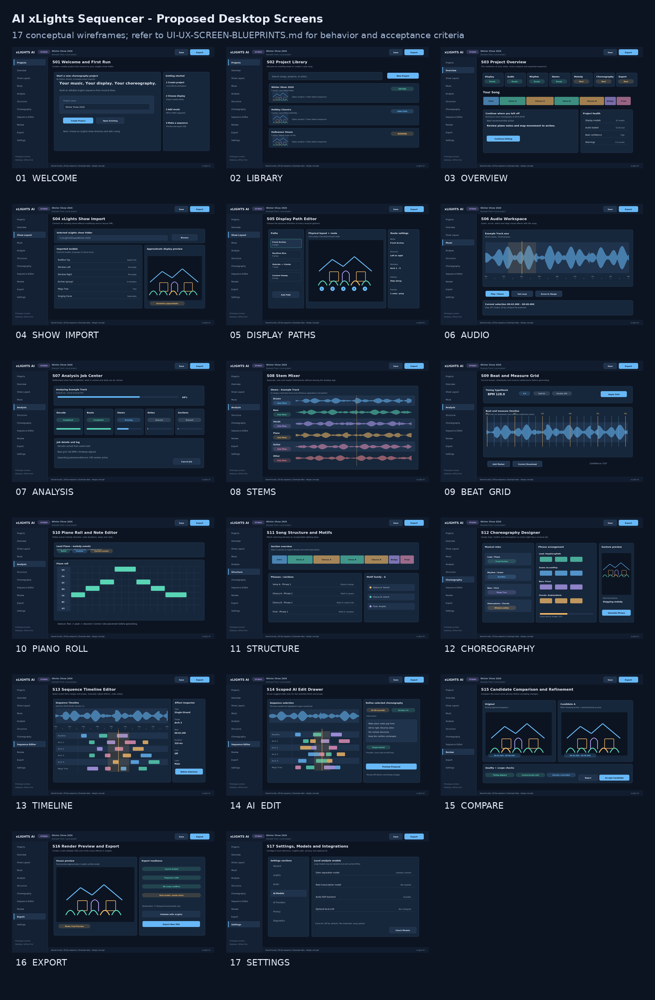

## Design principles

1. **A music sequencer, not a file-processing wizard.** Editing, playback and visual feedback should be the dominant experience; advanced analysis stays discoverable rather than obstructive.
2. **Always know where you are in the song.** A common playhead, time range, phrase/section context and selected props follow the user across relevant editors.
3. **Selection before generation.** Manual and AI edits must reveal the exact timing, props and locks that they will affect.
4. **Preview then commit.** Generate proposals in draft state; accept/reject applies a transactional change without losing approved work.
5. **Users can correct the music.** Beat markers, notes, instrument activity, motifs and physical prop order all have manual controls.
6. **No mystery AI behavior.** Show why effects were generated, source stems, confidence and repair attempts when meaningful.
7. **Contextual progressive UI.** Screens appear incrementally by phase; do not scaffold fake completed features just to match the final wireframe.
8. **Lightweight defaults.** Create a working sequence with one layout and one song before presenting expert controls.

## Global desktop shell

All main screens share a consistent shell:

- **Top command bar:** active project and song, playback transport on music screens, `Save`, optional `Analyze`, and prominent `Export` when valid.
- **Navigation rail:** `Projects`, `Overview`, `Show Layout`, `Music`, `Analysis`, `Structure`, `Choreography`, `Sequence Editor`, `Review`, `Export`, `Settings` (later capabilities can be disabled until implemented).
- **Central workspace:** the selected tool; no browser frame, no local web server.
- **Optional inspector/drawer:** right-side contextual details (selected effect, note, prop, AI edit) with ability to collapse.
- **Bottom status:** project dirty state, song time/playhead, running job/CPU inference state, last export and current warnings.

Suggested screen widths: design desktop-first at 1280x800, handle 1024x768 by collapsing right inspectors, retain keyboard access and avoid a mandatory fixed-size window. Colors shown in wireframes are **conceptual semantics**, not fixed production branding: blue audio/timeline, teal valid musical notes, violet stems/phrases, amber selection/warnings and neutral background.

**Keyboard design targets:** Space = play/pause (when timeline has focus); Ctrl+S = save; Ctrl+Z/Shift+Ctrl+Z = undo/redo; +/- = zoom; Delete = delete eligible selected effects; Escape = cancel selection/drawer; Ctrl+E = export. These shortcuts require an accessibility/focus audit before finalizing.

## Screen navigation map

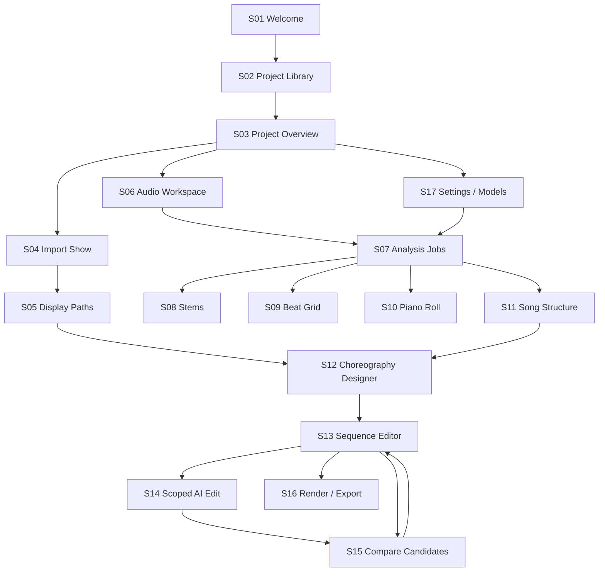

The arrows show common tasks, not locked navigation. The editor is the eventual main hub and should allow quick jumps to a phrase's note, beat, stem or spatial path.

## Screen catalog at a glance

| ID | Screen / surface | First phase | Primary goal | Wireframe |
|---|---|---:|---|---|
| S01 | Welcome and First Run | 01 | Create/open workspace | [View](assets/wireframes/SCREEN-01-WELCOME.png) |
| S02 | Project Library | 01 | Find songs/projects | [View](assets/wireframes/SCREEN-02-LIBRARY.png) |
| S03 | Project Overview | 01 | See workflow readiness | [View](assets/wireframes/SCREEN-03-OVERVIEW.png) |
| S04 | xLights Show Import | 02 | Validate real props | [View](assets/wireframes/SCREEN-04-SHOW-IMPORT.png) |
| S05 | Display Path Editor | 09 | Create physical motion routes | [View](assets/wireframes/SCREEN-05-DISPLAY-PATHS.png) |
| S06 | Audio Workspace | 04 | Playback / waveform / selection | [View](assets/wireframes/SCREEN-06-AUDIO.png) |
| S07 | Analysis Job Center | 05 | Observe/cancel/retry work | [View](assets/wireframes/SCREEN-07-ANALYSIS.png) |
| S08 | Stem Mixer | 06 | Inspect instrument separation | [View](assets/wireframes/SCREEN-08-STEMS.png) |
| S09 | Beat and Measure Grid | 05 | Fix pulse and downbeats | [View](assets/wireframes/SCREEN-09-BEAT-GRID.png) |
| S10 | Piano Roll and Note Editor | 07 | Fix melody transcription | [View](assets/wireframes/SCREEN-10-PIANO-ROLL.png) |
| S11 | Song Structure and Motifs | 08 | Relate repeated phrases | [View](assets/wireframes/SCREEN-11-STRUCTURE.png) |
| S12 | Choreography Designer | 10 | Assign music roles to gestures/props | [View](assets/wireframes/SCREEN-12-CHOREOGRAPHY.png) |
| S13 | Sequence Timeline Editor | 03 | Edit actual lighting effects | [View](assets/wireframes/SCREEN-13-TIMELINE.png) |
| S14 | Scoped AI Edit Drawer | 11 | Request a constrained local edit | [View](assets/wireframes/SCREEN-14-AI-EDIT.png) |
| S15 | Candidate Comparison and Refinement | 12 | Preview/rank/approve variants | [View](assets/wireframes/SCREEN-15-COMPARE.png) |
| S16 | Render Preview and Export | 02/13 | Validate/editable XSQ output | [View](assets/wireframes/SCREEN-16-EXPORT.png) |
| S17 | Settings, Models and Integrations | 01/06/11 | Configure local runtime and privacy | [View](assets/wireframes/SCREEN-17-SETTINGS.png) |

---

## S01 - Welcome and First Run

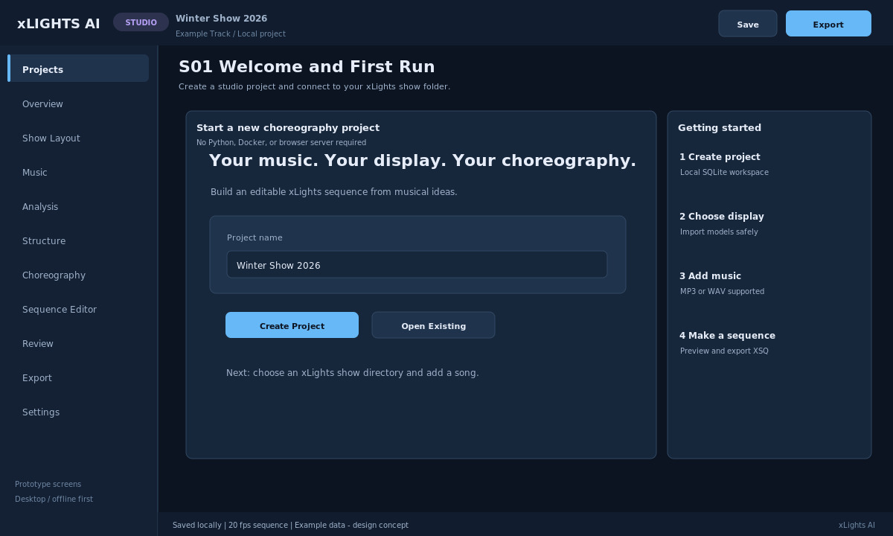

**First available:** Phase 01, Steps 004-007. **Later additions:** installer/model state in Phase 15.

**Layout:** Left navigation is deliberately minimal before a project exists. Center contains a prominent `Create Project` panel and `Open Existing Project` option. A third card explains the local-only default. Top contains product name, version and accessible Help.

**Interactions:** `Create Project` asks for project name/location. `Open` validates and migrates existing database safely. On first creation, user is offered `Choose xLights Show Folder` or `Do This Later`; no requirement to log in or connect to an AI provider.

**States:** Blank first-run; recent projects; missing/moved project directory; failed migration with recovery path; model assets not yet installed.

**Acceptance:** New project is visible in library, survives app restart, and creates no files inside the existing xLights show without consent. **Empty-state copy:** "Create a project to start with your own layout and music."

## S02 - Project Library

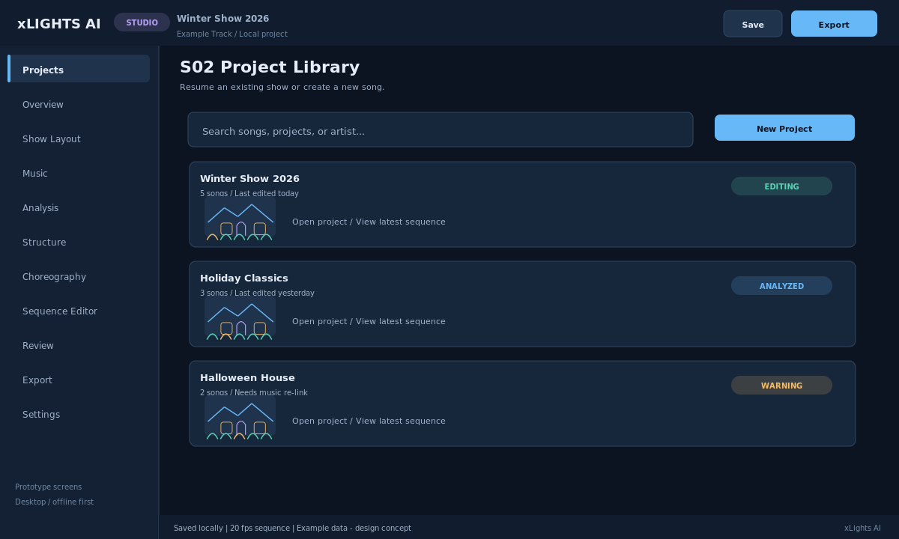

**First available:** Phase 01. **Extended:** Phase 04 song metadata and Phase 14 full-song progress.

**Layout:** Search/filter strip, left folder/collection list, central song project cards or sortable rows, right recent-activity panel. Each item displays title, artist if known, current phase/readiness, last edited, warnings and sequence preview thumbnail if available.

**Interactions:** Open/rename/archive project, duplicate as new version, filter `Draft / Analyzed / Edited / Exported`, drop a song onto an open project. Context menu must distinguish removing from library from deleting imported or source files.

**States:** No projects, empty filter, missing audio, missing layout path, older schema, queued analysis.

**Acceptance:** Opening an item navigates to its most recent editing context. Searching/filtering is deterministic, and deleting a library reference does not delete original audio or a user's show directory.

## S03 - Project Overview

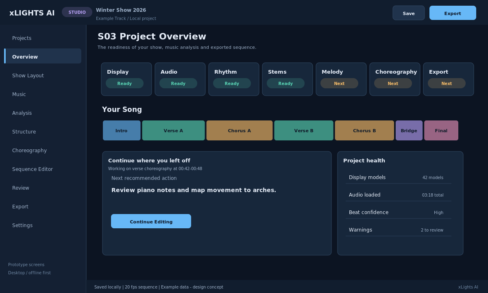

**First available:** Phase 01 with placeholder readiness cards; populated progressively in later phases.

**Layout:** Project/song header, a long horizontal readiness ribbon (`Show` -> `Audio` -> `Analysis` -> `Choreography` -> `Export`), section summary, last checkpoint/known issues and a large `Continue where I left off` action.

**Interactions:** Jump to unmet prerequisite, review detection warnings, reopen last sequence, open latest export. Display expected next useful action instead of a wall of raw job logs.

**States:** New project, audio-only project, all analysis complete, edits pending approval, export incompatible with chosen xLights version.

**Acceptance:** Every status derives from persisted artifacts, not manually maintained boolean flags. Readiness never claims finished if a required versioned dependency is stale.

## S04 - xLights Show Import

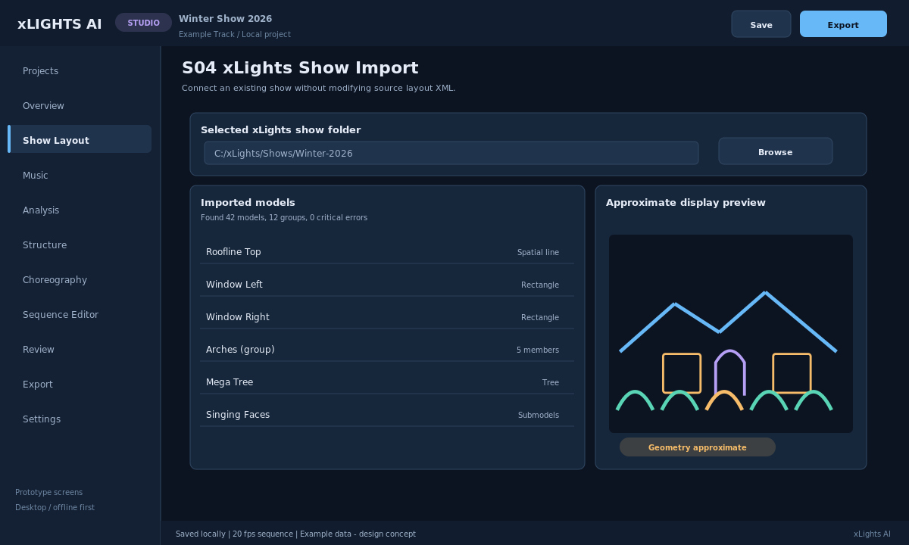

**First available:** Phase 02, Steps 009-011.

**Layout:** Show-folder path chooser across the top; left diagnostics summary; central imported model table; right approximate house/layout preview. Selected prop is highlighted consistently between table and preview.

**Interactions:** `Browse Show Folder`, `Scan`, `Refresh`, `View Missing/Unsupported`, `Use This Layout`. Show parsed groups/models and optionally network-file presence, but do not edit controllers. Offer `Re-link` if folder moved.

**States:** No folder, permission denied, malformed XML, duplicate names, unavailable geometry, imported layout changed since last scan, model name present in sequence but not layout.

**Acceptance:** A stable model identifier is persisted and can be used by the XSQ export adapter. Original xLights XML files remain byte-for-byte unchanged after import. Warn where physical geometry is unknown rather than inventing coordinates.

## S05 - Display Path Editor

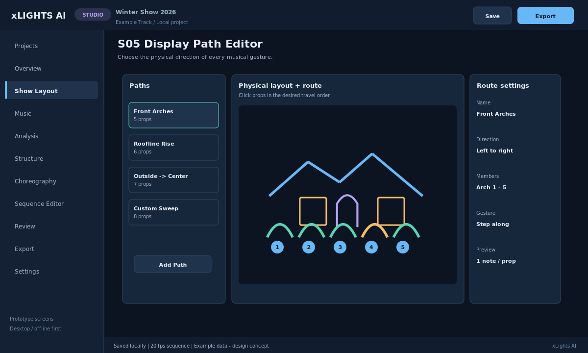

**First available:** Phase 09, Steps 059-065. **Early preview:** read-only positions in S04.

**Layout:** Left panel lists detected groups and custom paths. Central dark canvas shows prop outlines and numbered route segments. Right inspector holds ordered members, motion direction, reverse option, safe model roles and path preview.

**Interactions:** Click props to build an ordered route; drag route order; define `Left to Right`, `Outside In`, `Roofline Rising`, custom paths; test one-note-per-prop stepping; save correction overrides separately from xLights source XML.

**States:** Missing coordinates, ambiguous ordering, disconnected path, single prop, unsupported model/submodel, copied path referencing missing props after layout change.

**Acceptance:** A saved route returns the same ordered model IDs after restart. The same melodic test fixture correctly travels over two distinct paths; ambiguous geometry requires manual input, not a fabricated route.

## S06 - Audio Workspace

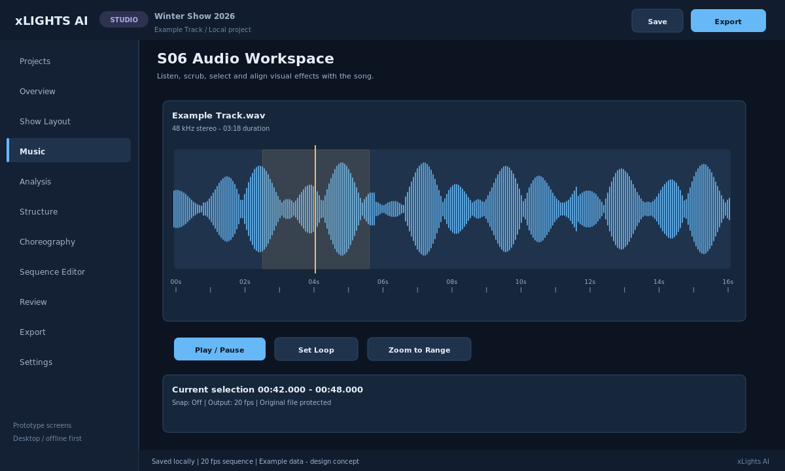

**First available:** Phase 04, Steps 024-030.

**Layout:** Large waveform and time ruler above a transport bar. The lower pane includes a song info panel, in/out selection controls, audio source diagnostics and upcoming timing-track toggles.

**Interactions:** Drag/drop MP3/WAV; Play/Pause/Seek; scrub; set loop in/out; zoom; jump to selected time; toggle timebase and snap modes. Later, show aligned drum/piano/vocal overlays without replacing the original waveform.

**States:** Unsupported/corrupt file, decode in progress, missing media, mismatched sample rate, long waveform still building.

**Acceptance:** Seeking to a known sample/marker is stable within the documented output tolerance and the waveform does not drift from the effect timeline over a multi-minute track.

## S07 - Analysis Job Center

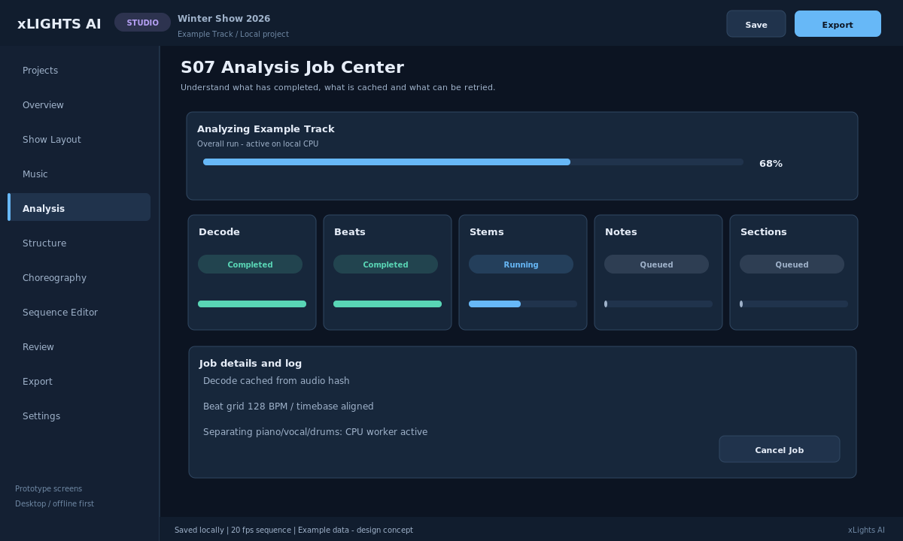

**First available:** Phase 05; extended significantly in Phase 06 and 12.

**Layout:** Status header with a large progress indicator, stage cards (`Decode`, `Beats`, `Stems`, `Notes`, `Structure`) and job log/details. Cached/completed stages are visually distinct from running/blocked stages.

**Interactions:** Start analysis, cancel safely, retry only failed/stale stage, inspect stage inputs/config/version/quality, clear an intentionally selected cache. Offer CPU/GPU choice only when the backend supports it.

**States:** Queued, running, cached, completed, cancelled, blocked, recoverable failure, unsupported inference model.

**Acceptance:** Cancel leaves earlier completed results usable and cleans temporary files. Closing/reopening the app restores last job state without showing a false completion.

## S08 - Stem Mixer

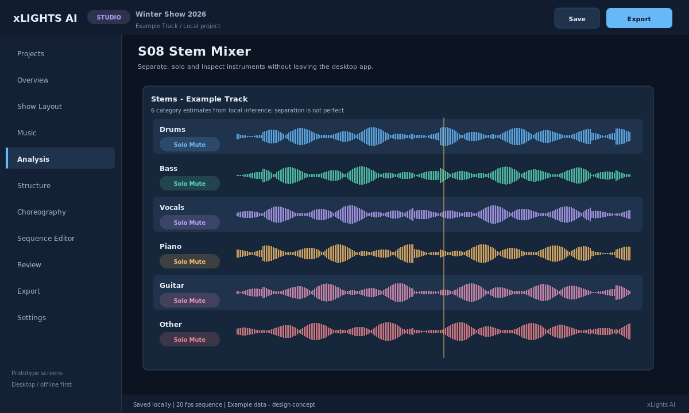

**First available:** Phase 06, Steps 038-044.

**Layout:** Six horizontal instrument tracks with labeled colored waveform summaries, a time cursor, Mute/Solo and confidence/activity area. Right side shows model version, quality caveats and a small selection-to-choreography action.

**Interactions:** Solo drums/piano/vocals, mute leakage-heavy tracks, choose a region, inspect activity and set a provisional musical role. User can label a stem `Lead in Chorus` without assuming the separated stem is a perfect isolated instrument.

**States:** Model not installed, separation still running, missing category, low confidence, pronounced cross-stem bleed, incompatible/corrupted cache.

**Acceptance:** Stem playback aligns with original music; displayed source/model/cache version can be inspected; a selected stem time range flows into the note/gesture analyzer.

## S09 - Beat and Measure Grid

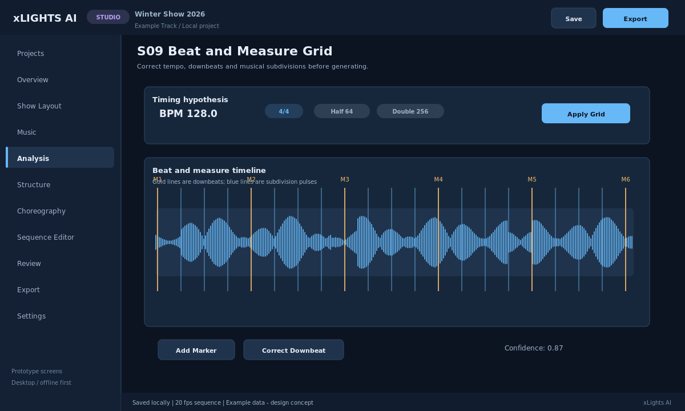

**First available:** Phase 05, Steps 031-037.

**Layout:** Waveform underneath vertical beat and measure markers; top strip shows BPM, time signature, confidence and half/double-time alternatives; right inspector shows selected marker timing and correction history.

**Interactions:** Audition metronome overlay; drag a beat or downbeat; insert/delete timing markers; test a selected beat-driven pop; choose auto/half/double-time interpretation; show changed dependent effects before applying.

**States:** Multiple plausible tempos, variable BPM, no detected downbeat, off-grid event, manual override, uncertain time signature.

**Acceptance:** Known 120 BPM fixture shows correct 500 ms quarter-note spacing where appropriate. Manual corrections persist and trigger targeted invalidation of dependent choreography, never wholesale resetting user edits.

## S10 - Piano Roll and Note Editor

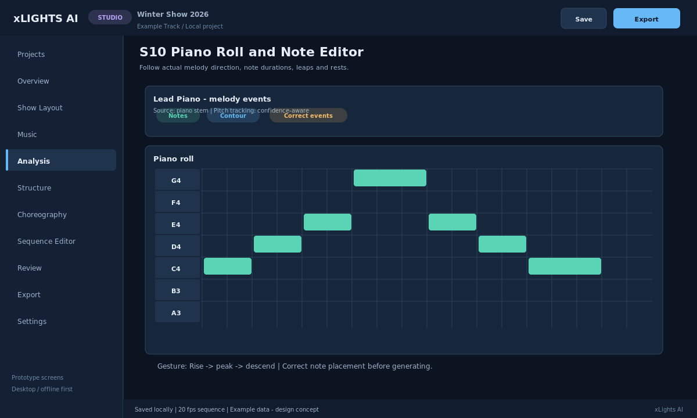

**First available:** Phase 07, Steps 045-051.

**Layout:** Pitched vertical keyboard at left; horizontally timed note blocks; source instrument selector and confidence toggle; lower pane displays a simplified `Pitch Contour -> Path Position` mapping.

**Interactions:** Select piano/vocal/guitar stem; correct note onset/end/pitch; remove false positive; add missed note; convert range into `Ascending Steps`, `Hold`, `Jump`, or other gesture; switch to contour-only mode when transcription is poor.

**States:** No reliable pitches, polyphonic overlap, unclear melody lead, transcribed notes with low confidence, manually corrected MIDI.

**Acceptance:** Synthetic note sequence `C4 D4 E4 G4 E4 D4 C4` produces expected directed path indices and correct starts/durations. Changes are traceable to the note source/version.

## S11 - Song Structure and Motifs

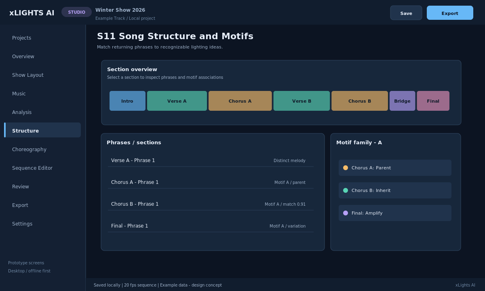

**First available:** Phase 08, Steps 052-058.

**Layout:** Color-coded horizontal song overview (intro, verse, chorus, bridge); phrase breakdown beneath; right motif family panel shows similar chorus/phrase occurrences linked by motif IDs.

**Interactions:** Split/merge sections, rename roles, link/unlink motifs, compare two phrase fingerprints, decide whether to inherit full choreography, only lead movement, or a variation. Click motif to highlight all occurrences on timeline.

**States:** Unknown section, one-off melody, two similar phrases with different arrangement, manual override that conflicts with auto-match.

**Acceptance:** Repeated test chorus is detected or manually linkable. Applying motif inheritance proposes changes to listed phrase instances only; the user sees all targets before approving.

## S12 - Choreography Designer

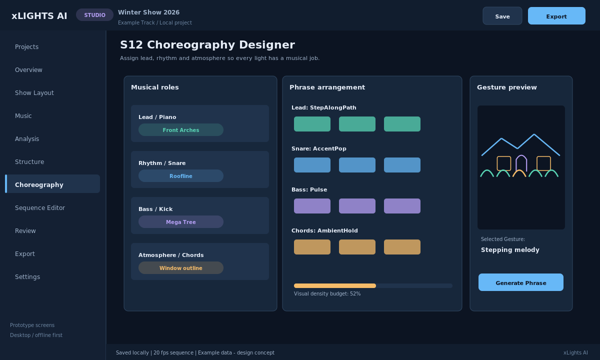

**First available:** Phase 10, Steps 066-071, using Phase 09 routes and earlier gestures.

**Layout:** Left role/instrument assignments; center arrangement lanes for lead/rhythm/bass/atmosphere; right gesture recipe panel with selected path, color palette, density and energy; miniature house preview at the bottom.

**Interactions:** Map piano -> Front Arches, drums -> Roofline, bass -> Mega Tree; assign `Stepping`, `Pulse`, `Accent`, `Reveal`; tune visual attention budget and section energy; generate selected phrase rather than the whole song.

**States:** No path assigned, incompatible effect/prop, conflicting simultaneous gestures, oversaturated visual density, quiet phrase requiring restraint.

**Acceptance:** A sample 20-30-second passage shows clearly differentiated lead movement and rhythmic accents, and can be edited in S13 without loss of intent metadata.

## S13 - Sequence Timeline Editor

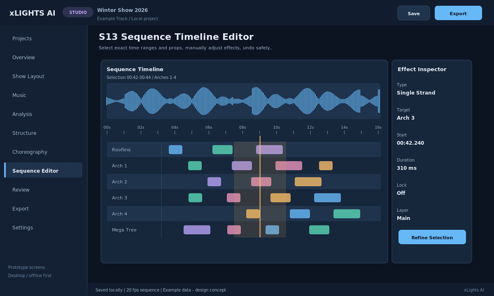

**First available:** Phase 03, Steps 016-023. **Becomes the primary working surface after Phase 04.**

**Layout:** The user's main editing desk: a top audio waveform/time ruler, nested left prop rows/groups, horizontal editable effect blocks, a gold selection rectangle, a playhead, bottom transport and a right effect inspector. Later add overlays for beat/notes/phrases/stems and a dockable house preview.

**Interactions:** Single/multiple effect selection; drag/resize; model/time-range lasso; snap to frame/beat/note/off; zoom and loop; lock/unlock; copy/paste; undo/redo; select a phrase from structure; open scoped edit drawer with current selection prefilled.

**States:** No audio, no layout, no effects, mixed edit/lock selection, collapsed groups, unsaved changes, invalid target, exporting.

**Acceptance:** Selection produces exact time and model IDs. Move/resize and undo round-trip to a real XSQ. A locked or out-of-range effect remains unchanged through any generated edit. **This screen owns the only canonical selection model used by AI editing.**

## S14 - Scoped AI Edit Drawer

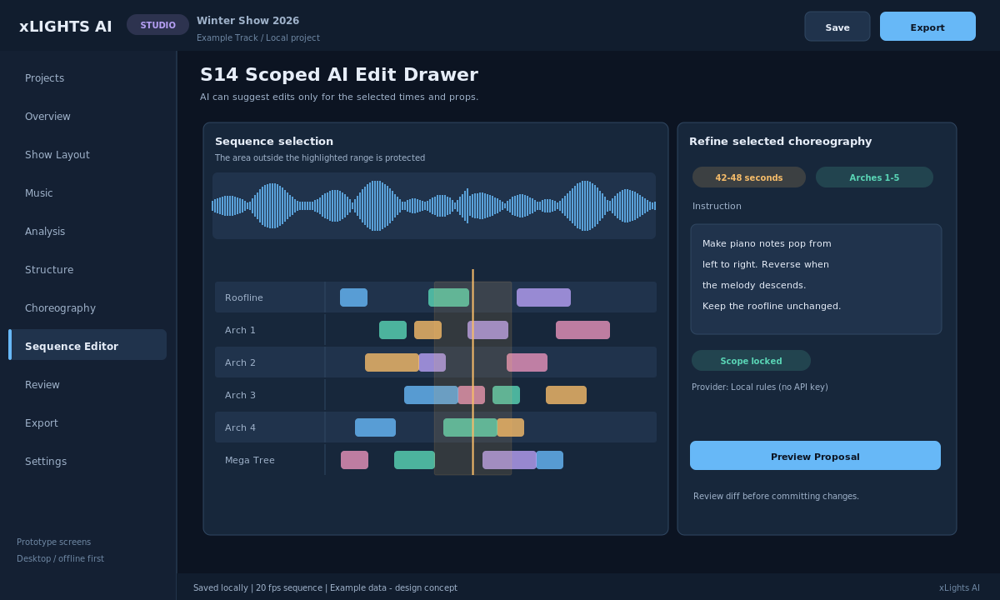

**First available:** Phase 11, Steps 072-078. It is a **drawer on S13**, not a second canonical editor.

**Layout:** A narrow right panel with immutable-looking scope chips (`00:42-00:48`, `Arches 1-5`, `Piano`), lock/out-of-scope summary, natural-language text area, guided gesture presets and `Preview Proposal` action. The selected timeline area remains visible behind the drawer.

**Interactions:** Type e.g. "Make the piano notes step left to right, reverse when descending; keep roofline unchanged." Choose deterministic local command first when possible; optionally enable local/BYOK model assistance. `Preview` validates schema and scope, then opens candidate compare.

**States:** No selection, selection includes locked effects, unsupported instruction, provider unavailable, invalid or unsafe scope change, proposal ready, stale document revision.

**Acceptance:** The request payload contains explicit model IDs, `[start,end)` times, note/stem/phrase references and permissions. No out-of-scope mutation is possible even if the model proposes one; no API key required for guided local edits.

## S15 - Candidate Comparison and Refinement

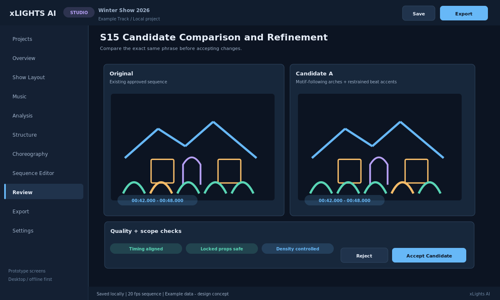

**First available:** Phase 12, Steps 079-084. Enhanced with real renderer in Phase 13.

**Layout:** Side-by-side `Original` and `Candidate` previews, synchronously scrubbed song time, score breakdown, machine-evaluated hard checks, an expandable effect diff, visible attempt count, and `Accept / Reject / Try Another` controls.

**Interactions:** Preview both at the same playback time; inspect which effects/models are added/removed/changed; filter score categories; keep best-so-far; retry within budget; approve the specific candidate and commit one reversible transaction.

**States:** Preview still generating, candidate fails hard gate, loop budget exhausted, no measurable improvement, human preference conflicts with numeric score.

**Acceptance:** Reject leaves the document byte-for-byte logically unchanged. Accept commits exactly one approved scoped operation. Scores never override xLights compatibility or edit boundaries.

## S16 - Render Preview and Export

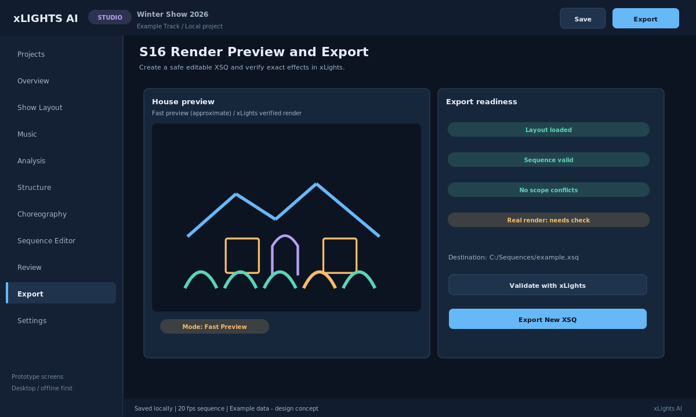

**First available:** Basic export in Phase 02, Step 013. Rendering/validation added in Phase 13.

**Layout:** Left approximate house preview and render mode selector; center export readiness checklist; right destination/version/settings and actual `Export New XSQ` action. A render-result strip shows warnings/errors and latest generated artifact.

**Interactions:** Refresh preview, verify in installed xLights (capability-aware), select target file name/folder, select full sequence or explicitly supported range export, inspect missing model/effect references, generate editable XSQ. Offer package creation only when the required assets and format are verified.

**States:** XSQ unavailable, stale renderer result, xLights not installed, unsupported headless API, missing media/assets, permissions denied, export already exists, render errors.

**Acceptance:** Export writes atomically to a new path by default. Actual compatible xLights opens the XSQ and shows intended models/effects. Present real warnings when full render verification is not available; never claim an approximate preview is an exact xLights render.

## S17 - Settings, Models and Integrations

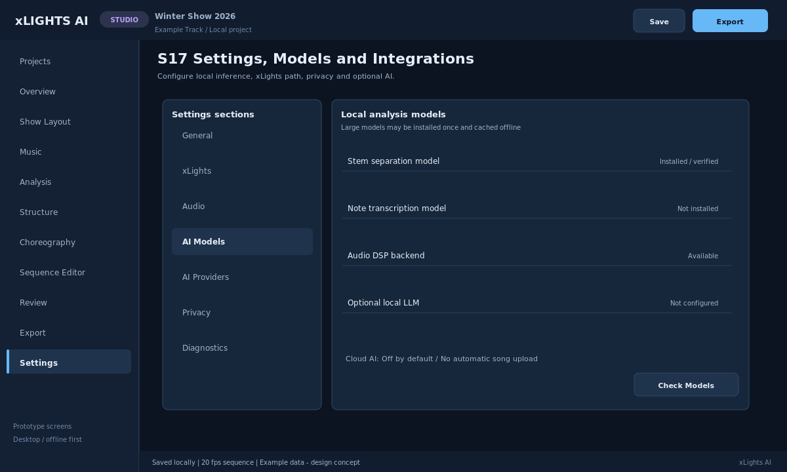

**First available:** Basic paths/theme/settings in Phase 01; inference management Phase 06; optional AI providers Phase 11; packaging updates Phase 15.

**Layout:** Left settings sections (`General`, `xLights`, `Audio`, `Models`, `AI Providers`, `Privacy`, `Diagnostics`), central options, right dependency/system state with model download/progress and diagnostic export.

**Interactions:** Choose xLights binary/show path, storage/cache limits, select supported inference backend, download/checksum-verify models, optionally register local or BYOK model provider, disable external networking, view dependency licenses, export redacted diagnostics.

**States:** No xLights found, missing model, invalid checksum, CPU-only fallback, provider authentication error, offline install, low storage, incompatible OS architecture.

**Acceptance:** App can run with cloud AI disabled. Sensitive keys are stored in platform-secure mechanisms when available, never in project files/logs. Clearing cache never deletes user-created source or approved sequence documents.

---

## Dockable surfaces / modal dialogs (not separate primary screens)

| Surface | Opens from | Expected contents and guardrails |
|---|---|---|
| Effect Inspector | S13 effect click | Selected effect IDs, parameters, provenance, duration, lock, valid ranges; read-only if locked |
| Time + Props Selector | S13 or S14 | `[start,end)` controls, list of included models/groups, phrase selection, protected scope summary |
| Song Import Wizard | S02/S06 | File path, metadata, missing audio/duplicates, sample rate and original-file protection |
| Model/Asset Downloader | S07/S17 | Source/license, size, platform support, SHA checksum, pause/cancel/retry |
| Export Warning Details | S16 | Missing models, unsupported effect settings, xLights target version, remediation |
| Diff Details | S15 | Added/deleted/changed effect IDs and exact affected time/prop matrix |
| Job Failure Detail | S07 | Retryable reason, installed dependency versions, sanitized logs, support bundle |

## Primary interaction journeys

### Journey A - First usable sequence (Steps 001-015)

`S01 Create -> S04 Import Show -> S03 Ready -> S16 Export 3-effect test -> Open in xLights.`

**User-visible test:** select a real show, generate three known effects, write a new XSQ and verify in actual xLights without changing show configuration.

### Journey B - Musical melody stepping (Steps 024-051)

`S06 Import song -> S07 Analyze -> S09 Adjust beats -> S08 Inspect instrument -> S10 Correct note contour -> S13/S16 Generate stepping sequence.`

**User-visible test:** known seven-note melody travels across selected arches at musical onsets, sustaining and reversing accurately.

### Journey C - Repeated chorus with variation (Steps 052-071)

`S11 Link Chorus A/B -> S05 Confirm prop route -> S12 Choose role and motif template -> S13 Compare placements.`

**User-visible test:** second chorus clearly recalls first with a permitted change in energy/arrangement.

### Journey D - Refine a two-second region (Steps 072-089)

`S13 Select 42-44 seconds + Arches 1-4 -> S14 Instruct -> S15 Compare -> Accept -> S13 Verify exact diff -> S16 Render/export.`

**User-visible test:** unaffected roofline and earlier/later effects are identical; accepted changes are undoable and rendered in xLights where supported.

### Journey E - Whole-song release (Steps 090-100)

`S03 Review readiness -> S11 Inspect sections -> S12 Set energy arc -> S13 Whole-song review -> S16 xLights render/export -> S02 Mark exported.`

**User-visible test:** open complete editable sequence from a clean installed desktop build; no Python/Git/Docker/cloud subscription.

## Accessibility and interaction acceptance

- Controls have descriptive text/tooltips; selected/disabled/error states do not rely on color alone.
- Keyboard users can reach navigation, project search, transport, timing selection, list/group rows, effect inspector and confirmation dialogs. Canvas-heavy editors provide numeric alternatives to dragging.
- High-contrast and colorblind-safe differentiators for section/stem/event tracks; zoom scales accessible text and waveform hit targets.
- UI work remains responsive during model inference, waveform building and xLights rendering; cancellation is meaningful and progress not fabricated.
- User destructive operations always display scope, effects impacted, and undo/backup path.
- Automated UI tests can target stable automation IDs per screen (`S01.CreateProject`, `S13.Timeline`, `S14.PreviewProposal`, etc.).

## Build guidance for coding agents

When implementing the associated phase, use the corresponding screenshot as a **compositional reference**, but implement only behaviors whose numbered steps are in scope. Earlier partial screens may show disabled future actions; they must not imply unsupported work actually runs. Preserve one common selection/playhead state, a stable project data model, and reversible editing. Write viewmodel tests and an explicit screen-state checklist; record a real screenshot once implemented for comparison with the proposed wireframe.

**Do not overfit to pixels.** The images demonstrate placement of major controls and user journeys. Actual spacing, font metrics, rendering technology, dark/light themes and scaling should follow Avalonia accessibility requirements and user testing.
