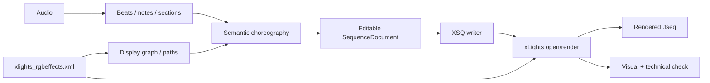

# xLights sequence engineering guide

**Product:** xLights AI Choreography Studio (proposed Avalonia/.NET application)  
**Status:** Implementation research and validation guide, **not** an official xLights schema specification  
**Reviewed:** 2026-10-10  
**Primary implementation gate:** Phase 02, steps 009-015  
**Related documents:** `SYSTEM-DESIGN-AND-PHASE-MAP.md`, `ARCHITECTURE-AND-GUARDRAILS.md`, `phase-specs/PHASE-02.md`, `TEST-DATA-AND-ACCEPTANCE.md`

> Important: xLights' user documentation explains the behavior, but we should not assume there is a stable formal, version-independent XSQ schema. This guide documents verified concepts and public examples, and prescribes how to discover exact fields and parameter encodings from **files produced by the target xLights release**. Never substitute an attractive but untested XML sample for a sequence that successfully opens and renders.

## 1. Exact goal of the integration

The .NET application must:

1. Read an **existing show folder** without changing the user's controller or model setup.
2. Discover addressable xLights models, model groups, and submodels, including the effects of their geometry and grouping on choreography.
3. Create an internally editable `SequenceDocument` of model-specific effects on precise musical times.
4. Serialize that document as an editable `.xsq`, including the metadata, effect settings, color palettes, effect layers, and timing tracks required by the selected xLights release.
5. Validate that xLights opens the file, shows the intended models and effects, and produces the intended light output when rendered.
6. Repeat the process after the user selects a narrow time range or set of props, without corrupting unrelated effects or original layout files.

The xLights sequence compiler is **not** the audio analyzer, the UI preview, or a standalone reimplementation of every xLights renderer. Its job is to translate renderer-neutral choreography instructions into compatible editable effects.

## 2. Key xLights files and responsibilities

| Item | Primary meaning | How our app uses it | Mutability policy |
|---|---|---|---|
| `xlights_rgbeffects.xml` | Show layout and model configuration: models, groups, and related xLights layout data | Read, normalize, validate, create spatial graph | Read-only unless an explicit separate layout-edit feature is built |
| `xlights_networks.xml` | Controllers, networks and channel-related configuration | Read where needed for diagnostics/validation of final output | Read-only |
| Original audio (`.mp3`, `.wav`, etc.) | Media backing a musical sequence | Analyse, play and associate with XSQ; preserve exact time origin | Preserve original |
| `.xsq` | XML-encoded **editable sequence**: model effects, timing, sequence metadata, effect settings/palettes | Main import/export target | Generate a **new** file by default; protect originals |
| `.xtiming` | Portable timing-track interchange format | Optional import/export of beats, notes and other timing marks | New output only |
| `.fseq` | Rendered frame/channel data consumed by show players | Downstream output/compatibility check, not editable source | Created by xLights rendering; do not hand-author in the first MVP |
| `.xsqz` | Sequence package used by xLights ecosystem | Consider later for portable exchange, with included referenced assets only where permitted | Optional later feature |

The official xLights glossary distinguishes `.xsq` sequence information from `.fseq` rendered output. The user manual says models are defined in `xlights_rgbeffects.xml`, and details `xlights_networks.xml` as controller data.

## 3. The actual end-to-end sequence pipeline



**Example:** The musical analyzer detects five successive piano onsets. The choreography planner chooses a left-to-right path through five arches. The sequence compiler places individual `On`-like or pulse effect instances at those onsets on the named arches. xLights reads the effect instances and the user's model definitions, renders pixels for each frame, and maps pixels to channels. An XSQ effect instance should not contain raw RGB frame data for each pixel.

## 4. Layout discovery: what the compiler must understand

An xLights model represents the physical properties needed to render an element, not simply a name. Models may have multiple strands and nodes; the exact number and spatial arrangement depend on model type and configuration. A **model group** is a logical collection of models; a model can belong to multiple groups. xLights can sequence effects directly on groups. Groups render to an internal grid, which may differ from sequencing the same effect independently on each child model.

Build a read-only importer that captures at least:

- Show directory identity and layout file hash.
- Model name, type, source XML identity, node/strand count where determinable, and relevant display/screen positions.
- Group membership (including nesting), ordering and render-grid behavior where present.
- Submodel names/references and parent relationship where applicable.
- Relevant model buffering/render styles and names as xLights expects to resolve them.
- Controller/channel summary for diagnostics, **not** as the primary key for XSQ effect targets.
- Missing/duplicate/ambiguous names and references as explicit diagnostics.

Do not assume screen-space coordinate order equals the best musical order. The application maintains a user-editable `SpatialPath` such as `Arch01 -> Arch02 -> Arch03 -> Arch04 -> Arch05`. The source xLights model names remain stable references for exporting.

**High-risk details to test:** model groups vs children, nested groups, custom models, submodels, moving-head/non-RGB models if supported later, groups with different render styles, and two models with similar names. Never silently edit a user's show layout just to make grouping easier.

## 5. XSQ file structure: observed public example

A publicly available xLights 2026.03-created example shows an XML root named `xsequence`, with sections including:

| Observed section / attribute | Role for our implementation | Evidence / caution |
|---|---|---|
| `xsequence` | Root and sequence-wide attributes (for example blending/timing-related flags) | Actual tags/attributes vary by version |
| `head` | `version`, author/media metadata, `sequenceTiming`, `sequenceType`, `mediaFile`, `sequenceDuration` | Base metadata from xLights-generated file |
| `nextid` | ID allocation metadata | Preserve consistent unique effect IDs where used |
| `ColorPalettes` / `ColorPalette` | Reusable encoded palette definitions | The payload is xLights-specific, not JSON or CSS |
| `EffectDB` / `Effect` | Table of effect parameter-setting strings | Effect placements reference entries by index in the observed sample |
| `DisplayElements` / `Element` | Sequence rows, model and timing elements, visibility/order | A model must be present/resolved in the intended sequence/view |
| `ElementEffects` / `Element` / `EffectLayer` | Concrete effects assigned to timing/model rows and layers | Primary target of XSQ compilation |
| `DataLayers` | Imported or rendered data layers | Preserve unknown/unused data, do not fabricate |
| `SequenceMedia`, `TimingTags`, `lastView`, others | Supporting metadata | Preserve when round-tripping; learn exact necessity by version |

An observed **effect placement** has attributes of this shape (illustrative values are **not a complete standalone XSQ**):

```xml
<Element type="model" name="Arch01">
  <EffectLayer>
    <Effect ref="0" name="On" startTime="1000" endTime="1250" palette="0" />
  </EffectLayer>
</Element>
```

**What this says:** The named model has an effect on a specific layer; `startTime` / `endTime` are expressed in milliseconds in the observed example; `ref` points to an `EffectDB` entry and `palette` points to a `ColorPalettes` entry. It is **not** sufficient to emit only this snippet: a valid sequence needs appropriate header, settings/palette data, displayed elements and other version-specific metadata. The sample source demonstrates additional attributes including `id` and `selected` on placements; do not hardcode assumptions about optional fields.

The existing xLightsAI project has a dedicated writer at `src/generator/xsq_writer.py`. The related public xLights MCP server has another writer at `src/xlights_mcp/xlights/xsq_writer.py`. Treat those as reference implementations and compare both against files created and successfully reopened by xLights itself.

### Relationship between settings, palettes and placements

```text
EffectDB[0]        = serialized effect settings (xLights-specific key=value list)
ColorPalettes[0]   = serialized palette settings (xLights-specific key=value list)
ElementEffects/... = { model="Arch01", layer=0, name="On",
                       startTime=1000, endTime=1250, ref=0, palette=0 }
```

A template library can deduplicate settings/palettes but must not accidentally shift indices when appending, deleting or reordering entries. On import, resolve indices to internal typed settings; on export, rebuild compatible tables consistently. Preserve unknown fields whenever the app edits a preexisting file.

## 6. xLights effect parameters: do not guess

The public example encodes settings in comma-delimited key/value-like strings, with keys such as `E_*` for effect settings, `C_*` for palette settings, and other specialized settings. They are **effect-specific**; the exact widget/key conventions and supported ranges are not universally stable.

**Authoritative discovery approach for an effect recipe:**

1. Open the **target xLights release**, create a small disposable show/sequence (using a 50 ms or 25 ms frame interval as desired).
2. Add exactly one known effect to a simple known model and choose a specific palette.
3. Save the XSQ and record the precise `<Effect>` placement and referenced `EffectDB` / `ColorPalettes` entries.
4. Change **one effect parameter** (for example direction, speed, brightness or transition), save another XSQ and diff the normalized XML/settings strings.
5. Repeat for min/max values, default setting, animation curve if relevant, layer settings, and at least one extra model type.
6. Implement a versioned effect recipe with **only** verified keys and tested value domains.
7. Open the generated effect in xLights, render it, and compare its actual appearance to the hand-authored control.

Prioritize recipes needed by our MVP: steady `On`, fade/hold, a short white pop, Single Strand stepping/chase, and a simple movement effect. Add Morph, Bars, Shockwave and more specialized effects only as their settings are verified. Some 'semantic gestures' may compile into a series of elementary `On` effects instead of one complex xLights effect; that is valid when it achieves predictable timing and preserves editability.

**Effect recipe record (internal schema, not actual XSQ XML):**

```json
{
  "effectKind": "On",
  "xlightsVersion": "validated-build-id",
  "supportedTargets": ["Arch", "SingleLine"],
  "settingsTemplateId": "on-simple-v1",
  "paletteTemplateId": "solid-white-v1",
  "validated": true,
  "fixture": "fixtures/xlights/version-x/on-arch.xsq"
}
```

The actual compiled strings belong in version-specific fixtures/serializer logic, **not** in an LLM prompt. Never let an LLM invent raw `E_*` setting keys.

## 7. Frames, audio, timing tracks and precision

The xLights manual states that `sequenceTiming` determines the frame interval: 50 ms = 20 frames/second. Some examples use 25 ms = 40 frames/second. A musical beat does not necessarily align to frame boundaries. Our core must retain original note/onset timing before quantizing effects for XSQ output.

Recommended timing model:

- Store audio event positions as sample index plus sample rate, or a precise monotonic timestamp.
- Use **half-open** internal intervals `[start, end)`.
- Store the sequence frame duration in milliseconds (or rational time) for export.
- Quantize on export or only when the user explicitly requests frame snapping; record the chosen policy (nearest, floor, ceil).
- Do not round repeatedly during analysis -> gesture -> edit -> export.
- Ensure positive effect duration, legal boundaries, sorted timing, no negative position and no out-of-bounds effect after snapping.
- Include tests near musical onsets, 0 ms, last frame, and adjacent notes that can quantize to the same frame.

Example: at 50 ms frames, an effect onset at 1,234 ms would snap to 1,250 ms with nearest-frame rounding; the original 1,234 ms remains in `SongAnalysis` so future work can use the true event position.

xLights supports multiple timing tracks and import of timing data. The manual also describes importing note tracks from MIDI, Audacity or MusicXML and using such tracks with the Piano effect. This may be an easier MVP path for some instrument-driven behaviors, but not every musical gesture should become a timing track. Keep notes and choreography as separate concepts.

Create fixtures showing timing row elements and their `EffectLayer` payloads from real xLights output, plus an `.xtiming` example. The existence of a `type="timing"` row does not imply its payload is identical to a normal model effect payload.

## 8. Group rendering, effect layers, and what the preview cannot fake

The xLights render manual describes a **rectangular render buffer** for each model, group, or submodel. Effects operate on that buffer, whose size/arrangement is based on model and settings. A group may use a special grid representation. After layer and model/group blending, pixels are mapped to real lights and channels.

Practical implications:

1. An effect on a **group** is not necessarily equivalent to replicating the effect on each child model.
2. Effect layers and blending may change the visual result even when effect timing and names match.
3. Layout-specific model properties influence how an effect looks: trees, matrices, arches and custom models differ.
4. For the MVP's instant preview, simulate simple, deterministic props/gestures. Label unsupported xLights effects as **approximate**.
5. The source of truth for high-fidelity appearance is an xLights-created render, not our approximate Avalonia preview.
6. Rendering and controller channel ordering are distinct from XSQ effect placement. We should not invent raw FSEQ frames as the primary method for generating editable sequences.

The manual explains that after disabling Render On Save, a user must Render All and save to refresh the FSEQ. Changes to sequence duration, timing, or model blending likewise need rendering. The application should explicitly report the difference between **XSQ exported successfully** and **FSEQ rendered successfully**.

## 9. Creating a new XSQ versus editing an existing XSQ

### New sequence

- Assemble a `SequenceDocument` with metadata, target model names, named layers and effect recipes.
- Resolve effect settings and palettes from validated templates.
- Construct the XSQ in a version-aware writer; assign IDs and table indices deterministically.
- Write to a temporary file, parse again, validate invariants, then atomically rename to a **new** target path.
- Open in xLights and verify. Never claim success on XML well-formedness alone.

### Existing sequence

- Import the **complete** supported XSQ representation and retain XML extension/unknown fields whenever possible.
- Preserve original metadata, sequence/view information, effect settings, palettes, timing tracks and unsupported effects.
- Apply a `ScopedEdit` by model IDs, layer and `[start, end)` time. Explicitly define behavior for an effect that crosses the boundary: split/trim only when safe, otherwise reject/ask for a wider scope.
- Rebuild indices/references carefully and validate that out-of-scope effects did not change.
- Save as a new XSQ revision, with backup and undo history.

**Hard requirement:** The default output path must not replace a user's authored XSQ or layout XML. A failed import, render or round-trip must leave source files intact.

## 10. .NET implementation boundary and contracts

Keep one C# model for our intent, and one adapter for xLights serialization:

```csharp
public sealed record SequenceEffect(
    string EffectId,
    string TargetModelName,
    int LayerIndex,
    long StartMicroseconds,
    long EndMicroseconds,
    string EffectKind,
    string RecipeId);

public sealed record XlightsExportOptions(
    string TargetXlightsVersion,
    int FrameDurationMilliseconds,
    string ShowDirectory,
    string OutputFile);

public interface IXlightsSequenceSerializer
{
    // Implementation must validate show/model references and recipe availability.
    Task<ExportResult> ExportAsync(
        SequenceDocument sequence,
        XlightsExportOptions options,
        CancellationToken cancellationToken);
}
```

This is an **illustrative internal API**, not a confirmed upstream API. Contracts may evolve as reference fixtures reveal additional needs (palette/layer values, timing rows, submodels, presets, transitions, model groups). Keep xLights-specific field names in adapter/recipe code, not in musical analysis or AI output schemas.

Suggested components:

- `ShowLayoutImporter` (read-only)
- `XlightsVersionProfile` (tested capabilities and format expectations)
- `EffectRecipeCatalog` (versioned, verified settings/palette templates)
- `SequenceDocument` (editable internal model)
- `XsqReader` / `XsqWriter` (parse/serialize, preserve unknowns)
- `XsqValidator` (structural and semantic diagnostics)
- `XlightsRenderAdapter` (external integration, capability-detected)
- `GoldenFixtureRunner` (baseline comparisons, render evidence)

Use `System.Xml.Linq` or `XmlReader/XmlWriter` as appropriate. XML validity is only the **first layer** of validation; actual xLights behavior is the final compatibility gate. If using `XDocument` to patch imported XML, preserve annotations/unknown nodes and avoid silently wiping sections we did not model.

## 11. Minimum reference fixtures: collect these before implementing the XSQ writer

Put anonymized, tiny, reproducible fixtures under `tests/fixtures/xlights/<tested-version>/` with a manifest containing xLights exact version, hash, show-layout hash, audio-asset status and reproduction steps. Respect media and fixture licensing.

| Fixture | Expected behavior | Purpose |
|---|---|---|
| `00-empty-sequence.xsq` | Opens as empty | Header and required metadata |
| `01-on-single-model.xsq` | One bright hold/pop on Arch01 | First effect / palette / refs |
| `02-two-effects-same-layer.xsq` | Two separate effects, correct times | Ordering and timing |
| `03-two-layers.xsq` | Two layers blend as observed | Layers, blending |
| `04-timing-track.xsq` | Named timing markers appear | Timing encoding |
| `05-musical-sequence.xsq` | Media and sequence length resolve | Media path and timing |
| `06-group-effect.xsq` | Effect renders across a group | Group target and render style |
| `07-submodel-effect.xsq` | Target submodel is resolved | Submodel names/targeting |
| `08-color-variants.xsq` | Different palettes show correctly | Palette references |
| `09-movement-param-A.xsq`, `09-movement-param-B.xsq` | One known setting changed | Param encoding diff |
| `10-unknown-effects.xsq` | Round-trip retains unsupported content | Preservation |
| `11-missing-model.xsq` | Clear diagnostic, no source damage | Failure path |
| `12-escaped-text.xsq` | Special chars survive | XML escaping and payload parsing |

Acceptance categories:

1. **Parser:** All fixtures parse and resolve references; malformed inputs produce diagnostics.
2. **Round-trip:** Known/unknown sequence components preserved as designed; no unrequested changes.
3. **Generated XSQ:** xLights opens each generated artifact without recovery dialog/repair.
4. **Effect behavior:** Models, layers, palettes, timing and parameters match the hand-authored baseline.
5. **Render:** Actual xLights output appears where expected. Only declare this passed after running the real renderer.
6. **Safety:** Atomic writing, never overwrite original by default, path escaping/media references and cancellation are tested.

## 12. Required Phase 02 engineering order

This expands the existing steps and avoids the common mistake of writing a made-up XSQ serializer:

| Step | What the agent must produce before proceeding |
|---|---|
| 009 | Show folder picker + read-only discovery + error UI |
| 010 | Parsed model/group fixtures and validated normalized names |
| 011 | Show diagnostics for ambiguous model/submodel/channel references |
| **012A** | **Collect real hand-authored XSQ fixtures and document a tested target xLights version** |
| **012B** | **Extract/refine one minimal `On` effect recipe by comparing xLights-generated settings and palette data** |
| 012 | Internal three-effect `SequenceDocument`, not raw XML |
| 013 | Version-aware XML writer with recipe table, palette table, display elements and effect layers |
| 014 | Real xLights open, effect inspection and actual render evidence |
| 015 | Atomic output, backup, round-trip and golden regression suite |

The `012A` and `012B` substeps are explicit preconditions within the existing Phase 02 plan, **not** additional phases or changes to the 100 numbered-step roadmap.

**Phase 02 must be blocked** if the only successful check is that a file is XML-well-formed or if the agent could not test in a compatible xLights instance. In that case report an *unverified integration* and the exact manual reproduction instructions, rather than inventing a pass.

## 13. Development research playbook for the coding agent

Before modifying the sequence adapter:

1. Inspect the pinned upstream `xlights-autosequencer/src/generator/xsq_writer.py` and its models and tests; extract which tags and reference tables it actually creates.
2. Inspect `xlights-autosequencer/src/grouper/layout.py`, `src/effects/builtin_effects.json` and related variant definitions to understand model parsing and verified/assumed settings.
3. Inspect a fresh `.xsq` created and saved by the **target** version of xLights; annotate all sections and timing units. Compare with an animated and a musical sequence.
4. Compare with the independent `xlights-mcp-server` XSQ writer and parser for additional compatibility examples; treat it as secondary evidence, not authority.
5. Implement fixtures before the writer. Do one `On` recipe end-to-end. Confirm it opens/renders. Only then implement two effects, multiple layers, group effects and timing marks.
6. Capture xLights version and screenshot/render artifacts in the test report.
7. Keep a `FORMAT-FINDINGS.md` and `EFFECT-RECIPE-REGISTRY.md` checked into source so later agents do not rediscover or hallucinate settings.
8. On a version mismatch, degrade gracefully: warn, route through a proven version profile, or refuse unsafe effect generation.

### Questions the agent must explicitly answer

- What versions of xLights are tested? On what OS?
- Which header/metadata sections are needed for new musical sequences?
- Do reference IDs in current generated XSQs resolve to zero-based `EffectDB` / palette indexes? How are IDs maintained?
- What exact effect-setting string produces a solid white `On` on an arch?
- What exact file and model name is used to locate a submodel in the XSQ?
- How are timing effects stored in this version, and what are their time units?
- How does the chosen effect behave on a group versus its child models?
- Can the output be opened and rendered in xLights *without* triggering repair or errors?
- What parts of an imported sequence can our editor safely preserve without understanding every setting?

## 14. Sources and reference code

**Official xLights documentation:**

- [xLights glossary: sequence, XSQ, FSEQ, show files](https://manual.xlights.org/xlights/appendicies/glossary)
- [Models and source `xlights_rgbeffects.xml`](https://manual.xlights.org/xlights/chapters/chapter-four-tabs/models)
- [Model groups and internal group grid](https://manual.xlights.org/xlights/chapters/chapter-four-tabs/model-groups)
- [xLights rendering buffers](https://manual.xlights.org/xlights/chapters/chapter-four-sequencer/rendering)
- [Sequence settings: media, timing, blending](https://manual.xlights.org/xlights/chapters/chapter-five-menus/file/sequence-settings)
- [Sequence settings: render-on-save/FSEQ](https://manual.xlights.org/xlights/chapters/chapter-five-menus/file/settings/sequences)
- [Timing tracks and imported notes](https://manual.xlights.org/xlights/chapters/chapter-four-sequencer/timing-tracks)
- [Opening xLights sequences](https://manual.xlights.org/xlights/chapters/chapter-five-menus/file)

**Reference implementations and real XSQ example:**

- [Public 2026.03-created XSQ example](https://github.com/FRC3620/xlights.sign1/blob/main/2026%20Doug.xsq)
- [xLights source code](https://github.com/xLightsSequencer/xLights)

**Source quality notes:** A real XSQ file is evidence for that file's schema and version, not a universal standard. Project README statements about generated files are implementation claims and must be checked against the target release. Some manual pages may lag current xLights releases. Record and pin a known-good version for each format fixture.

## 15. What remains unverified as of this document

This guide is intentionally explicit about its limits. The following are **not** claimed verified by merely reading public documentation:

- That the target user's installed xLights build loads any hypothetical generated XML snippet in this guide.
- The complete required XML fields for all supported xLights versions.
- The full xLights effect-parameter dictionary, default values and range rules for 40+ effects.
- The exact semantics of every possible submodel identifier, effect-layer blend mode, timing-track encoding and imported data layer.
- Availability of headless/CLI rendering on every released xLights build.
- A functioning .NET XSQ serializer or successful real xLights render: **neither is implemented in this package**.

These are the exact questions Phase 01 research and Phase 02 golden fixtures must resolve. This document tells the agent where to look, what to test, what outputs to save, and what not to assume.
