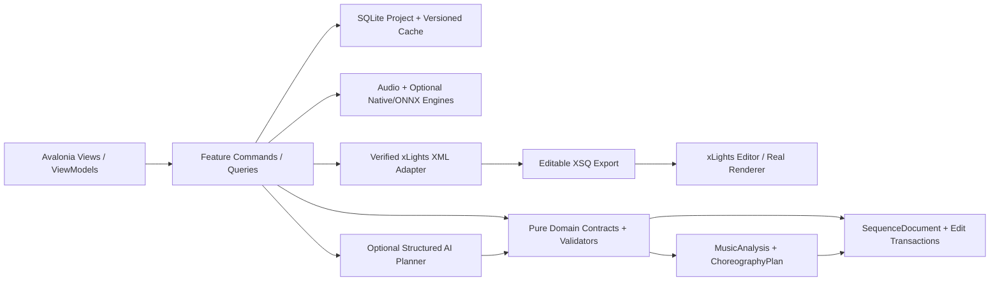
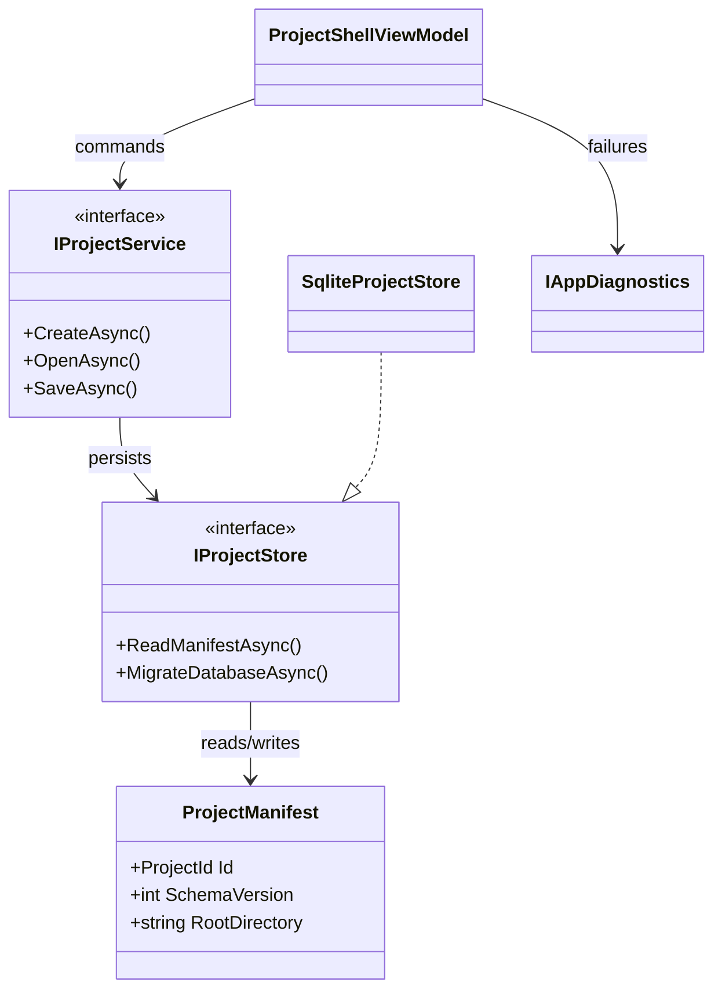
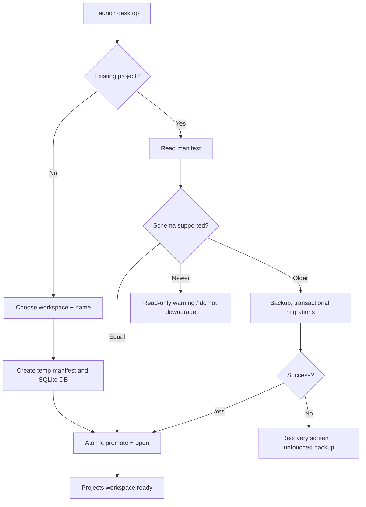

# PHASE 01 — Foundation and Reference Baselines

**Specification version:** 2.0 / 2026-10-10 | **Steps:** 001–008 | **Status:** Proposed, unimplemented until gate evidence exists

**Standalone specification.** This document contains the relevant product assumptions, contracts, class relationships, business flows, numbered implementation tasks, test designs, risk gates and an agent prompt. It does **not** mean Phase 01 can run without earlier implemented code; it means an architect/agent can plan and implement the phase without consulting a separate high-level brief. Code below expresses **proposed API signatures**, not verified source code. Reconcile them with the actual repository and xLights version before implementation.

## 1. User outcome, release boundary and phase gate

**User story:** As a sequencer, I can start a local desktop studio, create a project, close the app and reopen exactly the same project without touching my xLights show folder.

**Owned boundary:** Own application startup, project lifecycle, persistence, diagnostic scaffolding and a pinned reference corpus. All later phases consume these stable project/asset identifiers.

**Out of scope:** Do not parse a real xLights layout, run music inference, build an effect editor, or ship upstream Docker/Python in the application.

**Blocking phase gate:** Start a fresh install; create “Demo Song”, close/reopen; open a second project; inject a migration failure; show recovery screen, unchanged pre-migration backup and diagnostic log.

**Depends on:** None: starts from an empty repository and a selected source reference.

**Unblocks:** Phase 02: First Working xLights Sequence.

The gate is PASS only with automated tests, persisted-output inspection, and a real UI or xLights demonstration appropriate to the phase. If xLights or the required hardware/backend is unavailable, report BLOCKED or NOT VERIFIED—never silently substitute a mock.

## 2. Architectural assumptions (fully restated for standalone use)

- **Product:** locally installable Avalonia/.NET 10 desktop application; no Python, Docker, Git or mandatory LLM subscription for end users. CPU-first inference; native/ONNX only after a demonstrated and legally redistributable runtime/model fit.
- **Topology:** modular monolith with vertical feature slices. UI (Views/ViewModels), application orchestration, pure domain contracts, and platform/infrastructure adapters. Do not fabricate generic interfaces without a concrete boundary.
- **Timing:** internally represent position with an explicit canonical monotonic clock tied to source audio origin. Preserve sample index/rate for analysis provenance; UI may show milliseconds. All time scopes are half-open `[start,end)`. Convert to xLights frames only when explicitly snapping or exporting.
- **Ownership:** SQLite project metadata and committed user edits; immutable source media (linked/copied with consent); hash-addressed and versioned analysis/preview artifacts on disk. Every cache key includes algorithm/model/settings versions.
- **xLights:** `xlights_rgbeffects.xml` describes models/groups and other show configuration; `xlights_networks.xml` covers controller/output configuration; editable sequence is `.xsq` XML; rendered playback data is `.fseq`. Never overwrite source show files silently. Match layout models by verified name/identity mapping; do not invent xLights effect parameters.
- **Safe editing:** `SequenceDocument` is the editable state. `ChoreographyPlan` is an intent proposal, not a destructive replacement. Keep optimistic revision checks, effect locks, selection scope, immutable before/after patches, undo/redo, and explicit human acceptance.
- **AI trust:** optional local or BYOK cloud AI returns validated structured proposals only. Do not execute LLM-produced code, scripts or XML directly. Treat song lyrics, filenames, descriptions and external metadata as untrusted data. Explicit consent before sending media-derived data to remote services.
- **Verification:** unit tests + fixtures + integration tests + one observable UI/xLights demonstration per phase. An XML parse pass does not prove xLights renders an effect. A numeric musical score does not prove artistic quality. Do not claim tests ran when they did not.
- **Migration:** upstream xLightsAI (MIT repository, with separate dependency/model license checks) is a pinned reference for behavior, data and effect recipes. Python may run only in developer comparison tooling; there is no runtime Python requirement in releases.

### Core architecture at a glance



### Stable domain names and cross-phase ownership

| Aggregate / contract | First introduced | Sole authority / rule |
|---|---:|---|
| `ProjectManifest` and `ProjectId` | 01 | Project identity/version + root; SQLite and JSON atomically recoverable |
| `DisplayGraph`, `DisplayModel`, `ModelId` | 02 | Imported xLights model identities/group info; reference layout by hash |
| `SequenceDocument`, `EffectInstance` | 02 | Editable effects/locked state provenance; never serialize business behavior directly as XML |
| `EditScope`, `EditTransaction`, `DocumentRevision` | 03 | Exact time + model boundary and user-approved reversibility |
| `SongAsset`, `IAudioTransport` | 04 | Original song hash, timebase and synchronized playback |
| `BeatGrid` | 05 | Analyzed/corrected beats and alternative tempo hypotheses |
| `StemManifest`, `StemAsset` | 06 | Derived separated sources; known model version and sample origin |
| `MelodyTrack`, `NoteEvent` | 07 | Note/onset/contour truth with human corrections |
| `SongStructure`, `MotifLink` | 08 | Related phrase identities and inheritance decisions |
| `SpatialDisplayGraph`, `SpatialPath` | 09 | Artistic routes / normalized geometry separate from imported xLights identities |
| `VisualStory`, `ChoreographyPlan` | 10 | Musical/visual intent before concrete effect rendering |
| `EditProposal` | 11 | Untrusted/optional AI idea validated before `EditTransaction` |
| `LoopRun`, `Candidate`, `QualityReport` | 12 | Bounded attempts and reproducible candidate comparisons |
| `RenderArtifact` | 13 | Actual or clearly-marked approximate preview evidence |
| `WholeSongPlan` | 14 | Section continuity and approved phrase assembly |
| `ReleaseManifest` | 15 | Platform/model assets and delivery integrity |
| `ReleaseReadiness` | 16 | Explicit community compatibility/artistic evidence and release gate |

### Shared canonical C# identifiers

Define these once in `Studio.Contracts`. They are included here so the current phase spec can stand alone. **Do not redefine copies with different namespaces in code.**

```csharp
// Shared across phases; put these in Studio.Contracts (single declarations in the codebase).
namespace XlightsAI.Studio.Contracts;
public readonly record struct ProjectId(Guid Value);
public readonly record struct SongId(Guid Value);
public readonly record struct ModelId(string Value);
public readonly record struct DocumentRevision(long Value);
public readonly record struct TimelineTick(long Value); // 100 ns ticks from song origin
public readonly record struct TimeWindow(long StartTicks, long EndTicks); // [Start, End)
```

## 3. Phase-specific design and contracts

**Inputs:** User-selected workspace directory; app configuration; upstream Git URL plus immutable commit; legally shareable synthetic fixtures.

**Outputs:** Avalonia shell; project manifest; SQLite database; versioned migration runner; immutable reference fixtures; CI build/test reports.

### Architectural design notes

Use a **small feature-local vertical slice** for Projects: View -> ViewModel -> ProjectService -> repository/atomic manifest writer. Prefer SQLite for mutable project state and a short JSON manifest for portable project identity/schema/version; database creation/migration must occur inside a recoverable transaction with pre-migration backup. Treat UI initialization as a state machine: NeedsWorkspace, Ready, Migrating, IncompatibleVersion, Failed. Add a crash-safe recoverable autosave point and user-readable diagnostic log. Establish a pinned upstream `reference/` folder *by commit SHA*, not an always-changing moving branch. Collect synthetic audio and xLights fixtures without redistributing copyrighted songs.

### Proposed C# signatures

These are explicit API intent and relationship signatures, not an assertion that the existing repository already implements them. Favor the phase-local interfaces shown, adapt names to repository conventions, and record any compatibility decision. Referenced records introduced by prior phases are intentionally not redefined.

```csharp
using XlightsAI.Studio.Contracts;
namespace XlightsAI.Studio.Projects;
public sealed record ProjectManifest(ProjectId Id, int SchemaVersion,
    string Name, string RootDirectory, DateTimeOffset CreatedUtc);
public sealed record ProjectSummary(ProjectId Id, string Name, DateTimeOffset LastOpenedUtc);
public interface IProjectService {
    Task<ProjectManifest> CreateAsync(string directory, string name, CancellationToken ct);
    Task<ProjectManifest> OpenAsync(string directory, CancellationToken ct);
    Task SaveAsync(ProjectId id, CancellationToken ct);
    Task<IReadOnlyList<ProjectSummary>> RecentAsync(CancellationToken ct);
}
public interface IProjectStore {
    Task<ProjectManifest?> ReadManifestAsync(string directory, CancellationToken ct);
    Task WriteManifestAtomicallyAsync(ProjectManifest manifest, CancellationToken ct);
    Task MigrateDatabaseAsync(string directory, int targetSchema, CancellationToken ct);
}
public interface IAppDiagnostics { void RecordFailure(string code, Exception error); }
```

### Class relationship diagram



### Core process flowchart



## 4. Data contract, state ownership, migrations and caching

Project directory holds `project.json` (stable ID/schema/name), `studio.db` (migration-versioned mutable data), `cache/` (derived artifacts), `logs/` (diagnostics) and `exports/`. Original xLights show files are only referenced, never moved or modified.

### Contract compatibility rules

- Keep IDs stable across UI views, SQLite and exported artifacts; never persist Avalonia object instances or XML DOM nodes as domain objects.
- Schema changes require versioned migrations, fixture updates and tests against the preceding project version.
- Analysis caches may be rebuilt if their source/model/version hash changes; accepted manual edits are never disposable cache.
- All edits to `SequenceDocument` pass a revision-aware command boundary. Preview artifacts and AI proposals cannot update the accepted document directly.
- Logs include operation/fixture correlation IDs and error codes. External model names and XML payloads are treated as untrusted input.

## 5. User interface / screen behavior

Use the existing Avalonia shell and apply this phase incrementally; do not present empty future functionality as implemented. These wireframe images are conceptual design references, not pixels that must be copied literally.

- **SCREEN 01 WELCOME** — [Visual wireframe](../assets/wireframes/SCREEN-01-WELCOME.png). The screen must show loading/empty/error states, responsive resizing, keyboard navigation and an explicit version/status indicator when data is derived.
- **SCREEN 02 LIBRARY** — [Visual wireframe](../assets/wireframes/SCREEN-02-LIBRARY.png). The screen must show loading/empty/error states, responsive resizing, keyboard navigation and an explicit version/status indicator when data is derived.
- **SCREEN 03 OVERVIEW** — [Visual wireframe](../assets/wireframes/SCREEN-03-OVERVIEW.png). The screen must show loading/empty/error states, responsive resizing, keyboard navigation and an explicit version/status indicator when data is derived.
- **SCREEN 17 SETTINGS** — [Visual wireframe](../assets/wireframes/SCREEN-17-SETTINGS.png). The screen must show loading/empty/error states, responsive resizing, keyboard navigation and an explicit version/status indicator when data is derived.

UI behavior must always show *which song, time range, props, analysis source, version and approval state* the user is operating on when those concepts are available at this phase.

## 6. Numbered build slices — implement in order

Each numbered item is a complete vertical test cut: UI/command -> domain rule -> persistence or adapter -> observable result -> automated test. Avoid collecting multiple unverified tasks into one mega-commit.

### Step 001 — Fork or vendor upstream source at an immutable commit; document license and downstream notices

**User-visible outcome:** Versioned, inspectable project output plus a reproducible test report.

**Implementation guidance:** Record commit SHA, license, component inventory and upstream paths in a machine-readable manifest. Never rely on `main` at build time; note downstream attribution and third-party dependencies separately.

**Required acceptance:** Record URL, SHA, license and attribution; clean checkout resolves reference.

**Failure/edge case to prove:** Invalid input, cancellation or stale persisted state must not corrupt the project.

**Suggested automated acceptance test:** `Step001_Acceptance_Passes`. Implement a deterministic fixture and assert persisted domain state plus public output, not only a mock invocation. Include a negative-path assertion.

**Evidence:** Write `implementation-evidence/PHASE-01/STEP-001.md` with commands actually executed, input hashes, actual results, screen/output artifact, unresolved issues, and an explicit PASS/BLOCKED status.

- [ ] Implementation / tests / observable demo / evidence all complete before next numbered step.

### Step 002 — Audit upstream analysis, layout, theme, effects, XSQ writer, preview and dependency boundaries

**User-visible outcome:** Generated XML artifact and semantic diff/fixture, with xLights validation if this step changes rendering.

**Implementation guidance:** Identify source boundaries (`src/analyzer`, `src/grouper`, `src/generator`, `src/effects`, `src/variants`, `src/themes`, `src/review`). Produce port/use-data/replace/defer decisions and unsupported assumptions.

**Required acceptance:** Create a module-by-module reuse/port/replace/omit matrix with implementation risks.

**Failure/edge case to prove:** Invalid model/format/version must fail safely without rewriting source files.

**Suggested automated acceptance test:** `Step002_Acceptance_Passes`. Implement a deterministic fixture and assert persisted domain state plus public output, not only a mock invocation. Include a negative-path assertion.

**Evidence:** Write `implementation-evidence/PHASE-01/STEP-002.md` with commands actually executed, input hashes, actual results, screen/output artifact, unresolved issues, and an explicit PASS/BLOCKED status.

- [ ] Implementation / tests / observable demo / evidence all complete before next numbered step.

### Step 003 — Create baseline fixture corpus: synthetic notes, drum pulse, instrumental, complex mixed song and 2 layouts

**User-visible outcome:** Generated XML artifact and semantic diff/fixture, with xLights validation if this step changes rendering.

**Implementation guidance:** Use synthetic notes, a known click track, an isolated piano phrase, a short mixed-source audio fixture with rights, and at least two layout XML shapes. Store hashes, reference versions and expected outputs.

**Required acceptance:** Record input hashes, permitted usage, outputs and repeatable invocation.

**Failure/edge case to prove:** Invalid model/format/version must fail safely without rewriting source files.

**Suggested automated acceptance test:** `Step003_Acceptance_Passes`. Implement a deterministic fixture and assert persisted domain state plus public output, not only a mock invocation. Include a negative-path assertion.

**Evidence:** Write `implementation-evidence/PHASE-01/STEP-003.md` with commands actually executed, input hashes, actual results, screen/output artifact, unresolved issues, and an explicit PASS/BLOCKED status.

- [ ] Implementation / tests / observable demo / evidence all complete before next numbered step.

### Step 004 — Create .NET 10 Avalonia solution with basic navigation and no Python runtime

**User-visible outcome:** Versioned, inspectable project output plus a reproducible test report.

**Implementation guidance:** Build an empty but real Avalonia navigation shell with startup errors and one project feature; establish nullable reference checks and analyzers without speculative plugin architecture.

**Required acceptance:** Launch Windows desktop executable on a clean build.

**Failure/edge case to prove:** Silence, invalid timing boundaries and missing media must be handled explicitly.

**Suggested automated acceptance test:** `Step004_Acceptance_Passes`. Implement a deterministic fixture and assert persisted domain state plus public output, not only a mock invocation. Include a negative-path assertion.

**Evidence:** Write `implementation-evidence/PHASE-01/STEP-004.md` with commands actually executed, input hashes, actual results, screen/output artifact, unresolved issues, and an explicit PASS/BLOCKED status.

- [ ] Implementation / tests / observable demo / evidence all complete before next numbered step.

### Step 005 — Add structured logging, crash handling, settings and diagnostics page

**User-visible outcome:** Versioned, inspectable project output plus a reproducible test report.

**Implementation guidance:** Use structured events with correlation IDs; redact user filesystem paths from shared diagnostics where practical. Test read-only settings and simulated I/O errors.

**Required acceptance:** Restart restores settings and an injected error is reported without silent data loss.

**Failure/edge case to prove:** Clean machine and unsupported runtime must produce user-readable diagnostics.

**Suggested automated acceptance test:** `Step005_Acceptance_Passes`. Implement a deterministic fixture and assert persisted domain state plus public output, not only a mock invocation. Include a negative-path assertion.

**Evidence:** Write `implementation-evidence/PHASE-01/STEP-005.md` with commands actually executed, input hashes, actual results, screen/output artifact, unresolved issues, and an explicit PASS/BLOCKED status.

- [ ] Implementation / tests / observable demo / evidence all complete before next numbered step.

### Step 006 — Implement create/open/save project with versioned manifest and no direct writes to show folder

**User-visible outcome:** Versioned, inspectable project output plus a reproducible test report.

**Implementation guidance:** Make manifest writes atomic (same-volume temp file + flush + replace); persist schema version and stable project ID. Reject unsupported schema before mutating files.

**Required acceptance:** Round-trip sample project and reject newer unsupported schema safely.

**Failure/edge case to prove:** Invalid input, cancellation or stale persisted state must not corrupt the project.

**Suggested automated acceptance test:** `Step006_Acceptance_Passes`. Implement a deterministic fixture and assert persisted domain state plus public output, not only a mock invocation. Include a negative-path assertion.

**Evidence:** Write `implementation-evidence/PHASE-01/STEP-006.md` with commands actually executed, input hashes, actual results, screen/output artifact, unresolved issues, and an explicit PASS/BLOCKED status.

- [ ] Implementation / tests / observable demo / evidence all complete before next numbered step.

### Step 007 — Add SQLite persistence with transactional migrations and backups

**User-visible outcome:** Versioned, inspectable project output plus a reproducible test report.

**Implementation guidance:** Use SQLite `PRAGMA user_version` or migration table, explicit transaction and a pre-migration file backup. Unit test create, up/down mismatch, interruption and reopen.

**Required acceptance:** Migration tests on fresh and prior-version databases succeed.

**Failure/edge case to prove:** Out-of-scope, locked or stale revision must be rejected without partial mutation.

**Suggested automated acceptance test:** `Step007_Acceptance_Passes`. Implement a deterministic fixture and assert persisted domain state plus public output, not only a mock invocation. Include a negative-path assertion.

**Evidence:** Write `implementation-evidence/PHASE-01/STEP-007.md` with commands actually executed, input hashes, actual results, screen/output artifact, unresolved issues, and an explicit PASS/BLOCKED status.

- [ ] Implementation / tests / observable demo / evidence all complete before next numbered step.

### Step 008 — Add CI, unit/integration/golden test projects, formatting and artifact publishing

**User-visible outcome:** Versioned, inspectable project output plus a reproducible test report.

**Implementation guidance:** CI builds Windows at minimum and performs tests without developer Python; store fixture results and log manifest in build artifacts; require formatting/static checks to pass.

**Required acceptance:** Clean checkout builds, runs fixtures, and stores test reports.

**Failure/edge case to prove:** Invalid input, cancellation or stale persisted state must not corrupt the project.

**Suggested automated acceptance test:** `Step008_Acceptance_Passes`. Implement a deterministic fixture and assert persisted domain state plus public output, not only a mock invocation. Include a negative-path assertion.

**Evidence:** Write `implementation-evidence/PHASE-01/STEP-008.md` with commands actually executed, input hashes, actual results, screen/output artifact, unresolved issues, and an explicit PASS/BLOCKED status.

- [ ] Implementation / tests / observable demo / evidence all complete before next numbered step.

## 7. Full-phase test plan and quality gate matrix

| # | Test scenario / invariant | Type | Required evidence |
|---:|---|---|---|
| 1 | Create/open/restart preserves project ID and name | Unit + property | Actual result, input hash/fixture and pass/fail |
| 2 | Two simultaneous writers are detected or serialized | Integration/golden | Actual result, input hash/fixture and pass/fail |
| 3 | Older schema migrates transactionally with backup | Desktop/manual | Actual result, input hash/fixture and pass/fail |
| 4 | Newer-than-supported schema refuses destructive downgrade | Unit + property | Actual result, input hash/fixture and pass/fail |
| 5 | Abrupt cancellation leaves either old or new manifest, not partial JSON | Integration/golden | Actual result, input hash/fixture and pass/fail |
| 6 | Clean checkout `dotnet build` and `dotnet test` succeed | Desktop/manual | Actual result, input hash/fixture and pass/fail |
| 7 | Pinned upstream commit/license inventory is present and reviewable | Unit + property | Actual result, input hash/fixture and pass/fail |

### Phase gate demonstration — exact user workflow

Start a fresh install; create “Demo Song”, close/reopen; open a second project; inject a migration failure; show recovery screen, unchanged pre-migration backup and diagnostic log.

### Failure handling and known technical risks

Cross-platform filesystem differences, concurrent project open, interrupted migration, permission errors and fixture redistributability. Implement project-level file lock and test corrupt/empty DB recovery.

### Cross-cutting negative cases

- **Invalid/stale input:** reject and show the source of the problem; do not commit partial project state.
- **Cancellation:** propagate `CancellationToken`, dispose native/audio resources and leave resumable or safely rolled-back job state.
- **Compatibility:** detect actual versions/capabilities. No undocumented claim that all xLights versions or ML models behave identically.
- **Non-destructive writes:** if a user selects a show directory or existing XSQ, default to creating a new app-owned artifact rather than silently overwriting.
- **Regression:** rerun all previous phase gates affected by changed domain contracts or serializer versions.

## 8. Implementation checkpoints, decisions and handoff

### Recommended internal development order

1. Inspect the current committed code and pinned upstream reference; enumerate differences from signatures in this document.
2. Create fixtures and tests for the *first* numbered step; document exact external dependencies before writing the adapter.
3. Build one end-to-end slice, run the targeted tests, demonstrate the new behavior, then record evidence and proceed.
4. Update architecture decision records for genuine tradeoffs and migration decisions. Do not generalize everything into an interface.
5. At completion, run full automated regression and the phase demonstration; record blocker status truthfully.

### Explicit ADR questions to resolve during this phase

- **Primary design choice:** Is the proposed foundation and reference baselines contract compatible with existing repository conventions and user-approved state?
- **Runtime/source truth:** Which behaviors can be verified locally, and which require a specific xLights build, external model, audio device, or human judgment?
- **Recovery and rollback:** What happens on crash, cancellation, stale file version or invalid external content?
- **Dependency and licenses:** Are required upstream algorithms, model files or native libraries version-pinned and redistributable?

### Required final gate report

- [ ] All named numbered steps show independently recorded evidence.
- [ ] Compiles; full unit/integration/golden regression run records actual commands.
- [ ] Desktop interaction was exercised or explicitly reported blocked.
- [ ] Required xLights/manual/inference test ran against a recorded version, if applicable.
- [ ] Missing assumptions, compatibility limits, technical debt and migration impacts recorded.
- [ ] Previous accepted sequences/project files are unchanged except approved migrations/edits.
- [ ] Gate result = PASS or BLOCKED. Next phase begins only after PASS or an explicit scoped architecture waiver.

## 9. Copy/paste coding-agent prompt (phase-local)

```text
You are acting as a senior .NET/Avalonia architect and implementation agent on the xLights AI Choreography Studio repository.
Implement the PHASE 01 (Foundation and Reference Baselines) only, in numbered-step order. This spec is the source of truth for the current phase and contains the necessary contract and verification context. Read the existing repository and baseline history first; **do not copy sample signatures over working established contracts blindly**. Resolve any older/newer contract discrepancy with a short architecture decision and compatibility migration.

For EACH numbered step: (1) inspect only relevant repo files and pinned upstream sources; (2) write acceptance/failure tests first or alongside code; (3) implement the smallest complete UI -> application -> domain -> persistence/export pathway; (4) compile/run targeted and existing tests; (5) execute the manual demo or report explicitly why it could not run; (6) update completion/evidence notes in `implementation-evidence/PHASE-01/STEP-XXX.md`; (7) commit the step if permitted. Do not cross into future features except narrow stable contracts. Hard gates cannot be traded for weighted scoring.

Before ending the phase, produce a Gate Report showing exact tests/commands, observed results, fixture IDs/hashes, screenshots/XSQ artifacts, unverified assumptions, known risks and whether the phase gate is PASS/BLOCKED. Do not claim test success without execution. Do not start the next phase when blocked.

CURRENT SCOPE: Phase 01: Foundation and Reference Baselines. Implement only numbered steps 001, 002, 003, 004, 005, 006, 007, 008.
CORE DEMO REQUIRED: Start a fresh install; create “Demo Song”, close/reopen; open a second project; inject a migration failure; show recovery screen, unchanged pre-migration backup and diagnostic log.
NEVER CLAIM THE GATE PASSED WITHOUT: Pinned upstream commit/license inventory is present and reviewable
```

## 10. Developer test evidence format

```yaml
step: 001
phase: 01
implementation_commit: TO_BE_FILLED
source_fixture_hashes: []
automated_tests:
  - name: TO_BE_FILLED
    command: TO_BE_FILLED
    result: NOT_RUN
manual_demo:
  instructions: TO_BE_FILLED
  observed: NOT_RUN
xlights_version: NOT_TESTED
artifact_paths: []
blocking_failures: []
architectural_decisions: []
status: NOT_STARTED
```

## 11. Authoritative documentation and verification sources

The URLs below are references for implementation research, not substitute proof that our code or any installed xLights version works. Always pin relevant upstream revisions and record observed behavior.

- xLights source / headless rendering design (verify installed builds separately): https://github.com/xLightsSequencer/xLights/blob/master/AGENTS.md
- xLights manual glossary (layout/sequence formats): https://manual.xlights.org/xlights/appendicies/glossary
- xLights timing tracks: https://manual.xlights.org/xlights/chapters/chapter-four-sequencer/timing-tracks
- xLights model groups: https://manual.xlights.org/xlights/chapters/chapter-four-tabs/model-groups
- xLights importing and re-rendering: https://manual.xlights.org/xlights/chapters/chapter-five-menus/import
- xLights official source repository: https://github.com/xLightsSequencer/xLights
- Real public XSQ example (for observation; verify against target version): https://github.com/FRC3620/xlights.sign1/blob/main/2026%20Doug.xsq
- xLightsAI upstream raw XSQ generator path: `src/generator/xsq_writer.py` in pinned upstream checkout.

### Nearby package material (optional supporting context; this phase is complete without it)

- [`MASTER-SYSTEM-ARCHITECTURE.md`](../MASTER-SYSTEM-ARCHITECTURE.md)
- [`XLIGHTS-SEQUENCE-ENGINEERING-GUIDE.md`](../XLIGHTS-SEQUENCE-ENGINEERING-GUIDE.md)
- [`UI-UX-SCREEN-BLUEPRINTS.md`](../UI-UX-SCREEN-BLUEPRINTS.md)
- [`TEST-DATA-AND-ACCEPTANCE.md`](../TEST-DATA-AND-ACCEPTANCE.md)
- [`prompts/PHASE-01-PROMPT.md`](../prompts/PHASE-01-PROMPT.md)
