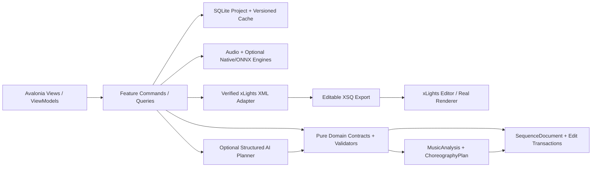
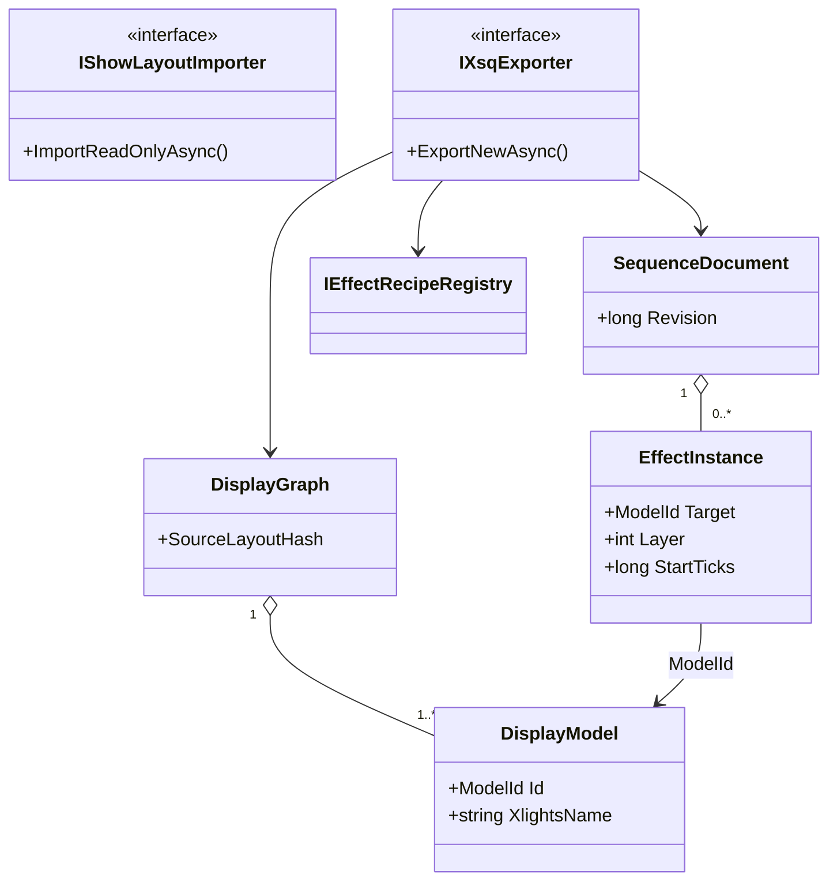
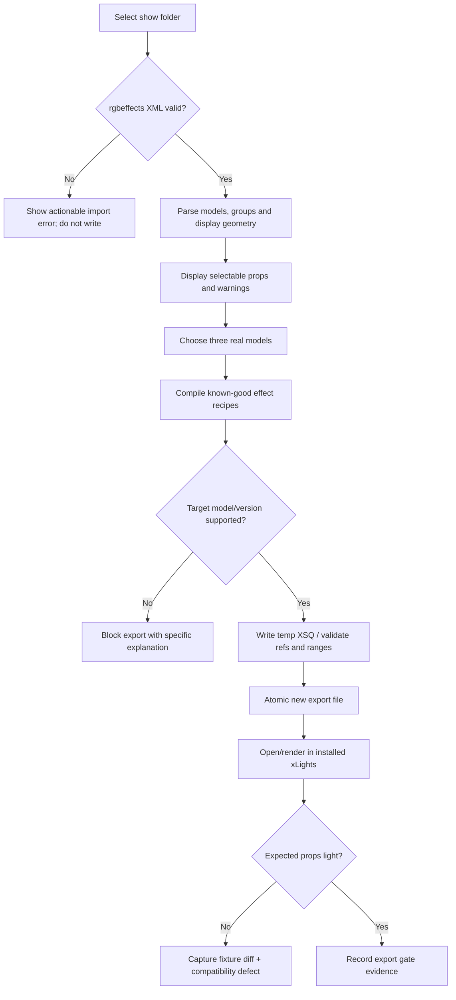

# PHASE 02 — First Working xLights Sequence

**Specification version:** 2.0 / 2026-10-10 | **Steps:** 009–015 | **Status:** Proposed, unimplemented until gate evidence exists

**Standalone specification.** This document contains the relevant product assumptions, contracts, class relationships, business flows, numbered implementation tasks, test designs, risk gates and an agent prompt. It does **not** mean Phase 02 can run without earlier implemented code; it means an architect/agent can plan and implement the phase without consulting a separate high-level brief. Code below expresses **proposed API signatures**, not verified source code. Reconcile them with the actual repository and xLights version before implementation.

## 1. User outcome, release boundary and phase gate

**User story:** As a sequencer, I can point the desktop application at a show directory, choose real props, generate three elementary effects and open a completely editable resulting sequence in xLights.

**Owned boundary:** Show-file discovery, read-only model/group import, initial effect plan, version-gated xLights serialization, safe export and the first real integration gate.

**Out of scope:** Do not implement the full effect catalog, arbitrary multi-layer editing, controller upload or fseq renderer emulation; do not write changed groups back to the show.

**Blocking phase gate:** Import a sample layout with Roofline, Arch 1 and Arch 2; click Generate 3 Effects; save into app exports folder; open resulting XSQ in target xLights version and visually verify timing, props, colors and duration.

**Depends on:** Phase 01: Foundation and Reference Baselines.

**Unblocks:** Phase 03: Visual Timeline and Manual Editing.

The gate is PASS only with automated tests, persisted-output inspection, and a real UI or xLights demonstration appropriate to the phase. If xLights or the required hardware/backend is unavailable, report BLOCKED or NOT VERIFIED—never silently substitute a mock.

## 2. Architectural assumptions (fully restated for standalone use)

- **Product:** locally installable Avalonia/.NET 10 desktop application; no Python, Docker, Git or mandatory LLM subscription for end users. CPU-first inference; native/ONNX only after a demonstrated and legally redistributable runtime/model fit.
- **Topology:** modular monolith with vertical feature slices. UI (Views/ViewModels), application orchestration, pure domain contracts, and platform/infrastructure adapters. Do not fabricate generic interfaces without a concrete boundary.
- **Timing:** internally represent position with an explicit canonical monotonic clock tied to source audio origin. Preserve sample index/rate for analysis provenance; UI may show milliseconds. All time scopes are half-open `[start,end)`. Convert to xLights frames only when explicitly snapping or exporting.
- **Ownership:** SQLite project metadata and committed user edits; immutable source media (linked/copied with consent); hash-addressed and versioned analysis/preview artifacts on disk. Every cache key includes algorithm/model/settings versions.
- **xLights:** `xlights_rgbeffects.xml` describes models/groups and other show configuration; `xlights_networks.xml` covers controller/output configuration; editable sequence is `.xsq` XML; rendered playback data is `.fseq`. Never overwrite source show files silently. Match layout models by verified name/identity mapping; do not invent xLights effect parameters.
- **Safe editing:** `SequenceDocument` is the editable state. `ChoreographyPlan` is an intent proposal, not a destructive replacement. Keep optimistic revision checks, effect locks, selection scope, immutable before/after patches, undo/redo, and explicit human acceptance.
- **AI trust:** optional local or BYOK cloud AI returns validated structured proposals only. Do not execute LLM-produced code, scripts or XML directly. Treat song lyrics, filenames, descriptions and external metadata as untrusted data. Explicit consent before sending media-derived data to remote services.
- **Verification:** unit tests + fixtures + integration tests + one observable UI/xLights demonstration per phase. An XML parse pass does not prove xLights renders an effect. A numeric musical score does not prove artistic quality. Do not claim tests ran when they did not.
- **Migration:** upstream xLightsAI (MIT repository, with separate dependency/model license checks) is a pinned reference for behavior, data and effect recipes. Python may run only in developer comparison tooling; there is no runtime Python requirement in releases.

### Core architecture at a glance



### Stable domain names and cross-phase ownership

| Aggregate / contract | First introduced | Sole authority / rule |
|---|---:|---|
| `ProjectManifest` and `ProjectId` | 01 | Project identity/version + root; SQLite and JSON atomically recoverable |
| `DisplayGraph`, `DisplayModel`, `ModelId` | 02 | Imported xLights model identities/group info; reference layout by hash |
| `SequenceDocument`, `EffectInstance` | 02 | Editable effects/locked state provenance; never serialize business behavior directly as XML |
| `EditScope`, `EditTransaction`, `DocumentRevision` | 03 | Exact time + model boundary and user-approved reversibility |
| `SongAsset`, `IAudioTransport` | 04 | Original song hash, timebase and synchronized playback |
| `BeatGrid` | 05 | Analyzed/corrected beats and alternative tempo hypotheses |
| `StemManifest`, `StemAsset` | 06 | Derived separated sources; known model version and sample origin |
| `MelodyTrack`, `NoteEvent` | 07 | Note/onset/contour truth with human corrections |
| `SongStructure`, `MotifLink` | 08 | Related phrase identities and inheritance decisions |
| `SpatialDisplayGraph`, `SpatialPath` | 09 | Artistic routes / normalized geometry separate from imported xLights identities |
| `VisualStory`, `ChoreographyPlan` | 10 | Musical/visual intent before concrete effect rendering |
| `EditProposal` | 11 | Untrusted/optional AI idea validated before `EditTransaction` |
| `LoopRun`, `Candidate`, `QualityReport` | 12 | Bounded attempts and reproducible candidate comparisons |
| `RenderArtifact` | 13 | Actual or clearly-marked approximate preview evidence |
| `WholeSongPlan` | 14 | Section continuity and approved phrase assembly |
| `ReleaseManifest` | 15 | Platform/model assets and delivery integrity |
| `ReleaseReadiness` | 16 | Explicit community compatibility/artistic evidence and release gate |

### Shared canonical C# identifiers

Define these once in `Studio.Contracts`. They are included here so the current phase spec can stand alone. **Do not redefine copies with different namespaces in code.**

```csharp
// Shared across phases; put these in Studio.Contracts (single declarations in the codebase).
namespace XlightsAI.Studio.Contracts;
public readonly record struct ProjectId(Guid Value);
public readonly record struct SongId(Guid Value);
public readonly record struct ModelId(string Value);
public readonly record struct DocumentRevision(long Value);
public readonly record struct TimelineTick(long Value); // 100 ns ticks from song origin
public readonly record struct TimeWindow(long StartTicks, long EndTicks); // [Start, End)
```

## 3. Phase-specific design and contracts

**Inputs:** A test show folder including `xlights_rgbeffects.xml`; optionally `xlights_networks.xml`; supported version-identified xLights-generated XSQ fixtures; three chosen model targets.

**Outputs:** Normalized `DisplayGraph`; initial `SequenceDocument`; three `EffectInstance`s; new XML `.xsq` file; verified xLights open/render evidence.

### Architectural design notes

Import `xlights_rgbeffects.xml` as **untrusted external XML** with limits on DTD/entity expansion, path traversal and large documents. xLights model names identify sequence targets; retain original qualified names and separate internal stable IDs/alias mappings for rename reconciliation. Groups may overlap; do not flatten user group membership and accidentally double-target. XSQ export must be **recipe-driven from real fixtures**, not freehand parameter guesses: inspect `src/generator/xsq_writer.py` in pinned upstream and a minimal XSQ created by the target xLights version. Generate required XML sections such as `head`, `ColorPalettes`, `EffectDB`, `DisplayElements` and `ElementEffects` in the shape proved by golden samples; never presume that those are the only required sections across versions. Write to a new filename and verify XML structure, effect refs/palette indices, timeline bounds, model identity and actual xLights render.

### Proposed C# signatures

These are explicit API intent and relationship signatures, not an assertion that the existing repository already implements them. Favor the phase-local interfaces shown, adapt names to repository conventions, and record any compatibility decision. Referenced records introduced by prior phases are intentionally not redefined.

```csharp
using XlightsAI.Studio.Contracts;
using XlightsAI.Studio.Projects;
namespace XlightsAI.Studio.Xlights;
public sealed record DisplayModel(ModelId Id, string XlightsName, string Kind,
    IReadOnlyList<string> GroupNames, IReadOnlyList<Point2> PreviewPoints);
public sealed record Point2(double X, double Y);
public sealed record DisplayGraph(string SourceLayoutHash, IReadOnlyList<DisplayModel> Models);
public sealed record EffectInstance(Guid Id, ModelId Target, int Layer, long StartTicks,
    long EndTicks, string RecipeId, string RecipeVersion, IReadOnlyDictionary<string,string> Parameters);
public sealed record SequenceDocument(Guid Id, long Revision, IReadOnlyList<EffectInstance> Effects);
public interface IShowLayoutImporter {
    Task<DisplayGraph> ImportReadOnlyAsync(string showDirectory, CancellationToken ct);
}
public interface IEffectRecipeRegistry {
    EffectInstance CreateVerified(string recipeId, ModelId target, long startTicks, long endTicks);
}
public interface IXsqExporter {
    Task<ExportResult> ExportNewAsync(DisplayGraph layout, SequenceDocument sequence,
        string outputPath, string targetXlightsVersion, CancellationToken ct);
}
public sealed record ExportResult(string Path, string Sha256, IReadOnlyList<string> Warnings);
```

### Class relationship diagram



### Core process flowchart



## 4. Data contract, state ownership, migrations and caching

Store read-only show path, source layout hash, imported model/group snapshot and model alias map in project DB. Save `SequenceDocument` in versioned JSON/SQLite. Save recipe IDs plus confirmed target version and golden XSQ fixtures; exported `.xsq` is an artifact, not editing source-of-truth.

### Contract compatibility rules

- Keep IDs stable across UI views, SQLite and exported artifacts; never persist Avalonia object instances or XML DOM nodes as domain objects.
- Schema changes require versioned migrations, fixture updates and tests against the preceding project version.
- Analysis caches may be rebuilt if their source/model/version hash changes; accepted manual edits are never disposable cache.
- All edits to `SequenceDocument` pass a revision-aware command boundary. Preview artifacts and AI proposals cannot update the accepted document directly.
- Logs include operation/fixture correlation IDs and error codes. External model names and XML payloads are treated as untrusted input.

## 5. User interface / screen behavior

Use the existing Avalonia shell and apply this phase incrementally; do not present empty future functionality as implemented. These wireframe images are conceptual design references, not pixels that must be copied literally.

- **SCREEN 04 SHOW IMPORT** — [Visual wireframe](../assets/wireframes/SCREEN-04-SHOW-IMPORT.png). The screen must show loading/empty/error states, responsive resizing, keyboard navigation and an explicit version/status indicator when data is derived.
- **SCREEN 16 EXPORT** — [Visual wireframe](../assets/wireframes/SCREEN-16-EXPORT.png). The screen must show loading/empty/error states, responsive resizing, keyboard navigation and an explicit version/status indicator when data is derived.

UI behavior must always show *which song, time range, props, analysis source, version and approval state* the user is operating on when those concepts are available at this phase.

## 6. Numbered build slices — implement in order

Each numbered item is a complete vertical test cut: UI/command -> domain rule -> persistence or adapter -> observable result -> automated test. Avoid collecting multiple unverified tasks into one mega-commit.

### Step 009 — Implement show-folder picker with read-only initial discovery

**User-visible outcome:** Versioned, inspectable project output plus a reproducible test report.

**Implementation guidance:** Only read files under selected show directory. Detect realpath/symlink boundary; display required/missing optional files; persist last successful folder selection.

**Required acceptance:** Missing folder/file produces actionable error; no mutation.

**Failure/edge case to prove:** Invalid input, cancellation or stale persisted state must not corrupt the project.

**Suggested automated acceptance test:** `Step009_Acceptance_Passes`. Implement a deterministic fixture and assert persisted domain state plus public output, not only a mock invocation. Include a negative-path assertion.

**Evidence:** Write `implementation-evidence/PHASE-02/STEP-009.md` with commands actually executed, input hashes, actual results, screen/output artifact, unresolved issues, and an explicit PASS/BLOCKED status.

- [ ] Implementation / tests / observable demo / evidence all complete before next numbered step.

### Step 010 — Parse xlights_rgbeffects.xml into normalized stable model IDs/groups/geometry where present

**User-visible outcome:** Generated XML artifact and semantic diff/fixture, with xLights validation if this step changes rendering.

**Implementation guidance:** Parse actual `<models>` and `<modelGroups>` structures from fixtures, preserve names/casing and normalized geometry. Avoid guessing total pixel counts or channel mappings from screen coordinates.

**Required acceptance:** Golden fixture verifies model names, groups and positions.

**Failure/edge case to prove:** Invalid model/format/version must fail safely without rewriting source files.

**Suggested automated acceptance test:** `Step010_Acceptance_Passes`. Implement a deterministic fixture and assert persisted domain state plus public output, not only a mock invocation. Include a negative-path assertion.

**Evidence:** Write `implementation-evidence/PHASE-02/STEP-010.md` with commands actually executed, input hashes, actual results, screen/output artifact, unresolved issues, and an explicit PASS/BLOCKED status.

- [ ] Implementation / tests / observable demo / evidence all complete before next numbered step.

### Step 011 — Validate referenced models, channel/network data where relevant and missing layout elements

**User-visible outcome:** Generated XML artifact and semantic diff/fixture, with xLights validation if this step changes rendering.

**Implementation guidance:** Identify targetable models versus groups/submodels, reject unresolved refs; read networks for diagnostics only if needed. Support nested/overlapping groups without flattening.

**Required acceptance:** Fixture with broken references generates warnings rather than partial destructive output.

**Failure/edge case to prove:** Invalid model/format/version must fail safely without rewriting source files.

**Suggested automated acceptance test:** `Step011_Acceptance_Passes`. Implement a deterministic fixture and assert persisted domain state plus public output, not only a mock invocation. Include a negative-path assertion.

**Evidence:** Write `implementation-evidence/PHASE-02/STEP-011.md` with commands actually executed, input hashes, actual results, screen/output artifact, unresolved issues, and an explicit PASS/BLOCKED status.

- [ ] Implementation / tests / observable demo / evidence all complete before next numbered step.

### Step 012 — Create effect plan containing three hardcoded simple effects on selected real props

**User-visible outcome:** Generated XML artifact and semantic diff/fixture, with xLights validation if this step changes rendering.

**Implementation guidance:** Create sequence with known song duration and three deterministic effect times. Store recipe identity independent of final xLights XML settings representation.

**Required acceptance:** Plan is serialized and inspectable independently of XSQ.

**Failure/edge case to prove:** Malformed proposal, no-improvement and exhausted retry budget must not auto-commit.

**Suggested automated acceptance test:** `Step012_Acceptance_Passes`. Implement a deterministic fixture and assert persisted domain state plus public output, not only a mock invocation. Include a negative-path assertion.

**Evidence:** Write `implementation-evidence/PHASE-02/STEP-012.md` with commands actually executed, input hashes, actual results, screen/output artifact, unresolved issues, and an explicit PASS/BLOCKED status.

- [ ] Implementation / tests / observable demo / evidence all complete before next numbered step.

### Step 013 — Port minimal editable XSQ writer and required sequencing metadata

**User-visible outcome:** Generated XML artifact and semantic diff/fixture, with xLights validation if this step changes rendering.

**Implementation guidance:** Inspect xLights-authored XSQ and upstream xsq_writer; implement XML escaping, ID/reference tables, palettes, effect data and layer order. Write a structural roundtrip test with a reference reader.

**Required acceptance:** Generated file passes XML/structural tests and round-trip parser.

**Failure/edge case to prove:** Invalid model/format/version must fail safely without rewriting source files.

**Suggested automated acceptance test:** `Step013_Acceptance_Passes`. Implement a deterministic fixture and assert persisted domain state plus public output, not only a mock invocation. Include a negative-path assertion.

**Evidence:** Write `implementation-evidence/PHASE-02/STEP-013.md` with commands actually executed, input hashes, actual results, screen/output artifact, unresolved issues, and an explicit PASS/BLOCKED status.

- [ ] Implementation / tests / observable demo / evidence all complete before next numbered step.

### Step 014 — Open output in installed xLights; verify duration, timing, models and visible effects

**User-visible outcome:** Generated XML artifact and semantic diff/fixture, with xLights validation if this step changes rendering.

**Implementation guidance:** Run installed target xLights; inspect target props visually or via supported render adapter. Save screenshot/log and record installed xLights version; do not mark passed on XML parse alone.

**Required acceptance:** Human-attested integration test with screenshot/render notes.

**Failure/edge case to prove:** Missing or incompatible model, cancellation and offline mode must yield a recoverable state.

**Suggested automated acceptance test:** `Step014_Acceptance_Passes`. Implement a deterministic fixture and assert persisted domain state plus public output, not only a mock invocation. Include a negative-path assertion.

**Evidence:** Write `implementation-evidence/PHASE-02/STEP-014.md` with commands actually executed, input hashes, actual results, screen/output artifact, unresolved issues, and an explicit PASS/BLOCKED status.

- [ ] Implementation / tests / observable demo / evidence all complete before next numbered step.

### Step 015 — Implement atomic export, filename safety, backups and golden XSQ regression tests

**User-visible outcome:** Generated XML artifact and semantic diff/fixture, with xLights validation if this step changes rendering.

**Implementation guidance:** Atomic create-new export with collision suffix; preserve source media path semantics and backup if user expressly requests overwrite; compare golden semantic XML, not only whitespace.

**Required acceptance:** Never overwrite source without explicit approval; no regression in fixture output.

**Failure/edge case to prove:** Invalid model/format/version must fail safely without rewriting source files.

**Suggested automated acceptance test:** `Step015_Acceptance_Passes`. Implement a deterministic fixture and assert persisted domain state plus public output, not only a mock invocation. Include a negative-path assertion.

**Evidence:** Write `implementation-evidence/PHASE-02/STEP-015.md` with commands actually executed, input hashes, actual results, screen/output artifact, unresolved issues, and an explicit PASS/BLOCKED status.

- [ ] Implementation / tests / observable demo / evidence all complete before next numbered step.

## 7. Full-phase test plan and quality gate matrix

| # | Test scenario / invariant | Type | Required evidence |
|---:|---|---|---|
| 1 | Missing `xlights_rgbeffects.xml` is non-destructive | Unit + property | Actual result, input hash/fixture and pass/fail |
| 2 | XXE / oversized XML protections reject malicious or corrupt fixtures | Integration/golden | Actual result, input hash/fixture and pass/fail |
| 3 | Fixture models and group membership match expected names | Desktop/manual | Actual result, input hash/fixture and pass/fail |
| 4 | Duplicate and renamed model targets produce disambiguation warnings | Unit + property | Actual result, input hash/fixture and pass/fail |
| 5 | Three effects reference valid effect database and color palettes | Integration/golden | Actual result, input hash/fixture and pass/fail |
| 6 | Export never overwrites original show or existing XSQ without explicit user action | Desktop/manual | Actual result, input hash/fixture and pass/fail |
| 7 | Gold-standard test opens and visibly renders in installed xLights | Unit + property | Actual result, input hash/fixture and pass/fail |

### Phase gate demonstration — exact user workflow

Import a sample layout with Roofline, Arch 1 and Arch 2; click Generate 3 Effects; save into app exports folder; open resulting XSQ in target xLights version and visually verify timing, props, colors and duration.

### Failure handling and known technical risks

xLights XML version differences; effect settings/palette index mismatches; model renames; group overlap; path quoting; media references; invalid effect silently ignored. **No hardcoded XML claimed valid until verified in xLights.**

### Cross-cutting negative cases

- **Invalid/stale input:** reject and show the source of the problem; do not commit partial project state.
- **Cancellation:** propagate `CancellationToken`, dispose native/audio resources and leave resumable or safely rolled-back job state.
- **Compatibility:** detect actual versions/capabilities. No undocumented claim that all xLights versions or ML models behave identically.
- **Non-destructive writes:** if a user selects a show directory or existing XSQ, default to creating a new app-owned artifact rather than silently overwriting.
- **Regression:** rerun all previous phase gates affected by changed domain contracts or serializer versions.

## 8. Implementation checkpoints, decisions and handoff

### Recommended internal development order

1. Inspect the current committed code and pinned upstream reference; enumerate differences from signatures in this document.
2. Create fixtures and tests for the *first* numbered step; document exact external dependencies before writing the adapter.
3. Build one end-to-end slice, run the targeted tests, demonstrate the new behavior, then record evidence and proceed.
4. Update architecture decision records for genuine tradeoffs and migration decisions. Do not generalize everything into an interface.
5. At completion, run full automated regression and the phase demonstration; record blocker status truthfully.

### Explicit ADR questions to resolve during this phase

- **Primary design choice:** Is the proposed first working xlights sequence contract compatible with existing repository conventions and user-approved state?
- **Runtime/source truth:** Which behaviors can be verified locally, and which require a specific xLights build, external model, audio device, or human judgment?
- **Recovery and rollback:** What happens on crash, cancellation, stale file version or invalid external content?
- **Dependency and licenses:** Are required upstream algorithms, model files or native libraries version-pinned and redistributable?

### Required final gate report

- [ ] All named numbered steps show independently recorded evidence.
- [ ] Compiles; full unit/integration/golden regression run records actual commands.
- [ ] Desktop interaction was exercised or explicitly reported blocked.
- [ ] Required xLights/manual/inference test ran against a recorded version, if applicable.
- [ ] Missing assumptions, compatibility limits, technical debt and migration impacts recorded.
- [ ] Previous accepted sequences/project files are unchanged except approved migrations/edits.
- [ ] Gate result = PASS or BLOCKED. Next phase begins only after PASS or an explicit scoped architecture waiver.

## 9. Copy/paste coding-agent prompt (phase-local)

```text
You are acting as a senior .NET/Avalonia architect and implementation agent on the xLights AI Choreography Studio repository.
Implement the PHASE 02 (First Working xLights Sequence) only, in numbered-step order. This spec is the source of truth for the current phase and contains the necessary contract and verification context. Read the existing repository and baseline history first; **do not copy sample signatures over working established contracts blindly**. Resolve any older/newer contract discrepancy with a short architecture decision and compatibility migration.

For EACH numbered step: (1) inspect only relevant repo files and pinned upstream sources; (2) write acceptance/failure tests first or alongside code; (3) implement the smallest complete UI -> application -> domain -> persistence/export pathway; (4) compile/run targeted and existing tests; (5) execute the manual demo or report explicitly why it could not run; (6) update completion/evidence notes in `implementation-evidence/PHASE-02/STEP-XXX.md`; (7) commit the step if permitted. Do not cross into future features except narrow stable contracts. Hard gates cannot be traded for weighted scoring.

Before ending the phase, produce a Gate Report showing exact tests/commands, observed results, fixture IDs/hashes, screenshots/XSQ artifacts, unverified assumptions, known risks and whether the phase gate is PASS/BLOCKED. Do not claim test success without execution. Do not start the next phase when blocked.

CURRENT SCOPE: Phase 02: First Working xLights Sequence. Implement only numbered steps 009, 010, 011, 012, 013, 014, 015.
CORE DEMO REQUIRED: Import a sample layout with Roofline, Arch 1 and Arch 2; click Generate 3 Effects; save into app exports folder; open resulting XSQ in target xLights version and visually verify timing, props, colors and duration.
NEVER CLAIM THE GATE PASSED WITHOUT: Gold-standard test opens and visibly renders in installed xLights
```

## 10. Developer test evidence format

```yaml
step: 009
phase: 02
implementation_commit: TO_BE_FILLED
source_fixture_hashes: []
automated_tests:
  - name: TO_BE_FILLED
    command: TO_BE_FILLED
    result: NOT_RUN
manual_demo:
  instructions: TO_BE_FILLED
  observed: NOT_RUN
xlights_version: NOT_TESTED
artifact_paths: []
blocking_failures: []
architectural_decisions: []
status: NOT_STARTED
```

## 11. Authoritative documentation and verification sources

The URLs below are references for implementation research, not substitute proof that our code or any installed xLights version works. Always pin relevant upstream revisions and record observed behavior.

- xLights source / headless rendering design (verify installed builds separately): https://github.com/xLightsSequencer/xLights/blob/master/AGENTS.md
- xLights manual glossary (layout/sequence formats): https://manual.xlights.org/xlights/appendicies/glossary
- xLights timing tracks: https://manual.xlights.org/xlights/chapters/chapter-four-sequencer/timing-tracks
- xLights model groups: https://manual.xlights.org/xlights/chapters/chapter-four-tabs/model-groups
- xLights importing and re-rendering: https://manual.xlights.org/xlights/chapters/chapter-five-menus/import
- xLights official source repository: https://github.com/xLightsSequencer/xLights
- Real public XSQ example (for observation; verify against target version): https://github.com/FRC3620/xlights.sign1/blob/main/2026%20Doug.xsq
- xLightsAI upstream raw XSQ generator path: `src/generator/xsq_writer.py` in pinned upstream checkout.

### Nearby package material (optional supporting context; this phase is complete without it)

- [`MASTER-SYSTEM-ARCHITECTURE.md`](../MASTER-SYSTEM-ARCHITECTURE.md)
- [`XLIGHTS-SEQUENCE-ENGINEERING-GUIDE.md`](../XLIGHTS-SEQUENCE-ENGINEERING-GUIDE.md)
- [`UI-UX-SCREEN-BLUEPRINTS.md`](../UI-UX-SCREEN-BLUEPRINTS.md)
- [`TEST-DATA-AND-ACCEPTANCE.md`](../TEST-DATA-AND-ACCEPTANCE.md)
- [`prompts/PHASE-02-PROMPT.md`](../prompts/PHASE-02-PROMPT.md)

## 12. xLights XSQ engineering appendix — local implementation facts

**Source-system distinctions**: `xlights_rgbeffects.xml` = layout/model/group definitions and other show configuration; `xlights_networks.xml` = controller/output settings; `.xsq` = editable sequence XML; `.fseq` = rendered channel playback data. The XSQ writer does **not** replace native xLights renderer.

**Observed XML structure from a public xLights-authored example (not a universal schema):**

```xml
<xsequence BaseChannel="0" FixedPointTiming="1" ModelBlending="true">
  <head>
    <version>2026.03</version>
    <sequenceTiming>25 ms</sequenceTiming>
    <sequenceType>Animation</sequenceType>
    <sequenceDuration>25</sequenceDuration>
  </head>
  <ColorPalettes>
    <ColorPalette>C_BUTTON_Palette1=#FFFFFF</ColorPalette>
  </ColorPalettes>
  <EffectDB>
    <!-- Full effect setting strings must come from verified xLights-authored fixtures. -->
  </EffectDB>
  <DisplayElements>
    <Element type="model" name="Arch1" visible="1" />
  </DisplayElements>
  <ElementEffects>
    <Element type="model" name="Arch1">
      <EffectLayer>
        <!-- name/ref/palette/timing values below are shown only as a shape example. -->
        <Effect name="On" ref="0" palette="0" startTime="0" endTime="500" />
      </EffectLayer>
    </Element>
  </ElementEffects>
</xsequence>
```

**Important:** The illustrative fragment above is intentionally **not a complete, valid import promise**: omitted settings, data layers, IDs, metadata, frame quantization and effect database entries may be required. Generate the reference recipe by saving a short sequence **from the installed xLights version** and extract *that* verified shape. Public observed sample: https://github.com/FRC3620/xlights.sign1/blob/main/2026%20Doug.xsq .

**Serializer invariants:** no dangling palette or `EffectDB` refs; selected model names exactly match imported show names; all effect intervals positive and within sequence duration; sorted layer items; xLights frame-grid rounding is documented; proper XML escaping; required media references supplied; unrecognized effects fail validation. Use DOM/XDocument serializer rather than string concatenation.

**Golden fixture process:** (1) author minimal On effect on Arch1 in xLights (2) save/record xLights version (3) inspect XML and compare to upstream pinned `src/generator/xsq_writer.py` (4) implement `IEffectRecipeRegistry` and `IXsqExporter` (5) generate our XSQ (6) open in xLights and render (7) compare target model/time/color semantically (8) freeze reference fixture. Repeat for every newly supported effect family.

**Contract test skeleton:**

```csharp
[Fact]
public async Task ExportedOnEffect_IsRenderableByTargetXlights() {
    // Arrange: version-pinned fixture layout + real authored reference XSQ.
    // Act: compile a SequenceDocument to new .xsq with one On recipe.
    // Assert: parsed refs exist, target name resolves, effect range is valid.
    // Integration gate (manual or enabled CI): real xLights opens/renders.
}
```
