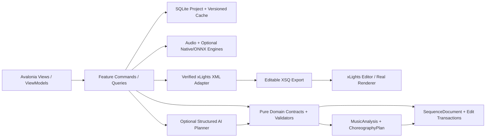
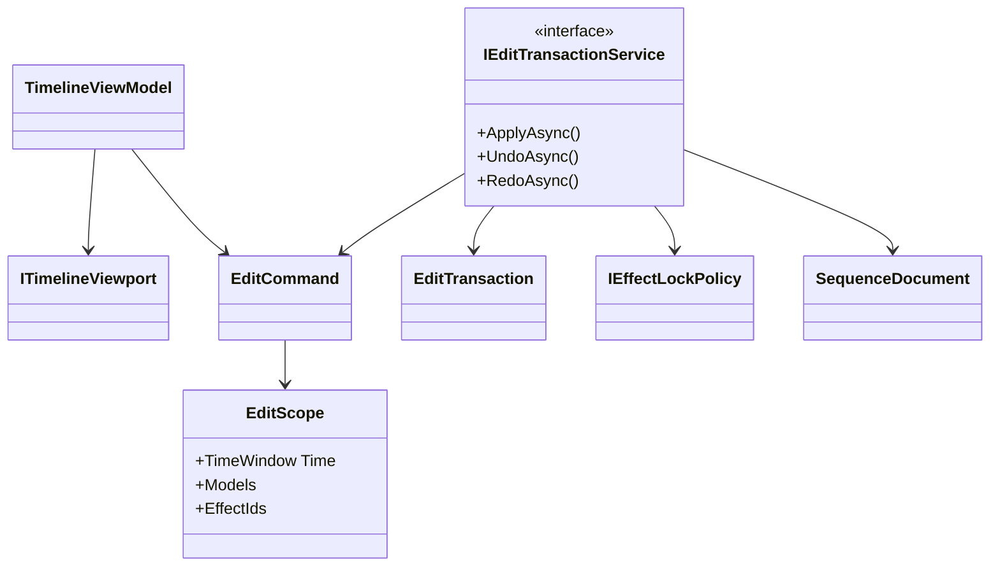
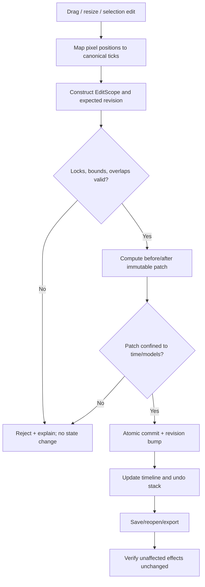

# PHASE 03 — Visual Timeline and Manual Editing

**Specification version:** 2.0 / 2026-10-10 | **Steps:** 016–023 | **Status:** Proposed, unimplemented until gate evidence exists

**Standalone specification.** This document contains the relevant product assumptions, contracts, class relationships, business flows, numbered implementation tasks, test designs, risk gates and an agent prompt. It does **not** mean Phase 03 can run without earlier implemented code; it means an architect/agent can plan and implement the phase without consulting a separate high-level brief. Code below expresses **proposed API signatures**, not verified source code. Reconcile them with the actual repository and xLights version before implementation.

## 1. User outcome, release boundary and phase gate

**User story:** As a sequencer, I can select a prop and time region, drag an effect, resize it, undo mistakes and lock approved parts so later generation cannot destroy my work.

**Owned boundary:** Timeline display and editing transactions over `SequenceDocument`; selected model/time scope, effect identity, locks, undo/redo and selective export preserving nonselected data.

**Out of scope:** No waveform playback, note extraction, AI prompt editor or real-time playback graphics; use dummy effects from Phase 02.

**Blocking phase gate:** Open a three-effect sample, drag Arch 1 effect, resize Roofline, undo/redo both operations, lock Arch 2, attempt forbidden modification, export and verify other effects stay bit-for-bit semantically identical.

**Depends on:** Phase 02: First Working xLights Sequence.

**Unblocks:** Phase 04: Audio Waveform and Synchronized Playback.

The gate is PASS only with automated tests, persisted-output inspection, and a real UI or xLights demonstration appropriate to the phase. If xLights or the required hardware/backend is unavailable, report BLOCKED or NOT VERIFIED—never silently substitute a mock.

## 2. Architectural assumptions (fully restated for standalone use)

- **Product:** locally installable Avalonia/.NET 10 desktop application; no Python, Docker, Git or mandatory LLM subscription for end users. CPU-first inference; native/ONNX only after a demonstrated and legally redistributable runtime/model fit.
- **Topology:** modular monolith with vertical feature slices. UI (Views/ViewModels), application orchestration, pure domain contracts, and platform/infrastructure adapters. Do not fabricate generic interfaces without a concrete boundary.
- **Timing:** internally represent position with an explicit canonical monotonic clock tied to source audio origin. Preserve sample index/rate for analysis provenance; UI may show milliseconds. All time scopes are half-open `[start,end)`. Convert to xLights frames only when explicitly snapping or exporting.
- **Ownership:** SQLite project metadata and committed user edits; immutable source media (linked/copied with consent); hash-addressed and versioned analysis/preview artifacts on disk. Every cache key includes algorithm/model/settings versions.
- **xLights:** `xlights_rgbeffects.xml` describes models/groups and other show configuration; `xlights_networks.xml` covers controller/output configuration; editable sequence is `.xsq` XML; rendered playback data is `.fseq`. Never overwrite source show files silently. Match layout models by verified name/identity mapping; do not invent xLights effect parameters.
- **Safe editing:** `SequenceDocument` is the editable state. `ChoreographyPlan` is an intent proposal, not a destructive replacement. Keep optimistic revision checks, effect locks, selection scope, immutable before/after patches, undo/redo, and explicit human acceptance.
- **AI trust:** optional local or BYOK cloud AI returns validated structured proposals only. Do not execute LLM-produced code, scripts or XML directly. Treat song lyrics, filenames, descriptions and external metadata as untrusted data. Explicit consent before sending media-derived data to remote services.
- **Verification:** unit tests + fixtures + integration tests + one observable UI/xLights demonstration per phase. An XML parse pass does not prove xLights renders an effect. A numeric musical score does not prove artistic quality. Do not claim tests ran when they did not.
- **Migration:** upstream xLightsAI (MIT repository, with separate dependency/model license checks) is a pinned reference for behavior, data and effect recipes. Python may run only in developer comparison tooling; there is no runtime Python requirement in releases.

### Core architecture at a glance



### Stable domain names and cross-phase ownership

| Aggregate / contract | First introduced | Sole authority / rule |
|---|---:|---|
| `ProjectManifest` and `ProjectId` | 01 | Project identity/version + root; SQLite and JSON atomically recoverable |
| `DisplayGraph`, `DisplayModel`, `ModelId` | 02 | Imported xLights model identities/group info; reference layout by hash |
| `SequenceDocument`, `EffectInstance` | 02 | Editable effects/locked state provenance; never serialize business behavior directly as XML |
| `EditScope`, `EditTransaction`, `DocumentRevision` | 03 | Exact time + model boundary and user-approved reversibility |
| `SongAsset`, `IAudioTransport` | 04 | Original song hash, timebase and synchronized playback |
| `BeatGrid` | 05 | Analyzed/corrected beats and alternative tempo hypotheses |
| `StemManifest`, `StemAsset` | 06 | Derived separated sources; known model version and sample origin |
| `MelodyTrack`, `NoteEvent` | 07 | Note/onset/contour truth with human corrections |
| `SongStructure`, `MotifLink` | 08 | Related phrase identities and inheritance decisions |
| `SpatialDisplayGraph`, `SpatialPath` | 09 | Artistic routes / normalized geometry separate from imported xLights identities |
| `VisualStory`, `ChoreographyPlan` | 10 | Musical/visual intent before concrete effect rendering |
| `EditProposal` | 11 | Untrusted/optional AI idea validated before `EditTransaction` |
| `LoopRun`, `Candidate`, `QualityReport` | 12 | Bounded attempts and reproducible candidate comparisons |
| `RenderArtifact` | 13 | Actual or clearly-marked approximate preview evidence |
| `WholeSongPlan` | 14 | Section continuity and approved phrase assembly |
| `ReleaseManifest` | 15 | Platform/model assets and delivery integrity |
| `ReleaseReadiness` | 16 | Explicit community compatibility/artistic evidence and release gate |

### Shared canonical C# identifiers

Define these once in `Studio.Contracts`. They are included here so the current phase spec can stand alone. **Do not redefine copies with different namespaces in code.**

```csharp
// Shared across phases; put these in Studio.Contracts (single declarations in the codebase).
namespace XlightsAI.Studio.Contracts;
public readonly record struct ProjectId(Guid Value);
public readonly record struct SongId(Guid Value);
public readonly record struct ModelId(string Value);
public readonly record struct DocumentRevision(long Value);
public readonly record struct TimelineTick(long Value); // 100 ns ticks from song origin
public readonly record struct TimeWindow(long StartTicks, long EndTicks); // [Start, End)
```

## 3. Phase-specific design and contracts

**Inputs:** Saved `SequenceDocument`, `DisplayGraph`, effect recipes and timeline view state from earlier phases.

**Outputs:** Timeline interactions producing validated `EditTransaction`s, persisted locks and revision history, exported updated XSQ.

### Architectural design notes

Use a **single immutable document mutation pipeline**. UI gestures calculate `EditScope` (half-open time interval, target model IDs, optional effect IDs) then create commands; commands are validated for document revision, locked state, overlaps and the approved scope. Apply atomically and persist reversible before/after patches. An effect crossing a selection boundary must be split, trimmed with preserved remainder, or explicitly rejected; never silently change the external portion. UI uses virtualization for many rows and effects; hit testing maps horizontal pixels through the common time transform. Maintain undo/redo command groups scoped to the project revision, not transient ViewModel memory.

### Proposed C# signatures

These are explicit API intent and relationship signatures, not an assertion that the existing repository already implements them. Favor the phase-local interfaces shown, adapt names to repository conventions, and record any compatibility decision. Referenced records introduced by prior phases are intentionally not redefined.

```csharp
using XlightsAI.Studio.Contracts;
using XlightsAI.Studio.Xlights;
namespace XlightsAI.Studio.Editing;
public sealed record EditScope(TimeWindow Time, IReadOnlySet<ModelId> Models,
    IReadOnlySet<Guid>? EffectIds, bool RespectLocks = true);
public abstract record EditCommand(DocumentRevision ExpectedRevision, EditScope Scope);
public sealed record MoveEffect(DocumentRevision ExpectedRevision, EditScope Scope,
    Guid EffectId, long NewStartTicks) : EditCommand(ExpectedRevision, Scope);
public sealed record EditTransaction(Guid Id, long BeforeRevision, long AfterRevision,
    string SerializedBeforePatch, string SerializedAfterPatch, DateTimeOffset AcceptedUtc);
public interface IEditTransactionService {
    Task<EditTransaction> ApplyAsync(EditCommand command, CancellationToken ct);
    Task<SequenceDocument> UndoAsync(Guid projectId, CancellationToken ct);
    Task<SequenceDocument> RedoAsync(Guid projectId, CancellationToken ct);
}
public interface IEffectLockPolicy { void AssertEditable(SequenceDocument document, EditScope scope); }
public interface ITimelineViewport { long TimeFromX(double pixel); double XFromTime(long ticks); }
```

### Class relationship diagram



### Core process flowchart



## 4. Data contract, state ownership, migrations and caching

Store `EditTransaction` audit records (sequence project, revision, scope, before/after patches, source actor), effect locks, viewport state. Undo/redo history survives restart within a retention limit. Stale revision rejects rather than silently merging overlapping edits.

### Contract compatibility rules

- Keep IDs stable across UI views, SQLite and exported artifacts; never persist Avalonia object instances or XML DOM nodes as domain objects.
- Schema changes require versioned migrations, fixture updates and tests against the preceding project version.
- Analysis caches may be rebuilt if their source/model/version hash changes; accepted manual edits are never disposable cache.
- All edits to `SequenceDocument` pass a revision-aware command boundary. Preview artifacts and AI proposals cannot update the accepted document directly.
- Logs include operation/fixture correlation IDs and error codes. External model names and XML payloads are treated as untrusted input.

## 5. User interface / screen behavior

Use the existing Avalonia shell and apply this phase incrementally; do not present empty future functionality as implemented. These wireframe images are conceptual design references, not pixels that must be copied literally.

- **SCREEN 13 TIMELINE** — [Visual wireframe](../assets/wireframes/SCREEN-13-TIMELINE.png). The screen must show loading/empty/error states, responsive resizing, keyboard navigation and an explicit version/status indicator when data is derived.

UI behavior must always show *which song, time range, props, analysis source, version and approval state* the user is operating on when those concepts are available at this phase.

## 6. Numbered build slices — implement in order

Each numbered item is a complete vertical test cut: UI/command -> domain rule -> persistence or adapter -> observable result -> automated test. Avoid collecting multiple unverified tasks into one mega-commit.

### Step 016 — Build time ruler, horizontal scroll and zoom

**User-visible outcome:** Avalonia screenshot or repeatable desktop interaction recording with saved-state verification.

**Implementation guidance:** Implement shared time/pixel transformation with zoom anchors and virtualized timeline bounds; unit test bidirectional conversions at arbitrary scroll offsets.

**Required acceptance:** Pixel-to-time conversion tests at zoom extremes.

**Failure/edge case to prove:** Silence, invalid timing boundaries and missing media must be handled explicitly.

**Suggested automated acceptance test:** `Step016_Acceptance_Passes`. Implement a deterministic fixture and assert persisted domain state plus public output, not only a mock invocation. Include a negative-path assertion.

**Evidence:** Write `implementation-evidence/PHASE-03/STEP-016.md` with commands actually executed, input hashes, actual results, screen/output artifact, unresolved issues, and an explicit PASS/BLOCKED status.

- [ ] Implementation / tests / observable demo / evidence all complete before next numbered step.

### Step 017 — Build prop rows, group expansion and stable mapping to model IDs

**User-visible outcome:** Avalonia screenshot or repeatable desktop interaction recording with saved-state verification.

**Implementation guidance:** Bind rows to stable imported model IDs and group hierarchy; retain user group collapse state; avoid mixing display row indices with identifiers.

**Required acceptance:** Visual rows match loaded layout including group nesting.

**Failure/edge case to prove:** Invalid model/format/version must fail safely without rewriting source files.

**Suggested automated acceptance test:** `Step017_Acceptance_Passes`. Implement a deterministic fixture and assert persisted domain state plus public output, not only a mock invocation. Include a negative-path assertion.

**Evidence:** Write `implementation-evidence/PHASE-03/STEP-017.md` with commands actually executed, input hashes, actual results, screen/output artifact, unresolved issues, and an explicit PASS/BLOCKED status.

- [ ] Implementation / tests / observable demo / evidence all complete before next numbered step.

### Step 018 — Render effect blocks and inspector selection

**User-visible outcome:** Generated XML artifact and semantic diff/fixture, with xLights validation if this step changes rendering.

**Implementation guidance:** Effects get immutable IDs, visual selection and inspector; hit test click and keyboard navigation; support overlapping layers explicitly.

**Required acceptance:** Selection maps exactly to effect ID and time span.

**Failure/edge case to prove:** Out-of-scope, locked or stale revision must be rejected without partial mutation.

**Suggested automated acceptance test:** `Step018_Acceptance_Passes`. Implement a deterministic fixture and assert persisted domain state plus public output, not only a mock invocation. Include a negative-path assertion.

**Evidence:** Write `implementation-evidence/PHASE-03/STEP-018.md` with commands actually executed, input hashes, actual results, screen/output artifact, unresolved issues, and an explicit PASS/BLOCKED status.

- [ ] Implementation / tests / observable demo / evidence all complete before next numbered step.

### Step 019 — Drag effect starts with optional snap

**User-visible outcome:** Generated XML artifact and semantic diff/fixture, with xLights validation if this step changes rendering.

**Implementation guidance:** Move operation creates expected-revision command; clamp negative times and prevent inadvertently changing effect duration; snapshot before/after.

**Required acceptance:** Start time persists after save/reopen and XSQ export.

**Failure/edge case to prove:** Out-of-scope, locked or stale revision must be rejected without partial mutation.

**Suggested automated acceptance test:** `Step019_Acceptance_Passes`. Implement a deterministic fixture and assert persisted domain state plus public output, not only a mock invocation. Include a negative-path assertion.

**Evidence:** Write `implementation-evidence/PHASE-03/STEP-019.md` with commands actually executed, input hashes, actual results, screen/output artifact, unresolved issues, and an explicit PASS/BLOCKED status.

- [ ] Implementation / tests / observable demo / evidence all complete before next numbered step.

### Step 020 — Resize duration and edit supported effect parameters

**User-visible outcome:** Generated XML artifact and semantic diff/fixture, with xLights validation if this step changes rendering.

**Implementation guidance:** Resize independently of playback/frame snap; reject zero/negative length and unsupported parameters; preserve unchanged effect fields.

**Required acceptance:** Edited parameters survive project reload and xLights import.

**Failure/edge case to prove:** Out-of-scope, locked or stale revision must be rejected without partial mutation.

**Suggested automated acceptance test:** `Step020_Acceptance_Passes`. Implement a deterministic fixture and assert persisted domain state plus public output, not only a mock invocation. Include a negative-path assertion.

**Evidence:** Write `implementation-evidence/PHASE-03/STEP-020.md` with commands actually executed, input hashes, actual results, screen/output artifact, unresolved issues, and an explicit PASS/BLOCKED status.

- [ ] Implementation / tests / observable demo / evidence all complete before next numbered step.

### Step 021 — Multi-row time-range selection with inclusive/exclusive boundary semantics

**User-visible outcome:** Avalonia screenshot or repeatable desktop interaction recording with saved-state verification.

**Implementation guidance:** Drag rectangle returns half-open time window and model set; selections crossing nonadjacent rows must be explicit; display exact scope.

**Required acceptance:** Selected model IDs and time range match UI; edge-case tests.

**Failure/edge case to prove:** Out-of-scope, locked or stale revision must be rejected without partial mutation.

**Suggested automated acceptance test:** `Step021_Acceptance_Passes`. Implement a deterministic fixture and assert persisted domain state plus public output, not only a mock invocation. Include a negative-path assertion.

**Evidence:** Write `implementation-evidence/PHASE-03/STEP-021.md` with commands actually executed, input hashes, actual results, screen/output artifact, unresolved issues, and an explicit PASS/BLOCKED status.

- [ ] Implementation / tests / observable demo / evidence all complete before next numbered step.

### Step 022 — Undo/redo transactions and lock semantics for approved effects

**User-visible outcome:** Generated XML artifact and semantic diff/fixture, with xLights validation if this step changes rendering.

**Implementation guidance:** Locks enforced below ViewModel; undo/redo persisted as transactions and respects project revision; test restart and stale writes.

**Required acceptance:** Undo restores exact snapshot; locked effects reject programmatic edits.

**Failure/edge case to prove:** Out-of-scope, locked or stale revision must be rejected without partial mutation.

**Suggested automated acceptance test:** `Step022_Acceptance_Passes`. Implement a deterministic fixture and assert persisted domain state plus public output, not only a mock invocation. Include a negative-path assertion.

**Evidence:** Write `implementation-evidence/PHASE-03/STEP-022.md` with commands actually executed, input hashes, actual results, screen/output artifact, unresolved issues, and an explicit PASS/BLOCKED status.

- [ ] Implementation / tests / observable demo / evidence all complete before next numbered step.

### Step 023 — Scope-aware export and regeneration contract

**User-visible outcome:** Generated XML artifact and semantic diff/fixture, with xLights validation if this step changes rendering.

**Implementation guidance:** Export scoped edits without regenerating other effect recipes; hash unaffected effects and inspect XSQ after round-trip.

**Required acceptance:** Hash unaffected effects before/after scoped edit; no changes outside scope.

**Failure/edge case to prove:** Invalid model/format/version must fail safely without rewriting source files.

**Suggested automated acceptance test:** `Step023_Acceptance_Passes`. Implement a deterministic fixture and assert persisted domain state plus public output, not only a mock invocation. Include a negative-path assertion.

**Evidence:** Write `implementation-evidence/PHASE-03/STEP-023.md` with commands actually executed, input hashes, actual results, screen/output artifact, unresolved issues, and an explicit PASS/BLOCKED status.

- [ ] Implementation / tests / observable demo / evidence all complete before next numbered step.

## 7. Full-phase test plan and quality gate matrix

| # | Test scenario / invariant | Type | Required evidence |
|---:|---|---|---|
| 1 | Move an effect by exactly one xLights frame and round-trip | Unit + property | Actual result, input hash/fixture and pass/fail |
| 2 | Resize effect and preserve original outside protected scope | Integration/golden | Actual result, input hash/fixture and pass/fail |
| 3 | Locks forbid manual and automated edits consistently | Desktop/manual | Actual result, input hash/fixture and pass/fail |
| 4 | Undo then redo restores same document hashes | Unit + property | Actual result, input hash/fixture and pass/fail |
| 5 | Editing a stale revision fails without any write | Integration/golden | Actual result, input hash/fixture and pass/fail |
| 6 | Across restart, selected locks and committed changes persist | Desktop/manual | Actual result, input hash/fixture and pass/fail |
| 7 | Randomized property tests confirm unrelated effect hashes never change | Unit + property | Actual result, input hash/fixture and pass/fail |

### Phase gate demonstration — exact user workflow

Open a three-effect sample, drag Arch 1 effect, resize Roofline, undo/redo both operations, lock Arch 2, attempt forbidden modification, export and verify other effects stay bit-for-bit semantically identical.

### Failure handling and known technical risks

Off-by-one frame drift, large virtualized timelines, overlapping effects, resizing past zero, zero-length effects and scope leaks. Use source-of-truth IDs not selected row indices.

### Cross-cutting negative cases

- **Invalid/stale input:** reject and show the source of the problem; do not commit partial project state.
- **Cancellation:** propagate `CancellationToken`, dispose native/audio resources and leave resumable or safely rolled-back job state.
- **Compatibility:** detect actual versions/capabilities. No undocumented claim that all xLights versions or ML models behave identically.
- **Non-destructive writes:** if a user selects a show directory or existing XSQ, default to creating a new app-owned artifact rather than silently overwriting.
- **Regression:** rerun all previous phase gates affected by changed domain contracts or serializer versions.

## 8. Implementation checkpoints, decisions and handoff

### Recommended internal development order

1. Inspect the current committed code and pinned upstream reference; enumerate differences from signatures in this document.
2. Create fixtures and tests for the *first* numbered step; document exact external dependencies before writing the adapter.
3. Build one end-to-end slice, run the targeted tests, demonstrate the new behavior, then record evidence and proceed.
4. Update architecture decision records for genuine tradeoffs and migration decisions. Do not generalize everything into an interface.
5. At completion, run full automated regression and the phase demonstration; record blocker status truthfully.

### Explicit ADR questions to resolve during this phase

- **Primary design choice:** Is the proposed visual timeline and manual editing contract compatible with existing repository conventions and user-approved state?
- **Runtime/source truth:** Which behaviors can be verified locally, and which require a specific xLights build, external model, audio device, or human judgment?
- **Recovery and rollback:** What happens on crash, cancellation, stale file version or invalid external content?
- **Dependency and licenses:** Are required upstream algorithms, model files or native libraries version-pinned and redistributable?

### Required final gate report

- [ ] All named numbered steps show independently recorded evidence.
- [ ] Compiles; full unit/integration/golden regression run records actual commands.
- [ ] Desktop interaction was exercised or explicitly reported blocked.
- [ ] Required xLights/manual/inference test ran against a recorded version, if applicable.
- [ ] Missing assumptions, compatibility limits, technical debt and migration impacts recorded.
- [ ] Previous accepted sequences/project files are unchanged except approved migrations/edits.
- [ ] Gate result = PASS or BLOCKED. Next phase begins only after PASS or an explicit scoped architecture waiver.

## 9. Copy/paste coding-agent prompt (phase-local)

```text
You are acting as a senior .NET/Avalonia architect and implementation agent on the xLights AI Choreography Studio repository.
Implement the PHASE 03 (Visual Timeline and Manual Editing) only, in numbered-step order. This spec is the source of truth for the current phase and contains the necessary contract and verification context. Read the existing repository and baseline history first; **do not copy sample signatures over working established contracts blindly**. Resolve any older/newer contract discrepancy with a short architecture decision and compatibility migration.

For EACH numbered step: (1) inspect only relevant repo files and pinned upstream sources; (2) write acceptance/failure tests first or alongside code; (3) implement the smallest complete UI -> application -> domain -> persistence/export pathway; (4) compile/run targeted and existing tests; (5) execute the manual demo or report explicitly why it could not run; (6) update completion/evidence notes in `implementation-evidence/PHASE-03/STEP-XXX.md`; (7) commit the step if permitted. Do not cross into future features except narrow stable contracts. Hard gates cannot be traded for weighted scoring.

Before ending the phase, produce a Gate Report showing exact tests/commands, observed results, fixture IDs/hashes, screenshots/XSQ artifacts, unverified assumptions, known risks and whether the phase gate is PASS/BLOCKED. Do not claim test success without execution. Do not start the next phase when blocked.

CURRENT SCOPE: Phase 03: Visual Timeline and Manual Editing. Implement only numbered steps 016, 017, 018, 019, 020, 021, 022, 023.
CORE DEMO REQUIRED: Open a three-effect sample, drag Arch 1 effect, resize Roofline, undo/redo both operations, lock Arch 2, attempt forbidden modification, export and verify other effects stay bit-for-bit semantically identical.
NEVER CLAIM THE GATE PASSED WITHOUT: Randomized property tests confirm unrelated effect hashes never change
```

## 10. Developer test evidence format

```yaml
step: 016
phase: 03
implementation_commit: TO_BE_FILLED
source_fixture_hashes: []
automated_tests:
  - name: TO_BE_FILLED
    command: TO_BE_FILLED
    result: NOT_RUN
manual_demo:
  instructions: TO_BE_FILLED
  observed: NOT_RUN
xlights_version: NOT_TESTED
artifact_paths: []
blocking_failures: []
architectural_decisions: []
status: NOT_STARTED
```

## 11. Authoritative documentation and verification sources

The URLs below are references for implementation research, not substitute proof that our code or any installed xLights version works. Always pin relevant upstream revisions and record observed behavior.

- xLights source / headless rendering design (verify installed builds separately): https://github.com/xLightsSequencer/xLights/blob/master/AGENTS.md
- xLights manual glossary (layout/sequence formats): https://manual.xlights.org/xlights/appendicies/glossary
- xLights timing tracks: https://manual.xlights.org/xlights/chapters/chapter-four-sequencer/timing-tracks
- xLights model groups: https://manual.xlights.org/xlights/chapters/chapter-four-tabs/model-groups
- xLights importing and re-rendering: https://manual.xlights.org/xlights/chapters/chapter-five-menus/import
- xLights official source repository: https://github.com/xLightsSequencer/xLights
- Real public XSQ example (for observation; verify against target version): https://github.com/FRC3620/xlights.sign1/blob/main/2026%20Doug.xsq
- xLightsAI upstream raw XSQ generator path: `src/generator/xsq_writer.py` in pinned upstream checkout.

### Nearby package material (optional supporting context; this phase is complete without it)

- [`MASTER-SYSTEM-ARCHITECTURE.md`](../MASTER-SYSTEM-ARCHITECTURE.md)
- [`XLIGHTS-SEQUENCE-ENGINEERING-GUIDE.md`](../XLIGHTS-SEQUENCE-ENGINEERING-GUIDE.md)
- [`UI-UX-SCREEN-BLUEPRINTS.md`](../UI-UX-SCREEN-BLUEPRINTS.md)
- [`TEST-DATA-AND-ACCEPTANCE.md`](../TEST-DATA-AND-ACCEPTANCE.md)
- [`prompts/PHASE-03-PROMPT.md`](../prompts/PHASE-03-PROMPT.md)

## 12. Scoped mutation reference implementation outline

```csharp
public async Task<EditTransaction> ApplyAsync(EditCommand command, CancellationToken ct) {
    // Load document and compare ExpectedRevision.
    // Reject stale expected revision, locked target models/effects, and invalid ranges.
    // Calculate the complete proposed before/after patch on an immutable copy.
    // Verify every changed effect is within the exact allowed model/time scope.
    // Commit patch + revision + audit atomically in SQLite.
    // Publish refreshed projection. Never mutate accepted document before validation.
    throw new NotImplementedException();
}
```

**Property to test**: `OutsideScope(before, scope) == OutsideScope(after, scope)` for all effect IDs/fields and portions of timeline outside permitted models and half-open ranges. A long effect spanning the scope is **not** freely replaceable: split into pre/selected/post parts, or reject if semantics cannot safely be split.
