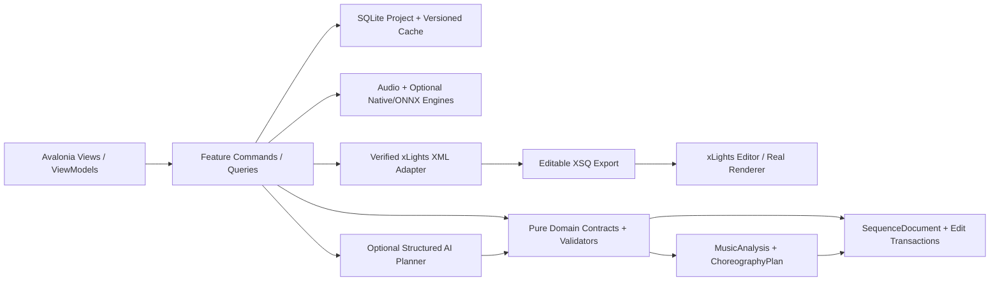
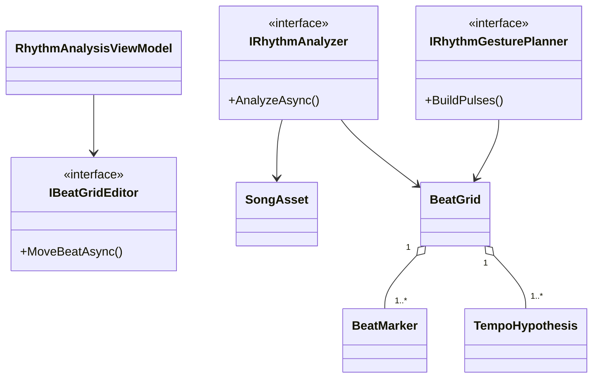
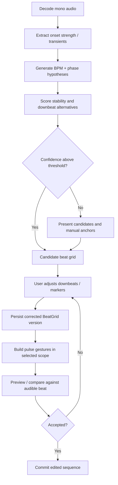

# PHASE 05 — Beat Measures and Rhythm Detection

**Specification version:** 2.0 / 2026-10-10 | **Steps:** 031–037 | **Status:** Proposed, unimplemented until gate evidence exists

**Standalone specification.** This document contains the relevant product assumptions, contracts, class relationships, business flows, numbered implementation tasks, test designs, risk gates and an agent prompt. It does **not** mean Phase 05 can run without earlier implemented code; it means an architect/agent can plan and implement the phase without consulting a separate high-level brief. Code below expresses **proposed API signatures**, not verified source code. Reconcile them with the actual repository and xLights version before implementation.

## 1. User outcome, release boundary and phase gate

**User story:** As a sequencer, I can inspect a detected beat grid, correct wrong beats/downbeats and generate light pops that synchronize with the song.

**Owned boundary:** Audio feature extraction, onset candidates, tempo hypotheses, beat/downbeat grid and rhythm-driven elementary gestures with user correction.

**Out of scope:** No perfect genre-agnostic beat detector; no melody transcription or automatic chorus classification; do not hard-code every note to a beat.

**Blocking phase gate:** Analyze a click/drum sample, see beat markers, correct an intentionally wrong downbeat, generate restrained pops for two props and play them synchronized while comparing before/after.

**Depends on:** Phase 04: Audio Waveform and Synchronized Playback.

**Unblocks:** Phase 06: Instrument Separation and Activity Detection.

The gate is PASS only with automated tests, persisted-output inspection, and a real UI or xLights demonstration appropriate to the phase. If xLights or the required hardware/backend is unavailable, report BLOCKED or NOT VERIFIED—never silently substitute a mock.

## 2. Architectural assumptions (fully restated for standalone use)

- **Product:** locally installable Avalonia/.NET 10 desktop application; no Python, Docker, Git or mandatory LLM subscription for end users. CPU-first inference; native/ONNX only after a demonstrated and legally redistributable runtime/model fit.
- **Topology:** modular monolith with vertical feature slices. UI (Views/ViewModels), application orchestration, pure domain contracts, and platform/infrastructure adapters. Do not fabricate generic interfaces without a concrete boundary.
- **Timing:** internally represent position with an explicit canonical monotonic clock tied to source audio origin. Preserve sample index/rate for analysis provenance; UI may show milliseconds. All time scopes are half-open `[start,end)`. Convert to xLights frames only when explicitly snapping or exporting.
- **Ownership:** SQLite project metadata and committed user edits; immutable source media (linked/copied with consent); hash-addressed and versioned analysis/preview artifacts on disk. Every cache key includes algorithm/model/settings versions.
- **xLights:** `xlights_rgbeffects.xml` describes models/groups and other show configuration; `xlights_networks.xml` covers controller/output configuration; editable sequence is `.xsq` XML; rendered playback data is `.fseq`. Never overwrite source show files silently. Match layout models by verified name/identity mapping; do not invent xLights effect parameters.
- **Safe editing:** `SequenceDocument` is the editable state. `ChoreographyPlan` is an intent proposal, not a destructive replacement. Keep optimistic revision checks, effect locks, selection scope, immutable before/after patches, undo/redo, and explicit human acceptance.
- **AI trust:** optional local or BYOK cloud AI returns validated structured proposals only. Do not execute LLM-produced code, scripts or XML directly. Treat song lyrics, filenames, descriptions and external metadata as untrusted data. Explicit consent before sending media-derived data to remote services.
- **Verification:** unit tests + fixtures + integration tests + one observable UI/xLights demonstration per phase. An XML parse pass does not prove xLights renders an effect. A numeric musical score does not prove artistic quality. Do not claim tests ran when they did not.
- **Migration:** upstream xLightsAI (MIT repository, with separate dependency/model license checks) is a pinned reference for behavior, data and effect recipes. Python may run only in developer comparison tooling; there is no runtime Python requirement in releases.

### Core architecture at a glance



### Stable domain names and cross-phase ownership

| Aggregate / contract | First introduced | Sole authority / rule |
|---|---:|---|
| `ProjectManifest` and `ProjectId` | 01 | Project identity/version + root; SQLite and JSON atomically recoverable |
| `DisplayGraph`, `DisplayModel`, `ModelId` | 02 | Imported xLights model identities/group info; reference layout by hash |
| `SequenceDocument`, `EffectInstance` | 02 | Editable effects/locked state provenance; never serialize business behavior directly as XML |
| `EditScope`, `EditTransaction`, `DocumentRevision` | 03 | Exact time + model boundary and user-approved reversibility |
| `SongAsset`, `IAudioTransport` | 04 | Original song hash, timebase and synchronized playback |
| `BeatGrid` | 05 | Analyzed/corrected beats and alternative tempo hypotheses |
| `StemManifest`, `StemAsset` | 06 | Derived separated sources; known model version and sample origin |
| `MelodyTrack`, `NoteEvent` | 07 | Note/onset/contour truth with human corrections |
| `SongStructure`, `MotifLink` | 08 | Related phrase identities and inheritance decisions |
| `SpatialDisplayGraph`, `SpatialPath` | 09 | Artistic routes / normalized geometry separate from imported xLights identities |
| `VisualStory`, `ChoreographyPlan` | 10 | Musical/visual intent before concrete effect rendering |
| `EditProposal` | 11 | Untrusted/optional AI idea validated before `EditTransaction` |
| `LoopRun`, `Candidate`, `QualityReport` | 12 | Bounded attempts and reproducible candidate comparisons |
| `RenderArtifact` | 13 | Actual or clearly-marked approximate preview evidence |
| `WholeSongPlan` | 14 | Section continuity and approved phrase assembly |
| `ReleaseManifest` | 15 | Platform/model assets and delivery integrity |
| `ReleaseReadiness` | 16 | Explicit community compatibility/artistic evidence and release gate |

### Shared canonical C# identifiers

Define these once in `Studio.Contracts`. They are included here so the current phase spec can stand alone. **Do not redefine copies with different namespaces in code.**

```csharp
// Shared across phases; put these in Studio.Contracts (single declarations in the codebase).
namespace XlightsAI.Studio.Contracts;
public readonly record struct ProjectId(Guid Value);
public readonly record struct SongId(Guid Value);
public readonly record struct ModelId(string Value);
public readonly record struct DocumentRevision(long Value);
public readonly record struct TimelineTick(long Value); // 100 ns ticks from song origin
public readonly record struct TimeWindow(long StartTicks, long EndTicks); // [Start, End)
```

## 3. Phase-specific design and contracts

**Inputs:** Original decoded song, canonical audio timeline, manually editable time-grid; baseline click and drum fixtures.

**Outputs:** Versioned `RhythmAnalysis` with onsets/tempo candidates, `BeatGrid` and confidence, light gesture plans compiled to selected props.

### Architectural design notes

Separate **raw audio features** from **human-approved beat grid**. Implement feature extraction windows with known FFT size, hop, normalization and latency correction. Compare multiple tempo candidates (e.g. double/half-time) and allow low-confidence manual BPM or beat anchors. Quantize only in the user's chosen output policy; don't modify source event timestamps. Downbeat estimation must be optional with confidence and manual labeling. `BeatGrid` references its audio hash, analyzer versions and user correction version; changes invalidate downstream generated gestures but **not** manually accepted effects. Implement deterministic On/Off pulse recipes with a restrained default visual density.

### Proposed C# signatures

These are explicit API intent and relationship signatures, not an assertion that the existing repository already implements them. Favor the phase-local interfaces shown, adapt names to repository conventions, and record any compatibility decision. Referenced records introduced by prior phases are intentionally not redefined.

```csharp
using XlightsAI.Studio.Contracts;
using XlightsAI.Studio.Audio;
using XlightsAI.Studio.Xlights;
namespace XlightsAI.Studio.Rhythm;
public sealed record OnsetEvent(long TimeTicks, float Strength, string SourceAlgorithm);
public sealed record TempoHypothesis(double Bpm, double Confidence, string MeterGuess);
public sealed record BeatMarker(Guid Id, long TimeTicks, int BeatWithinBar, double Confidence, bool UserCorrected);
public sealed record BeatGrid(Guid VersionId, IReadOnlyList<BeatMarker> Beats,
    IReadOnlyList<TempoHypothesis> Candidates, string SourceHash);
public interface IRhythmAnalyzer {
    Task<BeatGrid> AnalyzeAsync(SongAsset song, RhythmSettings settings, CancellationToken ct);
}
public sealed record RhythmSettings(int AnalysisSampleRate, int FftSize, int HopSamples);
public interface IBeatGridEditor {
    Task<BeatGrid> MoveBeatAsync(Guid beatId, long newTimeTicks, long expectedVersion, CancellationToken ct);
    Task<BeatGrid> SetDownbeatAsync(Guid beatId, CancellationToken ct);
}
public interface IRhythmGesturePlanner {
    IReadOnlyList<EffectInstance> BuildPulses(BeatGrid grid, IReadOnlySet<ModelId> targets,
        string verifiedRecipeId, TimeWindow range);
}
```

### Class relationship diagram



### Core process flowchart



## 4. Data contract, state ownership, migrations and caching

Store raw onset feature cache separately from corrected beat grids. Record `sourceHash`, `RhythmSettings`, detected tempo alternatives, correction history, confidence and selected hypothesis. Link generated effects to beat source provenance, not just integer BPM.

### Contract compatibility rules

- Keep IDs stable across UI views, SQLite and exported artifacts; never persist Avalonia object instances or XML DOM nodes as domain objects.
- Schema changes require versioned migrations, fixture updates and tests against the preceding project version.
- Analysis caches may be rebuilt if their source/model/version hash changes; accepted manual edits are never disposable cache.
- All edits to `SequenceDocument` pass a revision-aware command boundary. Preview artifacts and AI proposals cannot update the accepted document directly.
- Logs include operation/fixture correlation IDs and error codes. External model names and XML payloads are treated as untrusted input.

## 5. User interface / screen behavior

Use the existing Avalonia shell and apply this phase incrementally; do not present empty future functionality as implemented. These wireframe images are conceptual design references, not pixels that must be copied literally.

- **SCREEN 09 BEAT GRID** — [Visual wireframe](../assets/wireframes/SCREEN-09-BEAT-GRID.png). The screen must show loading/empty/error states, responsive resizing, keyboard navigation and an explicit version/status indicator when data is derived.
- **SCREEN 07 ANALYSIS** — [Visual wireframe](../assets/wireframes/SCREEN-07-ANALYSIS.png). The screen must show loading/empty/error states, responsive resizing, keyboard navigation and an explicit version/status indicator when data is derived.

UI behavior must always show *which song, time range, props, analysis source, version and approval state* the user is operating on when those concepts are available at this phase.

## 6. Numbered build slices — implement in order

Each numbered item is a complete vertical test cut: UI/command -> domain rule -> persistence or adapter -> observable result -> automated test. Avoid collecting multiple unverified tasks into one mega-commit.

### Step 031 — Implement RMS/energy envelope with baseline comparison

**User-visible outcome:** Versioned, inspectable project output plus a reproducible test report.

**Implementation guidance:** Compute RMS and spectral features with unit normalization; compare to reference numbers for synthetic tones and silence; document FFT window/hop.

**Required acceptance:** Synthetic envelope matches expected energy peaks.

**Failure/edge case to prove:** Invalid input, cancellation or stale persisted state must not corrupt the project.

**Suggested automated acceptance test:** `Step031_Acceptance_Passes`. Implement a deterministic fixture and assert persisted domain state plus public output, not only a mock invocation. Include a negative-path assertion.

**Evidence:** Write `implementation-evidence/PHASE-05/STEP-031.md` with commands actually executed, input hashes, actual results, screen/output artifact, unresolved issues, and an explicit PASS/BLOCKED status.

- [ ] Implementation / tests / observable demo / evidence all complete before next numbered step.

### Step 032 — Implement onset/transient detection with configurable sensitivity

**User-visible outcome:** Versioned, inspectable project output plus a reproducible test report.

**Implementation guidance:** Build spectral flux/energy rise onsets and optional percussive stem hooks; correct algorithmic group delay; test false triggers from sustained chords.

**Required acceptance:** Onset precision/recall measured on annotated fixtures.

**Failure/edge case to prove:** Invalid input, cancellation or stale persisted state must not corrupt the project.

**Suggested automated acceptance test:** `Step032_Acceptance_Passes`. Implement a deterministic fixture and assert persisted domain state plus public output, not only a mock invocation. Include a negative-path assertion.

**Evidence:** Write `implementation-evidence/PHASE-05/STEP-032.md` with commands actually executed, input hashes, actual results, screen/output artifact, unresolved issues, and an explicit PASS/BLOCKED status.

- [ ] Implementation / tests / observable demo / evidence all complete before next numbered step.

### Step 033 — Implement BPM candidate detection including half/double-time alternatives

**User-visible outcome:** Versioned, inspectable project output plus a reproducible test report.

**Implementation guidance:** Rank multiple tempo candidates rather than one BPM; evaluate autocorrelation/periodicity and known half/double-time signals.

**Required acceptance:** 120 BPM and 60/120 ambiguity tests pass.

**Failure/edge case to prove:** Silence, invalid timing boundaries and missing media must be handled explicitly.

**Suggested automated acceptance test:** `Step033_Acceptance_Passes`. Implement a deterministic fixture and assert persisted domain state plus public output, not only a mock invocation. Include a negative-path assertion.

**Evidence:** Write `implementation-evidence/PHASE-05/STEP-033.md` with commands actually executed, input hashes, actual results, screen/output artifact, unresolved issues, and an explicit PASS/BLOCKED status.

- [ ] Implementation / tests / observable demo / evidence all complete before next numbered step.

### Step 034 — Generate beats, likely downbeats, bars and confidence intervals

**User-visible outcome:** Saved audio/analysis artifact with timestamp provenance plus a synchronized waveform/timeline demonstration.

**Implementation guidance:** Represent beats with absolute ticks and bar indices; meter must be user correctable; show confidence and avoid asserting uncertainty away.

**Required acceptance:** Tempo fixture aligns events within configured threshold.

**Failure/edge case to prove:** Silence, invalid timing boundaries and missing media must be handled explicitly.

**Suggested automated acceptance test:** `Step034_Acceptance_Passes`. Implement a deterministic fixture and assert persisted domain state plus public output, not only a mock invocation. Include a negative-path assertion.

**Evidence:** Write `implementation-evidence/PHASE-05/STEP-034.md` with commands actually executed, input hashes, actual results, screen/output artifact, unresolved issues, and an explicit PASS/BLOCKED status.

- [ ] Implementation / tests / observable demo / evidence all complete before next numbered step.

### Step 035 — Add beat-grid manual correction and dependency invalidation

**User-visible outcome:** Saved audio/analysis artifact with timestamp provenance plus a synchronized waveform/timeline demonstration.

**Implementation guidance:** Allow drag, anchored beat insertion/removal and downbeat reassignment; recalibrate dependent gestures through source-provenance references.

**Required acceptance:** Move beat, dependent effects refresh only when authorized.

**Failure/edge case to prove:** Silence, invalid timing boundaries and missing media must be handled explicitly.

**Suggested automated acceptance test:** `Step035_Acceptance_Passes`. Implement a deterministic fixture and assert persisted domain state plus public output, not only a mock invocation. Include a negative-path assertion.

**Evidence:** Write `implementation-evidence/PHASE-05/STEP-035.md` with commands actually executed, input hashes, actual results, screen/output artifact, unresolved issues, and an explicit PASS/BLOCKED status.

- [ ] Implementation / tests / observable demo / evidence all complete before next numbered step.

### Step 036 — Create beat-pop and alternating-chase recipe to real selected props

**User-visible outcome:** Saved audio/analysis artifact with timestamp provenance plus a synchronized waveform/timeline demonstration.

**Implementation guidance:** Translate selected beat strength into finite pulse duration and verified effect recipe, respecting visual density and output frame snapping.

**Required acceptance:** Rendered/exported effects follow detected beats.

**Failure/edge case to prove:** Silence, invalid timing boundaries and missing media must be handled explicitly.

**Suggested automated acceptance test:** `Step036_Acceptance_Passes`. Implement a deterministic fixture and assert persisted domain state plus public output, not only a mock invocation. Include a negative-path assertion.

**Evidence:** Write `implementation-evidence/PHASE-05/STEP-036.md` with commands actually executed, input hashes, actual results, screen/output artifact, unresolved issues, and an explicit PASS/BLOCKED status.

- [ ] Implementation / tests / observable demo / evidence all complete before next numbered step.

### Step 037 — Add confidence/quality gate and diagnostics

**User-visible outcome:** Versioned, inspectable project output plus a reproducible test report.

**Implementation guidance:** Add timing deviation histograms, first-beat offset and confidence; false positives must show warning, not trigger a blind whole-song export.

**Required acceptance:** Low-confidence results are flagged and correction is possible.

**Failure/edge case to prove:** Malformed proposal, no-improvement and exhausted retry budget must not auto-commit.

**Suggested automated acceptance test:** `Step037_Acceptance_Passes`. Implement a deterministic fixture and assert persisted domain state plus public output, not only a mock invocation. Include a negative-path assertion.

**Evidence:** Write `implementation-evidence/PHASE-05/STEP-037.md` with commands actually executed, input hashes, actual results, screen/output artifact, unresolved issues, and an explicit PASS/BLOCKED status.

- [ ] Implementation / tests / observable demo / evidence all complete before next numbered step.

## 7. Full-phase test plan and quality gate matrix

| # | Test scenario / invariant | Type | Required evidence |
|---:|---|---|---|
| 1 | 120 BPM click produces beats at expected intervals within configured tolerance | Unit + property | Actual result, input hash/fixture and pass/fail |
| 2 | 60/120 BPM ambiguity is represented as alternate hypotheses | Integration/golden | Actual result, input hash/fixture and pass/fail |
| 3 | Swing fixture preserves off-grid note positions | Desktop/manual | Actual result, input hash/fixture and pass/fail |
| 4 | Manually moving one beat preserves other corrected beats | Unit + property | Actual result, input hash/fixture and pass/fail |
| 5 | Downbeat correction updates bar numbering without moving raw onsets | Integration/golden | Actual result, input hash/fixture and pass/fail |
| 6 | Algorithm cache invalidation does not delete user-approved grid | Desktop/manual | Actual result, input hash/fixture and pass/fail |
| 7 | Generated effects align selected props and remain confined to time scope | Unit + property | Actual result, input hash/fixture and pass/fail |

### Phase gate demonstration — exact user workflow

Analyze a click/drum sample, see beat markers, correct an intentionally wrong downbeat, generate restrained pops for two props and play them synchronized while comparing before/after.

### Failure handling and known technical risks

Half/double tempo, syncopation, swing, human tempo drift, odd meter, intro without drums, decoder latency, source hit leakage and inaccurate downbeats.

### Cross-cutting negative cases

- **Invalid/stale input:** reject and show the source of the problem; do not commit partial project state.
- **Cancellation:** propagate `CancellationToken`, dispose native/audio resources and leave resumable or safely rolled-back job state.
- **Compatibility:** detect actual versions/capabilities. No undocumented claim that all xLights versions or ML models behave identically.
- **Non-destructive writes:** if a user selects a show directory or existing XSQ, default to creating a new app-owned artifact rather than silently overwriting.
- **Regression:** rerun all previous phase gates affected by changed domain contracts or serializer versions.

## 8. Implementation checkpoints, decisions and handoff

### Recommended internal development order

1. Inspect the current committed code and pinned upstream reference; enumerate differences from signatures in this document.
2. Create fixtures and tests for the *first* numbered step; document exact external dependencies before writing the adapter.
3. Build one end-to-end slice, run the targeted tests, demonstrate the new behavior, then record evidence and proceed.
4. Update architecture decision records for genuine tradeoffs and migration decisions. Do not generalize everything into an interface.
5. At completion, run full automated regression and the phase demonstration; record blocker status truthfully.

### Explicit ADR questions to resolve during this phase

- **Primary design choice:** Is the proposed beat measures and rhythm detection contract compatible with existing repository conventions and user-approved state?
- **Runtime/source truth:** Which behaviors can be verified locally, and which require a specific xLights build, external model, audio device, or human judgment?
- **Recovery and rollback:** What happens on crash, cancellation, stale file version or invalid external content?
- **Dependency and licenses:** Are required upstream algorithms, model files or native libraries version-pinned and redistributable?

### Required final gate report

- [ ] All named numbered steps show independently recorded evidence.
- [ ] Compiles; full unit/integration/golden regression run records actual commands.
- [ ] Desktop interaction was exercised or explicitly reported blocked.
- [ ] Required xLights/manual/inference test ran against a recorded version, if applicable.
- [ ] Missing assumptions, compatibility limits, technical debt and migration impacts recorded.
- [ ] Previous accepted sequences/project files are unchanged except approved migrations/edits.
- [ ] Gate result = PASS or BLOCKED. Next phase begins only after PASS or an explicit scoped architecture waiver.

## 9. Copy/paste coding-agent prompt (phase-local)

```text
You are acting as a senior .NET/Avalonia architect and implementation agent on the xLights AI Choreography Studio repository.
Implement the PHASE 05 (Beat Measures and Rhythm Detection) only, in numbered-step order. This spec is the source of truth for the current phase and contains the necessary contract and verification context. Read the existing repository and baseline history first; **do not copy sample signatures over working established contracts blindly**. Resolve any older/newer contract discrepancy with a short architecture decision and compatibility migration.

For EACH numbered step: (1) inspect only relevant repo files and pinned upstream sources; (2) write acceptance/failure tests first or alongside code; (3) implement the smallest complete UI -> application -> domain -> persistence/export pathway; (4) compile/run targeted and existing tests; (5) execute the manual demo or report explicitly why it could not run; (6) update completion/evidence notes in `implementation-evidence/PHASE-05/STEP-XXX.md`; (7) commit the step if permitted. Do not cross into future features except narrow stable contracts. Hard gates cannot be traded for weighted scoring.

Before ending the phase, produce a Gate Report showing exact tests/commands, observed results, fixture IDs/hashes, screenshots/XSQ artifacts, unverified assumptions, known risks and whether the phase gate is PASS/BLOCKED. Do not claim test success without execution. Do not start the next phase when blocked.

CURRENT SCOPE: Phase 05: Beat Measures and Rhythm Detection. Implement only numbered steps 031, 032, 033, 034, 035, 036, 037.
CORE DEMO REQUIRED: Analyze a click/drum sample, see beat markers, correct an intentionally wrong downbeat, generate restrained pops for two props and play them synchronized while comparing before/after.
NEVER CLAIM THE GATE PASSED WITHOUT: Generated effects align selected props and remain confined to time scope
```

## 10. Developer test evidence format

```yaml
step: 031
phase: 05
implementation_commit: TO_BE_FILLED
source_fixture_hashes: []
automated_tests:
  - name: TO_BE_FILLED
    command: TO_BE_FILLED
    result: NOT_RUN
manual_demo:
  instructions: TO_BE_FILLED
  observed: NOT_RUN
xlights_version: NOT_TESTED
artifact_paths: []
blocking_failures: []
architectural_decisions: []
status: NOT_STARTED
```

## 11. Authoritative documentation and verification sources

The URLs below are references for implementation research, not substitute proof that our code or any installed xLights version works. Always pin relevant upstream revisions and record observed behavior.

- xLights source / headless rendering design (verify installed builds separately): https://github.com/xLightsSequencer/xLights/blob/master/AGENTS.md
- xLights manual glossary (layout/sequence formats): https://manual.xlights.org/xlights/appendicies/glossary
- xLights timing tracks: https://manual.xlights.org/xlights/chapters/chapter-four-sequencer/timing-tracks
- xLights model groups: https://manual.xlights.org/xlights/chapters/chapter-four-tabs/model-groups
- xLights importing and re-rendering: https://manual.xlights.org/xlights/chapters/chapter-five-menus/import
- xLights official source repository: https://github.com/xLightsSequencer/xLights
- Real public XSQ example (for observation; verify against target version): https://github.com/FRC3620/xlights.sign1/blob/main/2026%20Doug.xsq
- xLightsAI upstream raw XSQ generator path: `src/generator/xsq_writer.py` in pinned upstream checkout.

### Nearby package material (optional supporting context; this phase is complete without it)

- [`MASTER-SYSTEM-ARCHITECTURE.md`](../MASTER-SYSTEM-ARCHITECTURE.md)
- [`XLIGHTS-SEQUENCE-ENGINEERING-GUIDE.md`](../XLIGHTS-SEQUENCE-ENGINEERING-GUIDE.md)
- [`UI-UX-SCREEN-BLUEPRINTS.md`](../UI-UX-SCREEN-BLUEPRINTS.md)
- [`TEST-DATA-AND-ACCEPTANCE.md`](../TEST-DATA-AND-ACCEPTANCE.md)
- [`prompts/PHASE-05-PROMPT.md`](../prompts/PHASE-05-PROMPT.md)

## 12. Rhythm reference math and time audit

A quarter note at BPM `b` has an ideal interval `60 / b` seconds; at `120 BPM`, the quarter-note interval is `0.5 s`. This arithmetic describes an *ideal constant tempo*, not proof that a mixed song has a constant downbeat. Preserve hypotheses at 60/120/240 BPM where evidence is ambiguous. Document `sampleIndex`, `sampleRate`, `windowLength`, `hopSize`, `algorithmLatencySamples`, and conversion to `TimeWindow` in every raw event. Unit tests should include non-zero audio intro offset and swung eighth notes.
