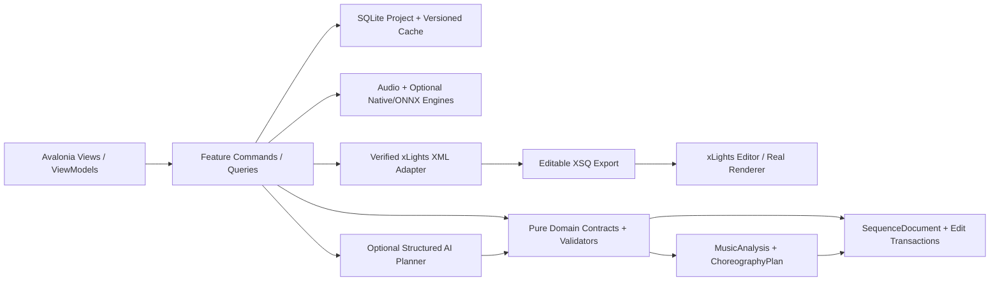
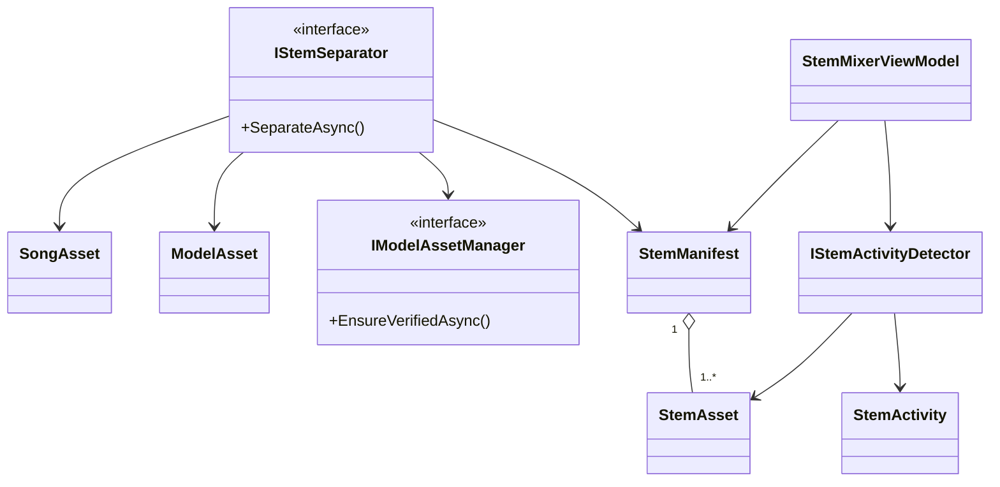
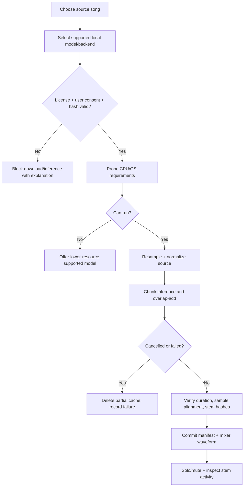

# PHASE 06 — Instrument Separation and Activity Detection

**Specification version:** 2.0 / 2026-10-10 | **Steps:** 038–044 | **Status:** Proposed, unimplemented until gate evidence exists

**Standalone specification.** This document contains the relevant product assumptions, contracts, class relationships, business flows, numbered implementation tasks, test designs, risk gates and an agent prompt. It does **not** mean Phase 06 can run without earlier implemented code; it means an architect/agent can plan and implement the phase without consulting a separate high-level brief. Code below expresses **proposed API signatures**, not verified source code. Reconcile them with the actual repository and xLights version before implementation.

## 1. User outcome, release boundary and phase gate

**User story:** As a sequencer, I can separate drums, bass and vocals locally, listen to each stem in sync and choose a stem as the source for my lighting movement.

**Owned boundary:** Verified local model assets, audio stem extraction, inference lifetime/resource controls, cache/provenance, instrument activity and stem mixer UI.

**Out of scope:** Do not claim six perfect sources, real-time low-latency separation, or guaranteed Demucs ONNX parity. Cloud inference and user uploads are not required.

**Blocking phase gate:** On CPU-only Windows, install model through app (or use offline pre-provisioned asset), separate a short sample, view aligned stems, solo vocals and drums, abort a long run and verify clean status.

**Depends on:** Phase 05: Beat Measures and Rhythm Detection.

**Unblocks:** Phase 07: Melody Pitch and Note Analysis.

The gate is PASS only with automated tests, persisted-output inspection, and a real UI or xLights demonstration appropriate to the phase. If xLights or the required hardware/backend is unavailable, report BLOCKED or NOT VERIFIED—never silently substitute a mock.

## 2. Architectural assumptions (fully restated for standalone use)

- **Product:** locally installable Avalonia/.NET 10 desktop application; no Python, Docker, Git or mandatory LLM subscription for end users. CPU-first inference; native/ONNX only after a demonstrated and legally redistributable runtime/model fit.
- **Topology:** modular monolith with vertical feature slices. UI (Views/ViewModels), application orchestration, pure domain contracts, and platform/infrastructure adapters. Do not fabricate generic interfaces without a concrete boundary.
- **Timing:** internally represent position with an explicit canonical monotonic clock tied to source audio origin. Preserve sample index/rate for analysis provenance; UI may show milliseconds. All time scopes are half-open `[start,end)`. Convert to xLights frames only when explicitly snapping or exporting.
- **Ownership:** SQLite project metadata and committed user edits; immutable source media (linked/copied with consent); hash-addressed and versioned analysis/preview artifacts on disk. Every cache key includes algorithm/model/settings versions.
- **xLights:** `xlights_rgbeffects.xml` describes models/groups and other show configuration; `xlights_networks.xml` covers controller/output configuration; editable sequence is `.xsq` XML; rendered playback data is `.fseq`. Never overwrite source show files silently. Match layout models by verified name/identity mapping; do not invent xLights effect parameters.
- **Safe editing:** `SequenceDocument` is the editable state. `ChoreographyPlan` is an intent proposal, not a destructive replacement. Keep optimistic revision checks, effect locks, selection scope, immutable before/after patches, undo/redo, and explicit human acceptance.
- **AI trust:** optional local or BYOK cloud AI returns validated structured proposals only. Do not execute LLM-produced code, scripts or XML directly. Treat song lyrics, filenames, descriptions and external metadata as untrusted data. Explicit consent before sending media-derived data to remote services.
- **Verification:** unit tests + fixtures + integration tests + one observable UI/xLights demonstration per phase. An XML parse pass does not prove xLights renders an effect. A numeric musical score does not prove artistic quality. Do not claim tests ran when they did not.
- **Migration:** upstream xLightsAI (MIT repository, with separate dependency/model license checks) is a pinned reference for behavior, data and effect recipes. Python may run only in developer comparison tooling; there is no runtime Python requirement in releases.

### Core architecture at a glance



### Stable domain names and cross-phase ownership

| Aggregate / contract | First introduced | Sole authority / rule |
|---|---:|---|
| `ProjectManifest` and `ProjectId` | 01 | Project identity/version + root; SQLite and JSON atomically recoverable |
| `DisplayGraph`, `DisplayModel`, `ModelId` | 02 | Imported xLights model identities/group info; reference layout by hash |
| `SequenceDocument`, `EffectInstance` | 02 | Editable effects/locked state provenance; never serialize business behavior directly as XML |
| `EditScope`, `EditTransaction`, `DocumentRevision` | 03 | Exact time + model boundary and user-approved reversibility |
| `SongAsset`, `IAudioTransport` | 04 | Original song hash, timebase and synchronized playback |
| `BeatGrid` | 05 | Analyzed/corrected beats and alternative tempo hypotheses |
| `StemManifest`, `StemAsset` | 06 | Derived separated sources; known model version and sample origin |
| `MelodyTrack`, `NoteEvent` | 07 | Note/onset/contour truth with human corrections |
| `SongStructure`, `MotifLink` | 08 | Related phrase identities and inheritance decisions |
| `SpatialDisplayGraph`, `SpatialPath` | 09 | Artistic routes / normalized geometry separate from imported xLights identities |
| `VisualStory`, `ChoreographyPlan` | 10 | Musical/visual intent before concrete effect rendering |
| `EditProposal` | 11 | Untrusted/optional AI idea validated before `EditTransaction` |
| `LoopRun`, `Candidate`, `QualityReport` | 12 | Bounded attempts and reproducible candidate comparisons |
| `RenderArtifact` | 13 | Actual or clearly-marked approximate preview evidence |
| `WholeSongPlan` | 14 | Section continuity and approved phrase assembly |
| `ReleaseManifest` | 15 | Platform/model assets and delivery integrity |
| `ReleaseReadiness` | 16 | Explicit community compatibility/artistic evidence and release gate |

### Shared canonical C# identifiers

Define these once in `Studio.Contracts`. They are included here so the current phase spec can stand alone. **Do not redefine copies with different namespaces in code.**

```csharp
// Shared across phases; put these in Studio.Contracts (single declarations in the codebase).
namespace XlightsAI.Studio.Contracts;
public readonly record struct ProjectId(Guid Value);
public readonly record struct SongId(Guid Value);
public readonly record struct ModelId(string Value);
public readonly record struct DocumentRevision(long Value);
public readonly record struct TimelineTick(long Value); // 100 ns ticks from song origin
public readonly record struct TimeWindow(long StartTicks, long EndTicks); // [Start, End)
```

## 3. Phase-specific design and contracts

**Inputs:** Licensed local music asset, appropriate model manifest and native/ONNX inference assets, CPU hardware capability, beat/timing metadata.

**Outputs:** A `StemManifest` with aligned derived audio assets and quality metadata; stem mixer/solo UI; activity regions by stem.

### Architectural design notes

Keep **model compatibility as an explicit feasibility gate**. Inventory selected model weights, input tensor shape, sample rate, chunk/hop/overlap, normalization and model redistribution license; compare at least two available inference backends. Build an `IStemSeparator` interface but do not assert that a given model runs under ONNX merely because ONNX Runtime has C# bindings. Process large songs in bounded chunks, overlap-add/crossfade appropriately, preserve exact `OriginalOriginTicks`, and document model latency. Use a verified download manifest (content hash, URL, model/version, license) with opt-in and offline fallback. Avoid forcing AVX/GPU-specific binaries on unsupported devices; cancel cleanly. Solo/mute UI is built on existing shared audio transport, not six independent drifting clocks.

### Proposed C# signatures

These are explicit API intent and relationship signatures, not an assertion that the existing repository already implements them. Favor the phase-local interfaces shown, adapt names to repository conventions, and record any compatibility decision. Referenced records introduced by prior phases are intentionally not redefined.

```csharp
using XlightsAI.Studio.Contracts;
using XlightsAI.Studio.Audio;
namespace XlightsAI.Studio.Stems;
public enum StemKind { Drums, Bass, Vocals, Guitar, Piano, Other }
public sealed record ModelAsset(string Id, string Version, Uri Source, string Sha256,
    string LicenseId, string InferenceBackend);
public sealed record StemAsset(Guid Id, StemKind Kind, string FilePath, int SampleRate,
    long SampleCount, long SourceOriginTicks, string Sha256);
public sealed record StemManifest(Guid RunId, string OriginalSongHash, string ModelId,
    IReadOnlyList<StemAsset> Stems, IReadOnlyList<string> Warnings);
public interface IModelAssetManager {
    Task<string> EnsureVerifiedAsync(ModelAsset asset, bool userConsent, CancellationToken ct);
}
public interface IStemSeparator {
    Task<StemManifest> SeparateAsync(SongAsset source, ModelAsset model,
        IProgress<SeparationProgress>? progress, CancellationToken ct);
}
public sealed record SeparationProgress(double Fraction, string Stage, long ProcessedSamples);
public interface IStemActivityDetector {
    Task<IReadOnlyList<StemActivity>> DetectAsync(StemAsset stem, CancellationToken ct);
}
public sealed record StemActivity(StemKind Kind, long StartTicks, long EndTicks, double Score);
```

### Class relationship diagram



### Core process flowchart



## 4. Data contract, state ownership, migrations and caching

Store inference run/model version, input song hash, backend/provider, options, hardware profile, output stem hashes, sample origins, complete/incomplete status and quality evaluation notes. Large stems go to cache files, not SQLite BLOBs.

### Contract compatibility rules

- Keep IDs stable across UI views, SQLite and exported artifacts; never persist Avalonia object instances or XML DOM nodes as domain objects.
- Schema changes require versioned migrations, fixture updates and tests against the preceding project version.
- Analysis caches may be rebuilt if their source/model/version hash changes; accepted manual edits are never disposable cache.
- All edits to `SequenceDocument` pass a revision-aware command boundary. Preview artifacts and AI proposals cannot update the accepted document directly.
- Logs include operation/fixture correlation IDs and error codes. External model names and XML payloads are treated as untrusted input.

## 5. User interface / screen behavior

Use the existing Avalonia shell and apply this phase incrementally; do not present empty future functionality as implemented. These wireframe images are conceptual design references, not pixels that must be copied literally.

- **SCREEN 08 STEMS** — [Visual wireframe](../assets/wireframes/SCREEN-08-STEMS.png). The screen must show loading/empty/error states, responsive resizing, keyboard navigation and an explicit version/status indicator when data is derived.
- **SCREEN 07 ANALYSIS** — [Visual wireframe](../assets/wireframes/SCREEN-07-ANALYSIS.png). The screen must show loading/empty/error states, responsive resizing, keyboard navigation and an explicit version/status indicator when data is derived.
- **SCREEN 17 SETTINGS** — [Visual wireframe](../assets/wireframes/SCREEN-17-SETTINGS.png). The screen must show loading/empty/error states, responsive resizing, keyboard navigation and an explicit version/status indicator when data is derived.

UI behavior must always show *which song, time range, props, analysis source, version and approval state* the user is operating on when those concepts are available at this phase.

## 6. Numbered build slices — implement in order

Each numbered item is a complete vertical test cut: UI/command -> domain rule -> persistence or adapter -> observable result -> automated test. Avoid collecting multiple unverified tasks into one mega-commit.

### Step 038 — Evaluate separation model licensing, .NET inference options, CPU baseline and memory profile

**User-visible outcome:** Versioned, inspectable project output plus a reproducible test report.

**Implementation guidance:** Create model feasibility ADR showing two candidates/backends, CPU benchmark, RAM requirements, model weight/license status and reproducible conversion prerequisites.

**Required acceptance:** Decision document includes at least two feasible alternatives or explicit blocker.

**Failure/edge case to prove:** Missing or incompatible model, cancellation and offline mode must yield a recoverable state.

**Suggested automated acceptance test:** `Step038_Acceptance_Passes`. Implement a deterministic fixture and assert persisted domain state plus public output, not only a mock invocation. Include a negative-path assertion.

**Evidence:** Write `implementation-evidence/PHASE-06/STEP-038.md` with commands actually executed, input hashes, actual results, screen/output artifact, unresolved issues, and an explicit PASS/BLOCKED status.

- [ ] Implementation / tests / observable demo / evidence all complete before next numbered step.

### Step 039 — Implement model asset manifest, verified download, consent and checksum validation

**User-visible outcome:** Versioned, inspectable project output plus a reproducible test report.

**Implementation guidance:** Use HTTPS, pinned hash and declared asset version/license. User consents to download; reject mismatch and recover from interrupted download atomically.

**Required acceptance:** Tampered models rejected and clean offline restart supported.

**Failure/edge case to prove:** Missing or incompatible model, cancellation and offline mode must yield a recoverable state.

**Suggested automated acceptance test:** `Step039_Acceptance_Passes`. Implement a deterministic fixture and assert persisted domain state plus public output, not only a mock invocation. Include a negative-path assertion.

**Evidence:** Write `implementation-evidence/PHASE-06/STEP-039.md` with commands actually executed, input hashes, actual results, screen/output artifact, unresolved issues, and an explicit PASS/BLOCKED status.

- [ ] Implementation / tests / observable demo / evidence all complete before next numbered step.

### Step 040 — Integrate selected ONNX/native inference via .NET with deterministic preprocessing/postprocessing

**User-visible outcome:** Versioned, inspectable project output plus a reproducible test report.

**Implementation guidance:** Implement preprocessing, backend selection and postprocessing as a single versioned processing recipe; regression-compare with source or ground-truth stems.

**Required acceptance:** Output stem count/shape and audio sync assertions pass.

**Failure/edge case to prove:** Missing or incompatible model, cancellation and offline mode must yield a recoverable state.

**Suggested automated acceptance test:** `Step040_Acceptance_Passes`. Implement a deterministic fixture and assert persisted domain state plus public output, not only a mock invocation. Include a negative-path assertion.

**Evidence:** Write `implementation-evidence/PHASE-06/STEP-040.md` with commands actually executed, input hashes, actual results, screen/output artifact, unresolved issues, and an explicit PASS/BLOCKED status.

- [ ] Implementation / tests / observable demo / evidence all complete before next numbered step.

### Step 041 — Add chunking/overlap, caching, progress, cancellation and bounded resource usage

**User-visible outcome:** Versioned, inspectable project output plus a reproducible test report.

**Implementation guidance:** Add overlapping chunks, merge normalization, cancellation and resumable complete-chunk cache; enforce upper bound on working buffers.

**Required acceptance:** Long fixture cancels cleanly and partial output never marked complete.

**Failure/edge case to prove:** Invalid input, cancellation or stale persisted state must not corrupt the project.

**Suggested automated acceptance test:** `Step041_Acceptance_Passes`. Implement a deterministic fixture and assert persisted domain state plus public output, not only a mock invocation. Include a negative-path assertion.

**Evidence:** Write `implementation-evidence/PHASE-06/STEP-041.md` with commands actually executed, input hashes, actual results, screen/output artifact, unresolved issues, and an explicit PASS/BLOCKED status.

- [x] Implementation / tests / observable demo / evidence all complete before next numbered step. (PASS — see `implementation-evidence/PHASE-06/STEP-041.md`; standalone manual demo skipped by explicit user choice, disclosed in evidence §5/§7.)

### Step 042 — Add waveform tracks, solo/mute and synchronized stem playback

**User-visible outcome:** Saved audio/analysis artifact with timestamp provenance plus a synchronized waveform/timeline demonstration.

**Implementation guidance:** Use single transport timebase to solo/mute stems; keep origin offset and resample alignment visible; cache separate waveform peaks.

**Required acceptance:** Audibly isolated stems stay aligned with source.

**Failure/edge case to prove:** Missing or incompatible model, cancellation and offline mode must yield a recoverable state.

**Suggested automated acceptance test:** `Step042_Acceptance_Passes`. Implement a deterministic fixture and assert persisted domain state plus public output, not only a mock invocation. Include a negative-path assertion.

**Evidence:** Write `implementation-evidence/PHASE-06/STEP-042.md` with commands actually executed, input hashes, actual results, screen/output artifact, unresolved issues, and an explicit PASS/BLOCKED status.

- [x] Implementation / tests / observable demo / evidence all complete before next numbered step. (PASS — see `implementation-evidence/PHASE-06/STEP-042.md`.)

### Step 043 — Detect instrument activity segments with scores

**User-visible outcome:** Versioned, inspectable project output plus a reproducible test report.

**Implementation guidance:** Calculate activity using stem RMS/onset features with hysteresis and confidence; avoid treating bleed as precise instrument classification.

**Required acceptance:** Known quiet/active regions appear correctly on timeline.

**Failure/edge case to prove:** Malformed proposal, no-improvement and exhausted retry budget must not auto-commit.

**Suggested automated acceptance test:** `Step043_Acceptance_Passes`. Implement a deterministic fixture and assert persisted domain state plus public output, not only a mock invocation. Include a negative-path assertion.

**Evidence:** Write `implementation-evidence/PHASE-06/STEP-043.md` with commands actually executed, input hashes, actual results, screen/output artifact, unresolved issues, and an explicit PASS/BLOCKED status.

- [x] Implementation / tests / observable demo / evidence all complete before next numbered step. (PASS — see `implementation-evidence/PHASE-06/STEP-043.md`.)

### Step 044 — Compare reference outputs, audio metrics and listening tests; establish supported hardware

**User-visible outcome:** Saved audio/analysis artifact with timestamp provenance plus a synchronized waveform/timeline demonstration.

**Implementation guidance:** Compute objective alignment + hearing ratings and benchmark time/memory across supported machines; reject parity claims unsupported by results.

**Required acceptance:** Measured separation quality/performance is documented and acceptance threshold met.

**Failure/edge case to prove:** Silence, invalid timing boundaries and missing media must be handled explicitly.

**Suggested automated acceptance test:** `Step044_Acceptance_Passes`. Implement a deterministic fixture and assert persisted domain state plus public output, not only a mock invocation. Include a negative-path assertion.

**Evidence:** Write `implementation-evidence/PHASE-06/STEP-044.md` with commands actually executed, input hashes, actual results, screen/output artifact, unresolved issues, and an explicit PASS/BLOCKED status.

- [x] Implementation / tests / observable demo / evidence all complete before next numbered step. (Step 044 itself PASS — see `implementation-evidence/PHASE-06/STEP-044.md`; **Phase 06's overall gate remains BLOCKED**, carried forward unresolved from Step 038's own disclosed feasibility verdict — see that evidence file's §9.)

## 7. Full-phase test plan and quality gate matrix

| # | Test scenario / invariant | Type | Required evidence |
|---:|---|---|---|
| 1 | Tampered asset hash fails and cannot be loaded | Unit + property | Actual result, input hash/fixture and pass/fail |
| 2 | Missing model with offline mode gives actionable message | Integration/golden | Actual result, input hash/fixture and pass/fail |
| 3 | Stem lengths and source offsets match within measured tolerance | Desktop/manual | Actual result, input hash/fixture and pass/fail |
| 4 | Cancellation does not mark partial files as completed | Unit + property | Actual result, input hash/fixture and pass/fail |
| 5 | Silent source yields finite output/no NaNs | Integration/golden | Actual result, input hash/fixture and pass/fail |
| 6 | Stereo/multi-minute input stays within memory budget | Desktop/manual | Actual result, input hash/fixture and pass/fail |
| 7 | At least two listening reference clips meet declared quality bar | Unit + property | Actual result, input hash/fixture and pass/fail |
| 8 | Solo stems remain synchronized with original transport | Integration/golden | Actual result, input hash/fixture and pass/fail |

### Phase gate demonstration — exact user workflow

On CPU-only Windows, install model through app (or use offline pre-provisioned asset), separate a short sample, view aligned stems, solo vocals and drums, abort a long run and verify clean status.

### Failure handling and known technical risks

Model licenses and redistribution, ONNX conversion correctness, 2-8 GB+ asset sizes depending on model, CPU runtime and memory, resampling shift, separated-stem artifacts and opaque model failures.

### Cross-cutting negative cases

- **Invalid/stale input:** reject and show the source of the problem; do not commit partial project state.
- **Cancellation:** propagate `CancellationToken`, dispose native/audio resources and leave resumable or safely rolled-back job state.
- **Compatibility:** detect actual versions/capabilities. No undocumented claim that all xLights versions or ML models behave identically.
- **Non-destructive writes:** if a user selects a show directory or existing XSQ, default to creating a new app-owned artifact rather than silently overwriting.
- **Regression:** rerun all previous phase gates affected by changed domain contracts or serializer versions.

## 8. Implementation checkpoints, decisions and handoff

### Recommended internal development order

1. Inspect the current committed code and pinned upstream reference; enumerate differences from signatures in this document.
2. Create fixtures and tests for the *first* numbered step; document exact external dependencies before writing the adapter.
3. Build one end-to-end slice, run the targeted tests, demonstrate the new behavior, then record evidence and proceed.
4. Update architecture decision records for genuine tradeoffs and migration decisions. Do not generalize everything into an interface.
5. At completion, run full automated regression and the phase demonstration; record blocker status truthfully.

### Explicit ADR questions to resolve during this phase

- **Primary design choice:** Is the proposed instrument separation and activity detection contract compatible with existing repository conventions and user-approved state?
- **Runtime/source truth:** Which behaviors can be verified locally, and which require a specific xLights build, external model, audio device, or human judgment?
- **Recovery and rollback:** What happens on crash, cancellation, stale file version or invalid external content?
- **Dependency and licenses:** Are required upstream algorithms, model files or native libraries version-pinned and redistributable?

### Required final gate report

- [ ] All named numbered steps show independently recorded evidence.
- [ ] Compiles; full unit/integration/golden regression run records actual commands.
- [ ] Desktop interaction was exercised or explicitly reported blocked.
- [ ] Required xLights/manual/inference test ran against a recorded version, if applicable.
- [ ] Missing assumptions, compatibility limits, technical debt and migration impacts recorded.
- [ ] Previous accepted sequences/project files are unchanged except approved migrations/edits.
- [ ] Gate result = PASS or BLOCKED. Next phase begins only after PASS or an explicit scoped architecture waiver.

## 9. Copy/paste coding-agent prompt (phase-local)

```text
You are acting as a senior .NET/Avalonia architect and implementation agent on the xLights AI Choreography Studio repository.
Implement the PHASE 06 (Instrument Separation and Activity Detection) only, in numbered-step order. This spec is the source of truth for the current phase and contains the necessary contract and verification context. Read the existing repository and baseline history first; **do not copy sample signatures over working established contracts blindly**. Resolve any older/newer contract discrepancy with a short architecture decision and compatibility migration.

For EACH numbered step: (1) inspect only relevant repo files and pinned upstream sources; (2) write acceptance/failure tests first or alongside code; (3) implement the smallest complete UI -> application -> domain -> persistence/export pathway; (4) compile/run targeted and existing tests; (5) execute the manual demo or report explicitly why it could not run; (6) update completion/evidence notes in `implementation-evidence/PHASE-06/STEP-XXX.md`; (7) commit the step if permitted. Do not cross into future features except narrow stable contracts. Hard gates cannot be traded for weighted scoring.

Before ending the phase, produce a Gate Report showing exact tests/commands, observed results, fixture IDs/hashes, screenshots/XSQ artifacts, unverified assumptions, known risks and whether the phase gate is PASS/BLOCKED. Do not claim test success without execution. Do not start the next phase when blocked.

CURRENT SCOPE: Phase 06: Instrument Separation and Activity Detection. Implement only numbered steps 038, 039, 040, 041, 042, 043, 044.
CORE DEMO REQUIRED: On CPU-only Windows, install model through app (or use offline pre-provisioned asset), separate a short sample, view aligned stems, solo vocals and drums, abort a long run and verify clean status.
NEVER CLAIM THE GATE PASSED WITHOUT: Solo stems remain synchronized with original transport
```

## 10. Developer test evidence format

```yaml
step: 038
phase: 06
implementation_commit: TO_BE_FILLED
source_fixture_hashes: []
automated_tests:
  - name: TO_BE_FILLED
    command: TO_BE_FILLED
    result: NOT_RUN
manual_demo:
  instructions: TO_BE_FILLED
  observed: NOT_RUN
xlights_version: NOT_TESTED
artifact_paths: []
blocking_failures: []
architectural_decisions: []
status: NOT_STARTED
```

## 11. Authoritative documentation and verification sources

The URLs below are references for implementation research, not substitute proof that our code or any installed xLights version works. Always pin relevant upstream revisions and record observed behavior.

- xLights source / headless rendering design (verify installed builds separately): https://github.com/xLightsSequencer/xLights/blob/master/AGENTS.md
- xLights manual glossary (layout/sequence formats): https://manual.xlights.org/xlights/appendicies/glossary
- xLights timing tracks: https://manual.xlights.org/xlights/chapters/chapter-four-sequencer/timing-tracks
- xLights model groups: https://manual.xlights.org/xlights/chapters/chapter-four-tabs/model-groups
- xLights importing and re-rendering: https://manual.xlights.org/xlights/chapters/chapter-five-menus/import
- xLights official source repository: https://github.com/xLightsSequencer/xLights
- Real public XSQ example (for observation; verify against target version): https://github.com/FRC3620/xlights.sign1/blob/main/2026%20Doug.xsq
- xLightsAI upstream raw XSQ generator path: `src/generator/xsq_writer.py` in pinned upstream checkout.

### Nearby package material (optional supporting context; this phase is complete without it)

- [`MASTER-SYSTEM-ARCHITECTURE.md`](../MASTER-SYSTEM-ARCHITECTURE.md)
- [`XLIGHTS-SEQUENCE-ENGINEERING-GUIDE.md`](../XLIGHTS-SEQUENCE-ENGINEERING-GUIDE.md)
- [`UI-UX-SCREEN-BLUEPRINTS.md`](../UI-UX-SCREEN-BLUEPRINTS.md)
- [`TEST-DATA-AND-ACCEPTANCE.md`](../TEST-DATA-AND-ACCEPTANCE.md)
- [`prompts/PHASE-06-PROMPT.md`](../prompts/PHASE-06-PROMPT.md)

## 12. Stem model feasibility decision record (mandatory before implementation)

| Candidate | Verified executable under .NET? | Input/Output tensor and resampling | CPU RAM / latency | Quality vs reference | License / weight distribution | Decision |
|---|---|---|---|---|---|---|
| Original reference Demucs stack (facebookresearch/demucs) | Reference only; shipped Python prohibited | PyTorch waveform model, stereo 44.1kHz, 4-stem output | ~90s/song-minute CPU, ~7GB RAM for 1hr audio (community-reported) | Reference baseline | MIT | Reference only, not shippable (Python) |
| Candidate A: StemSplit/demucs-onnx (htdemucs_ft ONNX export) | **Not yet proven** — ONNX file not yet downloaded/run against `Microsoft.ML.OnnxRuntime` in this repository | Documented upstream as stereo 44.1kHz chunked waveform in / 4-stem stereo waveform out; not independently re-inspected | Estimated ~7GB RAM, ~90s/song-minute CPU (upstream-reported, not re-measured here) | Upstream-reported to roughly match reference htdemucs_ft; not re-measured here | MIT (matches upstream Demucs); `Microsoft.ML.OnnxRuntime` (CPU) itself is MIT and installs cleanly via NuGet in this repo's `net10.0` TFM | **Unproven** — primary candidate for Step 039/040 |
| Candidate B: sherpa-onnx Spleeter 4-stem ONNX conversion | **Not yet proven** — ONNX file not yet downloaded/run in this repository | Documented upstream as 2/4/5-stem U-Net spectrogram-masking model; not independently re-inspected | Estimated ~1.5GB RAM, ~15s/song-minute CPU (upstream-reported, not re-measured here) | Upstream-reported as lower quality than Demucs-family but materially lighter/faster on CPU | Spleeter code MIT (Deezer) + sherpa-onnx conversion/runtime glue Apache-2.0 | **Unproven** — lightweight fallback candidate for Step 039/040 |
| Candidate C: UVR-MDX-NET-Voc_FT | **Not yet proven**; no reproducible CPU-only benchmark located | Not independently inspected in this repository | No documented CPU RAM figure; community reports describe CPU falling back silently and running "terribly slowly" without CUDA | Not assessed — rejected before benchmarking on performance grounds | MIT | **Rejected for this phase** — no reproducible CPU-first benchmark found |

**Step 038 decision (BLOCKED, explicit blocker — the required acceptance's "...or explicit blocker" branch):**
Zero candidates have an actual, reproduced end-to-end CPU inference run under a .NET host in this
repository yet — only the inference *backend* itself (`Microsoft.ML.OnnxRuntime`, MIT, CPU package) has
been confirmed to install and target this repository's `net10.0` TFM. Per Section 3's own rule ("do not
assert that a given model runs under ONNX merely because ONNX Runtime has C# bindings"), no candidate
model is marked Feasible at this step. Candidate A (Demucs-onnx `htdemucs_ft` export) is recommended as
the primary path for Step 039 (verified download) and Step 040 (integration); Candidate B (sherpa-onnx
Spleeter conversion) is the recommended lighter-weight fallback if Candidate A's CPU RAM/latency proves
unacceptable on target hardware. Candidate C (UVR-MDX-NET) is rejected for this phase: no reproducible
CPU-only benchmark was located during this step's research. This decision and the full candidate
inventory above are also encoded as a persisted, versioned `ModelFeasibilityReport` domain object (see
`src/XlightsAI.Studio.Stems/ModelFeasibilityReport.cs` and
`implementation-evidence/PHASE-06/STEP-038.md`), not only as this markdown table.

If no candidate meets quality/runtime requirements, **do not fabricate a working six-stem implementation**. Keep earlier MVP functionality available without separated stems and record Phase 06 as BLOCKED until an approved non-Python backend exists.
