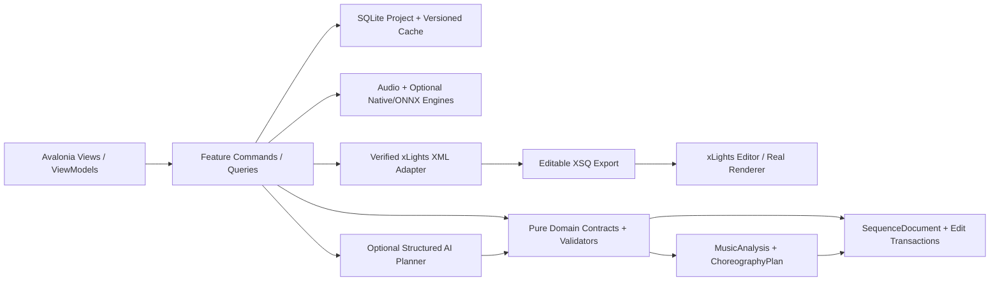
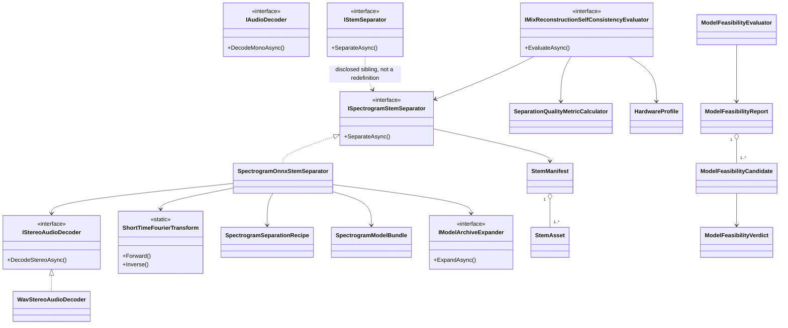
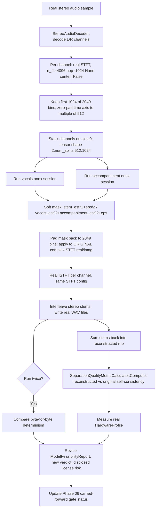

# PHASE 06A — Stereo STFT/Spectrogram Stem Separation: Real-Model Feasibility Closure

**Specification version:** 1.0 / 2026-10-13 | **Steps:** 044A–044F (inserted between PHASE-06's Step 044 and PHASE-07's Step 045) | **Status:** Proposed, unimplemented until gate evidence exists

**Standalone specification.** This document contains the relevant product assumptions, contracts, class relationships, business flows, numbered implementation tasks, test designs, risk gates and an agent prompt. It does **not** mean Phase 06A can run without earlier implemented code; it means an architect/agent can plan and implement this addendum without consulting a separate high-level brief. Code below expresses **proposed API signatures**, not verified source code. Reconcile them with the actual repository and xLights version before implementation.

**This is an addendum phase, not a renumbered phase.** Phase 06 (Steps 038–044) built a complete stem-separation *mechanism* — verified download/manifest, chunked ONNX inference, mixer UI, activity detection, and a quality/hardware benchmarking harness — and proved all of it, honestly and by its own disclosure, only against a 307-byte **synthetic** ONNX fixture (`stem = input × known_gain`). Phase 06's own Step 038 feasibility decision recorded every real candidate model as `Unproven` and the phase's overall gate as `BLOCKED` (`implementation-evidence/PHASE-06/STEP-038.md` §8-9, carried forward unchanged through `STEP-044.md` §9). Phase 07 (Steps 045–051) has since been built and does **not** depend on stem separation actually working against a real model — it consumes whatever stem/MIDI/audio is handed to it — so this gap has not blocked downstream work, but Phase 06's own user story ("I can separate drums, bass and vocals locally") has never been demonstrated against a real model. This addendum closes that gap narrowly: **stereo decode + STFT/ISTFT recipe + dual-model spectrogram-domain separator composition, wired to one real, verified, license-disclosed model, with an honest re-verification of feasibility and quality.** It does **not** redo Phase 06's download/manifest/activity-detection/mixer-UI work (those stay exactly as already built and are reused unmodified), and it does **not** touch Phase 07 at all — no later phase's step numbers change because of this document.

## 1. User outcome, release boundary and phase gate

**User story:** As a sequencer, I can trust that the drum/bass/vocal separation mechanism Phase 06 built actually produces real separated audio from a real, license-disclosed model — not only from a synthetic fixture — before I rely on it to drive lighting movement.

**Owned boundary:** Stereo audio decode (a disclosed, narrow extension beyond Phase 06's mono-only pipeline), a dependency-free STFT/ISTFT recipe matching one real published model's exact preprocessing contract, a phase-local dual-ONNX-session spectrogram-domain separator, the real `ModelAsset` declaration and archive-extraction mechanics for one specific, already-researched candidate (`sherpa-onnx-spleeter-2stems`), an honest proxy quality/hardware re-measurement against that real model's real output, and a revised, non-destructive `ModelFeasibilityReport` reflecting what is now actually proven.

**Out of scope:** Phase 06's own download-manifest/consent/chunk-cache/mixer-UI/activity-detection mechanics (unchanged, reused as-is). Phase 07's melody/pitch pipeline (untouched). Bring-your-own-model / arbitrary user-supplied-model-with-no-pre-declared-hash support (explicitly deferred by the user to a separate, later, out-of-scope follow-up — see §8 ADR questions). A final, settled legal opinion on Spleeter's or Demucs's pretrained-weight redistribution license (both remain genuinely open commercial-use questions — disclosed, not resolved, by this document). Re-evaluating the previously-rejected UVR-MDX-NET candidate (a reproducible CPU benchmark source now plausibly exists via the same sherpa-onnx release, but that re-evaluation is explicitly deferred to a future step/phase — see §8).

**Blocking phase gate:** On CPU-only Windows, using the real, downloaded, hash-verified `sherpa-onnx-spleeter-2stems` model (not Phase 06's synthetic fixture), decode a real multi-second stereo audio sample, separate it into vocals and accompaniment stem WAV files via the real dual-ONNX-session spectrogram pipeline, run the separation twice and confirm byte-for-byte determinism across both runs, review the real (proxy, disclosed-as-such) quality/hardware re-measurement, and review the revised `ModelFeasibilityReport`'s disclosed verdict and license-risk statement.

**Depends on:** Phase 06 Steps 038–044.

**Unblocks:** Phase 06's own carried-forward `BLOCKED` gate status — not Phase 07, which does not depend on this.

The gate is PASS only with automated tests, persisted-output inspection, and a real UI or xLights demonstration appropriate to the phase. If xLights or the required hardware/backend is unavailable, report BLOCKED or NOT VERIFIED—never silently substitute a mock.

## 2. Architectural assumptions (fully restated for standalone use)

- **Product:** locally installable Avalonia/.NET 10 desktop application; no Python, Docker, Git or mandatory LLM subscription for end users. CPU-first inference; native/ONNX only after a demonstrated and legally redistributable runtime/model fit.
- **Topology:** modular monolith with vertical feature slices. UI (Views/ViewModels), application orchestration, pure domain contracts, and platform/infrastructure adapters. Do not fabricate generic interfaces without a concrete boundary.
- **Timing:** internally represent position with an explicit canonical monotonic clock tied to source audio origin. Preserve sample index/rate for analysis provenance; UI may show milliseconds. All time scopes are half-open `[start,end)`. Convert to xLights frames only when explicitly snapping or exporting.
- **Ownership:** SQLite project metadata and committed user edits; immutable source media (linked/copied with consent); hash-addressed and versioned analysis/preview artifacts on disk. Every cache key includes algorithm/model/settings versions.
- **xLights:** `xlights_rgbeffects.xml` describes models/groups and other show configuration; `xlights_networks.xml` covers controller/output configuration; editable sequence is `.xsq` XML; rendered playback data is `.fseq`. Never overwrite source show files silently. Match layout models by verified name/identity mapping; do not invent xLights effect parameters.
- **Safe editing:** `SequenceDocument` is the editable state. `ChoreographyPlan` is an intent proposal, not a destructive replacement. Keep optimistic revision checks, effect locks, selection scope, immutable before/after patches, undo/redo, and explicit human acceptance.
- **AI trust:** optional local or BYOK cloud AI returns validated structured proposals only. Do not execute LLM-produced code, scripts or XML directly. Treat song lyrics, filenames, descriptions and external metadata as untrusted data. Explicit consent before sending media-derived data to remote services.
- **Verification:** unit tests + fixtures + integration tests + one observable UI/xLights demonstration per phase. An XML parse pass does not prove xLights renders an effect. A numeric musical score does not prove artistic quality. Do not claim tests ran when they did not.
- **Migration:** upstream xLightsAI (MIT repository, with separate dependency/model license checks) is a pinned reference for behavior, data and effect recipes. Python may run only in developer comparison tooling; there is no runtime Python requirement in releases.

### Core architecture at a glance



### Stable domain names and cross-phase ownership

| Aggregate / contract | First introduced | Sole authority / rule |
|---|---:|---|
| `ProjectManifest` and `ProjectId` | 01 | Project identity/version + root; SQLite and JSON atomically recoverable |
| `DisplayGraph`, `DisplayModel`, `ModelId` | 02 | Imported xLights model identities/group info; reference layout by hash |
| `SequenceDocument`, `EffectInstance` | 02 | Editable effects/locked state provenance; never serialize business behavior directly as XML |
| `EditScope`, `EditTransaction`, `DocumentRevision` | 03 | Exact time + model boundary and user-approved reversibility |
| `SongAsset`, `IAudioTransport` | 04 | Original song hash, timebase and synchronized playback |
| `BeatGrid` | 05 | Analyzed/corrected beats and alternative tempo hypotheses |
| `StemManifest`, `StemAsset` | 06 | Derived separated sources; known model version and sample origin |
| `MelodyTrack`, `NoteEvent` | 07 | Note/onset/contour truth with human corrections |
| `SongStructure`, `MotifLink` | 08 | Related phrase identities and inheritance decisions |
| `SpatialDisplayGraph`, `SpatialPath` | 09 | Artistic routes / normalized geometry separate from imported xLights identities |
| `VisualStory`, `ChoreographyPlan` | 10 | Musical/visual intent before concrete effect rendering |
| `EditProposal` | 11 | Untrusted/optional AI idea validated before `EditTransaction` |
| `LoopRun`, `Candidate`, `QualityReport` | 12 | Bounded attempts and reproducible candidate comparisons |
| `RenderArtifact` | 13 | Actual or clearly-marked approximate preview evidence |
| `WholeSongPlan` | 14 | Section continuity and approved phrase assembly |
| `ReleaseManifest` | 15 | Platform/model assets and delivery integrity |
| `ReleaseReadiness` | 16 | Explicit community compatibility/artistic evidence and release gate |

This addendum introduces **no new stable, cross-phase aggregate**. Every new type below (`SpectrogramSeparationRecipe`, `ISpectrogramStemSeparator`, `IStereoAudioDecoder`, etc.) is phase-local to this addendum, a disclosed sibling to an existing Phase 06 contract, never a redefinition of `StemManifest`/`StemAsset`'s own Phase-06 ownership recorded above.

### Shared canonical C# identifiers

Define these once in `Studio.Contracts`. They are included here so the current phase spec can stand alone. **Do not redefine copies with different namespaces in code.**

```csharp
// Shared across phases; put these in Studio.Contracts (single declarations in the codebase).
namespace XlightsAI.Studio.Contracts;
public readonly record struct ProjectId(Guid Value);
public readonly record struct SongId(Guid Value);
public readonly record struct ModelId(string Value);
public readonly record struct DocumentRevision(long Value);
public readonly record struct TimelineTick(long Value); // 100 ns ticks from song origin
public readonly record struct TimeWindow(long StartTicks, long EndTicks); // [Start, End)
```

## 3. Phase-specific design and contracts

**Inputs:** A real stereo-capable source `SongAsset` (44.1 kHz, 2-channel PCM/IEEE-float WAV); the real, pinned `sherpa-onnx-spleeter-2stems.tar.bz2` archive `ModelAsset` declaration; Phase 06's own unmodified `IModelAssetManager`, `IAudioDecoder`, `StemKind`, `StemManifest`/`StemAsset`, `SeparationProgress`, `SeparationQualityMetricCalculator`, `SeparationQualityThresholds`, `HardwareProfile`, and `ModelFeasibilityReport`/`ModelFeasibilityEvaluator` types.

**Outputs:** A real `IStereoAudioDecoder` sibling capability; a real, dependency-free STFT/ISTFT module matching one specific published model's exact algorithm; a real `SpectrogramSeparationRecipe`/`ISpectrogramStemSeparator` composition; a real, downloaded, extracted, hash-verified pair of ONNX sessions (`vocals.onnx`, `accompaniment.onnx`); a real end-to-end stereo separation run proven deterministic; a disclosed proxy quality/hardware re-measurement; a new, non-destructive `ModelFeasibilityReport` revision; and this addendum's own final gate report updating Phase 06's carried-forward `BLOCKED` status.

### Architectural design notes

The real candidate this addendum wires in — `sherpa-onnx-spleeter-2stems`, a genuine, actively-maintained `k2-fsa/sherpa-onnx` release asset (release tag `source-separation-models`, uploader `csukuangfj`, the project's real maintainer) — is **not** a raw-waveform model like the existing `OnnxStemSeparator`/`StemSeparationRecipe` assume (one tensor in, one tensor out). It is two **separate single-stem spectrogram-domain models** (`vocals.onnx`, `accompaniment.onnx`), each consuming a `(2, num_splits, 512, 1024)` tensor where axis 0 is the stereo channel pair, not a batch dimension, and each requiring the exact real STFT/mask/ISTFT algorithm recorded verbatim from the project's own published `scripts/spleeter/separate_onnx.py` reference implementation (§6, Step 044B/044C). Because this shape is fundamentally incompatible with `IStemSeparator.SeparateAsync(SongAsset, ModelAsset, ...)`'s single-model, single-tensor-pair contract — and because Phase 06's own mono-only decode pipeline (`WavAudioDecoder.DecodeMonoAsync`) cannot supply the stereo signal this model requires — every new contract below is introduced as a disclosed, phase-local **sibling** to its Phase-06 counterpart, exactly the same "new sibling interface for a shape-incompatible input, same canonical output contract" relationship Phase 07 Step 048 already established for `IMidiTranscriptionBackend` relative to `IMelodyAnalyzer` (`implementation-evidence/PHASE-07/STEP-048.md` §3). `IStemSeparator`/`StemSeparationRecipe`/`OnnxStemSeparator` are **not** modified, retired, or redefined by this addendum — they remain exactly as Phase 06 left them, continuing to serve any future raw-waveform model.

Two load-bearing, non-obvious facts about the real algorithm are preserved verbatim rather than "simplified": (1) only the first 1024 of each frame's 2049 real-STFT frequency bins are ever fed to or recovered from the model — bins 1024–2048 are a **permanent, disclosed quality ceiling** of this specific model, not a bug to fix; (2) the real published `checksum.txt` for this exact asset is confirmed stale/wrong against the actual served bytes, so this addendum pins the hash it directly, independently, byte-identically observed across two separate downloads (`e26401d9c1801f43c0229731d78d32c2e80085e3aceedeb25f29d2de5fa68ca2`), with that discrepancy disclosed as a named architecture decision at the exact step that declares the `ModelAsset` (Step 044D), never silently substituted as if it were the upstream-published value.

Both realistically obtainable candidates for this kind of model (Demucs/MUSDB18-HQ-trained weights and Spleeter's own weights) carry a genuinely open, unresolved pretrained-weight redistribution license question, independent of the MIT/Apache-2.0 status of the surrounding code/conversion tooling. This addendum discloses both honestly (§7, §8) rather than rounding either up to "clear" or down to "definitely prohibited," and requires an explicit, named decision point (Step 044F) before any `Feasible` verdict can be asserted.

### Proposed C# signatures

These are explicit API intent and relationship signatures, not an assertion that the existing repository already implements them. Favor the phase-local interfaces shown, adapt names to repository conventions, and record any compatibility decision. Referenced records introduced by prior phases (`SongAsset`, `IAudioDecoder`, `ModelAsset`, `IModelAssetManager`, `StemKind`, `StemAsset`, `StemManifest`, `SeparationProgress`, `IStemSeparator`, `StemSeparationRecipe`, `ModelFeasibilityCandidate`, `ModelFeasibilityReport`, `ModelFeasibilityEvaluator`, `SeparationQualityMetric`, `SeparationQualityThresholds`, `SeparationQualityMetricCalculator`, `HardwareProfile`) are intentionally not redefined.

```csharp
// --- Step 044A: stereo decode (sibling to IAudioDecoder, not a retrofit of it) ---
using XlightsAI.Studio.Contracts;
namespace XlightsAI.Studio.Audio;

/// <summary>One decoded stereo sample block: independently addressable left/right channels.</summary>
public readonly record struct StereoSampleBlock(ReadOnlyMemory<float> Left, ReadOnlyMemory<float> Right);

/// <summary>
/// Phase-local sibling to <see cref="IAudioDecoder"/>. Disclosed, deliberate: <see cref="IAudioDecoder"/>'s
/// only decode method is literally named <c>DecodeMonoAsync</c> and every existing caller (Phase 06's
/// <c>OnnxStemSeparator</c>, Phase 06 Step 043's <c>StemActivityDetector</c>, Phase 07's pitch tracker)
/// depends on its averaged-mono-downmix behavior; retrofitting it to also emit channel-preserving stereo
/// would either break that existing contract or require a second, differently-shaped method bolted onto
/// an interface whose name already promises mono. A new, narrowly-scoped sibling interface is introduced
/// instead — the same relationship Phase 07 Step 048 established for <c>IMidiTranscriptionBackend</c>
/// relative to <c>IMelodyAnalyzer</c>.
/// </summary>
public interface IStereoAudioDecoder
{
    /// <exception cref="StereoAudioDecodeChannelMismatchException"><paramref name="song"/> was not probed as a 2-channel file.</exception>
    IAsyncEnumerable<StereoSampleBlock> DecodeStereoAsync(SongAsset song, CancellationToken ct);
}

// --- Step 044B: dependency-free STFT/ISTFT matching the real published model's exact algorithm ---
namespace XlightsAI.Studio.Stems;

/// <summary>
/// The exact, real, verbatim-confirmed STFT configuration the sherpa-onnx Spleeter conversion requires
/// (from the project's own published <c>scripts/spleeter/separate_onnx.py</c>): 44100 Hz, n_fft=4096,
/// hop_length=1024, win_length=4096, Hann window, <c>center=False</c> (no edge padding/reflection — frame
/// <c>i</c> covers raw samples <c>[i*hop, i*hop+n_fft)</c>).
/// </summary>
public sealed record StftConfig(int FftSize, int HopSize, int WindowSize)
{
    public static StftConfig SpleeterReference { get; } = new(FftSize: 4096, HopSize: 1024, WindowSize: 4096);

    /// <summary>2049 for FftSize=4096 (n_fft/2 + 1 real-STFT frequency bins).</summary>
    public int FullFrequencyBinCount => FftSize / 2 + 1;
}

/// <summary>
/// Real (no third-party DSP NuGet package), dependency-free STFT/ISTFT — the same "own and test a
/// well-defined ~200-line algorithm" precedent Phase 07 Step 048 already established for its MIDI reader,
/// and <c>SeparationQualityMetricCalculator</c>'s own "no 3rd-party DSP dependency" precedent from Phase
/// 06 Step 044. FFT is computed via a recursive radix-2 Cooley-Tukey (4096 is a power of two).
/// </summary>
public static class ShortTimeFourierTransform
{
    /// <summary>
    /// Real-valued forward STFT, <c>center=False</c>. Returns the real and imaginary (Cartesian) component
    /// arrays of the complex STFT — not a magnitude/polar representation — each shaped
    /// <c>[frameCount, config.FullFrequencyBinCount]</c> — the full 2049 bins; truncation to the first
    /// 1024 bins the real model actually consumes is the caller's own disclosed, explicit step
    /// (<see cref="SpectrogramSeparationRecipe.RetainedFrequencyBins"/>), never silently applied here.
    /// </summary>
    public static (float[,] Real, float[,] Imag) Forward(ReadOnlySpan<float> signal, StftConfig config);

    /// <summary>
    /// Real-valued inverse STFT (overlap-add reconstruction), <c>center=False</c>, matching
    /// <see cref="Forward"/>'s exact frame convention. <paramref name="outputLength"/> is the original
    /// signal's own sample count, so trailing partial-frame padding introduced by <see cref="Forward"/>
    /// is trimmed away rather than left in the reconstructed signal.
    /// </summary>
    public static float[] Inverse((float[,] Real, float[,] Imag) stft, StftConfig config, int outputLength);
}

// --- Step 044C: dual-model spectrogram separator (sibling to IStemSeparator, not a redefinition) ---
namespace XlightsAI.Studio.Stems;

/// <summary>
/// Ties the real preprocessing (stereo STFT, bin truncation, time-axis zero-pad to a multiple of
/// <see cref="TimeSplitFrames"/>, per-channel-as-axis-0 tensor framing), the ONNX tensor contract (both
/// sessions share input name "x" / output name "y"), and the real soft-mask postprocessing together as
/// one inspectable, versioned unit — the same "single versioned processing recipe" principle
/// <see cref="StemSeparationRecipe"/> already established for the waveform-domain pipeline.
/// </summary>
/// <param name="RecipeVersion">Opaque version string for this exact preprocessing/tensor-contract/postprocessing combination.</param>
/// <param name="ExpectedSampleRate">44100 — the real model's own required sample rate.</param>
/// <param name="ExpectedChannels">2 — stereo is this recipe's own required input shape, unlike <see cref="StemSeparationRecipe.ExpectedChannels"/>'s mono-only constraint.</param>
/// <param name="Stft">The real STFT configuration (<see cref="StftConfig.SpleeterReference"/>).</param>
/// <param name="RetainedFrequencyBins">1024 of 2049 — the real model's own disclosed, permanent frequency-domain truncation.</param>
/// <param name="TimeSplitFrames">512 — the real model's own required time-axis split granularity.</param>
/// <param name="InputTensorName">"x" — identical for both the vocals and accompaniment sessions.</param>
/// <param name="OutputTensorName">"y" — identical for both sessions.</param>
/// <param name="SoftMaskEpsilon">1e-10 — the real published epsilon for the Wiener-like soft-mask formula's numerical stability against digital silence.</param>
public sealed record SpectrogramSeparationRecipe(
    string RecipeVersion,
    int ExpectedSampleRate,
    int ExpectedChannels,
    StftConfig Stft,
    int RetainedFrequencyBins,
    int TimeSplitFrames,
    string InputTensorName,
    string OutputTensorName,
    float SoftMaskEpsilon = 1e-10f);

/// <summary>
/// One verified, extracted ONNX file inside the declared archive — not an independently-pinned
/// <see cref="ModelAsset"/> (no individual SHA-256 exists for either extracted file; only the archive's
/// own hash is pinned), so its provenance is always traced back to the verified archive it came from.
/// </summary>
public sealed record ExtractedModelFile(string ArchiveEntryName, string LocalPath, long Length);

/// <summary>Real (no bespoke bzip2/tar implementation — see Step 044D's own disclosed dependency decision), deterministic archive expansion.</summary>
public interface IModelArchiveExpander
{
    Task<IReadOnlyList<ExtractedModelFile>> ExpandAsync(string verifiedArchivePath, string destinationDirectory, CancellationToken ct);
}

/// <summary>
/// Declares which extracted ONNX file inside the one verified, pinned archive <see cref="ModelAsset"/>
/// backs each stem's own single-stem session — never a second independently-pinned <see cref="ModelAsset"/>
/// per stem, since both files are produced by extracting one already hash-verified archive.
///
/// **Disclosed `StemKind` mapping decision:** the real model's two stems are "vocals" and
/// "accompaniment" (the whole non-vocal backing mix — drums, bass, and every other instrument,
/// undifferentiated). `vocals.onnx` maps cleanly to the existing <see cref="StemKind.Vocals"/>.
/// "accompaniment" has no clean existing match — it is not "one more instrument" the way
/// <see cref="StemKind.Other"/> already means elsewhere (miscellaneous leftover instruments in a full
/// drums/bass/vocals/guitar/piano decomposition); it is the entire remaining mix. This addendum maps
/// it to <see cref="StemKind.Other"/> anyway, as the lower-risk, non-breaking choice (no new
/// <see cref="StemKind"/> member added), but discloses this explicitly as a semantic overload: a
/// <see cref="StemAsset"/> produced by this recipe with <see cref="StemKind.Other"/> means "the whole
/// undifferentiated backing track," not "miscellaneous leftover instruments" the way it would for a
/// `StemSeparationRecipe`-produced (waveform-domain, multi-stem) asset. Any UI/mixer surface that
/// renders <see cref="StemKind"/> labels must disclose which recipe produced the asset (§5's own
/// requirement) specifically so this overload is never silently misread as "the same kind of Other."
/// </summary>
public sealed record SpectrogramModelBundle(
    ModelAsset Archive,
    IReadOnlyDictionary<StemKind, string> StemArchiveEntryNames);

/// <summary>
/// Phase-local sibling to <see cref="IStemSeparator"/>. Disclosed, deliberate: <see cref="IStemSeparator.SeparateAsync"/>
/// takes exactly one <see cref="ModelAsset"/> for one multi-stem-output model; the real
/// sherpa-onnx-spleeter-2stems candidate is two separate single-stem models sharing one archive, which is
/// not the shape <see cref="IStemSeparator"/>'s signature or <see cref="OnnxStemSeparator"/>'s single-
/// `InferenceSession` internals can express without a breaking change to an already-shipped, already-tested
/// Phase 06 contract. This sibling interface still returns the exact same canonical <see cref="StemManifest"/>/
/// <see cref="StemAsset"/> shape Phase 06 Section 3 already owns — only the *input* shape differs, never the
/// output contract downstream code (mixer UI, activity detection, quality evaluation) already depends on.
/// </summary>
public interface ISpectrogramStemSeparator
{
    /// <exception cref="StemSeparationIncompatibleSourceException"><paramref name="source"/> is not 44100 Hz stereo.</exception>
    /// <exception cref="StemSeparationOutputShapeException">Either session's output tensor shape is incompatible with the configured recipe.</exception>
    /// <exception cref="Stems.ModelAssetConsentRequiredException">The archive is not already verified locally and the caller has not separately granted download consent.</exception>
    /// <exception cref="OperationCanceledException"><paramref name="ct"/> was cancelled.</exception>
    Task<StemManifest> SeparateAsync(
        SongAsset source,
        SpectrogramModelBundle modelBundle,
        SpectrogramSeparationRecipe recipe,
        IProgress<SeparationProgress>? progress,
        CancellationToken ct);
}

/// <summary>Real <see cref="ISpectrogramStemSeparator"/>: real stereo decode, real STFT, real dual-session ONNX inference, real soft mask, real ISTFT, real stereo WAV write.</summary>
public sealed class SpectrogramOnnxStemSeparator : ISpectrogramStemSeparator
{
    public SpectrogramOnnxStemSeparator(
        IModelAssetManager modelAssetManager,
        IModelArchiveExpander archiveExpander,
        IStereoAudioDecoder stereoAudioDecoder,
        string outputDirectory);

    public Task<StemManifest> SeparateAsync(
        SongAsset source, SpectrogramModelBundle modelBundle, SpectrogramSeparationRecipe recipe,
        IProgress<SeparationProgress>? progress, CancellationToken ct);
}

// --- Step 044E: disclosed self-consistency proxy (reuses SeparationQualityMetricCalculator/HardwareProfile unmodified) ---
namespace XlightsAI.Studio.Stems;

/// <summary>
/// Step 044's own quality mechanism (<see cref="SeparationQualityEvaluator"/>/<see cref="QualityClip"/>)
/// assumes a genuine, known-correct reference stem file exists per stem kind — no such reference exists
/// for real musical separation (no professionally-mastered multitrack exists to score against; the same
/// honest constraint Step 044 itself already named). Retrofitting <see cref="QualityClip"/> to accept a
/// "reconstructed mix vs. original mix" self-consistency comparison would blur what
/// <see cref="QualityClip.ReferenceStemFilePaths"/> already documents as genuine ground truth. This is a
/// disclosed, new, deliberately thin orchestrator instead — it reuses <see cref="SeparationQualityMetricCalculator.Compute"/>
/// (the pure, generic calculator — any two equal-length float arrays) and the exact same
/// <see cref="HardwareProfile"/> measurement pattern <see cref="SeparationQualityEvaluator"/> already
/// established, completely unmodified, never asserting separation-quality parity.
/// </summary>
public sealed record MixReconstructionSelfConsistencyReport(
    Guid Id,
    long CreatedAtTicks,
    string ModelId,
    string RecipeVersion,
    SeparationQualityMetric ReconstructionMetric,
    HardwareProfile Hardware,
    string Decision);

public interface IMixReconstructionSelfConsistencyEvaluator
{
    /// <summary>
    /// Separates <paramref name="originalMix"/> via the real <paramref name="separator"/>, sums the two
    /// produced stems back into a reconstructed mix, and scores how closely that reconstructed mix
    /// matches the real original input — an energy/correlation self-consistency check, explicitly never a
    /// separation-quality claim.
    /// </summary>
    Task<MixReconstructionSelfConsistencyReport> EvaluateAsync(
        Guid reportId, long createdAtTicks, ISpectrogramStemSeparator separator,
        SpectrogramModelBundle modelBundle, SpectrogramSeparationRecipe recipe,
        SongAsset originalMix, SeparationQualityThresholds thresholds, CancellationToken ct);
}

// --- Step 044F: additive ModelFeasibilityCandidate extension + new, more honest intermediate verdict ---
namespace XlightsAI.Studio.Stems;

public enum ModelFeasibilityVerdict
{
    Feasible,
    NotFeasible,
    Unproven,

    /// <summary>
    /// New, Step 044F. Proven <see cref="ModelFeasibilityCandidate.VerifiedExecutableUnderDotNet"/> == true,
    /// but <see cref="ModelFeasibilityCandidate.LicenseRedistributable"/> is genuinely contested rather than
    /// cleanly true or false — the real, disclosed state of the sherpa-onnx Spleeter weights (§7/§8). Never
    /// counted toward the "two feasible alternatives" acceptance threshold Step 038's own evaluator enforces —
    /// deliberately a lesser, more honest claim than <see cref="Feasible"/>, not a quiet weakening of it.
    ///
    /// **Appended last, not inserted mid-sequence, on purpose.** The real, already-committed
    /// <c>src/XlightsAI.Studio.Stems/ModelFeasibilityVerdict.cs</c> is <c>{ Feasible, NotFeasible, Unproven }</c>
    /// (ordinals 0, 1, 2) and <c>JsonModelFeasibilityReportStore</c> serializes it via plain
    /// <c>JsonSerializer.Serialize</c>/<c>DeserializeAsync</c> with no <c>JsonStringEnumConverter</c> anywhere
    /// in this codebase for this type — i.e. as a raw integer. Step 038's own already-persisted report
    /// (`implementation-evidence/PHASE-06/STEP-038.md`) has real candidates on disk with the literal JSON
    /// value <c>2</c> for <c>Unproven</c>. Inserting a new member before <c>Unproven</c> would silently
    /// reinterpret that already-persisted <c>2</c> as whatever member now occupies ordinal 2 — corrupting
    /// Step 038's own original report, which §4/§7/§8's own "never mutate Step 038's original report" rule
    /// explicitly forbids. Appending strictly after <c>Unproven</c> is the only safe insertion point for
    /// this ordinal-serialized enum.
    /// </summary>
    FeasibleWithDisclosedLicenseRisk,
}
```

### Class relationship diagram



### Core process flowchart



## 4. Data contract, state ownership, migrations and caching

Store the archive `ModelAsset` entry (Id, Version, Source, pinned Sha256, LicenseId, InferenceBackend) alongside its two extracted-file provenance records (`ExtractedModelFile`), the `SpectrogramSeparationRecipe` version used for any produced stem, the real measured `MixReconstructionSelfConsistencyReport`, and the new `ModelFeasibilityReport` revision — **as a new report, never an in-place mutation of Step 038's original persisted report** (same "versioned revision, not destructive replacement" rule Section 2 already states for `ChoreographyPlan` vs `SequenceDocument`, applied here to a feasibility decision document). Large stem/archive/extracted-model files go to cache files, not SQLite BLOBs, matching Phase 06 Section 4 exactly.

### Contract compatibility rules

- Keep IDs stable across UI views, SQLite and exported artifacts; never persist Avalonia object instances or XML DOM nodes as domain objects.
- Schema changes require versioned migrations, fixture updates and tests against the preceding project version. `ModelFeasibilityCandidate`'s new, additive, disclosed `LicenseRiskDisclosure` field (default empty string) must not change any prior Step 038 candidate's serialized shape without a reviewed migration.
- Analysis caches may be rebuilt if their source/model/version hash changes; accepted manual edits are never disposable cache. A `SpectrogramSeparationRecipe` version bump invalidates any cached extracted/separated output exactly as `StemSeparationRecipe.RecipeVersion` already does for the waveform-domain pipeline.
- All edits to `SequenceDocument` pass a revision-aware command boundary. Preview artifacts and AI proposals cannot update the accepted document directly.
- Logs include operation/fixture correlation IDs and error codes. External model names, archive contents and XML payloads are treated as untrusted input until hash-verified.

## 5. User interface / screen behavior

Use the existing Avalonia shell and apply this addendum incrementally; do not present empty future functionality as implemented. These wireframe images are conceptual design references, not pixels that must be copied literally.

- **SCREEN 08 STEMS** — [Visual wireframe](../assets/wireframes/SCREEN-08-STEMS.png). Once a real model is wired in, the existing stem mixer (Phase 06 Step 042, unmodified) must disclose which recipe/model (waveform-domain `StemSeparationRecipe` vs. spectrogram-domain `SpectrogramSeparationRecipe`) produced the currently-viewed stems, consistent with Phase 06's own "explicit version/status indicator when data is derived" rule.
- **SCREEN 17 SETTINGS** — [Visual wireframe](../assets/wireframes/SCREEN-17-SETTINGS.png). Model selection/consent UI (Phase 06 Step 039, unmodified) must surface this addendum's own disclosed license-risk statement before a user consents to downloading the real archive — never hidden behind a generic "download model" button with no license context.

No new screen is introduced by this addendum. UI behavior must always show *which song, time range, props, analysis source, version and approval state* the user is operating on when those concepts are available, per Phase 06/07's own identical rule.

## 6. Numbered build slices — implement in order

Each numbered item is a complete vertical test cut: UI/command -> domain rule -> persistence or adapter -> observable result -> automated test. Avoid collecting multiple unverified tasks into one mega-commit. **These steps are inserted between PHASE-06's Step 044 and PHASE-07's Step 045; no later phase's step numbers are renumbered or otherwise touched by this document.**

### Step 044A — Add real stereo audio decode support

**User-visible outcome:** Versioned, inspectable project output plus a reproducible test report.

**Implementation guidance:** Add a new, phase-local `IStereoAudioDecoder`/`WavStereoAudioDecoder` sibling (not a retrofit of the existing, disclosed mono-only `IAudioDecoder`/`WavAudioDecoder`) — justified the same way Phase 07 Step 048 justified `IMidiTranscriptionBackend` as a sibling rather than retrofitting `IMelodyAnalyzer` (§3 above). Reuse `WavAudioDecoder`'s own established RIFF/WAVE chunk-parsing routines rather than re-implementing header parsing a second time; only the sample-deinterleaving step differs (per-channel output instead of averaged-mono downmix). Reject a non-stereo source explicitly rather than silently duplicating a mono signal across both channels.

**Required acceptance:** A real stereo WAV fixture (left channel = one known frequency tone, right channel = a different known frequency tone) is decoded via `IStereoAudioDecoder`; each decoded channel's own independently-measured frequency (e.g. zero-crossing or DFT-peak estimate) matches its own known tone within tolerance, round-tripped — proving channels are read independently, never swapped or downmixed.

**Failure/edge case to prove:** A mono (1-channel) or >2-channel source passed to `DecodeStereoAsync` throws `StereoAudioDecodeChannelMismatchException` before any sample data is read; a truncated/corrupt stereo file is rejected the same way `WavAudioDecoder.ProbeAsync` already rejects a truncated mono file (reused validation, not reinvented).

**Suggested automated acceptance test:** `Step044A_Acceptance_Passes`. Implement a deterministic fixture and assert persisted domain state plus public output, not only a mock invocation. Include a negative-path assertion.

**Evidence:** Write `implementation-evidence/PHASE-06A/STEP-044A.md` with commands actually executed, input hashes, actual results, screen/output artifact, unresolved issues, and an explicit PASS/BLOCKED status.

- [ ] Implementation / tests / observable demo / evidence all complete before next numbered step.

### Step 044B — Implement real, dependency-free STFT/ISTFT matching the exact published model algorithm

**User-visible outcome:** Versioned, inspectable project output plus a reproducible test report.

**Implementation guidance:** Implement `ShortTimeFourierTransform.Forward`/`Inverse` with the exact real parameters recorded in §3 (`n_fft=4096`, `hop_length=1024`, `win_length=4096`, Hann window, `center=False`), computing the underlying FFT via a simple recursive radix-2 Cooley-Tukey (4096 is a power of two) — no third-party DSP NuGet package, consistent with this repository's own established "own and test a well-defined ~200-line algorithm rather than add an external dependency" precedent (Phase 07 Step 048's MIDI reader; `SeparationQualityMetricCalculator`'s own "no 3rd-party DSP dependency" precedent from Phase 06 Step 044). Do not apply any edge padding/reflection; frame `i` must cover raw samples `[i*hop_length, i*hop_length+n_fft)` exactly.

**Required acceptance:** A real round-trip test (STFT then ISTFT reconstructs a synthetic signal — e.g. a sum of a few known sine tones — to within a small numeric tolerance) **and** a frequency-bin-truncation test proving the first 1024 of the full 2049 complex bins are the ones retained/discarded, matching the real model's own convention exactly.

**Failure/edge case to prove:** A signal shorter than one full `win_length` frame is handled explicitly (zero-padded or rejected, never silently truncated to zero frames); an all-zero (silent) input produces a finite, all-zero STFT/ISTFT round trip with no NaNs; a frame count that is *already* an exact multiple of 512 still receives one full extra 512-frame zero-padded block (the real reference algorithm computes `padding = 512 - frameCount % 512`, which equals `512`, not `0`, when `frameCount % 512 == 0` — an implementer must not special-case "already aligned" to mean "no padding," which would silently diverge from the real model's own expected input shape).

**Suggested automated acceptance test:** `Step044B_Acceptance_Passes`. Implement a deterministic fixture and assert persisted domain state plus public output, not only a mock invocation. Include a negative-path assertion.

**Evidence:** Write `implementation-evidence/PHASE-06A/STEP-044B.md` with commands actually executed, input hashes, actual results, screen/output artifact, unresolved issues, and an explicit PASS/BLOCKED status.

- [ ] Implementation / tests / observable demo / evidence all complete before next numbered step.

### Step 044C — Define the dual-model spectrogram separator composition and prove its masking/reconstruction math

**User-visible outcome:** Versioned, inspectable project output plus a reproducible test report.

**Implementation guidance:** Define `SpectrogramSeparationRecipe`/`ISpectrogramStemSeparator` (§3) as a disclosed sibling to the existing waveform-domain `StemSeparationRecipe`/`IStemSeparator` — never a redefinition or breaking change to either. Frame real stereo audio into the real `(2, num_splits, 512, 1024)` tensor shape (per-channel magnitude spectrogram, zero-padded in the time axis to a multiple of 512 frames, channels stacked on axis 0), run both real single-stem ONNX sessions, apply the real soft-mask formula verbatim (`mask = (stem_estimate² + ε/2) / (vocals_estimate² + accompaniment_estimate² + ε)`, `ε = 1e-10`), apply the padded mask to the *original* complex STFT's real/imaginary parts (never to a model-estimated phase), and reconstruct via Step 044B's real ISTFT.

**Required acceptance:** A synthetic end-to-end round-trip proving the real masking/reconstruction math is correct — e.g. a trivial, hand-computed two-stem synthetic case (two known, analytically-separable synthetic spectrograms standing in for "vocals_estimate"/"accompaniment_estimate") where the expected separated output is analytically known — **independent of the real model weights**, so this step's own correctness does not depend on the real model producing musically good output.

**Failure/edge case to prove:** A model output tensor of the wrong rank/shape is rejected via `StemSeparationOutputShapeException` (reusing the existing exception type, not inventing a parallel one) before any mask arithmetic runs; a digitally silent input never divides by zero in the soft-mask formula (the `ε` term is load-bearing, not decorative).

**Suggested automated acceptance test:** `Step044C_Acceptance_Passes`. Implement a deterministic fixture and assert persisted domain state plus public output, not only a mock invocation. Include a negative-path assertion.

**Evidence:** Write `implementation-evidence/PHASE-06A/STEP-044C.md` with commands actually executed, input hashes, actual results, screen/output artifact, unresolved issues, and an explicit PASS/BLOCKED status.

- [ ] Implementation / tests / observable demo / evidence all complete before next numbered step.

### Step 044D — Declare the real sherpa-onnx Spleeter `ModelAsset`, extract it, and prove a real end-to-end separation run

**User-visible outcome:** Saved audio/analysis artifact with timestamp provenance plus a synchronized waveform/timeline demonstration.

**Implementation guidance:** Declare the real `ModelAsset` for `sherpa-onnx-spleeter-2stems.tar.bz2` using the real, directly-observed SHA-256 (`e26401d9c1801f43c0229731d78d32c2e80085e3aceedeb25f29d2de5fa68ca2`, 74,682,545 bytes) — **not** the project's own published `checksum.txt` value, which is confirmed stale/wrong against the actually-served bytes. This substitution must be recorded as this step's own explicitly named architecture decision, citing the real supporting evidence: byte-identical across two fully independent download attempts, a structurally valid bzip2 header (`BZh` magic), a long-lived, legitimate asset (`download_count: 6758`, `created_at`/`updated_at` four seconds apart in May 2025, never modified since upload), and GitHub's own `digest` field recorded as `null` for this asset (no independent third-party hash exists to cross-check against — this is a disclosed absence of corroboration, not a false claim of one). Extract the archive via a real, deterministic `IModelArchiveExpander` to its two real files (`vocals.onnx`, 39,318,343 bytes; `accompaniment.onnx`, 39,318,336 bytes, both under a `sherpa-onnx-spleeter-2stems/` folder). Because .NET has no built-in bzip2 decompression (`System.IO.Compression` covers GZip/Deflate/Brotli/ZLib, not bzip2/tar), this step's `IModelArchiveExpander` implementation may take a dependency on one established, permissively-licensed .NET archive library capable of tar+bzip2 — a disclosed, deliberate exception to the "no 3rd-party DSP dependency" precedent (archive decompression is not DSP, and hand-rolling a correct bzip2 decompressor is a categorically larger undertaking than this repository's own "~200-line algorithm" precedent) — record the exact package/version/license actually used in this step's own evidence file, not merely proposed here. Wire the two real extracted ONNX files through Step 044C's `SpectrogramOnnxStemSeparator` against a real, multi-second stereo audio sample.

**Required acceptance:** A real stereo audio sample is separated into two real stem WAV files via the real downloaded model; byte-for-byte determinism across two runs is proven.

**Failure/edge case to prove:** A tampered/corrupted download (hash mismatch against the pinned, directly-observed value) is rejected before extraction ever runs, reusing `ModelAssetManager`'s own existing `ModelAssetHashMismatchException` mechanism unmodified; an already-cancelled run never leaves a partial extracted file or partial stem output on disk.

**Suggested automated acceptance test:** `Step044D_Acceptance_Passes`. Implement a deterministic fixture and assert persisted domain state plus public output, not only a mock invocation. Include a negative-path assertion.

**Evidence:** Write `implementation-evidence/PHASE-06A/STEP-044D.md` with commands actually executed, input hashes, actual results, screen/output artifact, unresolved issues, and an explicit PASS/BLOCKED status.

- [ ] Implementation / tests / observable demo / evidence all complete before next numbered step.

### Step 044E — Re-run the quality/hardware-benchmark mechanism against the real model's real output, as a disclosed proxy

**User-visible outcome:** Saved audio/analysis artifact with timestamp provenance plus a synchronized waveform/timeline demonstration.

**Implementation guidance:** Re-run Phase 06 Step 044's own quality/hardware-benchmark *mechanism* (`SeparationQualityMetricCalculator`, `SeparationQualityThresholds`, `HardwareProfile`) unmodified against this real model's real output — not `SeparationQualityEvaluator`/`QualityClip` directly, since those assume a genuine known-correct reference stem exists per stem kind, which no real musical separation can supply (no professionally-mastered multitrack reference exists to score true separation quality against — the same honest constraint Step 044 itself already named). Instead implement the new, disclosed, deliberately thin `IMixReconstructionSelfConsistencyEvaluator` (§3): separate a real stereo clip via the real model, sum the two real produced stems back together, and measure (via the unmodified `SeparationQualityMetricCalculator.Compute`) how closely that reconstructed mix matches the real original input mix — an energy/correlation self-consistency check, explicitly labeled as not a measure of separation quality itself. Measure the real `HardwareProfile` around the real separation call, exactly as Step 044's own evaluator already does.

**Required acceptance:** A `MixReconstructionSelfConsistencyReport` is produced and persisted, recording a real, measured `SeparationQualityMetric` (reconstructed-mix-vs-original) and a real, measured `HardwareProfile` for this specific mechanism on this specific machine.

**Failure/edge case to prove:** Reject fabricating any claim of "matches reference/professional separation quality" anywhere in this report's own `Decision` text or field names — this step proves the real mechanism ran against real output, nothing more. A test must assert the report's own `Decision` text does not claim quality parity, matching Step 044's own implementation guidance verbatim ("reject parity claims unsupported by results").

**Suggested automated acceptance test:** `Step044E_Acceptance_Passes`. Implement a deterministic fixture and assert persisted domain state plus public output, not only a mock invocation. Include a negative-path assertion.

**Evidence:** Write `implementation-evidence/PHASE-06A/STEP-044E.md` with commands actually executed, input hashes, actual results, screen/output artifact, unresolved issues, and an explicit PASS/BLOCKED status.

- [ ] Implementation / tests / observable demo / evidence all complete before next numbered step.

### Step 044F — Revise the feasibility report, disclose the license risk, and update Phase 06's carried-forward gate status

**User-visible outcome:** Versioned, inspectable project output plus a reproducible test report.

**Implementation guidance:** Produce a **new** `ModelFeasibilityReport` revision (a fresh `Id`/`CreatedAtTicks`, via the unmodified `ModelFeasibilityEvaluator`) — **never mutating Step 038's own original persisted report**.

**Candidate identity, disclosed precisely (do not conflate):** Step 038's own original record for "Candidate B" describes a generic, upstream-reported "sherpa-onnx Spleeter **2/4/5-stem** ONNX conversion" with *estimated* (never-measured) figures (~1.5GB RAM, ~15s/song-minute CPU) and an `InputOutputTensorShape` of "not independently re-inspected." The real asset this addendum actually downloaded, inspected and ran (`sherpa-onnx-spleeter-2stems.tar.bz2`) is a narrower, more specific variant — **2-stem only** (vocals/accompaniment; no 4- or 5-stem Spleeter ONNX conversion exists anywhere in the same real `k2-fsa/sherpa-onnx` release this addendum sourced it from). This step must not silently flip Step 038's own generic placeholder record as if it were proof of the broader, unverified 2/4/5-stem claim. Either (a) narrow that same candidate's own recorded fields honestly in the new revision — rename/annotate it as specifically "sherpa-onnx Spleeter **2-stem**," replace `InputOutputTensorShape` with the real, independently-inspected `(2, num_splits, 512, 1024)` shape, and replace the estimated RAM/CPU figures with Step 044E's own real, measured `HardwareProfile` numbers — or (b) add it as a distinct, separately-tracked candidate entry alongside the original, leaving Step 038's generic placeholder entry's own estimated figures untouched and explicitly marked as still unproven for any 4-/5-stem variant. Either choice must be an explicit, disclosed decision in this step's own evidence file, not a silent substitution.

Flip the verified candidate's recorded fact `VerifiedExecutableUnderDotNet` to `true` (now genuinely proven by Step 044D's real run). `LicenseRedistributable` must **not** be asserted `true` when it is genuinely contested: Spleeter's own official README states only that the *code* is MIT-licensed; Deezer has made no explicit statement extending that to the released pretrained weights, no official Deezer guidance on this specific question could be found anywhere (the one open GitHub discussion asking Deezer to clarify this has no maintainer response at all) — this is a real, unresolved question with **no existing official answer to cite**, not a settled policy either way; a prudent, undocumented next step would be contacting Deezer directly, but do not present that as if it were already-published guidance. Because `ModelFeasibilityEvaluator`'s own enforced invariant (`ValidateCandidate`) currently requires both `VerifiedExecutableUnderDotNet && LicenseRedistributable` to be true before a candidate may carry `ModelFeasibilityVerdict.Feasible`, this step must not quietly weaken that invariant. No explicit, user-granted waiver of the residual license risk exists in this addendum's own record (unlike the user's own standing, explicit waiver of the real-xLights human-verification check, recorded in this assistant's memory) — absent such an explicit waiver, this step must take the more conservative, honest path: extend `ModelFeasibilityCandidate` additively with a `LicenseRiskDisclosure` field (default empty string, non-breaking) and mark the candidate `FeasibleWithDisclosedLicenseRisk` (the new, more honest intermediate verdict defined in §3), not `Feasible`. Because `FeasibleWithDisclosedLicenseRisk` deliberately does not count toward the "two feasible alternatives" threshold (Candidate A, Demucs-onnx, remains `Unproven` — downloading/running it is explicitly out of this addendum's own scope), the revised report still requires an explicit, disclosed `BlockerReason` under the evaluator's own unmodified acceptance rule — supply one, honestly. Separately and explicitly, record whether the user/maintainer later chooses to accept the residual license risk and formally upgrade the verdict to `Feasible` via a named, visible waiver — that decision point is a future, explicit maintainer action, not something this document resolves on its own authority. Finally, update Phase 06's own carried-forward `BLOCKED` gate status (currently reiterated in `implementation-evidence/PHASE-07/STEP-045.md` through `STEP-049.md`): Phase 06's own phase-gate *demonstration* (separate real audio, solo vocals/accompaniment, abort a long run) can now be run against a real model, but Step 038's own formal "two feasible alternatives" research-document acceptance criterion remains honestly unmet.

**Required acceptance:** A new, persisted `ModelFeasibilityReport` revision exists, distinct from Step 038's original (both independently loadable and inspectable); the sherpa-onnx Spleeter candidate's `VerifiedExecutableUnderDotNet` is `true`; its `LicenseRiskDisclosure` is non-empty and accurately describes the real, disclosed Spleeter-weights license ambiguity; and this step's own gate-report text explicitly distinguishes "Phase 06's real-model demo can now run" from "Step 038's own research-threshold is still formally unmet," never conflating the two.

**Failure/edge case to prove:** Attempting to construct a report that marks the candidate `Feasible` (not `FeasibleWithDisclosedLicenseRisk`) while `LicenseRedistributable` is `false`/contested must still throw via the evaluator's own unmodified invariant — proving this step did not quietly bypass that check by routing around it.

**Suggested automated acceptance test:** `Step044F_Acceptance_Passes`. Implement a deterministic fixture and assert persisted domain state plus public output, not only a mock invocation. Include a negative-path assertion.

**Evidence:** Write `implementation-evidence/PHASE-06A/STEP-044F.md` with commands actually executed, input hashes, actual results, screen/output artifact, unresolved issues, and an explicit PASS/BLOCKED status.

- [ ] Implementation / tests / observable demo / evidence all complete before next numbered step.

## 7. Full-phase test plan and quality gate matrix

| # | Test scenario / invariant | Type | Required evidence |
|---:|---|---|---|
| 1 | Stereo fixture's left/right channels decode independently, never swapped/downmixed | Unit + property | Actual result, input hash/fixture and pass/fail |
| 2 | Mono/non-stereo source rejected by `DecodeStereoAsync` explicitly | Unit + property | Actual result, input hash/fixture and pass/fail |
| 3 | STFT→ISTFT round-trip reconstructs a synthetic signal within tolerance | Unit + property | Actual result, input hash/fixture and pass/fail |
| 4 | Only the first 1024 of 2049 bins are retained, matching the real model's own convention | Unit + property | Actual result, input hash/fixture and pass/fail |
| 5 | Synthetic two-stem soft-mask/reconstruction math matches an analytically-known expected output | Unit + property | Actual result, input hash/fixture and pass/fail |
| 6 | Tampered/mismatched archive download rejected before extraction | Integration/golden | Actual result, input hash/fixture and pass/fail |
| 7 | Real downloaded model separates a real stereo sample into two real stem files | Desktop/manual | Actual result, input hash/fixture and pass/fail |
| 8 | Two separation runs against the same real model/input are byte-for-byte deterministic | Integration/golden | Actual result, input hash/fixture and pass/fail |
| 9 | Reconstructed-mix self-consistency proxy never claims separation-quality parity | Unit + property | Actual result, input hash/fixture and pass/fail |
| 10 | Revised `ModelFeasibilityReport` is a new record, never mutating Step 038's original | Integration/golden | Actual result, input hash/fixture and pass/fail |
| 11 | A candidate cannot be marked `Feasible` while `LicenseRedistributable` is false/contested | Unit + property | Actual result, input hash/fixture and pass/fail |
| 12 | Silent stereo input yields finite STFT/mask/ISTFT output with no NaNs | Integration/golden | Actual result, input hash/fixture and pass/fail |

### Phase gate demonstration — exact user workflow

On CPU-only Windows, using the real, downloaded, hash-verified `sherpa-onnx-spleeter-2stems` model, decode a real multi-second stereo audio sample, separate it into vocals and accompaniment stem WAV files via the real dual-ONNX-session spectrogram pipeline, run the separation twice and confirm byte-for-byte determinism across both runs, review the real (proxy, disclosed-as-such) quality/hardware re-measurement, and review the revised `ModelFeasibilityReport`'s disclosed verdict and license-risk statement.

### Failure handling and known technical risks

Stale/wrong upstream `checksum.txt` values (disclosed, worked around by direct hash observation, not assumed to generalize to every future asset); a tar+bzip2 archive-extraction dependency not previously present in this repository; the real model's own permanent frequency-bin-truncation quality ceiling (bins 1024–2048 are always zero in the reconstructed stem); two genuinely unresolved pretrained-weight redistribution license questions (Demucs/MUSDB18-HQ, Spleeter/Deezer); no professionally-mastered reference multitrack to score true separation quality against (the self-consistency proxy is explicitly not a substitute); a new third-party archive-decompression dependency's own transitive license/maintenance risk.

### Cross-cutting negative cases

- **Invalid/stale input:** reject and show the source of the problem; do not commit partial project state.
- **Cancellation:** propagate `CancellationToken`, dispose native/audio resources and leave resumable or safely rolled-back job state.
- **Compatibility:** detect actual versions/capabilities. No undocumented claim that all xLights versions or ML models behave identically.
- **Non-destructive writes:** if a user selects a show directory or existing XSQ, default to creating a new app-owned artifact rather than silently overwriting.
- **Regression:** rerun all previous phase gates affected by changed domain contracts or serializer versions — in particular, every pre-existing Phase 06/07 test must still pass unmodified after this addendum's additive changes.

## 8. Implementation checkpoints, decisions and handoff

### Recommended internal development order

1. Inspect the current committed code (`src/XlightsAI.Studio.Stems/`, `src/XlightsAI.Studio.Audio/`) and this document's own proposed signatures; enumerate any difference before writing code.
2. Create fixtures and tests for Step 044A first; document exact external dependencies (the real sherpa-onnx release, the real archive library choice) before writing any adapter that depends on them.
3. Build one end-to-end slice at a time (044A through 044F in order), run the targeted tests, demonstrate the new behavior, then record evidence and proceed.
4. Update architecture decision records for genuine tradeoffs and migration decisions, especially the Step 044D hash-pinning decision and the Step 044F verdict/invariant decision. Do not generalize everything into an interface.
5. At completion, run full automated regression and the phase demonstration; record blocker status truthfully, distinguishing "this addendum's own steps pass" from "Phase 06's phase-wide BLOCKED status is now resolved" if they differ.

### Explicit ADR questions to resolve during this phase

- **Primary design choice:** Is the proposed `IStereoAudioDecoder`/`ISpectrogramStemSeparator` sibling-contract design compatible with existing repository conventions, or should a future phase instead unify the waveform-domain and spectrogram-domain separator interfaces behind one shared abstraction? Not resolved here — disclosed as an open question for a later phase, the same way Phase 07 Step 048 left `IMidiTranscriptionBackend`/`IMelodyAnalyzer` unification as an explicit, undone future question.
- **UVR-MDX-NET re-evaluation (explicitly flagged, not decided here):** the same `k2-fsa/sherpa-onnx` release that supplied the real Spleeter candidate also includes a dozen real UVR-MDX-NET ONNX variants, previously rejected in `PHASE-06.md` §12 as "no reproducible CPU-only benchmark found." A reproducible CPU benchmark source now plausibly exists via this same release. This addendum does **not** investigate or decide that question — it is recorded here as an explicitly flagged, undecided question for a future step/phase.
- **Bring-your-own-model (explicitly deferred, not designed here):** the broader idea of letting a user register/select a different model entirely, or supply their own local model file with no pre-declared hash, was explicitly discussed and deliberately deferred by the user to a separate, later, out-of-scope follow-up. This document does not design or spec it, and no contract above should be read as an implicit step toward it.
- **License-risk acceptance (an explicit, required decision point, not resolved here):** does the user/maintainer accept the residual, disclosed Spleeter pretrained-weights redistribution-license risk and formally grant a named waiver upgrading the candidate from `FeasibleWithDisclosedLicenseRisk` to `Feasible`, or does the candidate remain at the more conservative verdict until that question is independently resolved (e.g. by contacting Deezer directly — no official Deezer guidance on this specific question exists today; the one public GitHub discussion asking them to clarify has no maintainer response)? Step 044F's own default, absent an explicit waiver, is the conservative verdict — this is a real, visible decision for a human reviewer, not something silently assumed either way.
- **Runtime/source truth:** which behaviors can be verified locally, and which require a specific xLights build, external model, audio device, or human judgment?
- **Recovery and rollback:** what happens on crash, cancellation, stale file version or invalid external content (including a half-extracted archive)?
- **Dependency and licenses:** is the new tar+bzip2 archive-extraction dependency version-pinned, permissively licensed and recorded in this step's own evidence, exactly like every other dependency this repository already pins?

### Required final gate report

- [ ] All named numbered steps (044A–044F) show independently recorded evidence.
- [ ] Compiles; full unit/integration/golden regression run records actual commands, including every pre-existing Phase 06/07 test passing unmodified.
- [ ] Desktop interaction was exercised or explicitly reported blocked.
- [ ] Required xLights/manual/inference test ran against a recorded version, if applicable.
- [ ] Missing assumptions, compatibility limits, technical debt and migration impacts recorded — in particular, the two unresolved pretrained-weight license questions and the UVR-MDX-NET re-evaluation deferral.
- [ ] Previous accepted sequences/project files are unchanged except approved migrations/edits.
- [ ] Step 038's original `ModelFeasibilityReport` is unmodified; a new revision exists alongside it.
- [ ] Gate result = PASS or BLOCKED for this addendum's own steps, **and** a separate, explicit statement of Phase 06's carried-forward gate status (resolved / still BLOCKED / resolved pending an explicit license-risk waiver). Next phase begins only after PASS or an explicit scoped architecture waiver.

## 9. Copy/paste coding-agent prompt (phase-local)

```text
You are acting as a senior .NET/Avalonia architect and implementation agent on the xLights AI Choreography Studio repository.
Implement PHASE 06A (Stereo STFT/Spectrogram Stem Separation: Real-Model Feasibility Closure) only, in numbered-step order. This spec is the source of truth for the current phase and contains the necessary contract and verification context. Read the existing repository and baseline history first; **do not copy sample signatures over working established contracts blindly**. In particular, do not modify `IStemSeparator`, `StemSeparationRecipe`, `OnnxStemSeparator`, `IAudioDecoder`, `WavAudioDecoder`, or Step 038's original persisted `ModelFeasibilityReport` — every new type in this document is a disclosed sibling or an additive, non-breaking extension. Resolve any older/newer contract discrepancy with a short architecture decision and compatibility migration.

For EACH numbered step: (1) inspect only relevant repo files and the real, cited upstream sources (the `k2-fsa/sherpa-onnx` repo, its `source-separation-models` release tag, and its real `scripts/spleeter/separate_onnx.py` reference implementation); (2) write acceptance/failure tests first or alongside code; (3) implement the smallest complete UI -> application -> domain -> persistence/export pathway; (4) compile/run targeted and existing tests; (5) execute the manual demo or report explicitly why it could not run; (6) update completion/evidence notes in `implementation-evidence/PHASE-06A/STEP-044X.md`; (7) commit the step if permitted. Do not cross into Phase 07's scope. Hard gates cannot be traded for weighted scoring.

Before ending the phase, produce a Gate Report showing exact tests/commands, observed results, fixture IDs/hashes, screenshots/artifacts, unverified assumptions, known risks, and whether this addendum's own gate is PASS/BLOCKED — and separately, an explicit statement of Phase 06's carried-forward gate status. Do not claim test success without execution. Do not fabricate a license-risk waiver that was not actually granted.

CURRENT SCOPE: PHASE 06A only. Implement only numbered steps 044A, 044B, 044C, 044D, 044E, 044F.
CORE DEMO REQUIRED: On CPU-only Windows, using the real, downloaded, hash-verified sherpa-onnx Spleeter model, decode a real stereo audio sample, separate it into vocals and accompaniment stem WAV files via the real dual-ONNX-session spectrogram pipeline, run the separation twice and confirm byte-for-byte determinism, review the real proxy quality/hardware re-measurement, and review the revised ModelFeasibilityReport's disclosed verdict and license-risk statement.
NEVER CLAIM THE GATE PASSED WITHOUT: A candidate cannot be marked Feasible while LicenseRedistributable is false/contested.
```

## 10. Developer test evidence format

```yaml
step: 044A
phase: 06A
implementation_commit: TO_BE_FILLED
source_fixture_hashes: []
automated_tests:
  - name: TO_BE_FILLED
    command: TO_BE_FILLED
    result: NOT_RUN
manual_demo:
  instructions: TO_BE_FILLED
  observed: NOT_RUN
xlights_version: NOT_TESTED
artifact_paths: []
blocking_failures: []
architectural_decisions: []
status: NOT_STARTED
```

(Repeat this template once per step — `044B` through `044F` — with `step`/`phase` updated accordingly, per this repository's own established one-evidence-file-per-step convention.)

## 11. Authoritative documentation and verification sources

The URLs below are references for implementation research, not substitute proof that our code or any installed xLights version works. Always pin relevant upstream revisions and record observed behavior.

- `k2-fsa/sherpa-onnx` repository (the real, actively-maintained project supplying the candidate model): https://github.com/k2-fsa/sherpa-onnx
- The exact release/tag the candidate archive was obtained from: https://github.com/k2-fsa/sherpa-onnx/releases/tag/source-separation-models
- The real, authoritative reference preprocessing/postprocessing implementation this addendum's STFT/mask/ISTFT algorithm is verbatim-derived from: https://raw.githubusercontent.com/k2-fsa/sherpa-onnx/master/scripts/spleeter/separate_onnx.py
- Deezer/Spleeter source and code license (MIT for code; weights license unresolved — see §3/§8): https://github.com/deezer/spleeter
- Deezer's own research announcement for Spleeter (no explicit commercial-weights statement): https://research.deezer.com/publication/2020/06/24/releasing-spleeter.html
- The one public GitHub discussion asking Deezer to clarify the pretrained-weights license — confirmed to have **no maintainer response of any kind** as of this addendum's own research; cited as evidence the question is genuinely open, not as a source of guidance: https://github.com/deezer/spleeter/issues/898
- Facebook Research Demucs source and code license (MIT for code; MUSDB18-HQ-trained weights license unresolved — see §3/§8; no specific MUSDB18-HQ licensing URL was independently re-verified in this addendum's own research, disclosed here as an open question requiring independent confirmation before any commercial decision, not a citation): https://github.com/facebookresearch/demucs
- Community-reported Demucs CPU memory/timing discussion (used for context only, not a license source): https://github.com/facebookresearch/demucs/issues/498
- Microsoft.ML.OnnxRuntime license and C# usage (already a pinned `PackageReference` in `XlightsAI.Studio.Stems.csproj`, version 1.24.4): https://github.com/microsoft/onnxruntime/blob/main/LICENSE and https://onnxruntime.ai/docs/get-started/with-csharp.html
- xLights manual glossary (layout/sequence formats): https://manual.xlights.org/xlights/appendicies/glossary
- xLights official source repository: https://github.com/xLightsSequencer/xLights

### Nearby package material (optional supporting context; this phase is complete without it)

- [`MASTER-SYSTEM-ARCHITECTURE.md`](../MASTER-SYSTEM-ARCHITECTURE.md)
- [`XLIGHTS-SEQUENCE-ENGINEERING-GUIDE.md`](../XLIGHTS-SEQUENCE-ENGINEERING-GUIDE.md)
- [`UI-UX-SCREEN-BLUEPRINTS.md`](../UI-UX-SCREEN-BLUEPRINTS.md)
- [`TEST-DATA-AND-ACCEPTANCE.md`](../TEST-DATA-AND-ACCEPTANCE.md)
- `docs/phase-specs/PHASE-06.md` (the mechanism this addendum wires a real model into, unmodified)
- `implementation-evidence/PHASE-06/STEP-038.md` through `STEP-044.md` (the real, prior research and mechanism evidence this addendum builds on)
