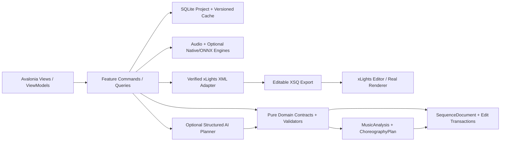
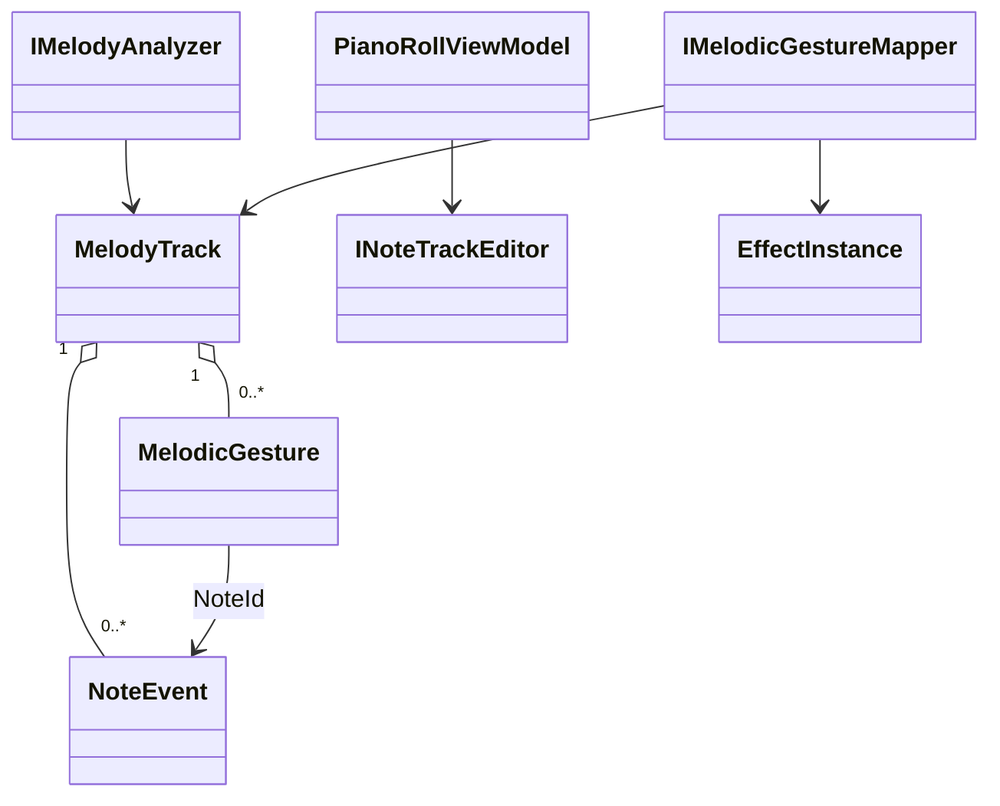
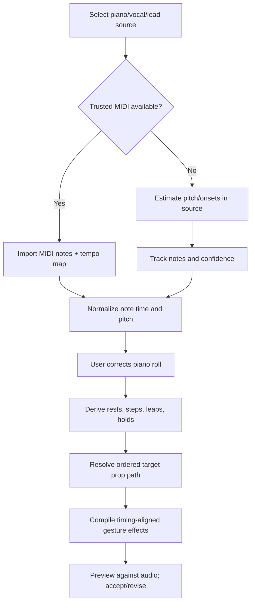

# PHASE 07 — Melody Pitch and Note Analysis

**Specification version:** 2.0 / 2026-10-10 | **Steps:** 045–051 | **Status:** Proposed, unimplemented until gate evidence exists

**Standalone specification.** This document contains the relevant product assumptions, contracts, class relationships, business flows, numbered implementation tasks, test designs, risk gates and an agent prompt. It does **not** mean Phase 07 can run without earlier implemented code; it means an architect/agent can plan and implement the phase without consulting a separate high-level brief. Code below expresses **proposed API signatures**, not verified source code. Reconcile them with the actual repository and xLights version before implementation.

## 1. User outcome, release boundary and phase gate

**User story:** As a sequencer, I can watch a detected melody rise and fall in a piano-roll view, correct wrong notes, and see my arches step in the same direction as the melody.

**Owned boundary:** Melodic pitch/onset/rest events, optional MIDI import, contour abstraction, user correction and deterministic note-to-gesture translation.

**Out of scope:** No promise of polyphonic note-perfect transcription from a full mastered song, no arbitrary chord voicing reconstruction, no style LLM yet.

**Blocking phase gate:** Import trusted MIDI or simple isolated melody, view notes on piano roll, correct an incorrect note, select five arches, preview stepping up and reversing on descent, export and validate in xLights.

**Depends on:** Phase 06: Instrument Separation and Activity Detection.

**Unblocks:** Phase 08: Song Structure and Repeated Phrases.

The gate is PASS only with automated tests, persisted-output inspection, and a real UI or xLights demonstration appropriate to the phase. If xLights or the required hardware/backend is unavailable, report BLOCKED or NOT VERIFIED—never silently substitute a mock.

## 2. Architectural assumptions (fully restated for standalone use)

- **Product:** locally installable Avalonia/.NET 10 desktop application; no Python, Docker, Git or mandatory LLM subscription for end users. CPU-first inference; native/ONNX only after a demonstrated and legally redistributable runtime/model fit.
- **Topology:** modular monolith with vertical feature slices. UI (Views/ViewModels), application orchestration, pure domain contracts, and platform/infrastructure adapters. Do not fabricate generic interfaces without a concrete boundary.
- **Timing:** internally represent position with an explicit canonical monotonic clock tied to source audio origin. Preserve sample index/rate for analysis provenance; UI may show milliseconds. All time scopes are half-open `[start,end)`. Convert to xLights frames only when explicitly snapping or exporting.
- **Ownership:** SQLite project metadata and committed user edits; immutable source media (linked/copied with consent); hash-addressed and versioned analysis/preview artifacts on disk. Every cache key includes algorithm/model/settings versions.
- **xLights:** `xlights_rgbeffects.xml` describes models/groups and other show configuration; `xlights_networks.xml` covers controller/output configuration; editable sequence is `.xsq` XML; rendered playback data is `.fseq`. Never overwrite source show files silently. Match layout models by verified name/identity mapping; do not invent xLights effect parameters.
- **Safe editing:** `SequenceDocument` is the editable state. `ChoreographyPlan` is an intent proposal, not a destructive replacement. Keep optimistic revision checks, effect locks, selection scope, immutable before/after patches, undo/redo, and explicit human acceptance.
- **AI trust:** optional local or BYOK cloud AI returns validated structured proposals only. Do not execute LLM-produced code, scripts or XML directly. Treat song lyrics, filenames, descriptions and external metadata as untrusted data. Explicit consent before sending media-derived data to remote services.
- **Verification:** unit tests + fixtures + integration tests + one observable UI/xLights demonstration per phase. An XML parse pass does not prove xLights renders an effect. A numeric musical score does not prove artistic quality. Do not claim tests ran when they did not.
- **Migration:** upstream xLightsAI (MIT repository, with separate dependency/model license checks) is a pinned reference for behavior, data and effect recipes. Python may run only in developer comparison tooling; there is no runtime Python requirement in releases.

### Core architecture at a glance



### Stable domain names and cross-phase ownership

| Aggregate / contract | First introduced | Sole authority / rule |
|---|---:|---|
| `ProjectManifest` and `ProjectId` | 01 | Project identity/version + root; SQLite and JSON atomically recoverable |
| `DisplayGraph`, `DisplayModel`, `ModelId` | 02 | Imported xLights model identities/group info; reference layout by hash |
| `SequenceDocument`, `EffectInstance` | 02 | Editable effects/locked state provenance; never serialize business behavior directly as XML |
| `EditScope`, `EditTransaction`, `DocumentRevision` | 03 | Exact time + model boundary and user-approved reversibility |
| `SongAsset`, `IAudioTransport` | 04 | Original song hash, timebase and synchronized playback |
| `BeatGrid` | 05 | Analyzed/corrected beats and alternative tempo hypotheses |
| `StemManifest`, `StemAsset` | 06 | Derived separated sources; known model version and sample origin |
| `MelodyTrack`, `NoteEvent` | 07 | Note/onset/contour truth with human corrections |
| `SongStructure`, `MotifLink` | 08 | Related phrase identities and inheritance decisions |
| `SpatialDisplayGraph`, `SpatialPath` | 09 | Artistic routes / normalized geometry separate from imported xLights identities |
| `VisualStory`, `ChoreographyPlan` | 10 | Musical/visual intent before concrete effect rendering |
| `EditProposal` | 11 | Untrusted/optional AI idea validated before `EditTransaction` |
| `LoopRun`, `Candidate`, `QualityReport` | 12 | Bounded attempts and reproducible candidate comparisons |
| `RenderArtifact` | 13 | Actual or clearly-marked approximate preview evidence |
| `WholeSongPlan` | 14 | Section continuity and approved phrase assembly |
| `ReleaseManifest` | 15 | Platform/model assets and delivery integrity |
| `ReleaseReadiness` | 16 | Explicit community compatibility/artistic evidence and release gate |

### Shared canonical C# identifiers

Define these once in `Studio.Contracts`. They are included here so the current phase spec can stand alone. **Do not redefine copies with different namespaces in code.**

```csharp
// Shared across phases; put these in Studio.Contracts (single declarations in the codebase).
namespace XlightsAI.Studio.Contracts;
public readonly record struct ProjectId(Guid Value);
public readonly record struct SongId(Guid Value);
public readonly record struct ModelId(string Value);
public readonly record struct DocumentRevision(long Value);
public readonly record struct TimelineTick(long Value); // 100 ns ticks from song origin
public readonly record struct TimeWindow(long StartTicks, long EndTicks); // [Start, End)
```

## 3. Phase-specific design and contracts

**Inputs:** User-selected stem/source, trusted MIDI where present, common timing grid, named target models or initial path order.

**Outputs:** Versioned `MelodyTrack` of note events and pitch-contour gestures; editable piano roll; note-driven effect placements for a limited gesture set.

### Architectural design notes

Adopt a **fallback ladder**: trustworthy MIDI -> high-confidence isolated-stem note events -> pitch contour direction and onset -> rhythm-only events. Keep pitch in MIDI note numbers plus pitch confidence, but build the gesture mapping from relative motion so an octave error does not necessarily ruin a lighting phrase. Represent rests explicitly. Note start/end must follow actual source time, not even subdivisions. Mapping of pitch to props is a declared policy (pitch rank, relative steps, clamp/wrap, nearest path position); test repeated notes, long holds, leaps and descents. Let users correct note pitch/start/end with linked selected light effects, without changing locked accepted effects unless approved.

### Proposed C# signatures

These are explicit API intent and relationship signatures, not an assertion that the existing repository already implements them. Favor the phase-local interfaces shown, adapt names to repository conventions, and record any compatibility decision. Referenced records introduced by prior phases are intentionally not redefined.

```csharp
using XlightsAI.Studio.Contracts;
using XlightsAI.Studio.Stems;
using XlightsAI.Studio.Xlights;
namespace XlightsAI.Studio.Melody;
public sealed record NoteEvent(Guid Id, long StartTicks, long EndTicks,
    int MidiNote, double Velocity, double Confidence, bool UserCorrected);
public enum PitchMotion { Repeat, StepUp, StepDown, LeapUp, LeapDown, Rest, Hold }
public sealed record MelodicGesture(Guid NoteId, PitchMotion Motion, int IntervalSemitones,
    long StartTicks, long EndTicks, double Confidence);
public sealed record MelodyTrack(Guid Id, string SourceAssetHash,
    IReadOnlyList<NoteEvent> Notes, IReadOnlyList<MelodicGesture> Gestures);
public interface IMelodyAnalyzer {
    Task<MelodyTrack> AnalyzeAsync(StemAsset source, MelodySettings options, CancellationToken ct);
}
public interface INoteTrackEditor {
    Task<MelodyTrack> CorrectAsync(Guid trackId, NoteEvent corrected, CancellationToken ct);
}
public interface IMelodicGestureMapper {
    IReadOnlyList<EffectInstance> MapToEffects(MelodyTrack track,
        IReadOnlyList<ModelId> orderedPath, TimeWindow window, GestureMapSettings settings);
}

public sealed record MelodySettings(int TargetSampleRate, double MinConfidence);
public sealed record GestureMapSettings(string PitchPolicy, string RecipeId, bool RespectRests);
```

### Class relationship diagram



### Core process flowchart



## 4. Data contract, state ownership, migrations and caching

Store original transcription version and corrected `MelodyTrack` as separate revisions, source stem hash, pitch confidence, MIDI tempo conversion source and gesture mapping settings; preserve link from effect IDs to source note IDs.

### Contract compatibility rules

- Keep IDs stable across UI views, SQLite and exported artifacts; never persist Avalonia object instances or XML DOM nodes as domain objects.
- Schema changes require versioned migrations, fixture updates and tests against the preceding project version.
- Analysis caches may be rebuilt if their source/model/version hash changes; accepted manual edits are never disposable cache.
- All edits to `SequenceDocument` pass a revision-aware command boundary. Preview artifacts and AI proposals cannot update the accepted document directly.
- Logs include operation/fixture correlation IDs and error codes. External model names and XML payloads are treated as untrusted input.

## 5. User interface / screen behavior

Use the existing Avalonia shell and apply this phase incrementally; do not present empty future functionality as implemented. These wireframe images are conceptual design references, not pixels that must be copied literally.

- **SCREEN 10 PIANO ROLL** — [Visual wireframe](../assets/wireframes/SCREEN-10-PIANO-ROLL.png). The screen must show loading/empty/error states, responsive resizing, keyboard navigation and an explicit version/status indicator when data is derived.
- **SCREEN 13 TIMELINE** — [Visual wireframe](../assets/wireframes/SCREEN-13-TIMELINE.png). The screen must show loading/empty/error states, responsive resizing, keyboard navigation and an explicit version/status indicator when data is derived.

UI behavior must always show *which song, time range, props, analysis source, version and approval state* the user is operating on when those concepts are available at this phase.

## 6. Numbered build slices — implement in order

Each numbered item is a complete vertical test cut: UI/command -> domain rule -> persistence or adapter -> observable result -> automated test. Avoid collecting multiple unverified tasks into one mega-commit.

### Step 045 — Define pitch/note/onset and relative melodic gesture contracts, with source/confidence

**User-visible outcome:** Saved audio/analysis artifact with timestamp provenance plus a synchronized waveform/timeline demonstration.

**Implementation guidance:** Define note/timing provenance, integer MIDI pitch, velocity and confidence with explicit units; normalize overlaps and invalid duration.

**Required acceptance:** Fixture JSON round-trips with units and source IDs.

**Failure/edge case to prove:** Silence, invalid timing boundaries and missing media must be handled explicitly.

**Suggested automated acceptance test:** `Step045_Acceptance_Passes`. Implement a deterministic fixture and assert persisted domain state plus public output, not only a mock invocation. Include a negative-path assertion.

**Evidence:** Write `implementation-evidence/PHASE-07/STEP-045.md` with commands actually executed, input hashes, actual results, screen/output artifact, unresolved issues, and an explicit PASS/BLOCKED status.

- [ ] Implementation / tests / observable demo / evidence all complete before next numbered step.

### Step 046 — Implement fundamental-frequency/pitch tracking for isolated lead source

**User-visible outcome:** Saved audio/analysis artifact with timestamp provenance plus a synchronized waveform/timeline demonstration.

**Implementation guidance:** Implement pitch detector with voice/instrument-specific limitations; test sine tones, instrument samples and octaves; preserve raw contour for fallback.

**Required acceptance:** Synthetic sine/recorded single notes within cents and timing tolerance.

**Failure/edge case to prove:** Invalid input, cancellation or stale persisted state must not corrupt the project.

**Suggested automated acceptance test:** `Step046_Acceptance_Passes`. Implement a deterministic fixture and assert persisted domain state plus public output, not only a mock invocation. Include a negative-path assertion.

**Evidence:** Write `implementation-evidence/PHASE-07/STEP-046.md` with commands actually executed, input hashes, actual results, screen/output artifact, unresolved issues, and an explicit PASS/BLOCKED status.

- [ ] Implementation / tests / observable demo / evidence all complete before next numbered step.

### Step 047 — Derive up/down/repeat/hold/leap/rest from melodic contour with noise filtering

**User-visible outcome:** Saved audio/analysis artifact with timestamp provenance plus a synchronized waveform/timeline demonstration.

**Implementation guidance:** Transform note differences to repeat/step/leap/hold/rest with tunable thresholds; measure musical interval not only note index.

**Required acceptance:** Synthetic melodic shapes classify correctly.

**Failure/edge case to prove:** Silence, invalid timing boundaries and missing media must be handled explicitly.

**Suggested automated acceptance test:** `Step047_Acceptance_Passes`. Implement a deterministic fixture and assert persisted domain state plus public output, not only a mock invocation. Include a negative-path assertion.

**Evidence:** Write `implementation-evidence/PHASE-07/STEP-047.md` with commands actually executed, input hashes, actual results, screen/output artifact, unresolved issues, and an explicit PASS/BLOCKED status.

- [ ] Implementation / tests / observable demo / evidence all complete before next numbered step.

### Step 048 — Support MIDI import and evaluate transcription backend behind an interface

**User-visible outcome:** Saved audio/analysis artifact with timestamp provenance plus a synchronized waveform/timeline demonstration.

**Implementation guidance:** Parse MIDI note-on/note-off and tempo changes; create adapter to same track; use MIDI as ground-truth alternative where present.

**Required acceptance:** Imported MIDI note timings map to canonical event structure.

**Failure/edge case to prove:** Invalid input, cancellation or stale persisted state must not corrupt the project.

**Suggested automated acceptance test:** `Step048_Acceptance_Passes`. Implement a deterministic fixture and assert persisted domain state plus public output, not only a mock invocation. Include a negative-path assertion.

**Evidence:** Write `implementation-evidence/PHASE-07/STEP-048.md` with commands actually executed, input hashes, actual results, screen/output artifact, unresolved issues, and an explicit PASS/BLOCKED status.

- [ ] Implementation / tests / observable demo / evidence all complete before next numbered step.

### Step 049 — Implement editable piano roll and low-confidence markers

**User-visible outcome:** Versioned, inspectable project output plus a reproducible test report.

**Implementation guidance:** Render note lengths and pitch rows, support drag/resize, and link selection to affected effect proposals; never lose original transcription.

**Required acceptance:** User corrections persist and regenerate only dependent phrases.

**Failure/edge case to prove:** Out-of-scope, locked or stale revision must be rejected without partial mutation.

**Suggested automated acceptance test:** `Step049_Acceptance_Passes`. Implement a deterministic fixture and assert persisted domain state plus public output, not only a mock invocation. Include a negative-path assertion.

**Evidence:** Write `implementation-evidence/PHASE-07/STEP-049.md` with commands actually executed, input hashes, actual results, screen/output artifact, unresolved issues, and an explicit PASS/BLOCKED status.

- [ ] Implementation / tests / observable demo / evidence all complete before next numbered step.

### Step 050 — Compile melody to stepping, holding, jumping choreography across ordered props

**User-visible outcome:** Saved audio/analysis artifact with timestamp provenance plus a synchronized waveform/timeline demonstration.

**Implementation guidance:** Map notes to an ordered path using configurable clamp/wrap/relative-center policy and verified effect recipes; prove a melody ascends and descends.

**Required acceptance:** Five/seven-note fixtures produce correct path order and durations.

**Failure/edge case to prove:** Silence, invalid timing boundaries and missing media must be handled explicitly.

**Suggested automated acceptance test:** `Step050_Acceptance_Passes`. Implement a deterministic fixture and assert persisted domain state plus public output, not only a mock invocation. Include a negative-path assertion.

**Evidence:** Write `implementation-evidence/PHASE-07/STEP-050.md` with commands actually executed, input hashes, actual results, screen/output artifact, unresolved issues, and an explicit PASS/BLOCKED status.

- [ ] Implementation / tests / observable demo / evidence all complete before next numbered step.

### Step 051 — Handle polyphony, rests, note gaps, variable durations and frame quantization gracefully

**User-visible outcome:** Versioned, inspectable project output plus a reproducible test report.

**Implementation guidance:** Represent musical rests and sustained notes explicitly; preserve sub-beat timing where valid and make uncertainty visible.

**Required acceptance:** Fallback to contour or onsets when pitch unreliable; no invalid effects.

**Failure/edge case to prove:** Silence, invalid timing boundaries and missing media must be handled explicitly.

**Suggested automated acceptance test:** `Step051_Acceptance_Passes`. Implement a deterministic fixture and assert persisted domain state plus public output, not only a mock invocation. Include a negative-path assertion.

**Evidence:** Write `implementation-evidence/PHASE-07/STEP-051.md` with commands actually executed, input hashes, actual results, screen/output artifact, unresolved issues, and an explicit PASS/BLOCKED status.

- [ ] Implementation / tests / observable demo / evidence all complete before next numbered step.

## 7. Full-phase test plan and quality gate matrix

| # | Test scenario / invariant | Type | Required evidence |
|---:|---|---|---|
| 1 | Synthetic C-D-E-G-E-D-C generates correct up/peak/down sequence | Unit + property | Actual result, input hash/fixture and pass/fail |
| 2 | Repeated note pulses same target, not random prop | Integration/golden | Actual result, input hash/fixture and pass/fail |
| 3 | Hold length follows note duration within expected frame quantization | Desktop/manual | Actual result, input hash/fixture and pass/fail |
| 4 | Rest introduces silence/no stray effect | Unit + property | Actual result, input hash/fixture and pass/fail |
| 5 | Jump interval skips target positions by declared mapping policy | Integration/golden | Actual result, input hash/fixture and pass/fail |
| 6 | Low-confidence pitch falls back to contour or onset with provenance | Desktop/manual | Actual result, input hash/fixture and pass/fail |
| 7 | Note correction updates proposal without overriding locked effects | Unit + property | Actual result, input hash/fixture and pass/fail |

### Phase gate demonstration — exact user workflow

Import trusted MIDI or simple isolated melody, view notes on piano roll, correct an incorrect note, select five arches, preview stepping up and reversing on descent, export and validate in xLights.

### Failure handling and known technical risks

Polyphonic interference, consonant-rich vocals with unstable pitch, octaves, note-off estimation, rapid ornamental notes and prop path length mismatch.

### Cross-cutting negative cases

- **Invalid/stale input:** reject and show the source of the problem; do not commit partial project state.
- **Cancellation:** propagate `CancellationToken`, dispose native/audio resources and leave resumable or safely rolled-back job state.
- **Compatibility:** detect actual versions/capabilities. No undocumented claim that all xLights versions or ML models behave identically.
- **Non-destructive writes:** if a user selects a show directory or existing XSQ, default to creating a new app-owned artifact rather than silently overwriting.
- **Regression:** rerun all previous phase gates affected by changed domain contracts or serializer versions.

## 8. Implementation checkpoints, decisions and handoff

### Recommended internal development order

1. Inspect the current committed code and pinned upstream reference; enumerate differences from signatures in this document.
2. Create fixtures and tests for the *first* numbered step; document exact external dependencies before writing the adapter.
3. Build one end-to-end slice, run the targeted tests, demonstrate the new behavior, then record evidence and proceed.
4. Update architecture decision records for genuine tradeoffs and migration decisions. Do not generalize everything into an interface.
5. At completion, run full automated regression and the phase demonstration; record blocker status truthfully.

### Explicit ADR questions to resolve during this phase

- **Primary design choice:** Is the proposed melody pitch and note analysis contract compatible with existing repository conventions and user-approved state?
- **Runtime/source truth:** Which behaviors can be verified locally, and which require a specific xLights build, external model, audio device, or human judgment?
- **Recovery and rollback:** What happens on crash, cancellation, stale file version or invalid external content?
- **Dependency and licenses:** Are required upstream algorithms, model files or native libraries version-pinned and redistributable?

### Required final gate report

- [ ] All named numbered steps show independently recorded evidence.
- [ ] Compiles; full unit/integration/golden regression run records actual commands.
- [ ] Desktop interaction was exercised or explicitly reported blocked.
- [ ] Required xLights/manual/inference test ran against a recorded version, if applicable.
- [ ] Missing assumptions, compatibility limits, technical debt and migration impacts recorded.
- [ ] Previous accepted sequences/project files are unchanged except approved migrations/edits.
- [ ] Gate result = PASS or BLOCKED. Next phase begins only after PASS or an explicit scoped architecture waiver.

## 9. Copy/paste coding-agent prompt (phase-local)

```text
You are acting as a senior .NET/Avalonia architect and implementation agent on the xLights AI Choreography Studio repository.
Implement the PHASE 07 (Melody Pitch and Note Analysis) only, in numbered-step order. This spec is the source of truth for the current phase and contains the necessary contract and verification context. Read the existing repository and baseline history first; **do not copy sample signatures over working established contracts blindly**. Resolve any older/newer contract discrepancy with a short architecture decision and compatibility migration.

For EACH numbered step: (1) inspect only relevant repo files and pinned upstream sources; (2) write acceptance/failure tests first or alongside code; (3) implement the smallest complete UI -> application -> domain -> persistence/export pathway; (4) compile/run targeted and existing tests; (5) execute the manual demo or report explicitly why it could not run; (6) update completion/evidence notes in `implementation-evidence/PHASE-07/STEP-XXX.md`; (7) commit the step if permitted. Do not cross into future features except narrow stable contracts. Hard gates cannot be traded for weighted scoring.

Before ending the phase, produce a Gate Report showing exact tests/commands, observed results, fixture IDs/hashes, screenshots/XSQ artifacts, unverified assumptions, known risks and whether the phase gate is PASS/BLOCKED. Do not claim test success without execution. Do not start the next phase when blocked.

CURRENT SCOPE: Phase 07: Melody Pitch and Note Analysis. Implement only numbered steps 045, 046, 047, 048, 049, 050, 051.
CORE DEMO REQUIRED: Import trusted MIDI or simple isolated melody, view notes on piano roll, correct an incorrect note, select five arches, preview stepping up and reversing on descent, export and validate in xLights.
NEVER CLAIM THE GATE PASSED WITHOUT: Note correction updates proposal without overriding locked effects
```

## 10. Developer test evidence format

```yaml
step: 045
phase: 07
implementation_commit: TO_BE_FILLED
source_fixture_hashes: []
automated_tests:
  - name: TO_BE_FILLED
    command: TO_BE_FILLED
    result: NOT_RUN
manual_demo:
  instructions: TO_BE_FILLED
  observed: NOT_RUN
xlights_version: NOT_TESTED
artifact_paths: []
blocking_failures: []
architectural_decisions: []
status: NOT_STARTED
```

## 11. Authoritative documentation and verification sources

The URLs below are references for implementation research, not substitute proof that our code or any installed xLights version works. Always pin relevant upstream revisions and record observed behavior.

- xLights source / headless rendering design (verify installed builds separately): https://github.com/xLightsSequencer/xLights/blob/master/AGENTS.md
- xLights manual glossary (layout/sequence formats): https://manual.xlights.org/xlights/appendicies/glossary
- xLights timing tracks: https://manual.xlights.org/xlights/chapters/chapter-four-sequencer/timing-tracks
- xLights model groups: https://manual.xlights.org/xlights/chapters/chapter-four-tabs/model-groups
- xLights importing and re-rendering: https://manual.xlights.org/xlights/chapters/chapter-five-menus/import
- xLights official source repository: https://github.com/xLightsSequencer/xLights
- Real public XSQ example (for observation; verify against target version): https://github.com/FRC3620/xlights.sign1/blob/main/2026%20Doug.xsq
- xLightsAI upstream raw XSQ generator path: `src/generator/xsq_writer.py` in pinned upstream checkout.

### Nearby package material (optional supporting context; this phase is complete without it)

- [`MASTER-SYSTEM-ARCHITECTURE.md`](../MASTER-SYSTEM-ARCHITECTURE.md)
- [`XLIGHTS-SEQUENCE-ENGINEERING-GUIDE.md`](../XLIGHTS-SEQUENCE-ENGINEERING-GUIDE.md)
- [`UI-UX-SCREEN-BLUEPRINTS.md`](../UI-UX-SCREEN-BLUEPRINTS.md)
- [`TEST-DATA-AND-ACCEPTANCE.md`](../TEST-DATA-AND-ACCEPTANCE.md)
- [`prompts/PHASE-07-PROMPT.md`](../prompts/PHASE-07-PROMPT.md)

## 12. Deterministic melody mapping worked example

Input notes `C4,D4,E4,G4,E4,D4,C4` at real note onsets. A path of five arches uses **declared pitch-to-index policy**; an example normalized ascending/descending mapping is `1,2,3,5,3,2,1`. A repeated pitch pulses the current arch; a rest emits no new light; a sustained note holds its effect until the note-off event. When the path is shorter than the number of contour positions, apply explicit clamp/wrap/compression configured by the user; do not randomize direction. Record expected note-to-prop links for tests and verify xLights frame snapping doesn't reverse event order.
