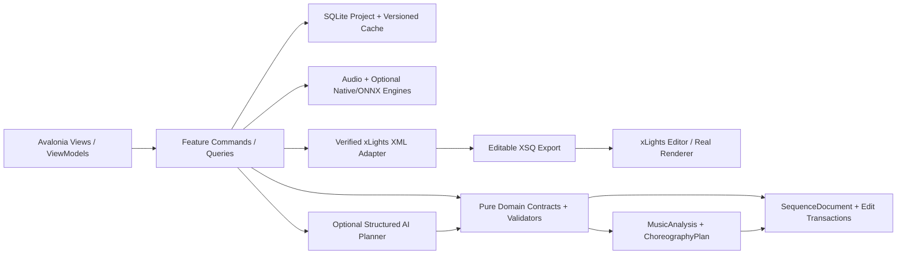
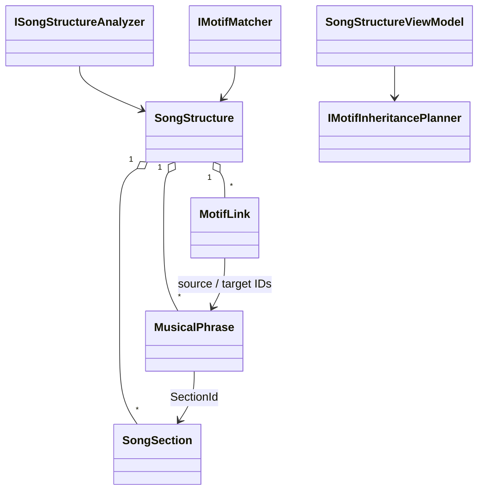
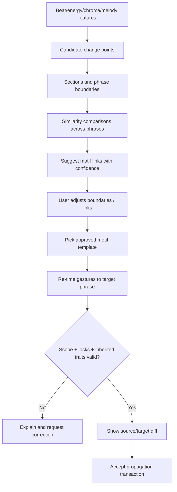

# PHASE 08 — Song Structure and Repeated Phrases

**Specification version:** 2.0 / 2026-10-10 | **Steps:** 052–058 | **Status:** Proposed, unimplemented until gate evidence exists

**Standalone specification.** This document contains the relevant product assumptions, contracts, class relationships, business flows, numbered implementation tasks, test designs, risk gates and an agent prompt. It does **not** mean Phase 08 can run without earlier implemented code; it means an architect/agent can plan and implement the phase without consulting a separate high-level brief. Code below expresses **proposed API signatures**, not verified source code. Reconcile them with the actual repository and xLights version before implementation.

## 1. User outcome, release boundary and phase gate

**User story:** As a sequencer, I can see verses and choruses divided into phrases, confirm recurring melodies and reuse a recognizable visual idea in repeated sections.

**Owned boundary:** Song structure inference, phrase boundaries, self-similarity, motif linking and inheritance of *accepted* choreography with controlled variants.

**Out of scope:** No guarantee every pop song has a standard verse/chorus form; do not equate identical BPM with identical motif.

**Blocking phase gate:** Analyze a song with repeated chorus; show two matching phrases highlighted; accept the first chorus as a template and propagate only melody movement into the second, preserving destination drums and locked effects.

**Depends on:** Phase 07: Melody Pitch and Note Analysis.

**Unblocks:** Phase 09: Spatial Choreography and Display Paths.

The gate is PASS only with automated tests, persisted-output inspection, and a real UI or xLights demonstration appropriate to the phase. If xLights or the required hardware/backend is unavailable, report BLOCKED or NOT VERIFIED—never silently substitute a mock.

## 2. Architectural assumptions (fully restated for standalone use)

- **Product:** locally installable Avalonia/.NET 10 desktop application; no Python, Docker, Git or mandatory LLM subscription for end users. CPU-first inference; native/ONNX only after a demonstrated and legally redistributable runtime/model fit.
- **Topology:** modular monolith with vertical feature slices. UI (Views/ViewModels), application orchestration, pure domain contracts, and platform/infrastructure adapters. Do not fabricate generic interfaces without a concrete boundary.
- **Timing:** internally represent position with an explicit canonical monotonic clock tied to source audio origin. Preserve sample index/rate for analysis provenance; UI may show milliseconds. All time scopes are half-open `[start,end)`. Convert to xLights frames only when explicitly snapping or exporting.
- **Ownership:** SQLite project metadata and committed user edits; immutable source media (linked/copied with consent); hash-addressed and versioned analysis/preview artifacts on disk. Every cache key includes algorithm/model/settings versions.
- **xLights:** `xlights_rgbeffects.xml` describes models/groups and other show configuration; `xlights_networks.xml` covers controller/output configuration; editable sequence is `.xsq` XML; rendered playback data is `.fseq`. Never overwrite source show files silently. Match layout models by verified name/identity mapping; do not invent xLights effect parameters.
- **Safe editing:** `SequenceDocument` is the editable state. `ChoreographyPlan` is an intent proposal, not a destructive replacement. Keep optimistic revision checks, effect locks, selection scope, immutable before/after patches, undo/redo, and explicit human acceptance.
- **AI trust:** optional local or BYOK cloud AI returns validated structured proposals only. Do not execute LLM-produced code, scripts or XML directly. Treat song lyrics, filenames, descriptions and external metadata as untrusted data. Explicit consent before sending media-derived data to remote services.
- **Verification:** unit tests + fixtures + integration tests + one observable UI/xLights demonstration per phase. An XML parse pass does not prove xLights renders an effect. A numeric musical score does not prove artistic quality. Do not claim tests ran when they did not.
- **Migration:** upstream xLightsAI (MIT repository, with separate dependency/model license checks) is a pinned reference for behavior, data and effect recipes. Python may run only in developer comparison tooling; there is no runtime Python requirement in releases.

### Core architecture at a glance



### Stable domain names and cross-phase ownership

| Aggregate / contract | First introduced | Sole authority / rule |
|---|---:|---|
| `ProjectManifest` and `ProjectId` | 01 | Project identity/version + root; SQLite and JSON atomically recoverable |
| `DisplayGraph`, `DisplayModel`, `ModelId` | 02 | Imported xLights model identities/group info; reference layout by hash |
| `SequenceDocument`, `EffectInstance` | 02 | Editable effects/locked state provenance; never serialize business behavior directly as XML |
| `EditScope`, `EditTransaction`, `DocumentRevision` | 03 | Exact time + model boundary and user-approved reversibility |
| `SongAsset`, `IAudioTransport` | 04 | Original song hash, timebase and synchronized playback |
| `BeatGrid` | 05 | Analyzed/corrected beats and alternative tempo hypotheses |
| `StemManifest`, `StemAsset` | 06 | Derived separated sources; known model version and sample origin |
| `MelodyTrack`, `NoteEvent` | 07 | Note/onset/contour truth with human corrections |
| `SongStructure`, `MotifLink` | 08 | Related phrase identities and inheritance decisions |
| `SpatialDisplayGraph`, `SpatialPath` | 09 | Artistic routes / normalized geometry separate from imported xLights identities |
| `VisualStory`, `ChoreographyPlan` | 10 | Musical/visual intent before concrete effect rendering |
| `EditProposal` | 11 | Untrusted/optional AI idea validated before `EditTransaction` |
| `LoopRun`, `Candidate`, `QualityReport` | 12 | Bounded attempts and reproducible candidate comparisons |
| `RenderArtifact` | 13 | Actual or clearly-marked approximate preview evidence |
| `WholeSongPlan` | 14 | Section continuity and approved phrase assembly |
| `ReleaseManifest` | 15 | Platform/model assets and delivery integrity |
| `ReleaseReadiness` | 16 | Explicit community compatibility/artistic evidence and release gate |

### Shared canonical C# identifiers

Define these once in `Studio.Contracts`. They are included here so the current phase spec can stand alone. **Do not redefine copies with different namespaces in code.**

```csharp
// Shared across phases; put these in Studio.Contracts (single declarations in the codebase).
namespace XlightsAI.Studio.Contracts;
public readonly record struct ProjectId(Guid Value);
public readonly record struct SongId(Guid Value);
public readonly record struct ModelId(string Value);
public readonly record struct DocumentRevision(long Value);
public readonly record struct TimelineTick(long Value); // 100 ns ticks from song origin
public readonly record struct TimeWindow(long StartTicks, long EndTicks); // [Start, End)
```

## 3. Phase-specific design and contracts

**Inputs:** Rhythm grid, spectral/chroma features, stem activity, melody tracks, song duration and previously approved choreography.

**Outputs:** Versioned `SongStructure` with `Section`, `Phrase`, `MotifGroup` and inheritance/variation links; editable structure timeline.

### Architectural design notes

Compute phrase-level embeddings or recurrence signatures combining harmony/rhythm/melody, then propose repeated sections with a score and explanation. Distinguish **segment boundary** from **section label** and **motif identity**; users must be able to rename and join/split them independently. Preserve all manual overrides through analyzer refresh. A motif link is not a signal to blindly clone exact effects: reuse relative gesture semantics and re-time to the destination phrase, with explicit inheritance mask (motion, palette, rhythm layer, intensity). Show prospective propagation targets and locks before applying. The first approved performance of a motif may be parent but a user may reassign the canonical source.

### Proposed C# signatures

These are explicit API intent and relationship signatures, not an assertion that the existing repository already implements them. Favor the phase-local interfaces shown, adapt names to repository conventions, and record any compatibility decision. Referenced records introduced by prior phases are intentionally not redefined.

```csharp
using XlightsAI.Studio.Contracts;
using XlightsAI.Studio.Rhythm;
using XlightsAI.Studio.Melody;
using XlightsAI.Studio.Stems;
namespace XlightsAI.Studio.Structure;
public enum SectionKind { Unknown, Intro, Verse, PreChorus, Chorus, Bridge, Solo, Outro }
public sealed record SongSection(Guid Id, SectionKind Kind, long StartTicks, long EndTicks,
    double Confidence, bool UserCorrected);
public sealed record MusicalPhrase(Guid Id, Guid SectionId, long StartTicks, long EndTicks,
    int? Bars, string SignatureHash);
public sealed record MotifLink(Guid SourcePhraseId, Guid TargetPhraseId,
    double Similarity, bool UserApproved, string InheritanceMask);
public sealed record SongStructure(Guid VersionId, IReadOnlyList<SongSection> Sections,
    IReadOnlyList<MusicalPhrase> Phrases, IReadOnlyList<MotifLink> Links);
public interface ISongStructureAnalyzer {
    Task<SongStructure> AnalyzeAsync(SongAnalysisContext context, CancellationToken ct);
}
public interface IMotifMatcher { IReadOnlyList<MotifLink> ProposeLinks(SongStructure structure); }
public interface IMotifInheritancePlanner {
    IReadOnlyList<EffectInstance> AdaptApprovedChoreography(MusicalPhrase source,
        MusicalPhrase target, string mask, SequenceDocument document);
}

public sealed record SongAnalysisContext(string SourceHash, BeatGrid BeatGrid,
    IReadOnlyList<MelodyTrack> MelodyTracks, IReadOnlyList<StemActivity> Activity);
```

### Class relationship diagram



### Core process flowchart



## 4. Data contract, state ownership, migrations and caching

Persist detected structure and user-edited structure in separately versioned stores; stable phrase IDs across small boundary shifts via reconciliation logic; motif link direction, similarity confidence, approval, inheritance mask and source version.

### Contract compatibility rules

- Keep IDs stable across UI views, SQLite and exported artifacts; never persist Avalonia object instances or XML DOM nodes as domain objects.
- Schema changes require versioned migrations, fixture updates and tests against the preceding project version.
- Analysis caches may be rebuilt if their source/model/version hash changes; accepted manual edits are never disposable cache.
- All edits to `SequenceDocument` pass a revision-aware command boundary. Preview artifacts and AI proposals cannot update the accepted document directly.
- Logs include operation/fixture correlation IDs and error codes. External model names and XML payloads are treated as untrusted input.

## 5. User interface / screen behavior

Use the existing Avalonia shell and apply this phase incrementally; do not present empty future functionality as implemented. These wireframe images are conceptual design references, not pixels that must be copied literally.

- **SCREEN 11 STRUCTURE** — [Visual wireframe](../assets/wireframes/SCREEN-11-STRUCTURE.png). The screen must show loading/empty/error states, responsive resizing, keyboard navigation and an explicit version/status indicator when data is derived.
- **SCREEN 13 TIMELINE** — [Visual wireframe](../assets/wireframes/SCREEN-13-TIMELINE.png). The screen must show loading/empty/error states, responsive resizing, keyboard navigation and an explicit version/status indicator when data is derived.

UI behavior must always show *which song, time range, props, analysis source, version and approval state* the user is operating on when those concepts are available at this phase.

## 6. Numbered build slices — implement in order

Each numbered item is a complete vertical test cut: UI/command -> domain rule -> persistence or adapter -> observable result -> automated test. Avoid collecting multiple unverified tasks into one mega-commit.

### Step 052 — Compute normalized bar/phrase feature fingerprints from audio and events

**User-visible outcome:** Saved audio/analysis artifact with timestamp provenance plus a synchronized waveform/timeline demonstration.

**Implementation guidance:** Compute normalized fingerprints per beat/bar from chosen spectral/harmonic/melodic sources with caching; retain enough features to explain matches.

**Required acceptance:** Similar motifs compare consistently across changed gain.

**Failure/edge case to prove:** Silence, invalid timing boundaries and missing media must be handled explicitly.

**Suggested automated acceptance test:** `Step052_Acceptance_Passes`. Implement a deterministic fixture and assert persisted domain state plus public output, not only a mock invocation. Include a negative-path assertion.

**Evidence:** Write `implementation-evidence/PHASE-08/STEP-052.md` with commands actually executed, input hashes, actual results, screen/output artifact, unresolved issues, and an explicit PASS/BLOCKED status.

- [ ] Implementation / tests / observable demo / evidence all complete before next numbered step.

### Step 053 — Detect candidate novelty/section boundaries with confidence

**User-visible outcome:** Versioned, inspectable project output plus a reproducible test report.

**Implementation guidance:** Detect novelty/changepoints and snap only when evidence supports beat grid; represent uncertain and human-adjustable boundaries.

**Required acceptance:** Annotated song has useful boundaries and error report.

**Failure/edge case to prove:** Malformed proposal, no-improvement and exhausted retry budget must not auto-commit.

**Suggested automated acceptance test:** `Step053_Acceptance_Passes`. Implement a deterministic fixture and assert persisted domain state plus public output, not only a mock invocation. Include a negative-path assertion.

**Evidence:** Write `implementation-evidence/PHASE-08/STEP-053.md` with commands actually executed, input hashes, actual results, screen/output artifact, unresolved issues, and an explicit PASS/BLOCKED status.

- [ ] Implementation / tests / observable demo / evidence all complete before next numbered step.

### Step 054 — Assign candidate intro/verse/chorus/bridge labels and support overrides

**User-visible outcome:** Versioned, inspectable project output plus a reproducible test report.

**Implementation guidance:** Classify section labels with confidence and evidence; Unknown is valid; never force classical song structure.

**Required acceptance:** UI shows provenance/confidence; overrides survive restart.

**Failure/edge case to prove:** Malformed proposal, no-improvement and exhausted retry budget must not auto-commit.

**Suggested automated acceptance test:** `Step054_Acceptance_Passes`. Implement a deterministic fixture and assert persisted domain state plus public output, not only a mock invocation. Include a negative-path assertion.

**Evidence:** Write `implementation-evidence/PHASE-08/STEP-054.md` with commands actually executed, input hashes, actual results, screen/output artifact, unresolved issues, and an explicit PASS/BLOCKED status.

- [ ] Implementation / tests / observable demo / evidence all complete before next numbered step.

### Step 055 — Segment sections into phrase units with manual corrections

**User-visible outcome:** Versioned, inspectable project output plus a reproducible test report.

**Implementation guidance:** Segment into phrases with bar-based hypothesis and melodic cadences; permit irregular length and phrase overlaps only by deliberate policy.

**Required acceptance:** Phrase boundaries align to bars or user-chosen events.

**Failure/edge case to prove:** Invalid input, cancellation or stale persisted state must not corrupt the project.

**Suggested automated acceptance test:** `Step055_Acceptance_Passes`. Implement a deterministic fixture and assert persisted domain state plus public output, not only a mock invocation. Include a negative-path assertion.

**Evidence:** Write `implementation-evidence/PHASE-08/STEP-055.md` with commands actually executed, input hashes, actual results, screen/output artifact, unresolved issues, and an explicit PASS/BLOCKED status.

- [ ] Implementation / tests / observable demo / evidence all complete before next numbered step.

### Step 056 — Cluster exact and similar motifs with tolerance for variation

**User-visible outcome:** Versioned, inspectable project output plus a reproducible test report.

**Implementation guidance:** Use self-similarity and robust time-scaling to propose repeated motifs; score separately from section label.

**Required acceptance:** Repeated eight-bar fixture shares motif ID; distinct passage does not.

**Failure/edge case to prove:** Invalid input, cancellation or stale persisted state must not corrupt the project.

**Suggested automated acceptance test:** `Step056_Acceptance_Passes`. Implement a deterministic fixture and assert persisted domain state plus public output, not only a mock invocation. Include a negative-path assertion.

**Evidence:** Write `implementation-evidence/PHASE-08/STEP-056.md` with commands actually executed, input hashes, actual results, screen/output artifact, unresolved issues, and an explicit PASS/BLOCKED status.

- [ ] Implementation / tests / observable demo / evidence all complete before next numbered step.

### Step 057 — Create parameterized choreography template and instance overrides

**User-visible outcome:** Versioned, inspectable project output plus a reproducible test report.

**Implementation guidance:** Create parent/instance pattern inheritance with adjustable mask and transform; preview effect list and respect locks.

**Required acceptance:** Edit master/motif occurrence without surprising cross-section changes.

**Failure/edge case to prove:** Invalid input, cancellation or stale persisted state must not corrupt the project.

**Suggested automated acceptance test:** `Step057_Acceptance_Passes`. Implement a deterministic fixture and assert persisted domain state plus public output, not only a mock invocation. Include a negative-path assertion.

**Evidence:** Write `implementation-evidence/PHASE-08/STEP-057.md` with commands actually executed, input hashes, actual results, screen/output artifact, unresolved issues, and an explicit PASS/BLOCKED status.

- [ ] Implementation / tests / observable demo / evidence all complete before next numbered step.

### Step 058 — Build phrase relationship/propagation inspector

**User-visible outcome:** Avalonia screenshot or repeatable desktop interaction recording with saved-state verification.

**Implementation guidance:** UI supports manual link/unlink, template selection, boundary moves, overrides, and whole-song persistence after reopen.

**Required acceptance:** User links/unlinks motifs and previews related effects.

**Failure/edge case to prove:** Invalid input, cancellation or stale persisted state must not corrupt the project.

**Suggested automated acceptance test:** `Step058_Acceptance_Passes`. Implement a deterministic fixture and assert persisted domain state plus public output, not only a mock invocation. Include a negative-path assertion.

**Evidence:** Write `implementation-evidence/PHASE-08/STEP-058.md` with commands actually executed, input hashes, actual results, screen/output artifact, unresolved issues, and an explicit PASS/BLOCKED status.

- [ ] Implementation / tests / observable demo / evidence all complete before next numbered step.

## 7. Full-phase test plan and quality gate matrix

| # | Test scenario / invariant | Type | Required evidence |
|---:|---|---|---|
| 1 | Synthetic song with two repeated 8-bar choruses links correct phrases | Unit + property | Actual result, input hash/fixture and pass/fail |
| 2 | Same rhythm but unrelated melody does not auto-accept a motif | Integration/golden | Actual result, input hash/fixture and pass/fail |
| 3 | Manual split/merge survives re-analysis | Desktop/manual | Actual result, input hash/fixture and pass/fail |
| 4 | Motif inheritance retimes source note events to destination markers | Unit + property | Actual result, input hash/fixture and pass/fail |
| 5 | Approved destination locks prevent propagation | Integration/golden | Actual result, input hash/fixture and pass/fail |
| 6 | Link graph rejects cycles and stale sources | Desktop/manual | Actual result, input hash/fixture and pass/fail |
| 7 | User can unlink one chorus without affecting others | Unit + property | Actual result, input hash/fixture and pass/fail |

### Phase gate demonstration — exact user workflow

Analyze a song with repeated chorus; show two matching phrases highlighted; accept the first chorus as a template and propagate only melody movement into the second, preserving destination drums and locked effects.

### Failure handling and known technical risks

False recurrence due to same chords, variable phrase lengths, key changes, extra fills, exact clone at wrong tempo, creating loops in inheritance graph and re-analysis destroying user links.

### Cross-cutting negative cases

- **Invalid/stale input:** reject and show the source of the problem; do not commit partial project state.
- **Cancellation:** propagate `CancellationToken`, dispose native/audio resources and leave resumable or safely rolled-back job state.
- **Compatibility:** detect actual versions/capabilities. No undocumented claim that all xLights versions or ML models behave identically.
- **Non-destructive writes:** if a user selects a show directory or existing XSQ, default to creating a new app-owned artifact rather than silently overwriting.
- **Regression:** rerun all previous phase gates affected by changed domain contracts or serializer versions.

## 8. Implementation checkpoints, decisions and handoff

### Recommended internal development order

1. Inspect the current committed code and pinned upstream reference; enumerate differences from signatures in this document.
2. Create fixtures and tests for the *first* numbered step; document exact external dependencies before writing the adapter.
3. Build one end-to-end slice, run the targeted tests, demonstrate the new behavior, then record evidence and proceed.
4. Update architecture decision records for genuine tradeoffs and migration decisions. Do not generalize everything into an interface.
5. At completion, run full automated regression and the phase demonstration; record blocker status truthfully.

### Explicit ADR questions to resolve during this phase

- **Primary design choice:** Is the proposed song structure and repeated phrases contract compatible with existing repository conventions and user-approved state?
- **Runtime/source truth:** Which behaviors can be verified locally, and which require a specific xLights build, external model, audio device, or human judgment?
- **Recovery and rollback:** What happens on crash, cancellation, stale file version or invalid external content?
- **Dependency and licenses:** Are required upstream algorithms, model files or native libraries version-pinned and redistributable?

### Required final gate report

- [ ] All named numbered steps show independently recorded evidence.
- [ ] Compiles; full unit/integration/golden regression run records actual commands.
- [ ] Desktop interaction was exercised or explicitly reported blocked.
- [ ] Required xLights/manual/inference test ran against a recorded version, if applicable.
- [ ] Missing assumptions, compatibility limits, technical debt and migration impacts recorded.
- [ ] Previous accepted sequences/project files are unchanged except approved migrations/edits.
- [ ] Gate result = PASS or BLOCKED. Next phase begins only after PASS or an explicit scoped architecture waiver.

## 9. Copy/paste coding-agent prompt (phase-local)

```text
You are acting as a senior .NET/Avalonia architect and implementation agent on the xLights AI Choreography Studio repository.
Implement the PHASE 08 (Song Structure and Repeated Phrases) only, in numbered-step order. This spec is the source of truth for the current phase and contains the necessary contract and verification context. Read the existing repository and baseline history first; **do not copy sample signatures over working established contracts blindly**. Resolve any older/newer contract discrepancy with a short architecture decision and compatibility migration.

For EACH numbered step: (1) inspect only relevant repo files and pinned upstream sources; (2) write acceptance/failure tests first or alongside code; (3) implement the smallest complete UI -> application -> domain -> persistence/export pathway; (4) compile/run targeted and existing tests; (5) execute the manual demo or report explicitly why it could not run; (6) update completion/evidence notes in `implementation-evidence/PHASE-08/STEP-XXX.md`; (7) commit the step if permitted. Do not cross into future features except narrow stable contracts. Hard gates cannot be traded for weighted scoring.

Before ending the phase, produce a Gate Report showing exact tests/commands, observed results, fixture IDs/hashes, screenshots/XSQ artifacts, unverified assumptions, known risks and whether the phase gate is PASS/BLOCKED. Do not claim test success without execution. Do not start the next phase when blocked.

CURRENT SCOPE: Phase 08: Song Structure and Repeated Phrases. Implement only numbered steps 052, 053, 054, 055, 056, 057, 058.
CORE DEMO REQUIRED: Analyze a song with repeated chorus; show two matching phrases highlighted; accept the first chorus as a template and propagate only melody movement into the second, preserving destination drums and locked effects.
NEVER CLAIM THE GATE PASSED WITHOUT: User can unlink one chorus without affecting others
```

## 10. Developer test evidence format

```yaml
step: 052
phase: 08
implementation_commit: TO_BE_FILLED
source_fixture_hashes: []
automated_tests:
  - name: TO_BE_FILLED
    command: TO_BE_FILLED
    result: NOT_RUN
manual_demo:
  instructions: TO_BE_FILLED
  observed: NOT_RUN
xlights_version: NOT_TESTED
artifact_paths: []
blocking_failures: []
architectural_decisions: []
status: NOT_STARTED
```

## 11. Authoritative documentation and verification sources

The URLs below are references for implementation research, not substitute proof that our code or any installed xLights version works. Always pin relevant upstream revisions and record observed behavior.

- xLights source / headless rendering design (verify installed builds separately): https://github.com/xLightsSequencer/xLights/blob/master/AGENTS.md
- xLights manual glossary (layout/sequence formats): https://manual.xlights.org/xlights/appendicies/glossary
- xLights timing tracks: https://manual.xlights.org/xlights/chapters/chapter-four-sequencer/timing-tracks
- xLights model groups: https://manual.xlights.org/xlights/chapters/chapter-four-tabs/model-groups
- xLights importing and re-rendering: https://manual.xlights.org/xlights/chapters/chapter-five-menus/import
- xLights official source repository: https://github.com/xLightsSequencer/xLights
- Real public XSQ example (for observation; verify against target version): https://github.com/FRC3620/xlights.sign1/blob/main/2026%20Doug.xsq
- xLightsAI upstream raw XSQ generator path: `src/generator/xsq_writer.py` in pinned upstream checkout.

### Nearby package material (optional supporting context; this phase is complete without it)

- [`MASTER-SYSTEM-ARCHITECTURE.md`](../MASTER-SYSTEM-ARCHITECTURE.md)
- [`XLIGHTS-SEQUENCE-ENGINEERING-GUIDE.md`](../XLIGHTS-SEQUENCE-ENGINEERING-GUIDE.md)
- [`UI-UX-SCREEN-BLUEPRINTS.md`](../UI-UX-SCREEN-BLUEPRINTS.md)
- [`TEST-DATA-AND-ACCEPTANCE.md`](../TEST-DATA-AND-ACCEPTANCE.md)
- [`prompts/PHASE-08-PROMPT.md`](../prompts/PHASE-08-PROMPT.md)

## 12. Motif inheritance and change propagation example

Chorus A (approved) has melody gesture M and drum accent D. Chorus B shares melody but adds percussion. An inheritance mask `{ motion: true, timing: retime, palette: false, drum_layer: false }` copies semantic M, warps its onset alignment to B's notes, and leaves destination-specific D untouched. A user must approve which chorus instances are targeted. Reject a copy if its target path is no longer valid or if it would overwrite locked effects. Persist parent source `ChoreographyPlan` version to detect stale inheritance later.
