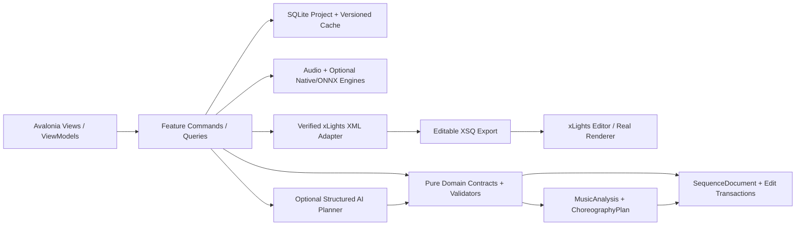
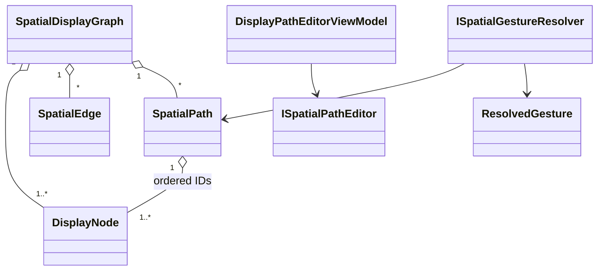
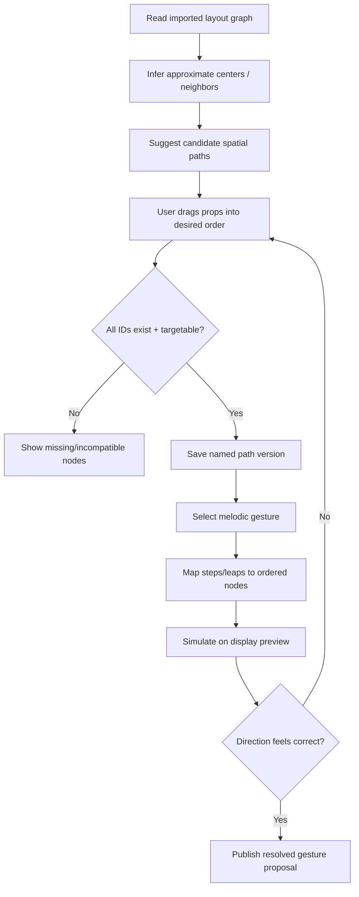

# PHASE 09 — Spatial Choreography and Display Paths

**Specification version:** 2.0 / 2026-10-10 | **Steps:** 059–065 | **Status:** Proposed, unimplemented until gate evidence exists

**Standalone specification.** This document contains the relevant product assumptions, contracts, class relationships, business flows, numbered implementation tasks, test designs, risk gates and an agent prompt. It does **not** mean Phase 09 can run without earlier implemented code; it means an architect/agent can plan and implement the phase without consulting a separate high-level brief. Code below expresses **proposed API signatures**, not verified source code. Reconcile them with the actual repository and xLights version before implementation.

## 1. User outcome, release boundary and phase gate

**User story:** As a sequencer, I can see my physical display and define an ordered movement route through props, then reuse the same rising melody gesture on arches, windows or roofline.

**Owned boundary:** Layout-derived display graph, visual geometric editor, explicit ordered paths, prop roles and geometry-aware gesture resolution.

**Out of scope:** No edits to xLights controller channel definitions; no guarantee layout screen coordinates perfectly match real-world depth, viewing angle or prop order.

**Blocking phase gate:** Load a layout, inspect suggested arch and roofline paths, reverse the arch route manually, preview C-D-E-G-E-D-C across both and prove geometry-aware effects target correct xLights props.

**Depends on:** Phase 08: Song Structure and Repeated Phrases.

**Unblocks:** Phase 10: Layered Musical Composition.

The gate is PASS only with automated tests, persisted-output inspection, and a real UI or xLights demonstration appropriate to the phase. If xLights or the required hardware/backend is unavailable, report BLOCKED or NOT VERIFIED—never silently substitute a mock.

## 2. Architectural assumptions (fully restated for standalone use)

- **Product:** locally installable Avalonia/.NET 10 desktop application; no Python, Docker, Git or mandatory LLM subscription for end users. CPU-first inference; native/ONNX only after a demonstrated and legally redistributable runtime/model fit.
- **Topology:** modular monolith with vertical feature slices. UI (Views/ViewModels), application orchestration, pure domain contracts, and platform/infrastructure adapters. Do not fabricate generic interfaces without a concrete boundary.
- **Timing:** internally represent position with an explicit canonical monotonic clock tied to source audio origin. Preserve sample index/rate for analysis provenance; UI may show milliseconds. All time scopes are half-open `[start,end)`. Convert to xLights frames only when explicitly snapping or exporting.
- **Ownership:** SQLite project metadata and committed user edits; immutable source media (linked/copied with consent); hash-addressed and versioned analysis/preview artifacts on disk. Every cache key includes algorithm/model/settings versions.
- **xLights:** `xlights_rgbeffects.xml` describes models/groups and other show configuration; `xlights_networks.xml` covers controller/output configuration; editable sequence is `.xsq` XML; rendered playback data is `.fseq`. Never overwrite source show files silently. Match layout models by verified name/identity mapping; do not invent xLights effect parameters.
- **Safe editing:** `SequenceDocument` is the editable state. `ChoreographyPlan` is an intent proposal, not a destructive replacement. Keep optimistic revision checks, effect locks, selection scope, immutable before/after patches, undo/redo, and explicit human acceptance.
- **AI trust:** optional local or BYOK cloud AI returns validated structured proposals only. Do not execute LLM-produced code, scripts or XML directly. Treat song lyrics, filenames, descriptions and external metadata as untrusted data. Explicit consent before sending media-derived data to remote services.
- **Verification:** unit tests + fixtures + integration tests + one observable UI/xLights demonstration per phase. An XML parse pass does not prove xLights renders an effect. A numeric musical score does not prove artistic quality. Do not claim tests ran when they did not.
- **Migration:** upstream xLightsAI (MIT repository, with separate dependency/model license checks) is a pinned reference for behavior, data and effect recipes. Python may run only in developer comparison tooling; there is no runtime Python requirement in releases.

### Core architecture at a glance



### Stable domain names and cross-phase ownership

| Aggregate / contract | First introduced | Sole authority / rule |
|---|---:|---|
| `ProjectManifest` and `ProjectId` | 01 | Project identity/version + root; SQLite and JSON atomically recoverable |
| `DisplayGraph`, `DisplayModel`, `ModelId` | 02 | Imported xLights model identities/group info; reference layout by hash |
| `SequenceDocument`, `EffectInstance` | 02 | Editable effects/locked state provenance; never serialize business behavior directly as XML |
| `EditScope`, `EditTransaction`, `DocumentRevision` | 03 | Exact time + model boundary and user-approved reversibility |
| `SongAsset`, `IAudioTransport` | 04 | Original song hash, timebase and synchronized playback |
| `BeatGrid` | 05 | Analyzed/corrected beats and alternative tempo hypotheses |
| `StemManifest`, `StemAsset` | 06 | Derived separated sources; known model version and sample origin |
| `MelodyTrack`, `NoteEvent` | 07 | Note/onset/contour truth with human corrections |
| `SongStructure`, `MotifLink` | 08 | Related phrase identities and inheritance decisions |
| `SpatialDisplayGraph`, `SpatialPath` | 09 | Artistic routes / normalized geometry separate from imported xLights identities |
| `VisualStory`, `ChoreographyPlan` | 10 | Musical/visual intent before concrete effect rendering |
| `EditProposal` | 11 | Untrusted/optional AI idea validated before `EditTransaction` |
| `LoopRun`, `Candidate`, `QualityReport` | 12 | Bounded attempts and reproducible candidate comparisons |
| `RenderArtifact` | 13 | Actual or clearly-marked approximate preview evidence |
| `WholeSongPlan` | 14 | Section continuity and approved phrase assembly |
| `ReleaseManifest` | 15 | Platform/model assets and delivery integrity |
| `ReleaseReadiness` | 16 | Explicit community compatibility/artistic evidence and release gate |

### Shared canonical C# identifiers

Define these once in `Studio.Contracts`. They are included here so the current phase spec can stand alone. **Do not redefine copies with different namespaces in code.**

```csharp
// Shared across phases; put these in Studio.Contracts (single declarations in the codebase).
namespace XlightsAI.Studio.Contracts;
public readonly record struct ProjectId(Guid Value);
public readonly record struct SongId(Guid Value);
public readonly record struct ModelId(string Value);
public readonly record struct DocumentRevision(long Value);
public readonly record struct TimelineTick(long Value); // 100 ns ticks from song origin
public readonly record struct TimeWindow(long StartTicks, long EndTicks); // [Start, End)
```

## 3. Phase-specific design and contracts

**Inputs:** Normalized `DisplayGraph` and source file hash; optional model/submodel pixel point geometry; user path ordering and roles.

**Outputs:** `SpatialPath`s and role bindings with versioning; visual display editor; geometry-aware `ResolvedGesture`s independent of XSQ internals.

### Architectural design notes

Represent **display graph** as both physical relationships and explicitly **directed user-defined paths**. Automatically inferred left-to-right order is a suggestion; user can drag to reorder, assign origin, reverse, skip, branch or group steps. Keep group/submodel identities and nested grouping without assuming they are pixel-equivalent to simple prop nodes. Store normalized 2D coordinates only for initial preview; retain original xLights display data. Edge relationships include neighbor, higher/lower and group membership, but choreography path order is separate so artistic order isn't forced by Euclidean distance. Route resolution should honor missing props, locked/excluded props and incompatible effect recipes; produce a warning and fallback rather than silent mutation.

### Proposed C# signatures

These are explicit API intent and relationship signatures, not an assertion that the existing repository already implements them. Favor the phase-local interfaces shown, adapt names to repository conventions, and record any compatibility decision. Referenced records introduced by prior phases are intentionally not redefined.

```csharp
using XlightsAI.Studio.Contracts;
using XlightsAI.Studio.Xlights;
using XlightsAI.Studio.Melody;
namespace XlightsAI.Studio.Display;
public sealed record DisplayNode(ModelId Id, string XlightsName, double X, double Y,
    string ModelKind, IReadOnlySet<string> Tags);
public sealed record SpatialEdge(ModelId From, ModelId To, string Relation,
    double Distance, bool UserDefined);
public sealed record SpatialPath(Guid Id, string Name, IReadOnlyList<ModelId> OrderedModels,
    bool IsClosed, int Version);
public sealed record SpatialDisplayGraph(string SourceLayoutHash,
    IReadOnlyList<DisplayNode> Nodes, IReadOnlyList<SpatialEdge> Edges,
    IReadOnlyList<SpatialPath> Paths);
public interface IDisplayGraphBuilder {
    SpatialDisplayGraph Build(DisplayGraph imported, GeometryPolicy policy);
}
public interface ISpatialPathEditor {
    SpatialPath Reorder(SpatialPath oldPath, IReadOnlyList<ModelId> newOrder);
    SpatialPath Reverse(SpatialPath oldPath);
}
public interface ISpatialGestureResolver {
    IReadOnlyList<ResolvedGesture> Resolve(MelodicGesture gesture,
        SpatialPath path, SpatialDisplayGraph display, ResolutionSettings settings);
}
public sealed record ResolvedGesture(ModelId Target, long StartTicks,
    long EndTicks, string GestureKind, double Intensity);

public sealed record GeometryPolicy(double MaxNeighborDistance, bool RespectGroups);
public sealed record ResolutionSettings(string BoundaryPolicy, bool SkipUnavailable);
```

### Class relationship diagram



### Core process flowchart



## 4. Data contract, state ownership, migrations and caching

Store user-authored paths, display import hash and normalized coordinate overrides separately. On show layout reimport, reconcile model aliases; never silently reorder a saved path when source coordinates change.

### Contract compatibility rules

- Keep IDs stable across UI views, SQLite and exported artifacts; never persist Avalonia object instances or XML DOM nodes as domain objects.
- Schema changes require versioned migrations, fixture updates and tests against the preceding project version.
- Analysis caches may be rebuilt if their source/model/version hash changes; accepted manual edits are never disposable cache.
- All edits to `SequenceDocument` pass a revision-aware command boundary. Preview artifacts and AI proposals cannot update the accepted document directly.
- Logs include operation/fixture correlation IDs and error codes. External model names and XML payloads are treated as untrusted input.

## 5. User interface / screen behavior

Use the existing Avalonia shell and apply this phase incrementally; do not present empty future functionality as implemented. These wireframe images are conceptual design references, not pixels that must be copied literally.

- **SCREEN 05 DISPLAY PATHS** — [Visual wireframe](../assets/wireframes/SCREEN-05-DISPLAY-PATHS.png). The screen must show loading/empty/error states, responsive resizing, keyboard navigation and an explicit version/status indicator when data is derived.
- **SCREEN 12 CHOREOGRAPHY** — [Visual wireframe](../assets/wireframes/SCREEN-12-CHOREOGRAPHY.png). The screen must show loading/empty/error states, responsive resizing, keyboard navigation and an explicit version/status indicator when data is derived.

UI behavior must always show *which song, time range, props, analysis source, version and approval state* the user is operating on when those concepts are available at this phase.

## 6. Numbered build slices — implement in order

Each numbered item is a complete vertical test cut: UI/command -> domain rule -> persistence or adapter -> observable result -> automated test. Avoid collecting multiple unverified tasks into one mega-commit.

### Step 059 — Normalize coordinates, model groups and relationships into display graph

**User-visible outcome:** Versioned, inspectable project output plus a reproducible test report.

**Implementation guidance:** Create stable graph node IDs, geometry metadata, group membership edges and controlled alias resolution for changing xLights model names.

**Required acceptance:** Fixtures map consistent physical positions and stable IDs.

**Failure/edge case to prove:** Invalid model/format/version must fail safely without rewriting source files.

**Suggested automated acceptance test:** `Step059_Acceptance_Passes`. Implement a deterministic fixture and assert persisted domain state plus public output, not only a mock invocation. Include a negative-path assertion.

**Evidence:** Write `implementation-evidence/PHASE-09/STEP-059.md` with commands actually executed, input hashes, actual results, screen/output artifact, unresolved issues, and an explicit PASS/BLOCKED status.

- [ ] Implementation / tests / observable demo / evidence all complete before next numbered step.

### Step 060 — Infer neighbors, left/right, center and vertical relations with confidence

**User-visible outcome:** Versioned, inspectable project output plus a reproducible test report.

**Implementation guidance:** Infer neighbor/center/above/below with normalized display geometry and outlier tolerances; surface confidence rather than assert physical truth.

**Required acceptance:** Expected order recognized; uncertain order flagged.

**Failure/edge case to prove:** Invalid input, cancellation or stale persisted state must not corrupt the project.

**Suggested automated acceptance test:** `Step060_Acceptance_Passes`. Implement a deterministic fixture and assert persisted domain state plus public output, not only a mock invocation. Include a negative-path assertion.

**Evidence:** Write `implementation-evidence/PHASE-09/STEP-060.md` with commands actually executed, input hashes, actual results, screen/output artifact, unresolved issues, and an explicit PASS/BLOCKED status.

- [ ] Implementation / tests / observable demo / evidence all complete before next numbered step.

### Step 061 — Create graphical layout/path editor with position correction

**User-visible outcome:** Generated XML artifact and semantic diff/fixture, with xLights validation if this step changes rendering.

**Implementation guidance:** Use zoomable Avalonia canvas and list editor with accessible selection; allow manual position correction without rewriting xLights layout.

**Required acceptance:** Drag and reorder saves across restart.

**Failure/edge case to prove:** Invalid model/format/version must fail safely without rewriting source files.

**Suggested automated acceptance test:** `Step061_Acceptance_Passes`. Implement a deterministic fixture and assert persisted domain state plus public output, not only a mock invocation. Include a negative-path assertion.

**Evidence:** Write `implementation-evidence/PHASE-09/STEP-061.md` with commands actually executed, input hashes, actual results, screen/output artifact, unresolved issues, and an explicit PASS/BLOCKED status.

- [ ] Implementation / tests / observable demo / evidence all complete before next numbered step.

### Step 062 — Define named custom paths and semantic spatial motions

**User-visible outcome:** Versioned, inspectable project output plus a reproducible test report.

**Implementation guidance:** Create named ordered paths and direction policies; reject duplicate IDs unless repeat intentionally allowed; path history is versioned.

**Required acceptance:** Left-right, outside-in and vertical previews match ordered props.

**Failure/edge case to prove:** Invalid input, cancellation or stale persisted state must not corrupt the project.

**Suggested automated acceptance test:** `Step062_Acceptance_Passes`. Implement a deterministic fixture and assert persisted domain state plus public output, not only a mock invocation. Include a negative-path assertion.

**Evidence:** Write `implementation-evidence/PHASE-09/STEP-062.md` with commands actually executed, input hashes, actual results, screen/output artifact, unresolved issues, and an explicit PASS/BLOCKED status.

- [ ] Implementation / tests / observable demo / evidence all complete before next numbered step.

### Step 063 — Persist role tags: lead, rhythm, ambient, hero and accent

**User-visible outcome:** Versioned, inspectable project output plus a reproducible test report.

**Implementation guidance:** Assign roles independently of paths so same prop can play lead in one phrase and background later; provide conflict policy.

**Required acceptance:** Role assignments are available in choreography UI.

**Failure/edge case to prove:** Invalid input, cancellation or stale persisted state must not corrupt the project.

**Suggested automated acceptance test:** `Step063_Acceptance_Passes`. Implement a deterministic fixture and assert persisted domain state plus public output, not only a mock invocation. Include a negative-path assertion.

**Evidence:** Write `implementation-evidence/PHASE-09/STEP-063.md` with commands actually executed, input hashes, actual results, screen/output artifact, unresolved issues, and an explicit PASS/BLOCKED status.

- [ ] Implementation / tests / observable demo / evidence all complete before next numbered step.

### Step 064 — Map pitch intervals/movement to jumps, holds and path traversal

**User-visible outcome:** Saved audio/analysis artifact with timestamp provenance plus a synchronized waveform/timeline demonstration.

**Implementation guidance:** Resolve step, leap, hold, sweep and reverse against path length; separate mapping from effect recipe rendering.

**Required acceptance:** Ascending/descending tests preserve contour and reach boundaries safely.

**Failure/edge case to prove:** Invalid input, cancellation or stale persisted state must not corrupt the project.

**Suggested automated acceptance test:** `Step064_Acceptance_Passes`. Implement a deterministic fixture and assert persisted domain state plus public output, not only a mock invocation. Include a negative-path assertion.

**Evidence:** Write `implementation-evidence/PHASE-09/STEP-064.md` with commands actually executed, input hashes, actual results, screen/output artifact, unresolved issues, and an explicit PASS/BLOCKED status.

- [ ] Implementation / tests / observable demo / evidence all complete before next numbered step.

### Step 065 — Add route validation, conflicting-write checks and incompatible prop fallback

**User-visible outcome:** Versioned, inspectable project output plus a reproducible test report.

**Implementation guidance:** Validate missing/locked prop, effect support, path intersections and overlaps; report incompatibilities before generating XSQ.

**Required acceptance:** Invalid path cannot silently produce mis-targeted XSQ effects.

**Failure/edge case to prove:** Invalid input, cancellation or stale persisted state must not corrupt the project.

**Suggested automated acceptance test:** `Step065_Acceptance_Passes`. Implement a deterministic fixture and assert persisted domain state plus public output, not only a mock invocation. Include a negative-path assertion.

**Evidence:** Write `implementation-evidence/PHASE-09/STEP-065.md` with commands actually executed, input hashes, actual results, screen/output artifact, unresolved issues, and an explicit PASS/BLOCKED status.

- [ ] Implementation / tests / observable demo / evidence all complete before next numbered step.

## 7. Full-phase test plan and quality gate matrix

| # | Test scenario / invariant | Type | Required evidence |
|---:|---|---|---|
| 1 | Five arches auto-order left-to-right for normal fixture | Unit + property | Actual result, input hash/fixture and pass/fail |
| 2 | Manual reverse path is stable after reload | Integration/golden | Actual result, input hash/fixture and pass/fail |
| 3 | Two layouts can reuse same gesture policy with distinct prop IDs | Desktop/manual | Actual result, input hash/fixture and pass/fail |
| 4 | Missing model warning preserves saved path for reconciliation | Unit + property | Actual result, input hash/fixture and pass/fail |
| 5 | Group membership does not create duplicate effect targeting | Integration/golden | Actual result, input hash/fixture and pass/fail |
| 6 | Large jump skips nodes according to declared policy | Desktop/manual | Actual result, input hash/fixture and pass/fail |
| 7 | Layout reimport does not silently alter user path order | Unit + property | Actual result, input hash/fixture and pass/fail |

### Phase gate demonstration — exact user workflow

Load a layout, inspect suggested arch and roofline paths, reverse the arch route manually, preview C-D-E-G-E-D-C across both and prove geometry-aware effects target correct xLights props.

### Failure handling and known technical risks

Disconnected/wrong geometry, model group submodel overlap, renamed props, path containing inaccessible nodes, dense subpixel positions, 3D vs 2D projection.

### Cross-cutting negative cases

- **Invalid/stale input:** reject and show the source of the problem; do not commit partial project state.
- **Cancellation:** propagate `CancellationToken`, dispose native/audio resources and leave resumable or safely rolled-back job state.
- **Compatibility:** detect actual versions/capabilities. No undocumented claim that all xLights versions or ML models behave identically.
- **Non-destructive writes:** if a user selects a show directory or existing XSQ, default to creating a new app-owned artifact rather than silently overwriting.
- **Regression:** rerun all previous phase gates affected by changed domain contracts or serializer versions.

## 8. Implementation checkpoints, decisions and handoff

### Recommended internal development order

1. Inspect the current committed code and pinned upstream reference; enumerate differences from signatures in this document.
2. Create fixtures and tests for the *first* numbered step; document exact external dependencies before writing the adapter.
3. Build one end-to-end slice, run the targeted tests, demonstrate the new behavior, then record evidence and proceed.
4. Update architecture decision records for genuine tradeoffs and migration decisions. Do not generalize everything into an interface.
5. At completion, run full automated regression and the phase demonstration; record blocker status truthfully.

### Explicit ADR questions to resolve during this phase

- **Primary design choice:** Is the proposed spatial choreography and display paths contract compatible with existing repository conventions and user-approved state?
- **Runtime/source truth:** Which behaviors can be verified locally, and which require a specific xLights build, external model, audio device, or human judgment?
- **Recovery and rollback:** What happens on crash, cancellation, stale file version or invalid external content?
- **Dependency and licenses:** Are required upstream algorithms, model files or native libraries version-pinned and redistributable?

### Required final gate report

- [ ] All named numbered steps show independently recorded evidence.
- [ ] Compiles; full unit/integration/golden regression run records actual commands.
- [ ] Desktop interaction was exercised or explicitly reported blocked.
- [ ] Required xLights/manual/inference test ran against a recorded version, if applicable.
- [ ] Missing assumptions, compatibility limits, technical debt and migration impacts recorded.
- [ ] Previous accepted sequences/project files are unchanged except approved migrations/edits.
- [ ] Gate result = PASS or BLOCKED. Next phase begins only after PASS or an explicit scoped architecture waiver.

## 9. Copy/paste coding-agent prompt (phase-local)

```text
You are acting as a senior .NET/Avalonia architect and implementation agent on the xLights AI Choreography Studio repository.
Implement the PHASE 09 (Spatial Choreography and Display Paths) only, in numbered-step order. This spec is the source of truth for the current phase and contains the necessary contract and verification context. Read the existing repository and baseline history first; **do not copy sample signatures over working established contracts blindly**. Resolve any older/newer contract discrepancy with a short architecture decision and compatibility migration.

For EACH numbered step: (1) inspect only relevant repo files and pinned upstream sources; (2) write acceptance/failure tests first or alongside code; (3) implement the smallest complete UI -> application -> domain -> persistence/export pathway; (4) compile/run targeted and existing tests; (5) execute the manual demo or report explicitly why it could not run; (6) update completion/evidence notes in `implementation-evidence/PHASE-09/STEP-XXX.md`; (7) commit the step if permitted. Do not cross into future features except narrow stable contracts. Hard gates cannot be traded for weighted scoring.

Before ending the phase, produce a Gate Report showing exact tests/commands, observed results, fixture IDs/hashes, screenshots/XSQ artifacts, unverified assumptions, known risks and whether the phase gate is PASS/BLOCKED. Do not claim test success without execution. Do not start the next phase when blocked.

CURRENT SCOPE: Phase 09: Spatial Choreography and Display Paths. Implement only numbered steps 059, 060, 061, 062, 063, 064, 065.
CORE DEMO REQUIRED: Load a layout, inspect suggested arch and roofline paths, reverse the arch route manually, preview C-D-E-G-E-D-C across both and prove geometry-aware effects target correct xLights props.
NEVER CLAIM THE GATE PASSED WITHOUT: Layout reimport does not silently alter user path order
```

## 10. Developer test evidence format

```yaml
step: 059
phase: 09
implementation_commit: TO_BE_FILLED
source_fixture_hashes: []
automated_tests:
  - name: TO_BE_FILLED
    command: TO_BE_FILLED
    result: NOT_RUN
manual_demo:
  instructions: TO_BE_FILLED
  observed: NOT_RUN
xlights_version: NOT_TESTED
artifact_paths: []
blocking_failures: []
architectural_decisions: []
status: NOT_STARTED
```

## 11. Authoritative documentation and verification sources

The URLs below are references for implementation research, not substitute proof that our code or any installed xLights version works. Always pin relevant upstream revisions and record observed behavior.

- xLights source / headless rendering design (verify installed builds separately): https://github.com/xLightsSequencer/xLights/blob/master/AGENTS.md
- xLights manual glossary (layout/sequence formats): https://manual.xlights.org/xlights/appendicies/glossary
- xLights timing tracks: https://manual.xlights.org/xlights/chapters/chapter-four-sequencer/timing-tracks
- xLights model groups: https://manual.xlights.org/xlights/chapters/chapter-four-tabs/model-groups
- xLights importing and re-rendering: https://manual.xlights.org/xlights/chapters/chapter-five-menus/import
- xLights official source repository: https://github.com/xLightsSequencer/xLights
- Real public XSQ example (for observation; verify against target version): https://github.com/FRC3620/xlights.sign1/blob/main/2026%20Doug.xsq
- xLightsAI upstream raw XSQ generator path: `src/generator/xsq_writer.py` in pinned upstream checkout.

### Nearby package material (optional supporting context; this phase is complete without it)

- [`MASTER-SYSTEM-ARCHITECTURE.md`](../MASTER-SYSTEM-ARCHITECTURE.md)
- [`XLIGHTS-SEQUENCE-ENGINEERING-GUIDE.md`](../XLIGHTS-SEQUENCE-ENGINEERING-GUIDE.md)
- [`UI-UX-SCREEN-BLUEPRINTS.md`](../UI-UX-SCREEN-BLUEPRINTS.md)
- [`TEST-DATA-AND-ACCEPTANCE.md`](../TEST-DATA-AND-ACCEPTANCE.md)
- [`prompts/PHASE-09-PROMPT.md`](../prompts/PHASE-09-PROMPT.md)
