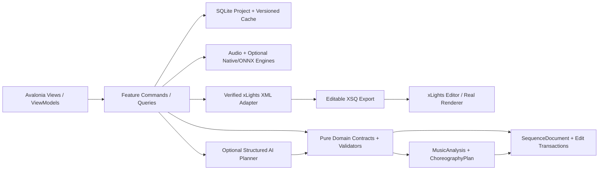
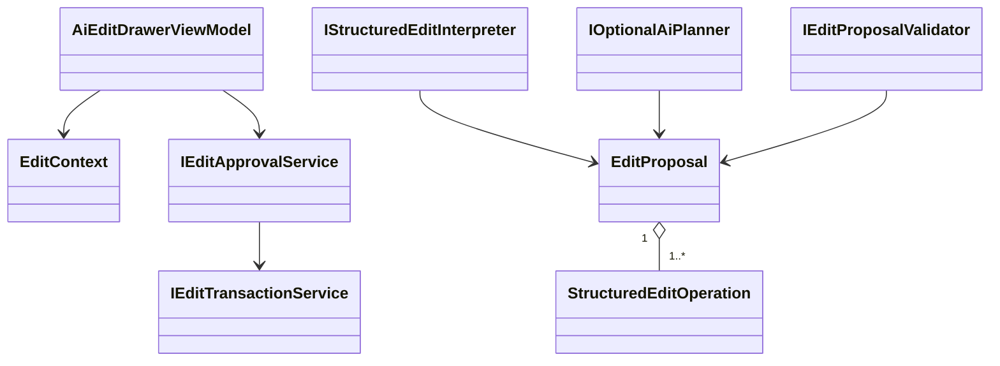
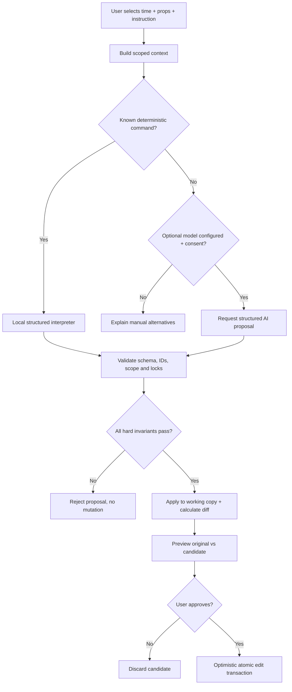

# PHASE 11 — Selective AI Editing

**Specification version:** 2.0 / 2026-10-10 | **Steps:** 072–078 | **Status:** Proposed, unimplemented until gate evidence exists

**Standalone specification.** This document contains the relevant product assumptions, contracts, class relationships, business flows, numbered implementation tasks, test designs, risk gates and an agent prompt. It does **not** mean Phase 11 can run without earlier implemented code; it means an architect/agent can plan and implement the phase without consulting a separate high-level brief. Code below expresses **proposed API signatures**, not verified source code. Reconcile them with the actual repository and xLights version before implementation.

## 1. User outcome, release boundary and phase gate

**User story:** As a sequencer, I can select arches at 42–48 seconds and say “make the piano move left-to-right, leave the roof alone,” then inspect a proposed diff before approving it.

**Owned boundary:** Context-aware selection, deterministic structured commands, optional LLM edit planning, schema validation, scope enforcement and approval transactions.

**Out of scope:** No background agent secretly editing or launching scripts, no arbitrary file system access by LLM, no mandatory paid inference.

**Blocking phase gate:** Select 42–48 seconds on five arches, ask for rising piano pops, inspect affected models/times and before/after visualization; reject, repeat, approve, verify roofline hash unchanged.

**Depends on:** Phase 10: Layered Musical Composition.

**Unblocks:** Phase 12: Loop-Engineered Refinement.

The gate is PASS only with automated tests, persisted-output inspection, and a real UI or xLights demonstration appropriate to the phase. If xLights or the required hardware/backend is unavailable, report BLOCKED or NOT VERIFIED—never silently substitute a mock.

## 2. Architectural assumptions (fully restated for standalone use)

- **Product:** locally installable Avalonia/.NET 10 desktop application; no Python, Docker, Git or mandatory LLM subscription for end users. CPU-first inference; native/ONNX only after a demonstrated and legally redistributable runtime/model fit.
- **Topology:** modular monolith with vertical feature slices. UI (Views/ViewModels), application orchestration, pure domain contracts, and platform/infrastructure adapters. Do not fabricate generic interfaces without a concrete boundary.
- **Timing:** internally represent position with an explicit canonical monotonic clock tied to source audio origin. Preserve sample index/rate for analysis provenance; UI may show milliseconds. All time scopes are half-open `[start,end)`. Convert to xLights frames only when explicitly snapping or exporting.
- **Ownership:** SQLite project metadata and committed user edits; immutable source media (linked/copied with consent); hash-addressed and versioned analysis/preview artifacts on disk. Every cache key includes algorithm/model/settings versions.
- **xLights:** `xlights_rgbeffects.xml` describes models/groups and other show configuration; `xlights_networks.xml` covers controller/output configuration; editable sequence is `.xsq` XML; rendered playback data is `.fseq`. Never overwrite source show files silently. Match layout models by verified name/identity mapping; do not invent xLights effect parameters.
- **Safe editing:** `SequenceDocument` is the editable state. `ChoreographyPlan` is an intent proposal, not a destructive replacement. Keep optimistic revision checks, effect locks, selection scope, immutable before/after patches, undo/redo, and explicit human acceptance.
- **AI trust:** optional local or BYOK cloud AI returns validated structured proposals only. Do not execute LLM-produced code, scripts or XML directly. Treat song lyrics, filenames, descriptions and external metadata as untrusted data. Explicit consent before sending media-derived data to remote services.
- **Verification:** unit tests + fixtures + integration tests + one observable UI/xLights demonstration per phase. An XML parse pass does not prove xLights renders an effect. A numeric musical score does not prove artistic quality. Do not claim tests ran when they did not.
- **Migration:** upstream xLightsAI (MIT repository, with separate dependency/model license checks) is a pinned reference for behavior, data and effect recipes. Python may run only in developer comparison tooling; there is no runtime Python requirement in releases.

### Core architecture at a glance



### Stable domain names and cross-phase ownership

| Aggregate / contract | First introduced | Sole authority / rule |
|---|---:|---|
| `ProjectManifest` and `ProjectId` | 01 | Project identity/version + root; SQLite and JSON atomically recoverable |
| `DisplayGraph`, `DisplayModel`, `ModelId` | 02 | Imported xLights model identities/group info; reference layout by hash |
| `SequenceDocument`, `EffectInstance` | 02 | Editable effects/locked state provenance; never serialize business behavior directly as XML |
| `EditScope`, `EditTransaction`, `DocumentRevision` | 03 | Exact time + model boundary and user-approved reversibility |
| `SongAsset`, `IAudioTransport` | 04 | Original song hash, timebase and synchronized playback |
| `BeatGrid` | 05 | Analyzed/corrected beats and alternative tempo hypotheses |
| `StemManifest`, `StemAsset` | 06 | Derived separated sources; known model version and sample origin |
| `MelodyTrack`, `NoteEvent` | 07 | Note/onset/contour truth with human corrections |
| `SongStructure`, `MotifLink` | 08 | Related phrase identities and inheritance decisions |
| `SpatialDisplayGraph`, `SpatialPath` | 09 | Artistic routes / normalized geometry separate from imported xLights identities |
| `VisualStory`, `ChoreographyPlan` | 10 | Musical/visual intent before concrete effect rendering |
| `EditProposal` | 11 | Untrusted/optional AI idea validated before `EditTransaction` |
| `LoopRun`, `Candidate`, `QualityReport` | 12 | Bounded attempts and reproducible candidate comparisons |
| `RenderArtifact` | 13 | Actual or clearly-marked approximate preview evidence |
| `WholeSongPlan` | 14 | Section continuity and approved phrase assembly |
| `ReleaseManifest` | 15 | Platform/model assets and delivery integrity |
| `ReleaseReadiness` | 16 | Explicit community compatibility/artistic evidence and release gate |

### Shared canonical C# identifiers

Define these once in `Studio.Contracts`. They are included here so the current phase spec can stand alone. **Do not redefine copies with different namespaces in code.**

```csharp
// Shared across phases; put these in Studio.Contracts (single declarations in the codebase).
namespace XlightsAI.Studio.Contracts;
public readonly record struct ProjectId(Guid Value);
public readonly record struct SongId(Guid Value);
public readonly record struct ModelId(string Value);
public readonly record struct DocumentRevision(long Value);
public readonly record struct TimelineTick(long Value); // 100 ns ticks from song origin
public readonly record struct TimeWindow(long StartTicks, long EndTicks); // [Start, End)
```

## 3. Phase-specific design and contracts

**Inputs:** `SequenceDocument`, `EditScope`, selected phrase/note/stem/motif context, locks, available gesture grammar, user instruction and optional configured model provider.

**Outputs:** `EditProposal` with typed bounded operations, validation report, before/after diff, approval record and optional propagated motif edits.

### Architectural design notes

Use a **structured plan not freeform XSQ**. Parse deterministic commands (brightness, reverse, follow lead, restrict targets, replace recipe) without a model when possible. Optional local/cloud LLM receives a redacted, least-privilege context containing just selected props/time and available op schema; require explicit opt-in for remote service and explain token use/cost. Treat model output as untrusted: strict JSON schema; reject unknown properties, unknown models, stale revision, time scope extension, effect lock conflicts and unsupported recipes. Prepare proposal in a sandbox copy, render and show a clear diff. Commit only upon user approval via Phase 03 `IEditTransactionService`. For edits involving boundary-crossing effects, apply a verified split/preserve policy or ask user to broaden scope.

### Proposed C# signatures

These are explicit API intent and relationship signatures, not an assertion that the existing repository already implements them. Favor the phase-local interfaces shown, adapt names to repository conventions, and record any compatibility decision. Referenced records introduced by prior phases are intentionally not redefined.

```csharp
using XlightsAI.Studio.Contracts;
using XlightsAI.Studio.Editing;
using XlightsAI.Studio.Melody;
using XlightsAI.Studio.Composition;
using XlightsAI.Studio.Xlights;
namespace XlightsAI.Studio.AiEdits;
public sealed record EditContext(long BaseDocumentRevision, EditScope Scope,
    IReadOnlyList<NoteEvent> Notes, IReadOnlyList<PlannedGesture> CurrentGestures,
    IReadOnlyList<string> PermittedRecipeIds);
public sealed record StructuredEditOperation(string OperationId, string Kind,
    TimeWindow Range, IReadOnlyList<ModelId> Targets,
    IReadOnlyDictionary<string, string> Parameters);
public sealed record EditProposal(Guid Id, long BaseRevision,
    IReadOnlyList<StructuredEditOperation> Operations, string Explanation);
public sealed record ProposalValidation(bool Allowed, IReadOnlyList<string> Errors,
    IReadOnlyList<string> Warnings);
public interface IStructuredEditInterpreter {
    EditProposal ParseKnownCommand(string instruction, EditContext context);
}
public interface IOptionalAiPlanner {
    Task<EditProposal> ProposeAsync(string instruction, EditContext context, CancellationToken ct);
}
public interface IEditProposalValidator {
    ProposalValidation Validate(EditProposal proposal, EditContext context, SequenceDocument document);
}
public interface IEditApprovalService {
    Task<EditTransaction> ApproveAsync(Guid proposalId, CancellationToken ct);
}
```

### Class relationship diagram



### Core process flowchart



## 4. Data contract, state ownership, migrations and caching

Store pending proposal, base document revision, provider/model config (without plaintext secrets), request provenance, redacted audit log, validation results, accept/reject status and committed transaction. Never log API keys or whole lyrics by default.

### Contract compatibility rules

- Keep IDs stable across UI views, SQLite and exported artifacts; never persist Avalonia object instances or XML DOM nodes as domain objects.
- Schema changes require versioned migrations, fixture updates and tests against the preceding project version.
- Analysis caches may be rebuilt if their source/model/version hash changes; accepted manual edits are never disposable cache.
- All edits to `SequenceDocument` pass a revision-aware command boundary. Preview artifacts and AI proposals cannot update the accepted document directly.
- Logs include operation/fixture correlation IDs and error codes. External model names and XML payloads are treated as untrusted input.

## 5. User interface / screen behavior

Use the existing Avalonia shell and apply this phase incrementally; do not present empty future functionality as implemented. These wireframe images are conceptual design references, not pixels that must be copied literally.

- **SCREEN 14 AI EDIT** — [Visual wireframe](../assets/wireframes/SCREEN-14-AI-EDIT.png). The screen must show loading/empty/error states, responsive resizing, keyboard navigation and an explicit version/status indicator when data is derived.
- **SCREEN 13 TIMELINE** — [Visual wireframe](../assets/wireframes/SCREEN-13-TIMELINE.png). The screen must show loading/empty/error states, responsive resizing, keyboard navigation and an explicit version/status indicator when data is derived.

UI behavior must always show *which song, time range, props, analysis source, version and approval state* the user is operating on when those concepts are available at this phase.

## 6. Numbered build slices — implement in order

Each numbered item is a complete vertical test cut: UI/command -> domain rule -> persistence or adapter -> observable result -> automated test. Avoid collecting multiple unverified tasks into one mega-commit.

### Step 072 — Create persisted selection context: interval, props, instruments, phrases, locks

**User-visible outcome:** Avalonia screenshot or repeatable desktop interaction recording with saved-state verification.

**Implementation guidance:** Snapshot selected notes/stem/phrase/path/effects with original revision and allowed models/time, not entire show by default.

**Required acceptance:** Serialization test preserves exact selection and scope.

**Failure/edge case to prove:** Out-of-scope, locked or stale revision must be rejected without partial mutation.

**Suggested automated acceptance test:** `Step072_Acceptance_Passes`. Implement a deterministic fixture and assert persisted domain state plus public output, not only a mock invocation. Include a negative-path assertion.

**Evidence:** Write `implementation-evidence/PHASE-11/STEP-072.md` with commands actually executed, input hashes, actual results, screen/output artifact, unresolved issues, and an explicit PASS/BLOCKED status.

- [ ] Implementation / tests / observable demo / evidence all complete before next numbered step.

### Step 073 — Implement deterministic command AST for brightness/motion/direction/speed/replace

**User-visible outcome:** Versioned, inspectable project output plus a reproducible test report.

**Implementation guidance:** Implement local typed edit grammar and parameter validation for brightness, direction, snap, hold and role-change actions.

**Required acceptance:** UI quick actions work offline and no token usage.

**Failure/edge case to prove:** Invalid input, cancellation or stale persisted state must not corrupt the project.

**Suggested automated acceptance test:** `Step073_Acceptance_Passes`. Implement a deterministic fixture and assert persisted domain state plus public output, not only a mock invocation. Include a negative-path assertion.

**Evidence:** Write `implementation-evidence/PHASE-11/STEP-073.md` with commands actually executed, input hashes, actual results, screen/output artifact, unresolved issues, and an explicit PASS/BLOCKED status.

- [ ] Implementation / tests / observable demo / evidence all complete before next numbered step.

### Step 074 — Add edit request panel, suggestions and change explanation

**User-visible outcome:** Versioned, inspectable project output plus a reproducible test report.

**Implementation guidance:** Create selection-summary drawer listing affected props and exact time range and AI text input; do not send until explicit action.

**Required acceptance:** Request always displays target context.

**Failure/edge case to prove:** Out-of-scope, locked or stale revision must be rejected without partial mutation.

**Suggested automated acceptance test:** `Step074_Acceptance_Passes`. Implement a deterministic fixture and assert persisted domain state plus public output, not only a mock invocation. Include a negative-path assertion.

**Evidence:** Write `implementation-evidence/PHASE-11/STEP-074.md` with commands actually executed, input hashes, actual results, screen/output artifact, unresolved issues, and an explicit PASS/BLOCKED status.

- [ ] Implementation / tests / observable demo / evidence all complete before next numbered step.

### Step 075 — Add optional Ollama/cloud provider behind opt-in structured-output adapter

**User-visible outcome:** Versioned, inspectable project output plus a reproducible test report.

**Implementation guidance:** Provider interface supports offline local and BYOK cloud; redact context, enforce size/timeouts, retries, consent and no silent paid requests.

**Required acceptance:** Provider off means no outbound calls; malformed JSON rejected.

**Failure/edge case to prove:** Invalid input, cancellation or stale persisted state must not corrupt the project.

**Suggested automated acceptance test:** `Step075_Acceptance_Passes`. Implement a deterministic fixture and assert persisted domain state plus public output, not only a mock invocation. Include a negative-path assertion.

**Evidence:** Write `implementation-evidence/PHASE-11/STEP-075.md` with commands actually executed, input hashes, actual results, screen/output artifact, unresolved issues, and an explicit PASS/BLOCKED status.

- [ ] Implementation / tests / observable demo / evidence all complete before next numbered step.

### Step 076 — Implement dry-run proposals, before/after diff and Accept/Reject

**User-visible outcome:** Versioned, inspectable project output plus a reproducible test report.

**Implementation guidance:** Diff proposals against immutable document and show changed effect count/models/time, with preview and explicit reject.

**Required acceptance:** Reject leaves state byte-equivalent; accept records transaction.

**Failure/edge case to prove:** Clean machine and unsupported runtime must produce user-readable diagnostics.

**Suggested automated acceptance test:** `Step076_Acceptance_Passes`. Implement a deterministic fixture and assert persisted domain state plus public output, not only a mock invocation. Include a negative-path assertion.

**Evidence:** Write `implementation-evidence/PHASE-11/STEP-076.md` with commands actually executed, input hashes, actual results, screen/output artifact, unresolved issues, and an explicit PASS/BLOCKED status.

- [ ] Implementation / tests / observable demo / evidence all complete before next numbered step.

### Step 077 — Implement explicit motif propagation and edit-scope intersection validation

**User-visible outcome:** Versioned, inspectable project output plus a reproducible test report.

**Implementation guidance:** Apply motif propagation only after preview of all affected occurrences and each target locks/scope permissions; support instance-only choice.

**Required acceptance:** Locked/out-of-scope effects cannot change even with malicious proposal.

**Failure/edge case to prove:** Out-of-scope, locked or stale revision must be rejected without partial mutation.

**Suggested automated acceptance test:** `Step077_Acceptance_Passes`. Implement a deterministic fixture and assert persisted domain state plus public output, not only a mock invocation. Include a negative-path assertion.

**Evidence:** Write `implementation-evidence/PHASE-11/STEP-077.md` with commands actually executed, input hashes, actual results, screen/output artifact, unresolved issues, and an explicit PASS/BLOCKED status.

- [ ] Implementation / tests / observable demo / evidence all complete before next numbered step.

### Step 078 — Persist proposal audit, undo/redo and failure recovery

**User-visible outcome:** Versioned, inspectable project output plus a reproducible test report.

**Implementation guidance:** Persist proposal lifecycle, validation failures and accepted transactions; test restart mid-proposal and provider error.

**Required acceptance:** Crash/restart leaves committed edits intact, partial proposal uncommitted.

**Failure/edge case to prove:** Out-of-scope, locked or stale revision must be rejected without partial mutation.

**Suggested automated acceptance test:** `Step078_Acceptance_Passes`. Implement a deterministic fixture and assert persisted domain state plus public output, not only a mock invocation. Include a negative-path assertion.

**Evidence:** Write `implementation-evidence/PHASE-11/STEP-078.md` with commands actually executed, input hashes, actual results, screen/output artifact, unresolved issues, and an explicit PASS/BLOCKED status.

- [ ] Implementation / tests / observable demo / evidence all complete before next numbered step.

## 7. Full-phase test plan and quality gate matrix

| # | Test scenario / invariant | Type | Required evidence |
|---:|---|---|---|
| 1 | Deterministic “reverse selected arches” works offline | Unit + property | Actual result, input hash/fixture and pass/fail |
| 2 | Unknown instruction produces controlled no-op or model offer | Integration/golden | Actual result, input hash/fixture and pass/fail |
| 3 | LLM cannot target Roofline outside selected arches | Desktop/manual | Actual result, input hash/fixture and pass/fail |
| 4 | Unknown effect recipe is rejected | Unit + property | Actual result, input hash/fixture and pass/fail |
| 5 | Prompt-injection-like lyrics remain untrusted data | Integration/golden | Actual result, input hash/fixture and pass/fail |
| 6 | Locked effect blocks even valid-looking proposal | Desktop/manual | Actual result, input hash/fixture and pass/fail |
| 7 | User reject leaves document hashes unchanged | Unit + property | Actual result, input hash/fixture and pass/fail |
| 8 | Accept creates one undoable transaction and survives restart | Integration/golden | Actual result, input hash/fixture and pass/fail |

### Phase gate demonstration — exact user workflow

Select 42–48 seconds on five arches, ask for rising piano pops, inspect affected models/times and before/after visualization; reject, repeat, approve, verify roofline hash unchanged.

### Failure handling and known technical risks

LLM hallucinated model IDs, prompt injection in lyrics, privacy leakage to cloud, stale revision, scope escape, unbounded cost, difficult multi-prop range boundary and misleading preview.

### Cross-cutting negative cases

- **Invalid/stale input:** reject and show the source of the problem; do not commit partial project state.
- **Cancellation:** propagate `CancellationToken`, dispose native/audio resources and leave resumable or safely rolled-back job state.
- **Compatibility:** detect actual versions/capabilities. No undocumented claim that all xLights versions or ML models behave identically.
- **Non-destructive writes:** if a user selects a show directory or existing XSQ, default to creating a new app-owned artifact rather than silently overwriting.
- **Regression:** rerun all previous phase gates affected by changed domain contracts or serializer versions.

## 8. Implementation checkpoints, decisions and handoff

### Recommended internal development order

1. Inspect the current committed code and pinned upstream reference; enumerate differences from signatures in this document.
2. Create fixtures and tests for the *first* numbered step; document exact external dependencies before writing the adapter.
3. Build one end-to-end slice, run the targeted tests, demonstrate the new behavior, then record evidence and proceed.
4. Update architecture decision records for genuine tradeoffs and migration decisions. Do not generalize everything into an interface.
5. At completion, run full automated regression and the phase demonstration; record blocker status truthfully.

### Explicit ADR questions to resolve during this phase

- **Primary design choice:** Is the proposed selective ai editing contract compatible with existing repository conventions and user-approved state?
- **Runtime/source truth:** Which behaviors can be verified locally, and which require a specific xLights build, external model, audio device, or human judgment?
- **Recovery and rollback:** What happens on crash, cancellation, stale file version or invalid external content?
- **Dependency and licenses:** Are required upstream algorithms, model files or native libraries version-pinned and redistributable?

### Required final gate report

- [ ] All named numbered steps show independently recorded evidence.
- [ ] Compiles; full unit/integration/golden regression run records actual commands.
- [ ] Desktop interaction was exercised or explicitly reported blocked.
- [ ] Required xLights/manual/inference test ran against a recorded version, if applicable.
- [ ] Missing assumptions, compatibility limits, technical debt and migration impacts recorded.
- [ ] Previous accepted sequences/project files are unchanged except approved migrations/edits.
- [ ] Gate result = PASS or BLOCKED. Next phase begins only after PASS or an explicit scoped architecture waiver.

## 9. Copy/paste coding-agent prompt (phase-local)

```text
You are acting as a senior .NET/Avalonia architect and implementation agent on the xLights AI Choreography Studio repository.
Implement the PHASE 11 (Selective AI Editing) only, in numbered-step order. This spec is the source of truth for the current phase and contains the necessary contract and verification context. Read the existing repository and baseline history first; **do not copy sample signatures over working established contracts blindly**. Resolve any older/newer contract discrepancy with a short architecture decision and compatibility migration.

For EACH numbered step: (1) inspect only relevant repo files and pinned upstream sources; (2) write acceptance/failure tests first or alongside code; (3) implement the smallest complete UI -> application -> domain -> persistence/export pathway; (4) compile/run targeted and existing tests; (5) execute the manual demo or report explicitly why it could not run; (6) update completion/evidence notes in `implementation-evidence/PHASE-11/STEP-XXX.md`; (7) commit the step if permitted. Do not cross into future features except narrow stable contracts. Hard gates cannot be traded for weighted scoring.

Before ending the phase, produce a Gate Report showing exact tests/commands, observed results, fixture IDs/hashes, screenshots/XSQ artifacts, unverified assumptions, known risks and whether the phase gate is PASS/BLOCKED. Do not claim test success without execution. Do not start the next phase when blocked.

CURRENT SCOPE: Phase 11: Selective AI Editing. Implement only numbered steps 072, 073, 074, 075, 076, 077, 078.
CORE DEMO REQUIRED: Select 42–48 seconds on five arches, ask for rising piano pops, inspect affected models/times and before/after visualization; reject, repeat, approve, verify roofline hash unchanged.
NEVER CLAIM THE GATE PASSED WITHOUT: Accept creates one undoable transaction and survives restart
```

## 10. Developer test evidence format

```yaml
step: 072
phase: 11
implementation_commit: TO_BE_FILLED
source_fixture_hashes: []
automated_tests:
  - name: TO_BE_FILLED
    command: TO_BE_FILLED
    result: NOT_RUN
manual_demo:
  instructions: TO_BE_FILLED
  observed: NOT_RUN
xlights_version: NOT_TESTED
artifact_paths: []
blocking_failures: []
architectural_decisions: []
status: NOT_STARTED
```

## 11. Authoritative documentation and verification sources

The URLs below are references for implementation research, not substitute proof that our code or any installed xLights version works. Always pin relevant upstream revisions and record observed behavior.

- xLights source / headless rendering design (verify installed builds separately): https://github.com/xLightsSequencer/xLights/blob/master/AGENTS.md
- xLights manual glossary (layout/sequence formats): https://manual.xlights.org/xlights/appendicies/glossary
- xLights timing tracks: https://manual.xlights.org/xlights/chapters/chapter-four-sequencer/timing-tracks
- xLights model groups: https://manual.xlights.org/xlights/chapters/chapter-four-tabs/model-groups
- xLights importing and re-rendering: https://manual.xlights.org/xlights/chapters/chapter-five-menus/import
- xLights official source repository: https://github.com/xLightsSequencer/xLights
- Real public XSQ example (for observation; verify against target version): https://github.com/FRC3620/xlights.sign1/blob/main/2026%20Doug.xsq
- xLightsAI upstream raw XSQ generator path: `src/generator/xsq_writer.py` in pinned upstream checkout.

### Nearby package material (optional supporting context; this phase is complete without it)

- [`MASTER-SYSTEM-ARCHITECTURE.md`](../MASTER-SYSTEM-ARCHITECTURE.md)
- [`XLIGHTS-SEQUENCE-ENGINEERING-GUIDE.md`](../XLIGHTS-SEQUENCE-ENGINEERING-GUIDE.md)
- [`UI-UX-SCREEN-BLUEPRINTS.md`](../UI-UX-SCREEN-BLUEPRINTS.md)
- [`TEST-DATA-AND-ACCEPTANCE.md`](../TEST-DATA-AND-ACCEPTANCE.md)
- [`prompts/PHASE-11-PROMPT.md`](../prompts/PHASE-11-PROMPT.md)

## 12. Structured AI proposal envelope (shape example)

```json
{
  "baseDocumentRevision": 31,
  "scope": {"startTicks": 420000000, "endTicks": 480000000,
            "modelIds": ["arch-01", "arch-02", "arch-03"], "respectLocks": true},
  "operations": [
    {"kind": "ReplaceScopedGestures", "recipeId": "verified-step-pop-v1",
     "pathId": "front-arches", "source": "lead-piano", "direction": "follow-contour"}
  ]
}
```

This JSON is an *illustrative envelope*, not the final API schema. Compare IDs and parameter domains with registered values; reject any unknown `kind`, `pathId`, `source` or `recipeId`. Never treat the natural language or output JSON as permission to edit unrelated props.
