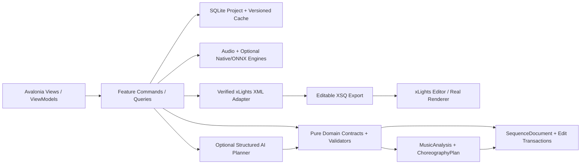
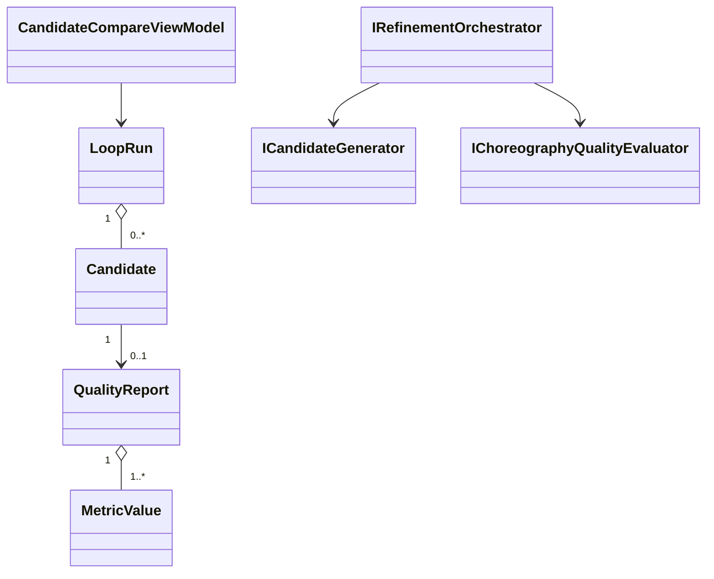
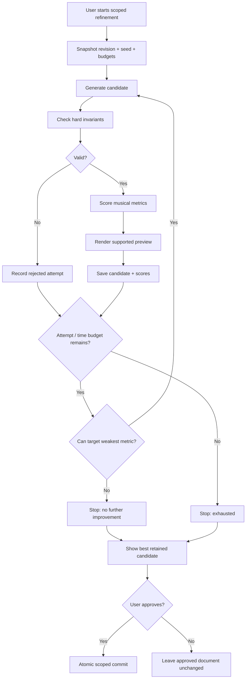

# PHASE 12 — Loop-Engineered Refinement

**Specification version:** 2.0 / 2026-10-10 | **Steps:** 079–084 | **Status:** Proposed, unimplemented until gate evidence exists

**Standalone specification.** This document contains the relevant product assumptions, contracts, class relationships, business flows, numbered implementation tasks, test designs, risk gates and an agent prompt. It does **not** mean Phase 12 can run without earlier implemented code; it means an architect/agent can plan and implement the phase without consulting a separate high-level brief. Code below expresses **proposed API signatures**, not verified source code. Reconcile them with the actual repository and xLights version before implementation.

## 1. User outcome, release boundary and phase gate

**User story:** As a sequencer, I can ask the app to try several variants of a phrase, see exactly why they were scored, and keep the best candidate without risking my approved edits.

**Owned boundary:** Durable bounded refinement run, deterministic candidate generation, technical scoring, failure-specific repair, stop criteria and candidate comparison.

**Out of scope:** No claim that a weighted quality score proves emotional impact; no infinite LLM loop; no auto-commit without human approval.

**Blocking phase gate:** Start with a knowingly over-busy 8-bar phrase, generate three candidates, inspect density/timing metrics and previews, accept one, then use Undo and show previous state restored.

**Depends on:** Phase 11: Selective AI Editing.

**Unblocks:** Phase 13: xLights Rendering and Visual Evaluation.

The gate is PASS only with automated tests, persisted-output inspection, and a real UI or xLights demonstration appropriate to the phase. If xLights or the required hardware/backend is unavailable, report BLOCKED or NOT VERIFIED—never silently substitute a mock.

## 2. Architectural assumptions (fully restated for standalone use)

- **Product:** locally installable Avalonia/.NET 10 desktop application; no Python, Docker, Git or mandatory LLM subscription for end users. CPU-first inference; native/ONNX only after a demonstrated and legally redistributable runtime/model fit.
- **Topology:** modular monolith with vertical feature slices. UI (Views/ViewModels), application orchestration, pure domain contracts, and platform/infrastructure adapters. Do not fabricate generic interfaces without a concrete boundary.
- **Timing:** internally represent position with an explicit canonical monotonic clock tied to source audio origin. Preserve sample index/rate for analysis provenance; UI may show milliseconds. All time scopes are half-open `[start,end)`. Convert to xLights frames only when explicitly snapping or exporting.
- **Ownership:** SQLite project metadata and committed user edits; immutable source media (linked/copied with consent); hash-addressed and versioned analysis/preview artifacts on disk. Every cache key includes algorithm/model/settings versions.
- **xLights:** `xlights_rgbeffects.xml` describes models/groups and other show configuration; `xlights_networks.xml` covers controller/output configuration; editable sequence is `.xsq` XML; rendered playback data is `.fseq`. Never overwrite source show files silently. Match layout models by verified name/identity mapping; do not invent xLights effect parameters.
- **Safe editing:** `SequenceDocument` is the editable state. `ChoreographyPlan` is an intent proposal, not a destructive replacement. Keep optimistic revision checks, effect locks, selection scope, immutable before/after patches, undo/redo, and explicit human acceptance.
- **AI trust:** optional local or BYOK cloud AI returns validated structured proposals only. Do not execute LLM-produced code, scripts or XML directly. Treat song lyrics, filenames, descriptions and external metadata as untrusted data. Explicit consent before sending media-derived data to remote services.
- **Verification:** unit tests + fixtures + integration tests + one observable UI/xLights demonstration per phase. An XML parse pass does not prove xLights renders an effect. A numeric musical score does not prove artistic quality. Do not claim tests ran when they did not.
- **Migration:** upstream xLightsAI (MIT repository, with separate dependency/model license checks) is a pinned reference for behavior, data and effect recipes. Python may run only in developer comparison tooling; there is no runtime Python requirement in releases.

### Core architecture at a glance



### Stable domain names and cross-phase ownership

| Aggregate / contract | First introduced | Sole authority / rule |
|---|---:|---|
| `ProjectManifest` and `ProjectId` | 01 | Project identity/version + root; SQLite and JSON atomically recoverable |
| `DisplayGraph`, `DisplayModel`, `ModelId` | 02 | Imported xLights model identities/group info; reference layout by hash |
| `SequenceDocument`, `EffectInstance` | 02 | Editable effects/locked state provenance; never serialize business behavior directly as XML |
| `EditScope`, `EditTransaction`, `DocumentRevision` | 03 | Exact time + model boundary and user-approved reversibility |
| `SongAsset`, `IAudioTransport` | 04 | Original song hash, timebase and synchronized playback |
| `BeatGrid` | 05 | Analyzed/corrected beats and alternative tempo hypotheses |
| `StemManifest`, `StemAsset` | 06 | Derived separated sources; known model version and sample origin |
| `MelodyTrack`, `NoteEvent` | 07 | Note/onset/contour truth with human corrections |
| `SongStructure`, `MotifLink` | 08 | Related phrase identities and inheritance decisions |
| `SpatialDisplayGraph`, `SpatialPath` | 09 | Artistic routes / normalized geometry separate from imported xLights identities |
| `VisualStory`, `ChoreographyPlan` | 10 | Musical/visual intent before concrete effect rendering |
| `EditProposal` | 11 | Untrusted/optional AI idea validated before `EditTransaction` |
| `LoopRun`, `Candidate`, `QualityReport` | 12 | Bounded attempts and reproducible candidate comparisons |
| `RenderArtifact` | 13 | Actual or clearly-marked approximate preview evidence |
| `WholeSongPlan` | 14 | Section continuity and approved phrase assembly |
| `ReleaseManifest` | 15 | Platform/model assets and delivery integrity |
| `ReleaseReadiness` | 16 | Explicit community compatibility/artistic evidence and release gate |

### Shared canonical C# identifiers

Define these once in `Studio.Contracts`. They are included here so the current phase spec can stand alone. **Do not redefine copies with different namespaces in code.**

```csharp
// Shared across phases; put these in Studio.Contracts (single declarations in the codebase).
namespace XlightsAI.Studio.Contracts;
public readonly record struct ProjectId(Guid Value);
public readonly record struct SongId(Guid Value);
public readonly record struct ModelId(string Value);
public readonly record struct DocumentRevision(long Value);
public readonly record struct TimelineTick(long Value); // 100 ns ticks from song origin
public readonly record struct TimeWindow(long StartTicks, long EndTicks); // [Start, End)
```

## 3. Phase-specific design and contracts

**Inputs:** Scoped choreography proposal, source music/gesture features, optional model provider, display path, locks, per-user quality presets.

**Outputs:** Persisted `LoopRun`, candidate lineage, metric breakdown, best technical candidate, stop reason and chosen accepted transaction.

### Architectural design notes

The orchestration graph is **deterministic**; creativity lives in **bounded repair loops**. State machine: Queued -> Generating -> Validating -> PreviewReady/Blocked -> AwaitingApproval -> Accepted/Rejected. Each attempt takes a versioned snapshot and seeded candidate inputs, enforces immutable hard constraints first, then scores soft metrics. Never compare candidates evaluated with incomparable scorer versions. Reject candidate on scope/lock, invalid timing, missing recipe or render failures regardless of aesthetic score. Use targeted repair strategy for weakest failing metric (timing, density, pitch motion, rest, repeated motif). Stop at max attempts, no-improvement patience, cancellation or missing prerequisite; preserve best candidate, metric evidence and failed attempts for diagnostic reuse. AI model use is optional and budgeted.

### Proposed C# signatures

These are explicit API intent and relationship signatures, not an assertion that the existing repository already implements them. Favor the phase-local interfaces shown, adapt names to repository conventions, and record any compatibility decision. Referenced records introduced by prior phases are intentionally not redefined.

```csharp
using XlightsAI.Studio.Contracts;
using XlightsAI.Studio.Editing;
using XlightsAI.Studio.Composition;
namespace XlightsAI.Studio.Refinement;
public enum RefinementStatus { Queued, Generating, Validating, PreviewReady,
    AwaitingApproval, Accepted, Rejected, Blocked, Cancelled }
public sealed record MetricValue(string Name, double Value, double Weight,
    bool HardGate, string Explanation);
public sealed record QualityReport(Guid CandidateId, string EvaluatorVersion,
    IReadOnlyList<MetricValue> Metrics, IReadOnlyList<string> Violations);
public sealed record Candidate(Guid Id, Guid RunId, int Attempt, int Seed,
    string SnapshotHash, ChoreographyPlan Plan, QualityReport? Report);
public sealed record LoopRun(Guid Id, long BaseRevision, EditScope Scope,
    int MaxAttempts, int AttemptsMade, RefinementStatus Status, Guid? BestCandidateId);
public interface ICandidateGenerator {
    Task<Candidate> GenerateAsync(LoopRun run, Candidate? prior, CancellationToken ct);
}
public interface IChoreographyQualityEvaluator {
    Task<QualityReport> EvaluateAsync(Candidate candidate, CancellationToken ct);
}
public interface IRefinementOrchestrator {
    Task<LoopRun> ExecuteAsync(Guid runId, CancellationToken ct);
    Task CancelAsync(Guid runId, CancellationToken ct);
}
```

### Class relationship diagram



### Core process flowchart



## 4. Data contract, state ownership, migrations and caching

SQLite contains loop states, candidate IDs, scores, provenance, seeds, error codes, attempt number, elapsed cost, stop reason and accepted snapshot. Large preview artifacts stored by hash; restarting should resume eligible incomplete jobs without duplicate mutations.

### Contract compatibility rules

- Keep IDs stable across UI views, SQLite and exported artifacts; never persist Avalonia object instances or XML DOM nodes as domain objects.
- Schema changes require versioned migrations, fixture updates and tests against the preceding project version.
- Analysis caches may be rebuilt if their source/model/version hash changes; accepted manual edits are never disposable cache.
- All edits to `SequenceDocument` pass a revision-aware command boundary. Preview artifacts and AI proposals cannot update the accepted document directly.
- Logs include operation/fixture correlation IDs and error codes. External model names and XML payloads are treated as untrusted input.

## 5. User interface / screen behavior

Use the existing Avalonia shell and apply this phase incrementally; do not present empty future functionality as implemented. These wireframe images are conceptual design references, not pixels that must be copied literally.

- **SCREEN 15 COMPARE** — [Visual wireframe](../assets/wireframes/SCREEN-15-COMPARE.png). The screen must show loading/empty/error states, responsive resizing, keyboard navigation and an explicit version/status indicator when data is derived.
- **SCREEN 14 AI EDIT** — [Visual wireframe](../assets/wireframes/SCREEN-14-AI-EDIT.png). The screen must show loading/empty/error states, responsive resizing, keyboard navigation and an explicit version/status indicator when data is derived.

UI behavior must always show *which song, time range, props, analysis source, version and approval state* the user is operating on when those concepts are available at this phase.

## 6. Numbered build slices — implement in order

Each numbered item is a complete vertical test cut: UI/command -> domain rule -> persistence or adapter -> observable result -> automated test. Avoid collecting multiple unverified tasks into one mega-commit.

### Step 079 — Create persisted run/candidate/result schema with hashes, seeds and state transitions

**User-visible outcome:** Versioned, inspectable project output plus a reproducible test report.

**Implementation guidance:** Define resumable job states with input hashes, selected scope, attempts, last heartbeat, seeds and cancellation records; use transactionally claimed work.

**Required acceptance:** Interrupted run resumes idempotently.

**Failure/edge case to prove:** Malformed proposal, no-improvement and exhausted retry budget must not auto-commit.

**Suggested automated acceptance test:** `Step079_Acceptance_Passes`. Implement a deterministic fixture and assert persisted domain state plus public output, not only a mock invocation. Include a negative-path assertion.

**Evidence:** Write `implementation-evidence/PHASE-12/STEP-079.md` with commands actually executed, input hashes, actual results, screen/output artifact, unresolved issues, and an explicit PASS/BLOCKED status.

- [ ] Implementation / tests / observable demo / evidence all complete before next numbered step.

### Step 080 — Build seeded candidate generator constrained to selected gesture family

**User-visible outcome:** Avalonia screenshot or repeatable desktop interaction recording with saved-state verification.

**Implementation guidance:** Build deterministic parameter variation and seeded gesture generation; preserve lineage links and edit permissions.

**Required acceptance:** Same seed + inputs yields same structured candidate.

**Failure/edge case to prove:** Malformed proposal, no-improvement and exhausted retry budget must not auto-commit.

**Suggested automated acceptance test:** `Step080_Acceptance_Passes`. Implement a deterministic fixture and assert persisted domain state plus public output, not only a mock invocation. Include a negative-path assertion.

**Evidence:** Write `implementation-evidence/PHASE-12/STEP-080.md` with commands actually executed, input hashes, actual results, screen/output artifact, unresolved issues, and an explicit PASS/BLOCKED status.

- [ ] Implementation / tests / observable demo / evidence all complete before next numbered step.

### Step 081 — Implement quality evaluators: timing, melodic alignment, density, motif reuse, legal effects

**User-visible outcome:** Generated XML artifact and semantic diff/fixture, with xLights validation if this step changes rendering.

**Implementation guidance:** Implement invariant gates (XML/effect compatibility, time/model scopes, locks) apart from soft music/density metrics with clear units.

**Required acceptance:** Known good/bad fixtures produce expected scores and findings.

**Failure/edge case to prove:** Silence, invalid timing boundaries and missing media must be handled explicitly.

**Suggested automated acceptance test:** `Step081_Acceptance_Passes`. Implement a deterministic fixture and assert persisted domain state plus public output, not only a mock invocation. Include a negative-path assertion.

**Evidence:** Write `implementation-evidence/PHASE-12/STEP-081.md` with commands actually executed, input hashes, actual results, screen/output artifact, unresolved issues, and an explicit PASS/BLOCKED status.

- [ ] Implementation / tests / observable demo / evidence all complete before next numbered step.

### Step 082 — Implement targeted repair strategy and preserve best-so-far candidate

**User-visible outcome:** Versioned, inspectable project output plus a reproducible test report.

**Implementation guidance:** Select a targeted mutation for failed metric (shorten holds, reduce density, repair direction) and compare without corrupting prior candidate.

**Required acceptance:** Repair only addresses reported dimension and respects locks.

**Failure/edge case to prove:** Malformed proposal, no-improvement and exhausted retry budget must not auto-commit.

**Suggested automated acceptance test:** `Step082_Acceptance_Passes`. Implement a deterministic fixture and assert persisted domain state plus public output, not only a mock invocation. Include a negative-path assertion.

**Evidence:** Write `implementation-evidence/PHASE-12/STEP-082.md` with commands actually executed, input hashes, actual results, screen/output artifact, unresolved issues, and an explicit PASS/BLOCKED status.

- [ ] Implementation / tests / observable demo / evidence all complete before next numbered step.

### Step 083 — Add retry, time, compute and quality thresholds; cancellation

**User-visible outcome:** Versioned, inspectable project output plus a reproducible test report.

**Implementation guidance:** Set hard budgets for attempts, elapsed time, cost, retries and no-improvement patience; expose stop reason to UI.

**Required acceptance:** Unproductive loop stops deterministically with reason.

**Failure/edge case to prove:** Silence, invalid timing boundaries and missing media must be handled explicitly.

**Suggested automated acceptance test:** `Step083_Acceptance_Passes`. Implement a deterministic fixture and assert persisted domain state plus public output, not only a mock invocation. Include a negative-path assertion.

**Evidence:** Write `implementation-evidence/PHASE-12/STEP-083.md` with commands actually executed, input hashes, actual results, screen/output artifact, unresolved issues, and an explicit PASS/BLOCKED status.

- [ ] Implementation / tests / observable demo / evidence all complete before next numbered step.

### Step 084 — Add candidate gallery, score explanations, preview and explicit selection

**User-visible outcome:** Avalonia screenshot or repeatable desktop interaction recording with saved-state verification.

**Implementation guidance:** Compare best-vs-current with scores and synchronized preview; record deliberate human accept/reject and optional feedback labels.

**Required acceptance:** User can compare alternatives and commit chosen candidate.

**Failure/edge case to prove:** Out-of-scope, locked or stale revision must be rejected without partial mutation.

**Suggested automated acceptance test:** `Step084_Acceptance_Passes`. Implement a deterministic fixture and assert persisted domain state plus public output, not only a mock invocation. Include a negative-path assertion.

**Evidence:** Write `implementation-evidence/PHASE-12/STEP-084.md` with commands actually executed, input hashes, actual results, screen/output artifact, unresolved issues, and an explicit PASS/BLOCKED status.

- [ ] Implementation / tests / observable demo / evidence all complete before next numbered step.

## 7. Full-phase test plan and quality gate matrix

| # | Test scenario / invariant | Type | Required evidence |
|---:|---|---|---|
| 1 | Same seed + inputs yields reproducible candidate | Unit + property | Actual result, input hash/fixture and pass/fail |
| 2 | A hard gate rejects scope leak even if all other scores high | Integration/golden | Actual result, input hash/fixture and pass/fail |
| 3 | Best candidate retained when later attempt is worse | Desktop/manual | Actual result, input hash/fixture and pass/fail |
| 4 | MaxAttempts enforced with exact attempt count | Unit + property | Actual result, input hash/fixture and pass/fail |
| 5 | Cancelled run never commits | Integration/golden | Actual result, input hash/fixture and pass/fail |
| 6 | Restart resumes persisted run state without repeating accepted work | Desktop/manual | Actual result, input hash/fixture and pass/fail |
| 7 | Quality metric evaluator-version mismatch flagged | Unit + property | Actual result, input hash/fixture and pass/fail |
| 8 | User approval checks base revision to prevent stale overwrite | Integration/golden | Actual result, input hash/fixture and pass/fail |

### Phase gate demonstration — exact user workflow

Start with a knowingly over-busy 8-bar phrase, generate three candidates, inspect density/timing metrics and previews, accept one, then use Undo and show previous state restored.

### Failure handling and known technical risks

Optimizing for proxy metrics rather than “feel”, expensive candidate explosion, random unrepeatability, generator changing scope, candidate order biases and mistaken score comparison after evaluator change.

### Cross-cutting negative cases

- **Invalid/stale input:** reject and show the source of the problem; do not commit partial project state.
- **Cancellation:** propagate `CancellationToken`, dispose native/audio resources and leave resumable or safely rolled-back job state.
- **Compatibility:** detect actual versions/capabilities. No undocumented claim that all xLights versions or ML models behave identically.
- **Non-destructive writes:** if a user selects a show directory or existing XSQ, default to creating a new app-owned artifact rather than silently overwriting.
- **Regression:** rerun all previous phase gates affected by changed domain contracts or serializer versions.

## 8. Implementation checkpoints, decisions and handoff

### Recommended internal development order

1. Inspect the current committed code and pinned upstream reference; enumerate differences from signatures in this document.
2. Create fixtures and tests for the *first* numbered step; document exact external dependencies before writing the adapter.
3. Build one end-to-end slice, run the targeted tests, demonstrate the new behavior, then record evidence and proceed.
4. Update architecture decision records for genuine tradeoffs and migration decisions. Do not generalize everything into an interface.
5. At completion, run full automated regression and the phase demonstration; record blocker status truthfully.

### Explicit ADR questions to resolve during this phase

- **Primary design choice:** Is the proposed loop-engineered refinement contract compatible with existing repository conventions and user-approved state?
- **Runtime/source truth:** Which behaviors can be verified locally, and which require a specific xLights build, external model, audio device, or human judgment?
- **Recovery and rollback:** What happens on crash, cancellation, stale file version or invalid external content?
- **Dependency and licenses:** Are required upstream algorithms, model files or native libraries version-pinned and redistributable?

### Required final gate report

- [ ] All named numbered steps show independently recorded evidence.
- [ ] Compiles; full unit/integration/golden regression run records actual commands.
- [ ] Desktop interaction was exercised or explicitly reported blocked.
- [ ] Required xLights/manual/inference test ran against a recorded version, if applicable.
- [ ] Missing assumptions, compatibility limits, technical debt and migration impacts recorded.
- [ ] Previous accepted sequences/project files are unchanged except approved migrations/edits.
- [ ] Gate result = PASS or BLOCKED. Next phase begins only after PASS or an explicit scoped architecture waiver.

## 9. Copy/paste coding-agent prompt (phase-local)

```text
You are acting as a senior .NET/Avalonia architect and implementation agent on the xLights AI Choreography Studio repository.
Implement the PHASE 12 (Loop-Engineered Refinement) only, in numbered-step order. This spec is the source of truth for the current phase and contains the necessary contract and verification context. Read the existing repository and baseline history first; **do not copy sample signatures over working established contracts blindly**. Resolve any older/newer contract discrepancy with a short architecture decision and compatibility migration.

For EACH numbered step: (1) inspect only relevant repo files and pinned upstream sources; (2) write acceptance/failure tests first or alongside code; (3) implement the smallest complete UI -> application -> domain -> persistence/export pathway; (4) compile/run targeted and existing tests; (5) execute the manual demo or report explicitly why it could not run; (6) update completion/evidence notes in `implementation-evidence/PHASE-12/STEP-XXX.md`; (7) commit the step if permitted. Do not cross into future features except narrow stable contracts. Hard gates cannot be traded for weighted scoring.

Before ending the phase, produce a Gate Report showing exact tests/commands, observed results, fixture IDs/hashes, screenshots/XSQ artifacts, unverified assumptions, known risks and whether the phase gate is PASS/BLOCKED. Do not claim test success without execution. Do not start the next phase when blocked.

CURRENT SCOPE: Phase 12: Loop-Engineered Refinement. Implement only numbered steps 079, 080, 081, 082, 083, 084.
CORE DEMO REQUIRED: Start with a knowingly over-busy 8-bar phrase, generate three candidates, inspect density/timing metrics and previews, accept one, then use Undo and show previous state restored.
NEVER CLAIM THE GATE PASSED WITHOUT: User approval checks base revision to prevent stale overwrite
```

## 10. Developer test evidence format

```yaml
step: 079
phase: 12
implementation_commit: TO_BE_FILLED
source_fixture_hashes: []
automated_tests:
  - name: TO_BE_FILLED
    command: TO_BE_FILLED
    result: NOT_RUN
manual_demo:
  instructions: TO_BE_FILLED
  observed: NOT_RUN
xlights_version: NOT_TESTED
artifact_paths: []
blocking_failures: []
architectural_decisions: []
status: NOT_STARTED
```

## 11. Authoritative documentation and verification sources

The URLs below are references for implementation research, not substitute proof that our code or any installed xLights version works. Always pin relevant upstream revisions and record observed behavior.

- xLights source / headless rendering design (verify installed builds separately): https://github.com/xLightsSequencer/xLights/blob/master/AGENTS.md
- xLights manual glossary (layout/sequence formats): https://manual.xlights.org/xlights/appendicies/glossary
- xLights timing tracks: https://manual.xlights.org/xlights/chapters/chapter-four-sequencer/timing-tracks
- xLights model groups: https://manual.xlights.org/xlights/chapters/chapter-four-tabs/model-groups
- xLights importing and re-rendering: https://manual.xlights.org/xlights/chapters/chapter-five-menus/import
- xLights official source repository: https://github.com/xLightsSequencer/xLights
- Real public XSQ example (for observation; verify against target version): https://github.com/FRC3620/xlights.sign1/blob/main/2026%20Doug.xsq
- xLightsAI upstream raw XSQ generator path: `src/generator/xsq_writer.py` in pinned upstream checkout.

### Nearby package material (optional supporting context; this phase is complete without it)

- [`MASTER-SYSTEM-ARCHITECTURE.md`](../MASTER-SYSTEM-ARCHITECTURE.md)
- [`XLIGHTS-SEQUENCE-ENGINEERING-GUIDE.md`](../XLIGHTS-SEQUENCE-ENGINEERING-GUIDE.md)
- [`UI-UX-SCREEN-BLUEPRINTS.md`](../UI-UX-SCREEN-BLUEPRINTS.md)
- [`TEST-DATA-AND-ACCEPTANCE.md`](../TEST-DATA-AND-ACCEPTANCE.md)
- [`prompts/PHASE-12-PROMPT.md`](../prompts/PHASE-12-PROMPT.md)

## 12. Bounded refinement pseudocode

```csharp
var best = await repository.LoadBestAsync(run.Id, ct);
for (var attempt = run.AttemptsMade; attempt < run.MaxAttempts; attempt++) {
    ct.ThrowIfCancellationRequested();
    var candidate = await generator.GenerateAsync(run, best, ct);
    var report = await evaluator.EvaluateAsync(candidate, ct);
    await repository.SaveAttemptAsync(candidate with { Report = report }, ct);
    if (report.Violations.Count == 0 && BetterThan(candidate, best))
        best = candidate;
    if (NoImprovementExceeded() || RuntimeBudgetExceeded()) break;
}
await repository.MarkAwaitingHumanApprovalAsync(run.Id, best?.Id, ct);
// IMPORTANT: not a commit to SequenceDocument.
```

`BetterThan` must compare quality reports produced with the same evaluator version and normalized units. Scope/lock and xLights validity checks are hard gates.
