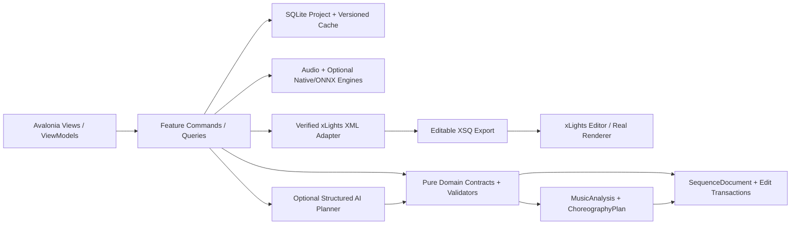
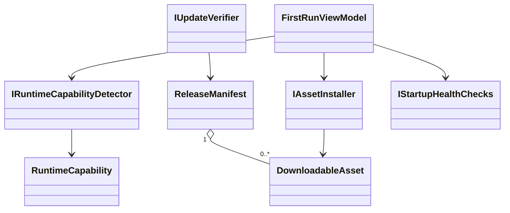
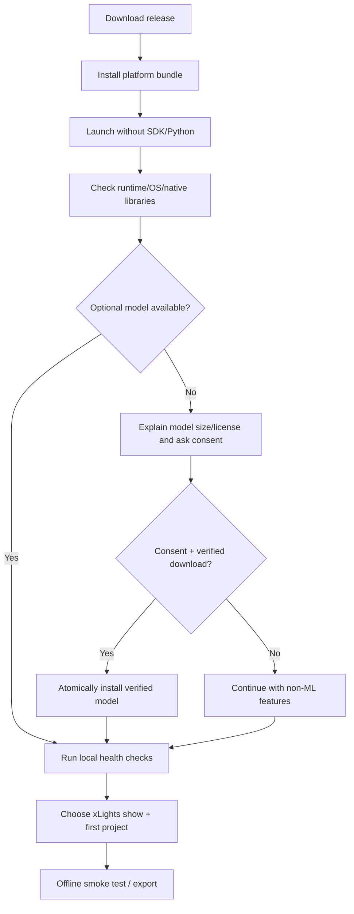

# PHASE 15 — Packaging and Distribution

**Specification version:** 2.0 / 2026-10-10 | **Steps:** 094–097 | **Status:** Proposed, unimplemented until gate evidence exists

**Standalone specification.** This document contains the relevant product assumptions, contracts, class relationships, business flows, numbered implementation tasks, test designs, risk gates and an agent prompt. It does **not** mean Phase 15 can run without earlier implemented code; it means an architect/agent can plan and implement the phase without consulting a separate high-level brief. Code below expresses **proposed API signatures**, not verified source code. Reconcile them with the actual repository and xLights version before implementation.

## 1. User outcome, release boundary and phase gate

**User story:** As a hobbyist, I can download a signed or integrity-verified desktop release, install it on a supported machine, select my show and optionally download ML models without installing Python or developer tools.

**Owned boundary:** Self-contained desktop distribution, native/model asset management, first-run setup, offline use after assets installed, upgrade/rollback and OS support matrix.

**Out of scope:** No promise identical GPU backend on all platforms, no unsigned auto-execution of arbitrary update scripts, no mandatory remote account.

**Blocking phase gate:** Install on a clean Windows x64 machine, import sample show/song, generate/edit a simple XSQ, optionally download model with consent, disconnect internet and continue playback/export.

**Depends on:** Phase 14: Whole Song Composition and Continuity.

**Unblocks:** Phase 16: Release Validation and Community Testing.

The gate is PASS only with automated tests, persisted-output inspection, and a real UI or xLights demonstration appropriate to the phase. If xLights or the required hardware/backend is unavailable, report BLOCKED or NOT VERIFIED—never silently substitute a mock.

## 2. Architectural assumptions (fully restated for standalone use)

- **Product:** locally installable Avalonia/.NET 10 desktop application; no Python, Docker, Git or mandatory LLM subscription for end users. CPU-first inference; native/ONNX only after a demonstrated and legally redistributable runtime/model fit.
- **Topology:** modular monolith with vertical feature slices. UI (Views/ViewModels), application orchestration, pure domain contracts, and platform/infrastructure adapters. Do not fabricate generic interfaces without a concrete boundary.
- **Timing:** internally represent position with an explicit canonical monotonic clock tied to source audio origin. Preserve sample index/rate for analysis provenance; UI may show milliseconds. All time scopes are half-open `[start,end)`. Convert to xLights frames only when explicitly snapping or exporting.
- **Ownership:** SQLite project metadata and committed user edits; immutable source media (linked/copied with consent); hash-addressed and versioned analysis/preview artifacts on disk. Every cache key includes algorithm/model/settings versions.
- **xLights:** `xlights_rgbeffects.xml` describes models/groups and other show configuration; `xlights_networks.xml` covers controller/output configuration; editable sequence is `.xsq` XML; rendered playback data is `.fseq`. Never overwrite source show files silently. Match layout models by verified name/identity mapping; do not invent xLights effect parameters.
- **Safe editing:** `SequenceDocument` is the editable state. `ChoreographyPlan` is an intent proposal, not a destructive replacement. Keep optimistic revision checks, effect locks, selection scope, immutable before/after patches, undo/redo, and explicit human acceptance.
- **AI trust:** optional local or BYOK cloud AI returns validated structured proposals only. Do not execute LLM-produced code, scripts or XML directly. Treat song lyrics, filenames, descriptions and external metadata as untrusted data. Explicit consent before sending media-derived data to remote services.
- **Verification:** unit tests + fixtures + integration tests + one observable UI/xLights demonstration per phase. An XML parse pass does not prove xLights renders an effect. A numeric musical score does not prove artistic quality. Do not claim tests ran when they did not.
- **Migration:** upstream xLightsAI (MIT repository, with separate dependency/model license checks) is a pinned reference for behavior, data and effect recipes. Python may run only in developer comparison tooling; there is no runtime Python requirement in releases.

### Core architecture at a glance



### Stable domain names and cross-phase ownership

| Aggregate / contract | First introduced | Sole authority / rule |
|---|---:|---|
| `ProjectManifest` and `ProjectId` | 01 | Project identity/version + root; SQLite and JSON atomically recoverable |
| `DisplayGraph`, `DisplayModel`, `ModelId` | 02 | Imported xLights model identities/group info; reference layout by hash |
| `SequenceDocument`, `EffectInstance` | 02 | Editable effects/locked state provenance; never serialize business behavior directly as XML |
| `EditScope`, `EditTransaction`, `DocumentRevision` | 03 | Exact time + model boundary and user-approved reversibility |
| `SongAsset`, `IAudioTransport` | 04 | Original song hash, timebase and synchronized playback |
| `BeatGrid` | 05 | Analyzed/corrected beats and alternative tempo hypotheses |
| `StemManifest`, `StemAsset` | 06 | Derived separated sources; known model version and sample origin |
| `MelodyTrack`, `NoteEvent` | 07 | Note/onset/contour truth with human corrections |
| `SongStructure`, `MotifLink` | 08 | Related phrase identities and inheritance decisions |
| `SpatialDisplayGraph`, `SpatialPath` | 09 | Artistic routes / normalized geometry separate from imported xLights identities |
| `VisualStory`, `ChoreographyPlan` | 10 | Musical/visual intent before concrete effect rendering |
| `EditProposal` | 11 | Untrusted/optional AI idea validated before `EditTransaction` |
| `LoopRun`, `Candidate`, `QualityReport` | 12 | Bounded attempts and reproducible candidate comparisons |
| `RenderArtifact` | 13 | Actual or clearly-marked approximate preview evidence |
| `WholeSongPlan` | 14 | Section continuity and approved phrase assembly |
| `ReleaseManifest` | 15 | Platform/model assets and delivery integrity |
| `ReleaseReadiness` | 16 | Explicit community compatibility/artistic evidence and release gate |

### Shared canonical C# identifiers

Define these once in `Studio.Contracts`. They are included here so the current phase spec can stand alone. **Do not redefine copies with different namespaces in code.**

```csharp
// Shared across phases; put these in Studio.Contracts (single declarations in the codebase).
namespace XlightsAI.Studio.Contracts;
public readonly record struct ProjectId(Guid Value);
public readonly record struct SongId(Guid Value);
public readonly record struct ModelId(string Value);
public readonly record struct DocumentRevision(long Value);
public readonly record struct TimelineTick(long Value); // 100 ns ticks from song origin
public readonly record struct TimeWindow(long StartTicks, long EndTicks); // [Start, End)
```

## 3. Phase-specific design and contracts

**Inputs:** Reproducible .NET build, native inference dependencies, model download manifest, license inventory, supported operating systems and architectures.

**Outputs:** Windows installer and self-contained binaries (macOS/Linux when supported), manifests/SBOM, first-run wizard, diagnostics and safe upgrade path.

### Architectural design notes

Publish .NET self-contained runtime **per OS and architecture**; include required Avalonia/native audio libraries, not developer SDKs. Choose an installer technology and code-signing plan after testing actual output, not just `dotnet publish`. Use model assets as optional independently versioned packages with trust roots (TLS + sha256/signatures), license/size/CPU notices, retry and offline pre-provisioning. Make app upgrade non-destructive to user's projects and show files; schema migration backup path and rollback matrix must be tested. Do not silently pull remote model updates after initial consent. Ship clear requirements for xLights integration: xLights optional for editor use but required for authoritative verification.

### Proposed C# signatures

These are explicit API intent and relationship signatures, not an assertion that the existing repository already implements them. Favor the phase-local interfaces shown, adapt names to repository conventions, and record any compatibility decision. Referenced records introduced by prior phases are intentionally not redefined.

```csharp
using XlightsAI.Studio.Contracts;
namespace XlightsAI.Studio.Distribution;
public sealed record RuntimeCapability(string OperatingSystem, string Architecture,
    bool CpuInferenceAvailable, bool XlightsDetected, string? XlightsVersion);
public sealed record DownloadableAsset(string Id, string Version, Uri Url,
    string Sha256, long SizeBytes, string LicenseId, bool Required);
public sealed record ReleaseManifest(string ProductVersion, string Channel,
    IReadOnlyList<DownloadableAsset> Assets, string SignatureAlgorithm);
public interface IRuntimeCapabilityDetector {
    Task<RuntimeCapability> ProbeAsync(CancellationToken ct);
}
public interface IAssetInstaller {
    Task<string> EnsureInstalledAsync(DownloadableAsset asset,
        IProgress<double>? progress, CancellationToken ct);
}
public interface IUpdateVerifier {
    bool VerifyManifest(ReadOnlySpan<byte> signedManifest, ReadOnlySpan<byte> trustedKey);
}
public interface IStartupHealthChecks {
    Task<IReadOnlyList<string>> CheckAsync(CancellationToken ct);
}
```

### Class relationship diagram



### Core process flowchart



## 4. Data contract, state ownership, migrations and caching

Per-user settings and projects remain outside install directory. Installed asset manifest tracks verified hashes/version/license. No embedded API tokens; encrypted/OS credential storage for BYOK secrets. Install logs can be sanitized and exported by user.

### Contract compatibility rules

- Keep IDs stable across UI views, SQLite and exported artifacts; never persist Avalonia object instances or XML DOM nodes as domain objects.
- Schema changes require versioned migrations, fixture updates and tests against the preceding project version.
- Analysis caches may be rebuilt if their source/model/version hash changes; accepted manual edits are never disposable cache.
- All edits to `SequenceDocument` pass a revision-aware command boundary. Preview artifacts and AI proposals cannot update the accepted document directly.
- Logs include operation/fixture correlation IDs and error codes. External model names and XML payloads are treated as untrusted input.

## 5. User interface / screen behavior

Use the existing Avalonia shell and apply this phase incrementally; do not present empty future functionality as implemented. These wireframe images are conceptual design references, not pixels that must be copied literally.

- **SCREEN 01 WELCOME** — [Visual wireframe](../assets/wireframes/SCREEN-01-WELCOME.png). The screen must show loading/empty/error states, responsive resizing, keyboard navigation and an explicit version/status indicator when data is derived.
- **SCREEN 17 SETTINGS** — [Visual wireframe](../assets/wireframes/SCREEN-17-SETTINGS.png). The screen must show loading/empty/error states, responsive resizing, keyboard navigation and an explicit version/status indicator when data is derived.

UI behavior must always show *which song, time range, props, analysis source, version and approval state* the user is operating on when those concepts are available at this phase.

## 6. Numbered build slices — implement in order

Each numbered item is a complete vertical test cut: UI/command -> domain rule -> persistence or adapter -> observable result -> automated test. Avoid collecting multiple unverified tasks into one mega-commit.

### Step 094 — Publish self-contained signed/unsigned-labeled Windows x64 app with verified native assets

**User-visible outcome:** Versioned, inspectable project output plus a reproducible test report.

**Implementation guidance:** Publish runtime-specific self-contained executable and bundle native audio and UI dependencies; audit clean VM missing-runtime behavior.

**Required acceptance:** Launch on clean VM with no .NET SDK and no Python.

**Failure/edge case to prove:** Missing or incompatible model, cancellation and offline mode must yield a recoverable state.

**Suggested automated acceptance test:** `Step094_Acceptance_Passes`. Implement a deterministic fixture and assert persisted domain state plus public output, not only a mock invocation. Include a negative-path assertion.

**Evidence:** Write `implementation-evidence/PHASE-15/STEP-094.md` with commands actually executed, input hashes, actual results, screen/output artifact, unresolved issues, and an explicit PASS/BLOCKED status.

- [ ] Implementation / tests / observable demo / evidence all complete before next numbered step.

### Step 095 — Build installer/uninstaller, show-folder onboarding and safe defaults

**User-visible outcome:** Avalonia screenshot or repeatable desktop interaction recording with saved-state verification.

**Implementation guidance:** Create installer/first run choosing workspace and show folder; no environment variable/Python setup or admin-only project storage.

**Required acceptance:** User completes first run without command line.

**Failure/edge case to prove:** Clean machine and unsupported runtime must produce user-readable diagnostics.

**Suggested automated acceptance test:** `Step095_Acceptance_Passes`. Implement a deterministic fixture and assert persisted domain state plus public output, not only a mock invocation. Include a negative-path assertion.

**Evidence:** Write `implementation-evidence/PHASE-15/STEP-095.md` with commands actually executed, input hashes, actual results, screen/output artifact, unresolved issues, and an explicit PASS/BLOCKED status.

- [ ] Implementation / tests / observable demo / evidence all complete before next numbered step.

### Step 096 — Add opt-in model asset installs, offline validation, logs and update notices

**User-visible outcome:** Installer/bundle artifact with clean-machine smoke results and checksums.

**Implementation guidance:** Build versioned model asset manager, offline package fallback, diagnostics export and integrity verification for updates/assets.

**Required acceptance:** Core app works offline after assets installed; missing models explained.

**Failure/edge case to prove:** Missing or incompatible model, cancellation and offline mode must yield a recoverable state.

**Suggested automated acceptance test:** `Step096_Acceptance_Passes`. Implement a deterministic fixture and assert persisted domain state plus public output, not only a mock invocation. Include a negative-path assertion.

**Evidence:** Write `implementation-evidence/PHASE-15/STEP-096.md` with commands actually executed, input hashes, actual results, screen/output artifact, unresolved issues, and an explicit PASS/BLOCKED status.

- [ ] Implementation / tests / observable demo / evidence all complete before next numbered step.

### Step 097 — Add supported macOS/Linux deliverables only after validating inference and xLights compatibility

**User-visible outcome:** Versioned, inspectable project output plus a reproducible test report.

**Implementation guidance:** Build on macOS/Linux only if inference/audio/UI dependencies are proven; document unsupported combinations rather than shipping broken bundles.

**Required acceptance:** Each advertised platform passes same smoke-test suite.

**Failure/edge case to prove:** Missing or incompatible model, cancellation and offline mode must yield a recoverable state.

**Suggested automated acceptance test:** `Step097_Acceptance_Passes`. Implement a deterministic fixture and assert persisted domain state plus public output, not only a mock invocation. Include a negative-path assertion.

**Evidence:** Write `implementation-evidence/PHASE-15/STEP-097.md` with commands actually executed, input hashes, actual results, screen/output artifact, unresolved issues, and an explicit PASS/BLOCKED status.

- [ ] Implementation / tests / observable demo / evidence all complete before next numbered step.

## 7. Full-phase test plan and quality gate matrix

| # | Test scenario / invariant | Type | Required evidence |
|---:|---|---|---|
| 1 | Fresh Windows VM starts app with no .NET SDK, Git, Python or Docker | Unit + property | Actual result, input hash/fixture and pass/fail |
| 2 | Offline basic editing after install works | Integration/golden | Actual result, input hash/fixture and pass/fail |
| 3 | Model download hash tampering rejected | Desktop/manual | Actual result, input hash/fixture and pass/fail |
| 4 | No-model mode remains functional for simple timelines | Unit + property | Actual result, input hash/fixture and pass/fail |
| 5 | Upgrade preserves projects and backups migrations | Integration/golden | Actual result, input hash/fixture and pass/fail |
| 6 | Uninstall leaves user projects intact unless expressly asked | Desktop/manual | Actual result, input hash/fixture and pass/fail |
| 7 | Invalid update manifest/signature rejected | Unit + property | Actual result, input hash/fixture and pass/fail |
| 8 | OS/arch incompatibility yields clear message | Integration/golden | Actual result, input hash/fixture and pass/fail |

### Phase gate demonstration — exact user workflow

Install on a clean Windows x64 machine, import sample show/song, generate/edit a simple XSQ, optionally download model with consent, disconnect internet and continue playback/export.

### Failure handling and known technical risks

Cross-platform codecs, native library ABI, unsigned installer warnings, macOS notarization, model download availability, security of auto-updates and data-loss during migration.

### Cross-cutting negative cases

- **Invalid/stale input:** reject and show the source of the problem; do not commit partial project state.
- **Cancellation:** propagate `CancellationToken`, dispose native/audio resources and leave resumable or safely rolled-back job state.
- **Compatibility:** detect actual versions/capabilities. No undocumented claim that all xLights versions or ML models behave identically.
- **Non-destructive writes:** if a user selects a show directory or existing XSQ, default to creating a new app-owned artifact rather than silently overwriting.
- **Regression:** rerun all previous phase gates affected by changed domain contracts or serializer versions.

## 8. Implementation checkpoints, decisions and handoff

### Recommended internal development order

1. Inspect the current committed code and pinned upstream reference; enumerate differences from signatures in this document.
2. Create fixtures and tests for the *first* numbered step; document exact external dependencies before writing the adapter.
3. Build one end-to-end slice, run the targeted tests, demonstrate the new behavior, then record evidence and proceed.
4. Update architecture decision records for genuine tradeoffs and migration decisions. Do not generalize everything into an interface.
5. At completion, run full automated regression and the phase demonstration; record blocker status truthfully.

### Explicit ADR questions to resolve during this phase

- **Primary design choice:** Is the proposed packaging and distribution contract compatible with existing repository conventions and user-approved state?
- **Runtime/source truth:** Which behaviors can be verified locally, and which require a specific xLights build, external model, audio device, or human judgment?
- **Recovery and rollback:** What happens on crash, cancellation, stale file version or invalid external content?
- **Dependency and licenses:** Are required upstream algorithms, model files or native libraries version-pinned and redistributable?

### Required final gate report

- [ ] All named numbered steps show independently recorded evidence.
- [ ] Compiles; full unit/integration/golden regression run records actual commands.
- [ ] Desktop interaction was exercised or explicitly reported blocked.
- [ ] Required xLights/manual/inference test ran against a recorded version, if applicable.
- [ ] Missing assumptions, compatibility limits, technical debt and migration impacts recorded.
- [ ] Previous accepted sequences/project files are unchanged except approved migrations/edits.
- [ ] Gate result = PASS or BLOCKED. Next phase begins only after PASS or an explicit scoped architecture waiver.

## 9. Copy/paste coding-agent prompt (phase-local)

```text
You are acting as a senior .NET/Avalonia architect and implementation agent on the xLights AI Choreography Studio repository.
Implement the PHASE 15 (Packaging and Distribution) only, in numbered-step order. This spec is the source of truth for the current phase and contains the necessary contract and verification context. Read the existing repository and baseline history first; **do not copy sample signatures over working established contracts blindly**. Resolve any older/newer contract discrepancy with a short architecture decision and compatibility migration.

For EACH numbered step: (1) inspect only relevant repo files and pinned upstream sources; (2) write acceptance/failure tests first or alongside code; (3) implement the smallest complete UI -> application -> domain -> persistence/export pathway; (4) compile/run targeted and existing tests; (5) execute the manual demo or report explicitly why it could not run; (6) update completion/evidence notes in `implementation-evidence/PHASE-15/STEP-XXX.md`; (7) commit the step if permitted. Do not cross into future features except narrow stable contracts. Hard gates cannot be traded for weighted scoring.

Before ending the phase, produce a Gate Report showing exact tests/commands, observed results, fixture IDs/hashes, screenshots/XSQ artifacts, unverified assumptions, known risks and whether the phase gate is PASS/BLOCKED. Do not claim test success without execution. Do not start the next phase when blocked.

CURRENT SCOPE: Phase 15: Packaging and Distribution. Implement only numbered steps 094, 095, 096, 097.
CORE DEMO REQUIRED: Install on a clean Windows x64 machine, import sample show/song, generate/edit a simple XSQ, optionally download model with consent, disconnect internet and continue playback/export.
NEVER CLAIM THE GATE PASSED WITHOUT: OS/arch incompatibility yields clear message
```

## 10. Developer test evidence format

```yaml
step: 094
phase: 15
implementation_commit: TO_BE_FILLED
source_fixture_hashes: []
automated_tests:
  - name: TO_BE_FILLED
    command: TO_BE_FILLED
    result: NOT_RUN
manual_demo:
  instructions: TO_BE_FILLED
  observed: NOT_RUN
xlights_version: NOT_TESTED
artifact_paths: []
blocking_failures: []
architectural_decisions: []
status: NOT_STARTED
```

## 11. Authoritative documentation and verification sources

The URLs below are references for implementation research, not substitute proof that our code or any installed xLights version works. Always pin relevant upstream revisions and record observed behavior.

- xLights source / headless rendering design (verify installed builds separately): https://github.com/xLightsSequencer/xLights/blob/master/AGENTS.md
- xLights manual glossary (layout/sequence formats): https://manual.xlights.org/xlights/appendicies/glossary
- xLights timing tracks: https://manual.xlights.org/xlights/chapters/chapter-four-sequencer/timing-tracks
- xLights model groups: https://manual.xlights.org/xlights/chapters/chapter-four-tabs/model-groups
- xLights importing and re-rendering: https://manual.xlights.org/xlights/chapters/chapter-five-menus/import
- xLights official source repository: https://github.com/xLightsSequencer/xLights
- Real public XSQ example (for observation; verify against target version): https://github.com/FRC3620/xlights.sign1/blob/main/2026%20Doug.xsq
- xLightsAI upstream raw XSQ generator path: `src/generator/xsq_writer.py` in pinned upstream checkout.

### Nearby package material (optional supporting context; this phase is complete without it)

- [`MASTER-SYSTEM-ARCHITECTURE.md`](../MASTER-SYSTEM-ARCHITECTURE.md)
- [`XLIGHTS-SEQUENCE-ENGINEERING-GUIDE.md`](../XLIGHTS-SEQUENCE-ENGINEERING-GUIDE.md)
- [`UI-UX-SCREEN-BLUEPRINTS.md`](../UI-UX-SCREEN-BLUEPRINTS.md)
- [`TEST-DATA-AND-ACCEPTANCE.md`](../TEST-DATA-AND-ACCEPTANCE.md)
- [`prompts/PHASE-15-PROMPT.md`](../prompts/PHASE-15-PROMPT.md)

## 12. Install-time acceptance table

| Condition | Expected behavior |
|---|---|
| Fresh Windows x64 with no developer toolchain | App starts, imports layout, plays audio and exports minimal XSQ |
| No internet and no preinstalled ML model | Basic UI/edit/export works; stem feature explains missing asset |
| Model hash failure | Install fails, quarantines temp download, no execution |
| Unsupported CPU/native backend | Offer supported fallback or disable only that feature |
| Upgrade with prior project schema | Backup before migration; preserve user-approved effects |
| Uninstall | Never delete user workspace silently |
