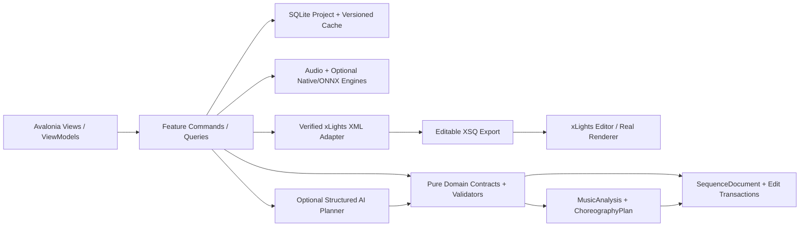
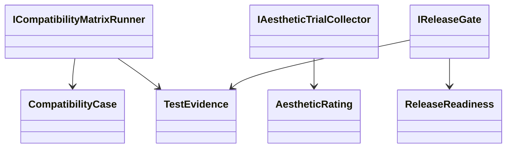
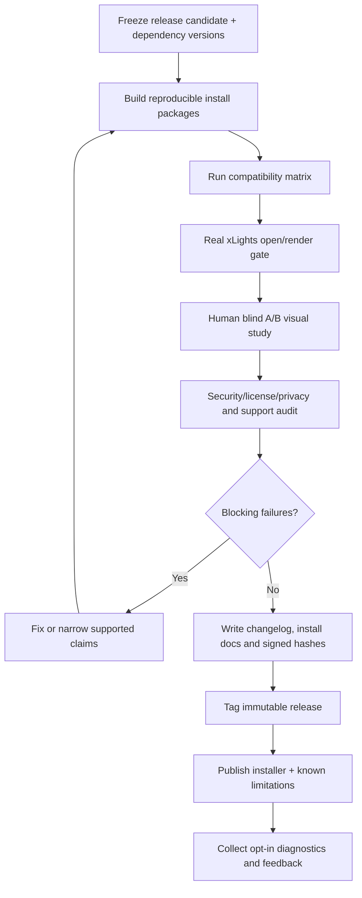

# PHASE 16 — Release Validation and Community Testing

**Specification version:** 2.0 / 2026-10-10 | **Steps:** 098–100 | **Status:** Proposed, unimplemented until gate evidence exists

**Standalone specification.** This document contains the relevant product assumptions, contracts, class relationships, business flows, numbered implementation tasks, test designs, risk gates and an agent prompt. It does **not** mean Phase 16 can run without earlier implemented code; it means an architect/agent can plan and implement the phase without consulting a separate high-level brief. Code below expresses **proposed API signatures**, not verified source code. Reconcile them with the actual repository and xLights version before implementation.

## 1. User outcome, release boundary and phase gate

**User story:** As a new xLights community user, I can install a released build, follow short onboarding, sequence a sample, review/edit it, export to my xLights version and understand any limitations.

**Owned boundary:** End-to-end quality matrix, manual A/B music/visual studies, clean-install compatibility, documentation, security/license release gates and tagged public distribution.

**Out of scope:** No guarantee every model type, xLights release, media codec or song genre behaves perfectly; no simulated community feedback passed off as real test results.

**Blocking phase gate:** Give a non-developer tester only the installer and demo show; observe install, import, song analysis or safe fallback, phrase editing, XSQ export and actual xLights rendering; record real feedback and cleanup effort.

**Depends on:** Phase 15: Packaging and Distribution.

**Unblocks:** Public release maintenance / further planned features.

The gate is PASS only with automated tests, persisted-output inspection, and a real UI or xLights demonstration appropriate to the phase. If xLights or the required hardware/backend is unavailable, report BLOCKED or NOT VERIFIED—never silently substitute a mock.

## 2. Architectural assumptions (fully restated for standalone use)

- **Product:** locally installable Avalonia/.NET 10 desktop application; no Python, Docker, Git or mandatory LLM subscription for end users. CPU-first inference; native/ONNX only after a demonstrated and legally redistributable runtime/model fit.
- **Topology:** modular monolith with vertical feature slices. UI (Views/ViewModels), application orchestration, pure domain contracts, and platform/infrastructure adapters. Do not fabricate generic interfaces without a concrete boundary.
- **Timing:** internally represent position with an explicit canonical monotonic clock tied to source audio origin. Preserve sample index/rate for analysis provenance; UI may show milliseconds. All time scopes are half-open `[start,end)`. Convert to xLights frames only when explicitly snapping or exporting.
- **Ownership:** SQLite project metadata and committed user edits; immutable source media (linked/copied with consent); hash-addressed and versioned analysis/preview artifacts on disk. Every cache key includes algorithm/model/settings versions.
- **xLights:** `xlights_rgbeffects.xml` describes models/groups and other show configuration; `xlights_networks.xml` covers controller/output configuration; editable sequence is `.xsq` XML; rendered playback data is `.fseq`. Never overwrite source show files silently. Match layout models by verified name/identity mapping; do not invent xLights effect parameters.
- **Safe editing:** `SequenceDocument` is the editable state. `ChoreographyPlan` is an intent proposal, not a destructive replacement. Keep optimistic revision checks, effect locks, selection scope, immutable before/after patches, undo/redo, and explicit human acceptance.
- **AI trust:** optional local or BYOK cloud AI returns validated structured proposals only. Do not execute LLM-produced code, scripts or XML directly. Treat song lyrics, filenames, descriptions and external metadata as untrusted data. Explicit consent before sending media-derived data to remote services.
- **Verification:** unit tests + fixtures + integration tests + one observable UI/xLights demonstration per phase. An XML parse pass does not prove xLights renders an effect. A numeric musical score does not prove artistic quality. Do not claim tests ran when they did not.
- **Migration:** upstream xLightsAI (MIT repository, with separate dependency/model license checks) is a pinned reference for behavior, data and effect recipes. Python may run only in developer comparison tooling; there is no runtime Python requirement in releases.

### Core architecture at a glance



### Stable domain names and cross-phase ownership

| Aggregate / contract | First introduced | Sole authority / rule |
|---|---:|---|
| `ProjectManifest` and `ProjectId` | 01 | Project identity/version + root; SQLite and JSON atomically recoverable |
| `DisplayGraph`, `DisplayModel`, `ModelId` | 02 | Imported xLights model identities/group info; reference layout by hash |
| `SequenceDocument`, `EffectInstance` | 02 | Editable effects/locked state provenance; never serialize business behavior directly as XML |
| `EditScope`, `EditTransaction`, `DocumentRevision` | 03 | Exact time + model boundary and user-approved reversibility |
| `SongAsset`, `IAudioTransport` | 04 | Original song hash, timebase and synchronized playback |
| `BeatGrid` | 05 | Analyzed/corrected beats and alternative tempo hypotheses |
| `StemManifest`, `StemAsset` | 06 | Derived separated sources; known model version and sample origin |
| `MelodyTrack`, `NoteEvent` | 07 | Note/onset/contour truth with human corrections |
| `SongStructure`, `MotifLink` | 08 | Related phrase identities and inheritance decisions |
| `SpatialDisplayGraph`, `SpatialPath` | 09 | Artistic routes / normalized geometry separate from imported xLights identities |
| `VisualStory`, `ChoreographyPlan` | 10 | Musical/visual intent before concrete effect rendering |
| `EditProposal` | 11 | Untrusted/optional AI idea validated before `EditTransaction` |
| `LoopRun`, `Candidate`, `QualityReport` | 12 | Bounded attempts and reproducible candidate comparisons |
| `RenderArtifact` | 13 | Actual or clearly-marked approximate preview evidence |
| `WholeSongPlan` | 14 | Section continuity and approved phrase assembly |
| `ReleaseManifest` | 15 | Platform/model assets and delivery integrity |
| `ReleaseReadiness` | 16 | Explicit community compatibility/artistic evidence and release gate |

### Shared canonical C# identifiers

Define these once in `Studio.Contracts`. They are included here so the current phase spec can stand alone. **Do not redefine copies with different namespaces in code.**

```csharp
// Shared across phases; put these in Studio.Contracts (single declarations in the codebase).
namespace XlightsAI.Studio.Contracts;
public readonly record struct ProjectId(Guid Value);
public readonly record struct SongId(Guid Value);
public readonly record struct ModelId(string Value);
public readonly record struct DocumentRevision(long Value);
public readonly record struct TimelineTick(long Value); // 100 ns ticks from song origin
public readonly record struct TimeWindow(long StartTicks, long EndTicks); // [Start, End)
```

## 3. Phase-specific design and contracts

**Inputs:** Release candidate installer, supported xLights versions, fixtures, reference renders, beta testers with appropriate permission, license manifests.

**Outputs:** Release readiness report, compatibility matrix, meaningful blind evaluation results, onboarding/help, changelog, SBOM/notices, tagged version, support diagnostics.

### Architectural design notes

Treat release as an **auditable gate**, not ceremonial documentation. Define an explicit support matrix with operating system/arch, xLights version, show layout types, effect recipes, media codecs and CPU capability. Separate **automated compatibility evidence** from **human artistic preference**. Blind A/B comparisons should randomize order and gather quality dimensions (musical timing, pattern clarity, contrast, excitement, cleanup effort) rather than cherry-picking winning clips. Every blocker must be fixed, deferred behind feature flag with documentation, or removed from supported claims. Verify third-party source/data/model licenses and distribution obligations. Build a reproducible release from CI with immutable manifest and checksums; don't publish security-sensitive tokens or copyrighted song fixtures.

### Proposed C# signatures

These are explicit API intent and relationship signatures, not an assertion that the existing repository already implements them. Favor the phase-local interfaces shown, adapt names to repository conventions, and record any compatibility decision. Referenced records introduced by prior phases are intentionally not redefined.

```csharp
using XlightsAI.Studio.Contracts;
namespace XlightsAI.Studio.Release;
public sealed record CompatibilityCase(string Os, string Architecture,
    string XlightsVersion, string LayoutFixtureId, string AudioFixtureId);
public sealed record TestEvidence(string TestId, bool Passed, string ArtifactPath,
    string ToolVersion, DateTimeOffset RecordedUtc);
public sealed record AestheticRating(string AnonymousTrialId, string CandidateId,
    int Musicality, int Clarity, int Contrast, int Excitement, double CleanupMinutes);
public sealed record ReleaseReadiness(string Version, bool Eligible,
    IReadOnlyList<string> Blockers, IReadOnlyList<TestEvidence> Evidence);
public interface ICompatibilityMatrixRunner {
    Task<IReadOnlyList<TestEvidence>> RunAsync(IReadOnlyList<CompatibilityCase> cases,
        CancellationToken ct);
}
public interface IAestheticTrialCollector {
    Task RecordAsync(AestheticRating rating, CancellationToken ct);
}
public interface IReleaseGate {
    ReleaseReadiness Evaluate(IReadOnlyList<TestEvidence> evidence,
        IReadOnlyList<string> unresolvedRisks);
}
```

### Class relationship diagram



### Core process flowchart



## 4. Data contract, state ownership, migrations and caching

Publish versioned test reports, compatibility matrix, signed/checksummed installers, changelog, dependency notices, open issues and release manifest; user feedback only with consent/privacy retention policy.

### Contract compatibility rules

- Keep IDs stable across UI views, SQLite and exported artifacts; never persist Avalonia object instances or XML DOM nodes as domain objects.
- Schema changes require versioned migrations, fixture updates and tests against the preceding project version.
- Analysis caches may be rebuilt if their source/model/version hash changes; accepted manual edits are never disposable cache.
- All edits to `SequenceDocument` pass a revision-aware command boundary. Preview artifacts and AI proposals cannot update the accepted document directly.
- Logs include operation/fixture correlation IDs and error codes. External model names and XML payloads are treated as untrusted input.

## 5. User interface / screen behavior

Use the existing Avalonia shell and apply this phase incrementally; do not present empty future functionality as implemented. These wireframe images are conceptual design references, not pixels that must be copied literally.

- **SCREEN 03 OVERVIEW** — [Visual wireframe](../assets/wireframes/SCREEN-03-OVERVIEW.png). The screen must show loading/empty/error states, responsive resizing, keyboard navigation and an explicit version/status indicator when data is derived.
- **SCREEN 16 EXPORT** — [Visual wireframe](../assets/wireframes/SCREEN-16-EXPORT.png). The screen must show loading/empty/error states, responsive resizing, keyboard navigation and an explicit version/status indicator when data is derived.
- **SCREEN 17 SETTINGS** — [Visual wireframe](../assets/wireframes/SCREEN-17-SETTINGS.png). The screen must show loading/empty/error states, responsive resizing, keyboard navigation and an explicit version/status indicator when data is derived.

UI behavior must always show *which song, time range, props, analysis source, version and approval state* the user is operating on when those concepts are available at this phase.

## 6. Numbered build slices — implement in order

Each numbered item is a complete vertical test cut: UI/command -> domain rule -> persistence or adapter -> observable result -> automated test. Avoid collecting multiple unverified tasks into one mega-commit.

### Step 098 — Run tested OS/xLights/audio/layout compatibility matrix and record known limitations

**User-visible outcome:** Generated XML artifact and semantic diff/fixture, with xLights validation if this step changes rendering.

**Implementation guidance:** Test a matrix of Windows versions, xLights supported versions, layouts including groups/submodels, audio types and offline/GPU-less machines; persist observed actual outcomes.

**Required acceptance:** Supported combinations each have installation and XSQ smoke evidence.

**Failure/edge case to prove:** Invalid model/format/version must fail safely without rewriting source files.

**Suggested automated acceptance test:** `Step098_Acceptance_Passes`. Implement a deterministic fixture and assert persisted domain state plus public output, not only a mock invocation. Include a negative-path assertion.

**Evidence:** Write `implementation-evidence/PHASE-16/STEP-098.md` with commands actually executed, input hashes, actual results, screen/output artifact, unresolved issues, and an explicit PASS/BLOCKED status.

- [ ] Implementation / tests / observable demo / evidence all complete before next numbered step.

### Step 099 — Conduct A/B musicality evaluations and manual-effort measurement on varied songs

**User-visible outcome:** Saved audio/analysis artifact with timestamp provenance plus a synchronized waveform/timeline demonstration.

**Implementation guidance:** Randomize candidate ordering for human A/B reviews, use rights-cleared clips, collect musicality/excitement/effort ratings and report sample size honestly.

**Required acceptance:** Collect preference ratings and editing-time results, not only auto scores.

**Failure/edge case to prove:** Invalid input, cancellation or stale persisted state must not corrupt the project.

**Suggested automated acceptance test:** `Step099_Acceptance_Passes`. Implement a deterministic fixture and assert persisted domain state plus public output, not only a mock invocation. Include a negative-path assertion.

**Evidence:** Write `implementation-evidence/PHASE-16/STEP-099.md` with commands actually executed, input hashes, actual results, screen/output artifact, unresolved issues, and an explicit PASS/BLOCKED status.

- [ ] Implementation / tests / observable demo / evidence all complete before next numbered step.

### Step 100 — Finalize documentation, attribution/licenses, privacy defaults, diagnostics, changelog and versioned release

**User-visible outcome:** Installer/bundle artifact with clean-machine smoke results and checksums.

**Implementation guidance:** Gate release on installer quality, source/model licenses, documentation, security/privacy checks, changelog, support matrix, signed/checksummed artifact and known issues.

**Required acceptance:** Reproducible artifacts and first-user walkthrough tested.

**Failure/edge case to prove:** Clean machine and unsupported runtime must produce user-readable diagnostics.

**Suggested automated acceptance test:** `Step100_Acceptance_Passes`. Implement a deterministic fixture and assert persisted domain state plus public output, not only a mock invocation. Include a negative-path assertion.

**Evidence:** Write `implementation-evidence/PHASE-16/STEP-100.md` with commands actually executed, input hashes, actual results, screen/output artifact, unresolved issues, and an explicit PASS/BLOCKED status.

- [ ] Implementation / tests / observable demo / evidence all complete before next numbered step.

## 7. Full-phase test plan and quality gate matrix

| # | Test scenario / invariant | Type | Required evidence |
|---:|---|---|---|
| 1 | Full application workflow on clean supported systems | Unit + property | Actual result, input hash/fixture and pass/fail |
| 2 | Sequence opens with selected xLights versions and renders expected props | Integration/golden | Actual result, input hash/fixture and pass/fail |
| 3 | No required Python, Docker, Git, cloud login or paid tokens | Desktop/manual | Actual result, input hash/fixture and pass/fail |
| 4 | First-run failure messages are comprehensible to beta testers | Unit + property | Actual result, input hash/fixture and pass/fail |
| 5 | Software/model third-party notices complete | Integration/golden | Actual result, input hash/fixture and pass/fail |
| 6 | A/B trials preserve blind ordering and actual respondent data | Desktop/manual | Actual result, input hash/fixture and pass/fail |
| 7 | All blockers resolved or documented with constrained support | Unit + property | Actual result, input hash/fixture and pass/fail |
| 8 | Release artifacts produce matching checksum manifest | Integration/golden | Actual result, input hash/fixture and pass/fail |

### Phase gate demonstration — exact user workflow

Give a non-developer tester only the installer and demo show; observe install, import, song analysis or safe fallback, phrase editing, XSQ export and actual xLights rendering; record real feedback and cleanup effort.

### Failure handling and known technical risks

Unrepresentative songs/layouts, silent effect incompatibility, licensing problems for ML weights, misleading self-reported speedups, missing CI reproducibility and insufficient onboarding.

### Cross-cutting negative cases

- **Invalid/stale input:** reject and show the source of the problem; do not commit partial project state.
- **Cancellation:** propagate `CancellationToken`, dispose native/audio resources and leave resumable or safely rolled-back job state.
- **Compatibility:** detect actual versions/capabilities. No undocumented claim that all xLights versions or ML models behave identically.
- **Non-destructive writes:** if a user selects a show directory or existing XSQ, default to creating a new app-owned artifact rather than silently overwriting.
- **Regression:** rerun all previous phase gates affected by changed domain contracts or serializer versions.

## 8. Implementation checkpoints, decisions and handoff

### Recommended internal development order

1. Inspect the current committed code and pinned upstream reference; enumerate differences from signatures in this document.
2. Create fixtures and tests for the *first* numbered step; document exact external dependencies before writing the adapter.
3. Build one end-to-end slice, run the targeted tests, demonstrate the new behavior, then record evidence and proceed.
4. Update architecture decision records for genuine tradeoffs and migration decisions. Do not generalize everything into an interface.
5. At completion, run full automated regression and the phase demonstration; record blocker status truthfully.

### Explicit ADR questions to resolve during this phase

- **Primary design choice:** Is the proposed release validation and community testing contract compatible with existing repository conventions and user-approved state?
- **Runtime/source truth:** Which behaviors can be verified locally, and which require a specific xLights build, external model, audio device, or human judgment?
- **Recovery and rollback:** What happens on crash, cancellation, stale file version or invalid external content?
- **Dependency and licenses:** Are required upstream algorithms, model files or native libraries version-pinned and redistributable?

### Required final gate report

- [ ] All named numbered steps show independently recorded evidence.
- [ ] Compiles; full unit/integration/golden regression run records actual commands.
- [ ] Desktop interaction was exercised or explicitly reported blocked.
- [ ] Required xLights/manual/inference test ran against a recorded version, if applicable.
- [ ] Missing assumptions, compatibility limits, technical debt and migration impacts recorded.
- [ ] Previous accepted sequences/project files are unchanged except approved migrations/edits.
- [ ] Gate result = PASS or BLOCKED. Next phase begins only after PASS or an explicit scoped architecture waiver.

## 9. Copy/paste coding-agent prompt (phase-local)

```text
You are acting as a senior .NET/Avalonia architect and implementation agent on the xLights AI Choreography Studio repository.
Implement the PHASE 16 (Release Validation and Community Testing) only, in numbered-step order. This spec is the source of truth for the current phase and contains the necessary contract and verification context. Read the existing repository and baseline history first; **do not copy sample signatures over working established contracts blindly**. Resolve any older/newer contract discrepancy with a short architecture decision and compatibility migration.

For EACH numbered step: (1) inspect only relevant repo files and pinned upstream sources; (2) write acceptance/failure tests first or alongside code; (3) implement the smallest complete UI -> application -> domain -> persistence/export pathway; (4) compile/run targeted and existing tests; (5) execute the manual demo or report explicitly why it could not run; (6) update completion/evidence notes in `implementation-evidence/PHASE-16/STEP-XXX.md`; (7) commit the step if permitted. Do not cross into future features except narrow stable contracts. Hard gates cannot be traded for weighted scoring.

Before ending the phase, produce a Gate Report showing exact tests/commands, observed results, fixture IDs/hashes, screenshots/XSQ artifacts, unverified assumptions, known risks and whether the phase gate is PASS/BLOCKED. Do not claim test success without execution. Do not start the next phase when blocked.

CURRENT SCOPE: Phase 16: Release Validation and Community Testing. Implement only numbered steps 098, 099, 100.
CORE DEMO REQUIRED: Give a non-developer tester only the installer and demo show; observe install, import, song analysis or safe fallback, phrase editing, XSQ export and actual xLights rendering; record real feedback and cleanup effort.
NEVER CLAIM THE GATE PASSED WITHOUT: Release artifacts produce matching checksum manifest
```

## 10. Developer test evidence format

```yaml
step: 098
phase: 16
implementation_commit: TO_BE_FILLED
source_fixture_hashes: []
automated_tests:
  - name: TO_BE_FILLED
    command: TO_BE_FILLED
    result: NOT_RUN
manual_demo:
  instructions: TO_BE_FILLED
  observed: NOT_RUN
xlights_version: NOT_TESTED
artifact_paths: []
blocking_failures: []
architectural_decisions: []
status: NOT_STARTED
```

## 11. Authoritative documentation and verification sources

The URLs below are references for implementation research, not substitute proof that our code or any installed xLights version works. Always pin relevant upstream revisions and record observed behavior.

- xLights source / headless rendering design (verify installed builds separately): https://github.com/xLightsSequencer/xLights/blob/master/AGENTS.md
- xLights manual glossary (layout/sequence formats): https://manual.xlights.org/xlights/appendicies/glossary
- xLights timing tracks: https://manual.xlights.org/xlights/chapters/chapter-four-sequencer/timing-tracks
- xLights model groups: https://manual.xlights.org/xlights/chapters/chapter-four-tabs/model-groups
- xLights importing and re-rendering: https://manual.xlights.org/xlights/chapters/chapter-five-menus/import
- xLights official source repository: https://github.com/xLightsSequencer/xLights
- Real public XSQ example (for observation; verify against target version): https://github.com/FRC3620/xlights.sign1/blob/main/2026%20Doug.xsq
- xLightsAI upstream raw XSQ generator path: `src/generator/xsq_writer.py` in pinned upstream checkout.

### Nearby package material (optional supporting context; this phase is complete without it)

- [`MASTER-SYSTEM-ARCHITECTURE.md`](../MASTER-SYSTEM-ARCHITECTURE.md)
- [`XLIGHTS-SEQUENCE-ENGINEERING-GUIDE.md`](../XLIGHTS-SEQUENCE-ENGINEERING-GUIDE.md)
- [`UI-UX-SCREEN-BLUEPRINTS.md`](../UI-UX-SCREEN-BLUEPRINTS.md)
- [`TEST-DATA-AND-ACCEPTANCE.md`](../TEST-DATA-AND-ACCEPTANCE.md)
- [`prompts/PHASE-16-PROMPT.md`](../prompts/PHASE-16-PROMPT.md)

## 12. Release scorecard template

| Gate | Evidence | Status |
|---|---|---|
| Clean install without Python/SDK/Git/Docker | VM screenshot/command and installer hash | NOT RUN |
| Real xLights XSQ open/render across supported versions | Model/time/color comparison for named fixtures | NOT RUN |
| Crash/migration/export safety | Regression suite + recovery scenario | NOT RUN |
| Native model licenses and package notices | SBOM + license owner review | NOT RUN |
| Song timing and melody fixtures | Numeric tests + reference output | NOT RUN |
| Human musicality A/B ratings | Sample size, blind method and raw anonymous ratings | NOT RUN |
| Offline/privacy and optional AI behavior | Network inspection and consent demonstration | NOT RUN |
