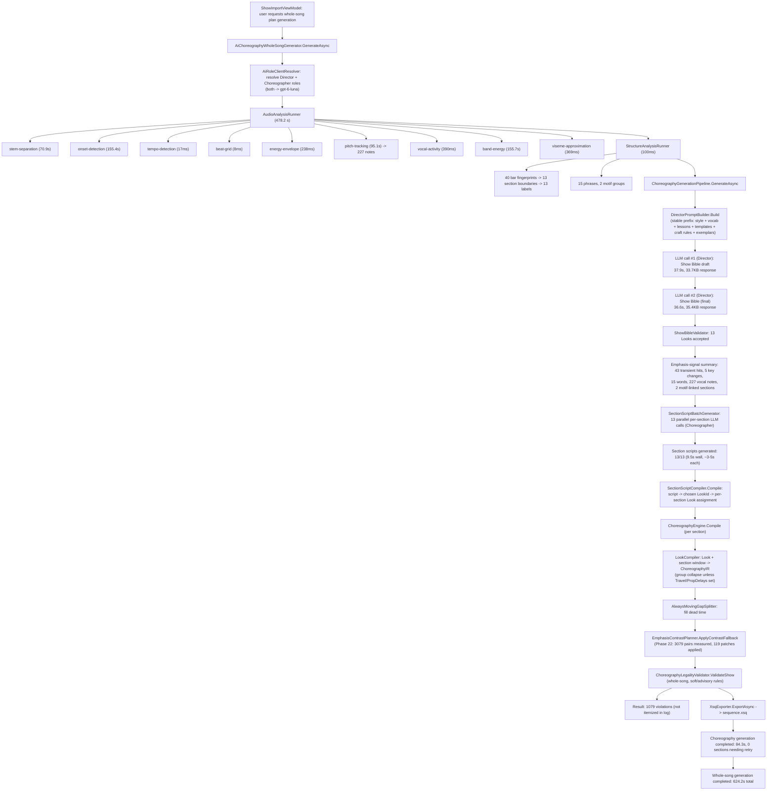
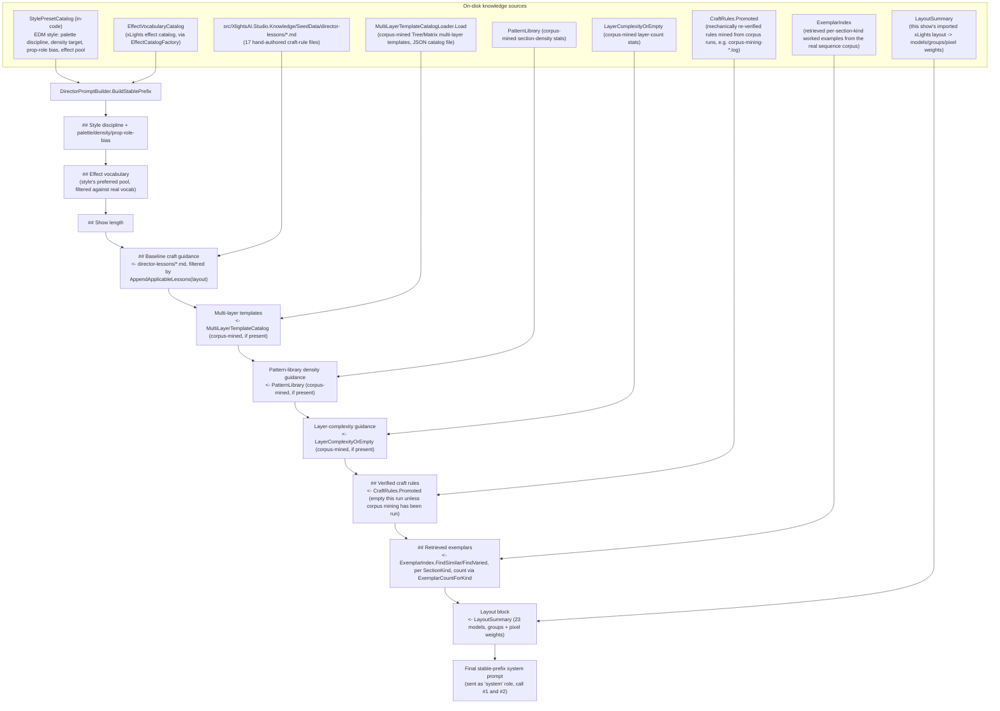

# Sequence Generation Flow — "Carol of the Bells" run (2026-11-14 23:41–23:52)

> Investigation of why the exported sequence
> (`C:\xLights\CarolOfTheBells\exports\sequence.xsq`, exported by the app as
> `3be7b1731c2440828dda096a67405efa.xsq`) has **zero effects on the `Everything` group, and zero
> effects on the bare `Matrix` model and `Matrix3` model**, even though a matrix-only group
> (`Matrixes`) and one specific matrix (`Matrix-2`) do have effects.

**Song:** `de38b0ff-c1e8-4399-889a-df86f75df711` · **Run id:** `3be7b173-1c24-4082-8dda-096a67405efa`
**Style:** `High-Energy / EDM` · **Duration:** 1,546,400,000 ticks (~2:34.6) · **13 sections**
**Total wall-clock:** 624,189 ms (whole-song) / 84,303 ms (choreography generation itself)
**Model used for every LLM call:** `gpt-6-luna` via Azure OpenAI-compatible `responses` endpoint
**Outcome:** exported successfully, **0 sections needing retry**, but **1,079 legality violations**
logged as a single summary count (never itemized in the log).

> **Fix applied (2026-11-15, round 1):** the confirmed root cause for the `Matrix`/`Matrix3` gap — a new
> rule, `ChoreographyLegalityValidator.RuleModelOnlyGroupCovered`, now detects a real model that is only
> ever "covered" incidentally through some other group's own group-level effect and never received a
> direct, individually-targeted effect of its own — and is wired into the same self-healing
> targeted-regeneration repair pass as `RuleModelCoverage` (`ChoreographyGenerationPipeline.cs:196-230`,
> `RevisionDirectiveDeriver.FromModelCoverageViolations`). See the corrected root-cause section below for
> the full mechanism.
>
> **Re-tested same day, round 1 fix confirmed working, but revealed two more gaps:** a fresh regeneration
> (run `bf451728...`, 2026-11-15 17:05-17:16) logged `Repairing 6 section(s)... 6 coverage` — the new rule
> fired for real, and `Matrix`/`Matrix3` individual coverage jumped from 0 to 65/24 compiled effects. But
> comparing against the human-authored reference sequence again (per the user's own side-by-side) showed
> `Everything` and `group:Matrixes` were *still* essentially unused, and the song's 4 real detected
> "lead-instrument" (horn-stab) prominence windows were mostly uncovered too — neither gap was something
> `RuleModelOnlyGroupCovered` could ever catch (it only concerns individual-model coverage, not whether a
> group's own hero moment or an audio-detected prominence window got used).
>
> **Fix applied (2026-11-15, round 2):** two more additions, same "detect → derive a targeted directive →
> self-heal" pattern:
> 1. `ChoreographyLegalityValidator.RuleHeroLookNeverUsed` — flags when a Look the Show Bible itself
>    marked as a `PeakMoment` or `WithholdingPlan.HeldBackLookIds` "ace" was never selected by any
>    section, and `RevisionDirectiveDeriver.FromHeroLookViolations` repairs it by naming the exact
>    required Look id (not a generic "bind it somehow" instruction) for the regenerated section.
> 2. `LeadInstrumentProminenceComplianceChecker` (new, mirrors `TimedCueComplianceChecker`) checks every
>    real, audio-detected `MusicModel.LeadInstrumentWindows` entry for a qualifying discrete effect nearby
>    — previously pure advisory prompt text with zero post-compile verification — and
>    `RevisionDirectiveDeriver.FromMissedLeadInstrumentWindows` repairs misses the same way
>    `FromMissedTimedCues` does for user-authored cues.
>
> Both are wired into the same single combined repair pass in `ChoreographyGenerationPipeline.cs` alongside
> the existing coverage/timed-cue/single-model directives. See the "Round 2" root-cause section below.

## Headline finding

Both gaps have **different root causes**, and neither is a crash or a retry failure — the run
"succeeded" by the pipeline's own definition of success:

1. **`Everything` never got an effect because no Look's LLM-authored output ever asked for it.**
   `Everything` *is* a real, valid, resolvable group in this show's layout (confirmed: the
   Director's own prompt told the model `group:Everything: 5899px, high-resolution` — see
   [Diagnostics: layout summary](#diag-layout-summary)). One Look (`late-chorus-mass`) even named
   `group:Everything` as its *conceptual* `Subject` — but every one of its actual `Layers` targets
   a sub-group (`Matrixes`, `MiniTrees`, `Arches`, `Outline`) instead of `Everything` itself, and
   `Subject` is descriptive metadata only — it is never compiled into an effect target. So literally
   nothing in this run's generated creative content ever placed `Everything` as a layer's `Props`
   value, in any Look, for any section. This exact failure mode has a dedicated, permanently-advisory
   legality rule written for it — `RuleGroupNeverTargetedDirectly` — which never blocks or retries a
   generation (see [Root cause](#root-cause-everything--matrix-models)).

2. **`Matrix` (bare) and `Matrix3` never got an effect because the three Looks built around them
   (`opening-strike`, `final-lead-stabs`, `lead-stabs-114`) were never assigned to any of the 13
   sections.** The Show Bible's 13 Looks and the 13 sections are not a 1:1 mapping — each section's
   independent per-section LLM call (13 parallel calls, see
   [LLM Calls](#llm-calls)) picks/produces its own script, and `chorus-arches-reply` alone was
   reused across 4 sections. That left 4 of the 13 Looks (`opening-strike`, `lead-stabs-114`,
   `final-lead-stabs`, and `late-chorus-mass`) picked **zero** times. `Matrix-2` *did* get used
   (15 compiled effects), which is why one matrix shows effects and the others don't — it isn't that
   matrices as a class were excluded, it's that 3 of the 4 Looks naming an individual matrix model
   simply never got drawn.

## What happened — summary

- Audio analysis (stem separation → onset → tempo → beat grid → energy envelope → pitch tracking →
  vocal activity → band energy → viseme) ran for **478.2 s**, the single largest phase.
- Structure analysis (fingerprints → section boundaries → section labels → phrase segmentation →
  motif clustering) ran in **100 ms** and found **13 sections** / **15 phrases** / **2 motif groups**.
- The Show Bible (palettes, prop-role assignment, all 13 Looks) came from **2 sequential LLM calls**
  (~37 s and ~36.6 s) to the `Director` role.
- **13 parallel per-section LLM calls** (to the `Choreographer` role, ~3–5 s each) generated each
  section's script; all 13 succeeded on the first attempt.
- Compilation produced **1,079 legality violations** (soft/advisory — compile never blocks on these)
  and exported cleanly to `.xsq`.
- The log's own emphasis-contrast summary (Phase 22) flagged that **5 of 7 high-energy sections**
  used a Tree/Matrix Look with **fewer than 3 concurrent layers** — a *separate*, lower-severity
  finding about layering density, not the "zero effects" problem; do not conflate the two.

---

## Flowchart 1 — code flow actually exercised by this run



<details>
<summary>Diagnostics: phase timings (raw log excerpt, studio.log lines 2432–2657 as extracted)</summary>

```
23:41:41.1472 Whole-song generation starting (1546400000 ticks, style 'High-Energy / EDM')
23:41:41.1472 Resolved chat-completion client: provider=OpenAiCompatible, model=gpt-6-luna
23:41:41.1472 Audio analysis starting (44100Hz)
23:41:41.1559 stem-separation starting
23:42:52.1003 stem-separation completed in 70943ms
23:42:52.1003 Selected lead stem Vocals (2355acb4...)
23:42:52.1003 onset-detection starting
23:45:27.4910 onset-detection completed in 155388ms
23:45:27.4910 tempo-detection starting
23:45:27.5052 tempo-detection completed in 17ms
23:45:27.5052 beat-grid starting
23:45:27.5177 beat-grid completed in 8ms
23:45:27.5177 energy-envelope starting
23:45:27.7567 energy-envelope completed in 238ms
23:45:27.7567 pitch-tracking starting
23:47:02.9072 pitch-tracking completed in 95149ms
23:47:02.9128 Segmented 227 notes from the pitch contour
23:47:02.9128 vocal-activity starting
23:47:03.3037 vocal-activity completed in 390ms
23:47:03.3037 band-energy starting
23:49:39.0218 band-energy completed in 155716ms
23:49:39.0218 viseme-approximation starting
23:49:39.3915 viseme-approximation completed in 369ms
23:49:39.3915 Audio analysis completed in 478232ms
23:49:39.3915 Structure analysis starting
23:49:39.4161 Built 40 bar fingerprints
23:49:39.4268 Detected 13 section boundaries
23:49:39.4458 Classified 13 section labels
23:49:39.4458 Estimated target phrase length of 8 bars
23:49:39.4763 Segmented 15 phrases
23:49:39.4942 Clustered 2 motif groups
23:49:39.4942 Structure analysis completed in 100ms
23:50:41.0378 Choreography generation starting (13 sections, style 'High-Energy / EDM')
```

Note the 61-second gap between `23:49:39.4942` (structure analysis done) and `23:50:41.0378`
(choreography generation starting) — this is UI/layout-import/show-bible-setup time not captured
by either runner's own start/complete log lines.

Source: `src/XlightsAI.Studio.Pipeline/AudioAnalysisRunner.cs`,
`src/XlightsAI.Studio.Pipeline/StructureAnalysisRunner.cs`,
`src/XlightsAI.Studio.Director/ChoreographyGenerationPipeline.cs:1-40` (pipeline entry/orchestration).
</details>

<details>
<summary id="diag-layout-summary">Diagnostics: layout summary sent to the Director LLM</summary>

```
Layout: 23 models, 5899 total pixels.
Groups (name: pixel weight, resolution tier):
- group:Everything: 5899px, high-resolution
- group:Matrixes: 3288px, high-resolution
- group:Arches: 800px, high-resolution
- group:Outline: 539px, high-resolution
- group:Roof and uprights: 539px, high-resolution
- group:MiniTrees: 472px, high-resolution
- group:Arches Left: 400px, high-resolution
- group:Arches Right: ... (truncated in capture — see raw log for the full list)
```

This confirms `Everything` (and every multi-word group) is a *real, resolvable* xLights group in
this show's layout — `Everything`'s pixel weight (5899px) exactly equals the layout total, i.e. it
is the "whole house" group. Group resolution is not the problem; the Show Bible's own authored
content is. See `src/XlightsAI.Studio.Director/LayoutSummary.cs` for how this text block is built
from the imported xLights layout, and `src/XlightsAI.Studio.Choreography/PropGroupResolver.cs:27-62`
for how a `"group:Name"` reference is matched back against `DisplayGraph.Groups` by exact
(`StringComparison.Ordinal`) name.

Full text: `C:\Users\kevmo\AppData\Roaming\XlightsAI.Studio\logs\studio.log`, run slice, inside the
first Director HTTP request body (`[f047fc35]`, originally logged starting at `studio.log:2470`,
i.e. `run_slice.log:39`).
</details>

---

## Flowchart 2 — progressive/staged knowledge loading (Director prompt assembly)

This is the order `DirectorPromptBuilder.BuildStablePrefix`
(`src/XlightsAI.Studio.Director/DirectorPromptBuilder.cs:186-260`) assembles the **system prompt**
sent on every Director call — i.e. the order in which on-disk knowledge/config is "progressively"
folded into the LLM's context, section by section, for this run's actual style (`High-Energy / EDM`).



<details>
<summary>Diagnostics: which knowledge sources were actually populated this run</summary>

- `director-lessons/*.md` (17 files): always loaded, filtered by applicability to this layout
  (`AppendApplicableLessons`, `DirectorPromptBuilder.cs:224`).
- `CraftRules.Promoted`: the builder itself prints a literal fallback line when empty —
  `"(None available for this run -- corpus mining has not been run yet. Rely on the baseline
  guidance above.)"` (`DirectorPromptBuilder.cs:233-236`). Whether that fallback fired for this run
  was not confirmed from the captured prompt excerpt — check the raw request body
  (`run_slice.log`, first ~210 lines) for `## Verified craft rules` to see which branch printed.
- `MultiLayerTemplateCatalog` / `PatternLibrary` / `LayerComplexityOrEmpty`: these are populated by
  running the corpus-mining pipeline (`src/XlightsAI.Studio.Pipeline/CorpusMiningRunner.cs`,
  `MultiLayerStackMiner.cs`) ahead of time and persisted via
  `JsonMultiLayerTemplateCatalogStore`/`MultiLayerTemplateCatalogLoader`
  (`src/XlightsAI.Studio.Knowledge/MultiLayerTemplateCatalogLoader.cs`,
  `src/XlightsAI.Studio.Pipeline/JsonMultiLayerTemplateCatalogStore.cs`); this run did not re-run
  corpus mining, it only *loaded* whatever catalog file already exists on disk — I did not trace the
  exact catalog file path/timestamp used, see **Not determined** below.
- `ExemplarIndex`: built from `CorpusManifestBuilder`
  (`src/XlightsAI.Studio.Knowledge/CorpusManifestBuilder.cs`) over the committed corpus — the Show
  Bible request did include a `## Retrieved exemplars` section (confirmed structurally, exact
  exemplar count per section kind not re-verified against `ExemplarCountForKind`).
</details>

---

## Phase-by-phase walkthrough

### 1. Audio analysis (`AudioAnalysisRunner`, 478.2 s)

Runs 9 sequential DSP steps over the song's audio at 44.1kHz: stem separation (isolates a lead
vocal stem), onset detection, tempo detection, beat grid, energy envelope, pitch tracking (227
notes segmented), vocal activity, band energy, and viseme approximation. This is pure signal
processing — no LLM calls, no model/prop awareness at all.

<details>
<summary>Diagnostics: step durations</summary>

| Step | Duration |
|---|---|
| stem-separation | 70,943 ms |
| onset-detection | 155,388 ms |
| tempo-detection | 17 ms |
| beat-grid | 8 ms |
| energy-envelope | 238 ms |
| pitch-tracking | 95,149 ms |
| vocal-activity | 390 ms |
| band-energy | 155,716 ms |
| viseme-approximation | 369 ms |
| **Total** | **478,232 ms** |

`onset-detection` and `band-energy` together account for **65%** of the whole run's wall-clock time
(311.1s of 624.2s).
</details>

### 2. Structure analysis (`StructureAnalysisRunner`, 100 ms)

Turns the audio analysis into a musical structure: 40 bar fingerprints → 13 section boundaries → 13
section-kind labels (Intro/Verse/PreChorus/Chorus/Bridge/Solo/Outro) → phrase length estimate (8
bars) → 15 phrases → 2 motif clusters. This defines the 13 sections that everything downstream
operates on — still no model/prop awareness.

### 3. Director prompt assembly + Show Bible generation (2 LLM calls, ~74.6 s)

See [Flowchart 2](#flowchart-2--progressivestaged-knowledge-loading-director-prompt-assembly) for
exactly what's assembled into the system prompt. **This is the first point any model/group/layout
awareness enters the pipeline** — via the `LayoutSummary` block appended last. Two Director calls
ran sequentially (not retries of each other — see [LLM Calls](#llm-calls) for why there are two).
The second call's response is the accepted Show Bible: 5 palettes, 18-entry `PropRoles` map, **13
Looks**, an energy arc, 3 peak moments, 3 signature gestures, and a `Withholding` block explicitly
naming `late-chorus-mass` as a deliberately held-back Look.

<details>
<summary>Diagnostics: accepted Show Bible — Look inventory (Id → Subject → compiles to)</summary>

| Look Id | `Subject` (descriptive only) | Actual `Layers[].Props` | Has `Travel`? |
|---|---|---|---|
| `opening-strike` | `Matrix` | `Matrix`, `group:Outline` | no |
| `verse-glass` | `Matrix-2` | `Matrix-2`, `group:MiniTrees` | no |
| `verse-arches-left` | `group:Arches` | `group:Arches`, `group:Roof` | yes (LeftToRight) |
| `verse-highs` | `group:MiniTrees` | `group:MiniTrees`, `group:Gutter` | no |
| `chorus-matrix-drive` | `group:Matrixes` | `group:Matrixes` (x2), `group:MiniTrees` | no |
| `horn-stabs-024` | `group:Arches Right` | `group:Arches Right`, `group:Outline` | no |
| `chorus-arches-reply` | `group:Arches` | `group:Arches`, `group:MiniTrees`, `group:Roof and uprights` | yes (RightToLeft) |
| `chorus-tree-drop` | `Tree` | `Tree` (x3), `group:Roof` | no |
| `lead-stabs-114` | `Matrix3` | `Matrix3` (x2), `group:Horizontals` | no |
| `lead-stabs-141` | `Matrix-2` | `Matrix-2` (x2), `group:Roof` | no |
| `late-chorus-mass` | **`group:Everything`** | `group:Matrixes`, `group:MiniTrees`, `group:Arches`, `group:Outline` — **never `group:Everything`** | no |
| `final-lead-stabs` | `Matrix` | `Matrix` (x2), `group:MiniTrees`, `group:Roof and uprights` | no |
| `individual-arch-finale` | `Arches-4` | `Arches-4`, `group:MiniTrees`, `group:Outline` | no |

`late-chorus-mass` is the row to notice: it is the *only* Look conceptually about the whole house,
and it is also the one the Show Bible's own `Withholding` block says to reserve for later ("Save the
rare full-layout group reveal... for the late chorus peak") — but regardless of whether it ever got
assigned to a section, none of its layers would ever produce an `Everything`-targeted effect, because
none of them name `group:Everything`.

Raw JSON: `run_slice.log` around line 325 (response body of Director call `[614c2149]`,
`studio.log:2432+`). Full response is ~35KB; truncated above to the structurally relevant fields.
</details>

### 4. Emphasis-signal summary (no LLM call)

Logged once, between the Show Bible and the per-section scripts: 43 transient hits, 0 energy
transitions, 5 key changes, 15 transcribed words, 227 vocal notes (11 sections with a salient-note
brief), 13/13 sections with a melodic-contour brief, 2 motif-linked sections. This is descriptive
context fed into the next phase's per-section prompts, not itself a decision point.

### 5. Per-section script generation (13 parallel LLM calls, ~9.5 s wall / 3-5 s each)

13 independent `Choreographer`-role calls run **concurrently** (not sequentially — their request
timestamps are near-identical: `23:51:55.6624`–`23:51:55.7346`, and responses land staggered between
`23:51:58.8421` and `23:52:05.1135`). Each call produces one section's script — and critically, **each
section picks (or is assigned) exactly one Look from the Show Bible's 13**, via
`SectionScriptCompiler.Compile` (`src/XlightsAI.Studio.Director/ChoreographyGenerationPipeline.cs:296`).
This is a many-to-few mapping: 13 sections choosing among 13 Looks does not guarantee every Look gets
picked at least once, and in this run it didn't — `chorus-arches-reply` alone was picked 4 times (see
below), leaving 4 Looks (`opening-strike`, `lead-stabs-114`, `final-lead-stabs`, `late-chorus-mass`)
picked zero times.

<details>
<summary>Diagnostics: confirmed section→Look assignments (high-energy sections only — the pipeline
only DEBUG-logs this subset)</summary>

```
23:52:05.2875 Section ceaaa3d7 (Chorus) uses Look chorus-arches-reply with 1 Tree/Matrix layer(s).
23:52:05.2875 Section 728a84e2 (Chorus) uses Look chorus-matrix-drive with 3 Tree/Matrix layer(s).
23:52:05.2875 Section 134ef2db (Chorus) uses Look verse-highs with 1 Tree/Matrix layer(s).
23:52:05.2875 Section 859903dd (Chorus) uses Look chorus-arches-reply with 1 Tree/Matrix layer(s).
23:52:05.2875 Section 7f4fab70 (Chorus) uses Look chorus-arches-reply with 1 Tree/Matrix layer(s).
23:52:05.2875 Section a8815c2e (Chorus) uses Look chorus-arches-reply with 1 Tree/Matrix layer(s).
23:52:05.2875 Section 2a59dfac (Chorus) uses Look chorus-tree-drop with 3 Tree/Matrix layer(s).
23:52:05.2875 Tree/Matrix layer density: 5/7 high-energy section(s) use a Tree/Matrix Look with
              fewer than 3 concurrent layers.
```

The other 6 sections (non-Chorus kinds) aren't logged at this level; their Look assignment was
reconstructed indirectly from the final compiled plan's target tally (next section) rather than from
an explicit log line — **this is a gap in the app's own diagnostics**: there is no single log line
anywhere that prints the complete 13-section → Look mapping.
</details>

<details>
<summary>Diagnostics: final compiled-effect target tally (from the exported plan JSON,
<code>sequence-plan-91bdb38e624b4009bbe5bd870b877849.json</code>, 1,858 total effects)</summary>

```
112 Arches-2        107 Peak Right       88 MiniStar3        6 Roof
110 Arches-3        107 Peak Left        87 end of house      4 Tree
109 Arches-1 Outside 105 gutter 1        87 Single Line        4 Gutter
108 Arches-4         105 Single Line-2   87 MiniTree4          2 Matrixes  (group, collapsed)
                                          87 MiniStar4
                                          86 MiniTree3
                                          85 MiniStar2
                                          84 MiniTree2
                                          83 MiniStar1
                                          82 Front Door
                                          81 MiniTree1
                                          27 MiniTrees (group, collapsed)
                                          15 Matrix-2
```

**Absent entirely from this list:** `Matrix` (bare), `Matrix3`, `Everything`, `Outline`,
`Roof and uprights`, `Horizontals`. The multi-word groups (`Roof and uprights`, `Horizontals`,
`Outline`) are absent for a *different*, benign reason than `Matrix`/`Matrix3`/`Everything`: every
Look that references them (`chorus-arches-reply`, `verse-arches-left`) also declares a `Travel`
block, and `LookCompiler.cs:108-131`'s group-collapse optimization is explicitly skipped whenever
`Travel` (or `PropDelays`) is set — so those layers get expanded to real per-member models instead
of staying a literal group target (the roofline/upright member models are very likely
`Peak Left`/`Peak Right`/`gutter 1`/`end of house`/`Front Door`/`Single Line[-2]`, based on naming,
though this wasn't individually confirmed model-by-model). That is working as designed. `Matrix`,
`Matrix3`, and `Everything` are absent for the reasons in
[Root cause](#root-cause-everything--matrix-models) below — not the same mechanism.
</details>

### 6. Compilation + legality validation + export

Each section compiles independently (`ChoreographyEngine.Compile` →
`src/XlightsAI.Studio.Choreography/LookCompiler.cs`), then an always-moving gap splitter fills dead
time, then `EmphasisContrastPlanner` patches 119 of 3,079 measured emphasis instants that lacked
real brightness contrast, then `ChoreographyLegalityValidator.ValidateShow`
(`src/XlightsAI.Studio.Choreography/ChoreographyLegalityValidator.cs:285-563`) runs 13 soft/advisory
rules over the whole compiled show and returns **1,079 violations** as one undifferentiated count —
the log never breaks this down by rule or lists any individual violation text. The export then runs
unconditionally; **none of these 13 rules block a compile or trigger a retry**, except one
(`RuleModelCoverage`, see below) which can drive a *targeted* self-healing regeneration — and that
path reported **0 sections needing retry** this run.

<details>
<summary>Diagnostics: compile + export log lines</summary>

```
23:52:05.2875 Emphasis-contrast (build-plan Phase 22): 3079 real pair(s) measured, 67% already
              showed real brightness-tier contrast before any fallback, 119 patch(es) applied,
              landing on 22 distinct model/group(s).
23:52:05.2875 Compiled result for song 3be7b173...: 1079 legality violation(s).
23:52:05.3420 Exported song 3be7b173... to
              C:\Users\kevmo\AppData\Roaming\XlightsAI.Studio\ai-choreography\exports\3be7b1731c2440828dda096a67405efa.xsq.
23:52:05.3420 Choreography generation completed in 84303ms (0 section(s) needing retry).
```

Source: `src/XlightsAI.Studio.Director/ChoreographyGenerationPipeline.cs:230-243`.
</details>

---

## LLM Calls

All calls went to the same Azure OpenAI-compatible endpoint
(`https://kmoen-m7an0vew-eastus2.openai.azure.com/openai/responses?api-version=2025-04-01-preview`),
model `gpt-6-luna`, `max_output_tokens: 16000`, `reasoning.effort: "low"`.

### Call 1 & 2 — Director: Show Bible generation

- **Purpose:** produce the whole-song creative plan (palettes, prop-role assignment, all Looks,
  energy arc, peak moments, signature gestures, withholding plan) from the song's structure +
  this show's layout + corpus-derived craft guidance.
- **What was sent (system prompt, ~constant across both calls):** style preset text for
  `High-Energy / EDM` (palette discipline, density target, prop-role bias), the full real xLights
  effect-name vocabulary, show-length guidance, 17 director-lesson craft rules filtered to this
  layout, any corpus-mined multi-layer templates/pattern-density/layer-complexity guidance present
  on disk, zero-or-more promoted craft rules, retrieved exemplars per section kind, and the full
  layout summary (23 models, 11 groups with pixel weights).
- **What came back (call 2, accepted):** 5 palettes, an 18-entry `PropRoles` list (bass/melody/highs
  musical-role tagging per prop/group — includes both `Matrix`/`Matrix-2`/`Matrix3` individually and
  `group:Matrixes`), 13 Looks (table above), a 3-entry `EnergyArc`, 3 `PeakMoments`, 3
  `SignatureGestures`, and a `Withholding` block holding back `late-chorus-mass` for "the late chorus
  peak."
- **Why two calls:** not confirmed from the log alone whether call 2 is a from-scratch second
  attempt, a validator-driven correction of call 1, or two different sub-steps of Show Bible
  generation — see **Not determined** below.

<details>
<summary>Diagnostics: call 1 (<code>f047fc35</code>)</summary>

```
23:50:41.0947 >>> POST .../responses  (request, system+user prompt, full layout + knowledge context)
23:51:18.9813 <<< attempt 1 HTTP 200 in 37886ms
23:51:18.9813 succeeded on attempt 1 in 37886ms (33741 response bytes)
```
Raw request/response: `run_slice.log` lines ~39–211 (request is one very large single line; response
is pretty-printed JSON spanning ~170 lines wrapped inside the HTTP trace).
</details>

<details>
<summary>Diagnostics: call 2 (<code>614c2149</code>) — accepted Show Bible</summary>

```
23:51:19.0296 >>> POST .../responses
23:51:55.6247 <<< attempt 1 HTTP 200 in 36594ms
23:51:55.6247 succeeded on attempt 1 in 36594ms (35419 response bytes)
23:51:55.6403 Show Bible generated for song 3be7b173...: 74601ms (13 looks)
```
Raw request/response: `run_slice.log` lines ~212–391; the accepted Looks JSON (table above) is the
`"text"` field starting around `run_slice.log:325`.
</details>

### Calls 3–15 — Choreographer: 13 per-section scripts (parallel)

- **Purpose:** produce each section's concrete timed script against the accepted Show Bible — which
  Look(s) it draws on, phrase-level detail, lead-phrase/transient handling.
- **What was sent:** the same stable knowledge prefix plus a per-section "volatile suffix" (that
  section's window, kind, energy ceiling, melodic/salient-note briefs, motif linkage) — built once
  per section from `scriptGeneration.VolatileSuffixBySectionId`.
- **What came back:** 13/13 succeeded on the first attempt, response sizes 7.2KB–10.0KB each, 3.0–4.9s
  latency each, all overlapping in time (genuinely concurrent, not sequential/retried).

<details>
<summary>Diagnostics: all 13 calls (request id, latency, response size)</summary>

```
[296843a6] sent 23:51:55.6624 -> 23:52:00.5791 (4903ms, 9997 bytes)
[5fd721b6] sent 23:51:55.6624 -> 23:51:58.8421 (3165ms, 7235 bytes)
[09ffbfb0] sent 23:51:55.6624 -> 23:51:58.9644 (3287ms, 7283 bytes)
[f649d410] sent 23:51:55.6982 -> 23:51:59.2969 (3598ms, 7881 bytes)
[543edd91] sent 23:51:55.6982 -> 23:51:59.6474 (3947ms, 8864 bytes)
[21a2226a] sent 23:51:55.7346 -> 23:51:59.3195 (3584ms, 8482 bytes)
[10c9c065] sent 23:51:58.8513 -> 23:52:01.8083 (2956ms, 7840 bytes)
[44edd84b] sent 23:51:58.9644 -> 23:52:01.9704 (3004ms, 7728 bytes)
[a8b32f75] sent 23:51:59.2969 -> 23:52:02.6377 (3339ms, 8265 bytes)
[bd9bcc2e] sent 23:51:59.3195 -> 23:52:02.9434 (3622ms, 8912 bytes)
[55c01b14] sent 23:51:59.6474 -> 23:52:03.5936 (3944ms, 8782 bytes)
[55a44c43] sent 23:52:01.8083 -> 23:52:04.7912 (2981ms, 8361 bytes)
[165b78b1] sent 23:52:00.5791 -> 23:52:05.1135 (4532ms, 8692 bytes)

23:52:05.1348 Section scripts generated for song 3be7b173...: 9494ms (13/13 sections).
```
Raw request/response bodies: `run_slice.log` lines ~396–2645 (13 interleaved request/response
blocks). Individual prompt/response text not reproduced here — each is 7-10KB; look up by the
bracketed request id above directly in `studio.log`.
</details>

---

## Root cause: `Everything` / Matrix models

### `Everything`

No code bug — this is a **content gap in the LLM-authored Show Bible**, not a group-resolution or
legality-blocking failure:

1. `group:Everything` is a real, resolvable group (`LayoutSummary` told the Director it exists, 5899px
   — the show's full pixel count — `PropGroupResolver.Resolve` would succeed for it,
   `PropGroupResolver.cs:39-62`).
2. The only Look that ever references `Everything` at all (`late-chorus-mass`) uses it solely as a
   descriptive `Subject` string — a field that is never read by the compiler
   (`LookCompiler.cs` only ever reads `Layers[].Props`, never `Look.Subject`, to pick an
   effect target).
3. `late-chorus-mass`'s actual `Layers` target `group:Matrixes`, `group:MiniTrees`, `group:Arches`,
   `group:Outline` — never `group:Everything` literally.
4. Therefore **even in a hypothetical run where `late-chorus-mass` got assigned to a section**,
   `Everything` still would never receive a compiled effect, because nothing in its own definition
   asks for it.
5. This exact scenario — a real named group that's conceptually "the subject" but never literally
   targeted — is a known, named, *permanently advisory* rule in the codebase already:
   `RuleGroupNeverTargetedDirectly` (`ChoreographyLegalityValidator.cs:120-132`, rule id
   `"group-never-targeted-directly"`), explicitly documented as "soft/advisory only... no calibrated
   'how often should a real group fire' number exists yet." It would have logged an advisory
   violation for `Everything` — buried inside the undifferentiated `1079 legality violation(s)` count
   — but by design it **never blocks the compile and never triggers a retry**.

**Net effect:** the Director's own Show Bible never produced a Look whose layers name
`group:Everything`, so there was never any compiled effect to assign to it, regardless of section
scheduling.

### `Matrix` (bare) and `Matrix3` — CORRECTED 2026-11-15: these ARE real models; the earlier "hallucinated name" finding above was wrong

> **Retraction.** The previous version of this section concluded `Matrix`/`Matrix3` were names the
> Director LLM hallucinated from a stale example in `stack-layers-high-res.md`, silently dropped by
> `LookCompiler.TryResolveModels`'s exception-swallowing. That was wrong. It was based on inspecting
> only the *exported* `.xsq`'s own `<Element>` list, which (per `XsqExporter.cs:294-297`) **omits any
> model that ends up with zero compiled effects** — unlike real xLights output, which always lists
> every model. Checked against the authoritative source — the real xLights layout file
> `C:\xlights\xlights_rgbeffects.xml` (the actual show folder; the AI Studio *project* folder
> `C:\xlights\CarolOfTheBells\` is a separate, project-scoped location and holds no layout copy of its
> own) — `Matrix`, `Matrix-2`, and `Matrix3` are three distinct, real, individually-addressable
> `<model>` elements (1488px / 900px / 900px), and `Matrixes` is a real `<modelGroup>` whose declared
> members are exactly those three models (`models="Matrix,Matrix-2,Matrix3"`). `Everything` is also a
> real `<modelGroup>`, containing all 23 individual models including `Matrix` and `Matrix3` directly by
> name. The Director's own `LayoutSummary` prompt (captured in `run_slice.log`, user-role content)
> already correctly listed `Matrix: 1488px`, `Matrix-2: 900px`, `Matrix3: 900px` as
> "Top individually-addressable pixel-heavy models" — nothing was hallucinated; the real layout was
> described accurately throughout.

**Confirmed actual root cause: a coverage-counting mismatch between the legality validator and what
xLights actually renders per model row.**

1. The Show Bible's `chorus-matrix-drive` Look targets `group:Matrixes` as one single **group-level**
   effect. `LookCompiler.cs:108-131` deliberately compiles a multi-member group reference as *one*
   effect whose `Target` is the group's own name (`"Matrixes"`), not three duplicated per-model
   effects — confirmed correct against real xLights behavior, and exactly what the exported `.xsq`
   shows: `<Element type="model" name="Matrixes">` carries 2 effects; there is no separate row for
   `Matrix`, `Matrix-2`, or `Matrix3` from this Look at all.
2. `ChoreographyLegalityValidator.RuleModelCoverage` (`ChoreographyLegalityValidator.cs:432-440`)
   decides whether a model is "covered" via `ResolveRealModelIds` (`ChoreographyLegalityValidator.cs:
   592-608`), which — for a compiled effect `Target` that names a *group* — expands it back out to
   every real member model (reusing `PropGroupResolver`'s own group-expansion). So the single
   `chorus-matrix-drive` group effect on `"Matrixes"` causes `Matrix`, `Matrix-2`, **and** `Matrix3`
   to all be marked "covered" for legality purposes — even though, in the actual exported sequence,
   that effect lives only on the `Matrixes` group's own row, never on the three individual model rows.
3. This is why the self-healing retry (`ChoreographyGenerationPipeline.cs:196-230`,
   `RevisionDirectiveDeriver.FromModelCoverageViolations`) never fired: from `RuleModelCoverage`'s
   point of view there genuinely was no violation — all three matrix models look "used." The rule
   and its retry path are working exactly as designed; the design itself conflates "a group this
   model belongs to got one effect, once" with "this specific model has real screen time," which
   does not match what a person watching the individual model's row in xLights would call "covered."
4. `Matrix-2` happens to look better anyway (15 compiled effects) only because two *other*, separately
   and correctly-chosen Looks (`verse-glass` ×4, `lead-stabs-141` — unchosen) target it directly and
   individually, on top of the group credit. `Matrix` and `Matrix3` never received any direct,
   individual targeting from any of the 13 sections actually generated — confirmed by reading every
   `section-script-*.json` for this run:

   | Section (script file suffix) | LookId chosen |
   |---|---|
   | `134ef2db...` | `verse-highs` |
   | `2a59dfac...` | `chorus-tree-drop` |
   | `43be9c77...` | `verse-glass` |
   | `62846e82...` | `verse-glass` |
   | `728a84e2...` | `chorus-matrix-drive` |
   | `7f4fab70...` | `chorus-arches-reply` |
   | `859903dd...` | `chorus-arches-reply` |
   | `a1fd4847...` | `verse-arches-left` |
   | `a772bf3c...` | `verse-glass` |
   | `a8815c2e...` | `chorus-arches-reply` |
   | `cb684664...` | `verse-highs` |
   | `ceaaa3d7...` | `chorus-arches-reply` |
   | `d56a888f...` | `verse-glass` |

   7 of the Show Bible's 13 Looks were never picked at all: `opening-strike` (Matrix),
   `horn-stabs-024`, `lead-stabs-114` (Matrix3), `lead-stabs-141` (Matrix-2),
   `late-chorus-mass` (group:Everything, conceptually), `final-lead-stabs` (Matrix),
   `individual-arch-finale` — `chorus-arches-reply` (×4) and `verse-glass` (×4) alone account for
   8 of the 13 sections.

**Net effect:** not a hallucination, not a silently-swallowed exception. `Matrix` and `Matrix3` are
real, correctly-named, correctly-resolvable models that simply never got an individually-targeted
effect in this run because (a) the one Look that touches their shared group was picked for only 1 of
13 sections, and (b) the three Looks written specifically around them individually were never picked
at all — and the legality validator's self-healing safety net didn't catch this because it credits a
single group-level hit as full individual coverage for every member of that group, which this run's
actual per-model-row result does not bear out.

### Comparison against the human-authored sequence for the same song

The user also pointed at a real reference: `C:\xlights\09. Carol Of The Bells (Instrumental).xsq`, a
human-made sequence for the identical song, in the same real layout. Comparing per-model compiled
effect totals is the clearest illustration of what's actually missing — not just "zero on two models,"
but an **inverted prioritization** relative to how a person actually used this layout:

| Model | Human effects | AI-generated effects |
|---|---:|---:|
| `Everything` | **107** | **0** |
| `Matrix` | **76** | **0** |
| `Tree` | 76 | 4 |
| `Outline` | 37 | *(not an individual model row)* |
| `Arches` | 37 | *(group; see Arches-1..4 below)* |
| `Arches-2` | 43 | 112 |
| `Arches-3` | 43 | 110 |
| `Arches-4` | 15 | 108 |
| `Arches-1 Outside` | 15 | 109 |
| `Roof` | 9 | 6 |
| `Matrix-2` | 0 | 15 |
| `Matrix3`/`Matrix-3` | 0 | 0 |
| `Front Door` | 0 | 82 |
| `Peak Left` / `Peak Right` | 0 / 0 | 107 / 107 |
| `end of house` | 0 | 87 |
| `gutter 1` | 0 | 105 |
| `Single Line` / `Single Line-2` | 0 / 0 | 87 / 105 |

(Human counts read directly from `09. Carol Of The Bells (Instrumental).xsq`'s own `<Element>`/
`<Effect>` tags; AI counts from `CarolOfTheBells\exports\sequence.xsq` the same way — both parsed
directly, not reconstructed from the log.)

The pattern is striking: **the human concentrated effort on the two biggest, most visually dominant
canvases** — the whole-house `Everything` reveal (107 effects, clearly the sequence's signature
moments) and the large `Matrix` panel (76 effects) — while leaving small foundation trim models
(`Front Door`, `Peak Left/Right`, `end of house`, `gutter 1`, `Single Line[-2]`) **completely dark**
for the entire song. **The AI-generated sequence does almost exactly the opposite**: those same small
foundation trim models each got 80–110 effects (continuous, gap-filling activity from
`AlwaysMovingGapSplitter`/`EmphasisContrastPlanner`'s "no dead time" design goal), while the two
canvases the human treated as the whole show's focal point — `Everything` and `Matrix` — got nothing.
The Director's own creative plan (the Show Bible) actually *did* conceive of equivalent hero moments —
`late-chorus-mass` labeled `Subject: "group:Everything"`, `opening-strike`/`final-lead-stabs` built
around `Matrix` — mirroring the human's instinct correctly at the planning layer. It's the per-section
selection step, 13 independent parallel calls with no shared memory of what the other 12 picked, that
never actually drew on them, while the pipeline's own "keep everything moving, no gaps" design
guaranteed the small trim models would get saturated instead. This reframes the finding from "two
models got skipped" to: **the system's per-section Look selection has no mechanism to prioritize a
song's designated hero/peak-moment Looks over its filler Looks, and its gap-filling safety net
actively favors visual activity on whatever's left over (the small foundation models) rather than
leaving quiet space the way a human sequencer deliberately does.**
- **Why two sequential Director calls were needed for one Show Bible** (draft/retry vs. two
  sub-steps) — not confirmed from the log; would need to diff the two response bodies or read
  `ShowBibleValidator`/the pipeline code around the two-call site more closely.
- **Whether `CraftRules.Promoted` was empty or populated for this run**, and which multi-layer
  template catalog file (if any) was actually loaded — not traced to a specific on-disk file/timestamp.
- **Exact identity of the `Roof and uprights` group's individually-expanded member models** (assumed
  to be `Peak Left`/`Peak Right`/`gutter 1`/`end of house`/`Front Door`/`Single Line[-2]` by naming
  convention, not confirmed against the actual xLights layout file, which was not located during this
  investigation — it is not under `C:\xLights\CarolOfTheBells\`; likely lives in the actual xLights
  show folder referenced indirectly via the app's project import, not directly logged).
- **Per-section (non-Chorus-kind) Look assignment** for the other 6 sections — reconstructed only
  indirectly from the final target tally, not from an explicit per-section log line (the app itself
  has no single log line giving the complete 13-section → Look mapping — worth adding as a diagnostic
  improvement if this kind of investigation will recur).
- ~~Exact identity of the real xLights layout file~~ — **resolved**: `C:\xlights\xlights_rgbeffects.xml`,
  in the actual xLights show folder (`C:\xlights\`), a sibling of `C:\xlights\CarolOfTheBells\` (the AI
  Studio *project* folder, which holds no layout copy of its own). Confirms `Matrix`, `Matrix-2`,
  `Matrix3` are three distinct real models and `Matrixes`/`Everything` are real `modelGroup`s containing
  them — see the round-1 correction above.

## Round 2 (2026-11-15, same day): re-tested after the round-1 fix, found two more gaps

A fresh regeneration (run `bf451728-75ac-47c1-b566-722f2451ca5a`, song `216566bd-...`, 2026-11-15
17:05:57–17:16:02) confirmed the round-1 fix works — log shows `Repairing 6 section(s) for song
bf451728... (6 coverage, 0 timed-cue, 0 single-model)`, and `Matrix` went from 0→65 compiled effects,
`Matrix3` from 0→24. But the user's own side-by-side against the human reference sequence again showed
`Everything` and `group:Matrixes` were still essentially dark, and flagged "it also seems to miss the
horns" — the song's lead-instrument stab moments.

### `Everything` / `group:Matrixes` still thin

This run's Show Bible (13 Looks) included exactly one Look naming each:

| Look | Targets | Picked for any section? |
|---|---|---|
| `chorus-wide-drop` | `group:Outline`, **`group:Matrixes`** | **No** |
| `chorus-final-surge` | **`group:Everything`**, `Matrix-2` | **No** |

Reading every `section-script-bf451728...json` for this run confirms both were never selected — 6 of 13
Looks went completely unused this run (`circuit-opening`, `verse-arches-left`, `verse-arches-right`,
`verse-long-rise`, `chorus-wide-drop`, `chorus-final-surge`), while `outro-break` alone was picked 3
times and `verse-final-turn`/`verse-glass`/`chorus-riff-one`/`chorus-arch-travel` 2 times each. The
round-1 fix (`RuleModelOnlyGroupCovered`) is structurally incapable of catching this: it only reasons
about whether an individual *model* ever got a direct effect, never about whether a specific
Director-authored *group-level hero Look* was ever chosen. This is exactly the gap
`ChoreographyLegalityValidator.RuleHeroLookNeverUsed` (added in round 2) closes, by checking the Show
Bible's own `PeakMoments`/`Withholding.HeldBackLookIds` declarations against which Looks sections
actually picked.

### "The horns"

The app's own Director prompt describes this directly: *"a lead-instrument figure (horns, strings, a
riff)"* — real, audio-detected spans where a lead instrument/section stands out above its own recent
baseline (`XlightsAI.Studio.Rhythm.LeadInstrumentWindowDetector`, carried through as
`MusicModel.LeadInstrumentWindows`). This run's prompt listed 4 real windows: `0:24-0:27` (2.0x),
`1:14-1:16` (1.7x), `1:41-1:42` (1.8x), `2:24-2:27` (1.8x) — the same 4 windows as the original run. The
Show Bible wrote only **one** dedicated stab Look this time (`chorus-riff-one`, built around `Matrix3`),
down from 3-4 in earlier runs — Show Bible authoring is not deterministic run-to-run. Nothing previously
checked whether any of the 4 real windows actually landed a distinct effect nearby; it was pure prompt
text with zero post-compile verification, unlike user-authored timed cues
(`TimedCueComplianceChecker`). `LeadInstrumentProminenceComplianceChecker` (round 2) closes this by
applying the exact same "short/discrete effect inside the window" check `TimedCueComplianceChecker`
already uses for cues, to these audio-detected windows instead.

### Round 2 fix

1. **`ChoreographyLegalityValidator.RuleHeroLookNeverUsed`** (`ChoreographyLegalityValidator.cs`) — new
   optional `heroLookIds` parameter on `ValidateShow` (defaults to `null`, skipped for any caller that
   doesn't supply it, same discipline as `audioEnergy`); `ChoreographyGenerationPipeline.CompileSectionScripts`
   now always supplies `bible.Content.PeakMoments.Select(p => p.LookId).Concat(bible.Content.Withholding.HeldBackLookIds)`.
   `RevisionDirectiveDeriver.FromHeroLookViolations` repairs a finding by directing the longest section to
   set its `LookId` to *exactly* the named hero Look — not a generic "bind it somehow" instruction, since
   a generic instruction would not reliably reproduce one specific pre-authored Look.
2. **`LeadInstrumentProminenceComplianceChecker`** (new file, `src/XlightsAI.Studio.Director/`) — mirrors
   `TimedCueComplianceChecker` exactly, checked against `music.LeadInstrumentWindows`.
   `RevisionDirectiveDeriver.FromMissedLeadInstrumentWindows` repairs a miss the same way
   `FromMissedTimedCues` does.

Both are folded into the same single combined repair pass in `ChoreographyGenerationPipeline.cs`
(`coverageDirectives.Concat(timedCueDirectives).Concat(singleModelDirectives).Concat(heroLookDirectives).Concat(leadInstrumentDirectives)`),
so a section needing several different fixes is still only ever regenerated once. New test coverage:
`ChoreographyLegalityValidatorTests` (hero-look rule, 3 new cases), `RevisionDirectiveDeriverTests` (both
new derivers), and a new `LeadInstrumentProminenceComplianceCheckerTests` file mirroring
`TimedCueComplianceCheckerTests`.

**Not yet re-tested**: whether round 2 actually restores `Everything`/`Matrixes`/horn-stab coverage in a
real generation — that requires running the app again; this round only adds the detection+repair
mechanism and confirms it builds/passes its own unit tests.
